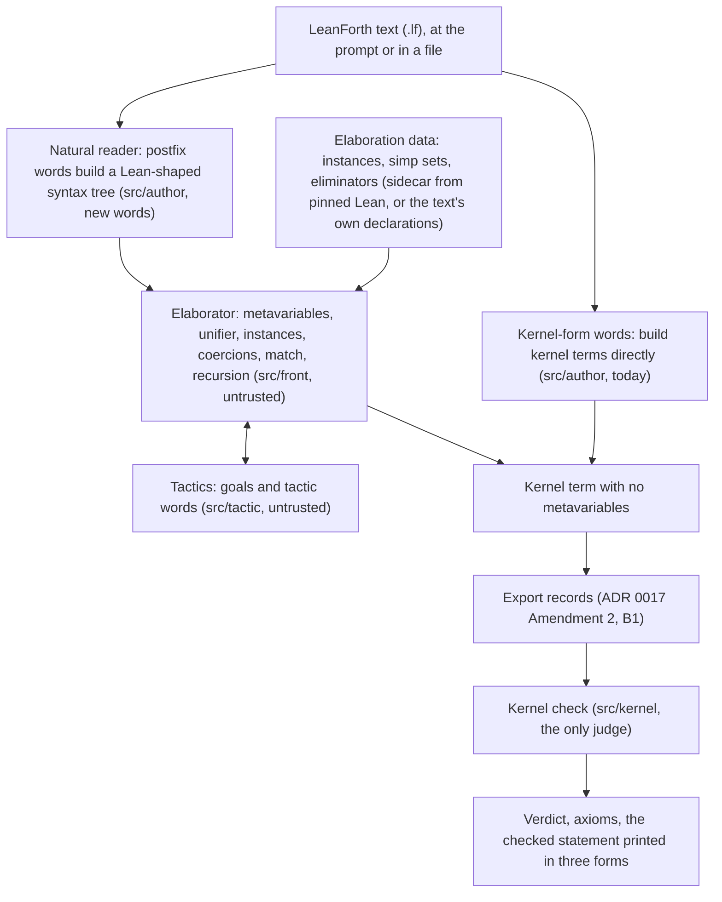
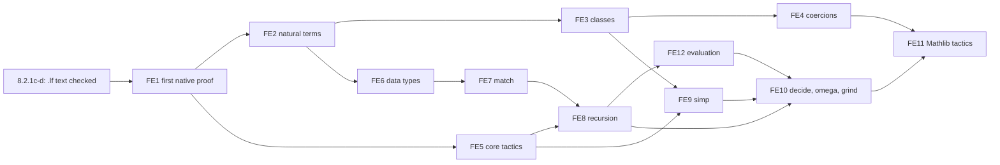

# LeanForth's front end: what Lean's does, and how LeanForth will do it

**Status (2026-11-12): designed; the first two steps are written, on
branch `fe1` (Forth review pending):** FE1a, the natural reader
(`src/front/reader.fs`, `syntax.fs`, `src/author/form.fs`), is integrated
(`leanforth check FILE.lf` reads natural text into syntax trees and stops
as not supported yet where elaboration or a tactic would begin; the
kernel form needs `kernel-form`), and FE1b, the metavariable context
(`src/front/mvars.fs`, `core/mvar-leaves.fs`), is tested alone (no command
makes metavariables yet; the export writer refuses any). Nothing else in
this document is built. It is
the design and plan for the half of Lean that LeanForth does not have: the
part that turns what a person writes into the full proof term the kernel
checks. The architecture and trust boundary are proposed in
[ADR 0021](../adr/0021-front-end.md); the milestones FE1–FE12 replace plan
rows 8.3.1 and 8.3.2 in [the plan](../project/PLAN_DRAFT.md#phase-8-front-end-fe1fe12-2026-11-12-replaces-831-and-832).
Sizes of Lean's parts are measured from the pinned Lean 4.35.0 sources
(commands in the [appendix](#appendix-measurement-commands)); every
estimate of LeanForth work is marked *speculative*.

## In plain words

A proof assistant has two halves.

- The **kernel** is a referee. It is given a complete proof, written out in
  full with every detail (Lean's *proof term*), and says yes or no.
  LeanForth has this half: it re-checks the proof terms that Lean produced
  and exported, and gave Lean's verdict on all 729,263 declarations of
  Mathlib. Those proofs were all made by Lean.
- The **front end** is the assistant that writes the full proof term from
  what a person actually types. A person writes `0 + n = n` and "by
  induction on n; the first case is immediate; the second follows from the
  induction hypothesis". The front end works out that `0` is a natural
  number, which `+` is meant, which induction principle to use, what the two
  cases are, and builds the full term that the kernel can check.
  **LeanForth has none of this half.** It has no elaborator, no
  unification, no type classes, no coercions, no tactics, no compilation of
  pattern matching or recursion, no generated definitions for new data
  types and no evaluation.

Today, therefore, a LeanForth proof has to be written as the full kernel
term by hand: `tests/author/20-zero-add.lf` on branch `lf-files-2` (not
yet merged) proves $0 + n = n$ in 37 lines of words, one of which reads
`HAdd.hAdd 0 ^ 0 ^ 0 ^ Nat $ Nat $ Nat $  instHAdd 0 ^ Nat $ instAddNat $  $`.
That is what you called "only usable as an 'assembly' language". With a
front end, the same proof would be written (syntax still to be decided by
you, [questions](#9-questions-for-the-owner)):

```text
theorem zero_add'
  Nat explicit: n
  0 n + n =
:= by
  n by-induction
  by-case: zero =>       by-rfl
  by-case: succ k ih =>  ' Nat.succ ih congrArg by-exact
end zero_add'
```

The front end never decides whether a theorem is true. It only proposes a
proof term; LeanForth's kernel checks every one, exactly as it checks
Lean's. A front-end mistake can stop a proof or produce a wrong term, which
the kernel then rejects; it cannot make a false theorem accepted. What the
front end *does* decide is what a statement means (which `+`, which `0`),
so the checked statement is always printed back, and its rules are
compared with Lean's.

**Size.** Lean's front end is far bigger than its kernel: the elaborator
(`Lean/Elab`) is 76,612 lines in 320 files and the metaprogramming layer
under it (`Lean/Meta`) is 98,540 lines in 482 files, against LeanForth's
whole Forth source of about 48,000 lines. Mathlib adds 81,374 lines of its
own tactics. Doing all of it is years of work, so the plan builds it in
twelve milestones, each with a command you can run, starting with the
smallest piece that proves something real: FE1, $0 + n = n$ by induction.

| Milestone | What a user can do when it is done | Size |
| --- | --- | --- |
| FE1 | Prove $0 + n = n$ in LeanForth with `induction`, `rfl` and `exact`, no proof term written by hand, no Lean tool run | L (8 steps) |
| FE2 | Write any statement and term proof as naturally as in Lean (implicit arguments, numerals, `+`, `=`, `fun`, `let`, holes) | L |
| FE3 | Declare classes and instances; instance search as Lean's | L |
| FE4 | Coercions (`↑n`, a natural number used as an integer) | M |
| FE5 | The everyday tactics (`intro`, `apply`, `cases`, `rw`, `constructor`, `calc` …); `add_comm` and Cantor's theorem of the demos proved natively | L |
| FE6 | Declare data types and structures; Lean's generated definitions (`casesOn`, `noConfusion`, `sizeOf` …) | L |
| FE7 | Definitions by pattern matching (`match`) | L |
| FE8 | Recursive definitions (structural and well-founded, `termination_by`) | L |
| FE9 | `simp` and its relatives | L |
| FE10 | Decision procedures: `decide`, `omega`, later `grind`; the other three demos (they use `simp` and `omega`) proved natively | L |
| FE11 | Mathlib's tactics: `ring`, `norm_num`, `linarith`, `positivity`, `aesop` … | L, many rows |
| FE12 | Evaluation: `#reduce`, `#eval`, then definitions compiled to Forth words | M then L |

## 1. What exists today, and what does not

| Piece | State on `main` (2026-11-12) |
| --- | --- |
| Kernel: re-checks Lean's exported proof terms | integrated; gave Lean's verdict on all 729,263 Mathlib declarations, whose proofs Lean made ([progress](../project/PROJECT_PROGRESS.md)) |
| LeanForth words for kernel terms (`src/author/`, ADR 0017) | integrated as Forth words; [parser] gate approved 2026-11-03 |
| `leanforth check FILE.lf` | on `main`: refuses LeanForth text (exit 4). On branch `lf-files-2` (not merged): integrated, its gates pending (ADR 0017 Amendment 2); it checks hand-written kernel terms such as `20-zero-add.lf` against an export of `Init` |
| Printing a checked statement in LeanForth words, Lean notation and mathematics | integrated (`leanforth print`, plan 8.6.2); the notation table maps `HAdd.hAdd` to `+` for printing only |
| Holes `_` | refused: error 52, "holes are filled by the elaborator" |
| Metavariable context (FE1b): metavariables, assignment, occurs check, instantiation | tested alone on branch `fe1` (`tests/front/front.fs`); the beta step and delayed assignments' values answer unsupported until FE1c |
| Elaborator, unification, implicit arguments, numerals as Lean reads them | not started |
| Type classes, coercions | not started |
| Tactics and proof states | not started |
| Pattern matching, recursion | not started |
| Generated definitions for new data types (FE6) | `T.casesOn`, `T.recOn` and `T.ctorIdx` written and tested alone on branch `fe6a` (`src/front/constructions.fs`, `ctor-idx.fs`): built from a loaded export's `T.rec`, `T`'s type and constructors as Lean builds them, and compared with Lean's own on all of Init (`make reference-constructions`): of 597 `casesOn`, 436 equal node for node, 160 equal up to binder names and binder information (Lean's exporter shares terms that differ only in those), 0 different, 1 unsupported (`Lean.Syntax`, a nested type: `casesOn` with several motives is not ported yet); of 576 `recOn`, 539, 37, 0 and 0; of 397 `ctorIdx`, 0, 397, 0 and 0 (Lean gives its arrow's binder a fresh hygienic name). Not yet used for LeanForth's own data types, which need FE2–FE5; the kernel builds `T.rec` when it checks a data type, as Lean's kernel does; `noConfusionType` and `noConfusion` (they need the front end's type inference and definitional equality, FE1c), `below`, `brecOn` (type inference of levels), `sizeOf` and the injectivity lemmas not started |
| `simp`, decision procedures, Mathlib's tactics | not started |
| Evaluation (`#eval`, `#reduce`) | not started (the kernel reduces terms internally, with no user command) |
| Natural LeanForth (plan 8.6.10): the natural reader (FE1a) | integrated on branch `fe1`: natural text is the default and is read into Lean-shaped syntax trees (`binrel% Eq (binop% HAdd.hAdd 0 n) n`, compared with pinned Lean's macro expansion); nothing is elaborated yet |
| First native proof (8.6.11) | not started |

## 2. What Lean's front end does

### 2.1 The pipeline

When Lean reads `theorem zero_add' (n : Nat) : 0 + n = n := by …` it:

1. **parses** the text with an extensible parser (`Lean/Parser`, 7,850
   lines) into a syntax tree; notation such as `+` is defined in Lean
   itself (`infixl:65 " + " => HAdd.hAdd` in `Init/Notation.lean`);
2. **expands macros**: `0 + n` becomes `binop% HAdd.hAdd 0 n`;
3. **elaborates** the header: the binder `(n : Nat)`, then the type
   `0 + n = n` (`Lean/Elab`, running on `Lean/Meta`), creating
   *metavariables* for everything not yet known;
4. **runs the tactic block** once the type is known: each tactic changes a
   list of goals until none is left;
5. **instantiates** every metavariable, collects universe parameters and
   refuses anything left unknown (after an error Lean instead fills the hole
   with `sorryAx` and carries on, so that it can report more errors);
6. sends the declaration to the **kernel** (`addDecl`);
7. for definitions, also **compiles** them for evaluation and generates
   auxiliary definitions and lemmas (for a new data type, `casesOn`,
   `noConfusion`, `sizeOf` …; for a recursive function, its equations).

What pinned Lean 4.35.0 produces for the tactic proof above (run on
2026-11-12 with `set_option pp.explicit true` and `pp.universes true`;
`0` abbreviates `@OfNat.ofNat.{0} Nat (nat_lit 0) (instOfNatNat (nat_lit 0))`
and `0 + n = n` abbreviates `@Eq.{1} Nat (@HAdd.hAdd.{0, 0, 0} Nat Nat Nat
(@instHAdd.{0} Nat instAddNat) 0 n) n`, as Lean printed them in full):

```text
fun (n : Nat) =>
  @Nat.recAux.{0} (fun (n : Nat) => 0 + n = n)
    (@Eq.refl.{1} Nat (0 + 0))
    (fun (n : Nat) (a : 0 + n = n) =>
      @congrArg.{1, 1} Nat Nat (Nat.add 0 n) n Nat.succ a)
    n
```

Three details show how much of Lean's behaviour the front end must copy to
give **the same term**, which the owner's rule of 100% Lean behaviour asks
for:

- `induction` used `Nat.recAux`, not `Nat.rec`, because `Init` marks
  `Nat.recAux` with the attribute `@[induction_eliminator]` — data that is
  not in the kernel export;
- `congrArg`'s hidden argument is `Nat.add 0 n`, not `0 + n`: Lean matched
  `Nat.succ ?a` against the goal `0 + (n + 1)` *before* looking at `ih`, and
  reducing the goal gives `Nat.succ (Nat.add 0 n)`. Elaborating the
  arguments in another order gives a different, also valid, term;
- the tactic `rfl` gives `@Eq.refl Nat (0 + 0)`, while the term `rfl`
  written in the same place gives `@rfl Nat (0 + 0)`; and with `case succ
  k ih` the proof term keeps the eliminator's binder names `n a`, while
  `induction n with | succ k ih` gives `k ih`.

### 2.2 The pieces, their sizes and what they need

Lines of Lean 4.35.0 source, measured with the commands in the
[appendix](#appendix-measurement-commands). The groups overlap little and do
not cover every file (documentation, the language server, linters and
`do` notation are listed separately below).

| Piece | Role | Lean files (lines) | Needs |
| --- | --- | --- | --- |
| Elaborator core | turns syntax into terms: applications, binders, `fun`, `let`, numerals, `binop%` trees, structure instances, expected types, postponement | 17 (10,516) | metavariables and unification, instances |
| Metavariables, unification, reduction | unknowns (`?m`), their contexts and assignments; `isDefEq` (the unifier), `whnf` and type inference with transparency levels | 25 (13,191) | the term data model |
| Type classes | instance tables (discrimination trees), tabled instance resolution, default instances, out-parameters | 10 (4,291) | unification |
| Coercions | inserting `↑` where types differ (`Coe`, `CoeFun`, `CoeSort`) | 2 (369) | type classes |
| Declarations | headers, universe parameters, `variable`, modifiers, mutual blocks | 10 (5,128) | elaborator core |
| Data types and generated definitions | `inductive`, `structure`, `class`; `casesOn` (C++ in Lean, not measured), `recOn`, `below`, `brecOn`, `noConfusion`, `ctorIdx`, `sizeOf`, injectivity lemmas, projections | 22 (8,074) | declarations, kernel inductives |
| Pattern matching | `match`, equation-style definitions; compiled into matcher definitions over `casesOn`, with exhaustiveness and overlap checks; match equations | 25 (6,008) | generated definitions, unification |
| Recursion | structural recursion (`brecOn`), well-founded recursion (`WellFounded.fix`, `termination_by`, `decreasing_by`), mutual and nested recursion, equation lemmas, functional induction | 45 (10,316) | pattern matching, tactics (for `decreasing_by`) |
| Tactic framework | goals as metavariables, focusing, combinators, `intro`, `apply`, `assert`, `revert`, `clear` | 19 (3,988) | elaborator core |
| Core tactics | `induction`, `cases`, `rw`, `rfl`, `exact`, `constructor`, `subst`, `injection`, `contradiction`, `calc`, `conv`, `rcases`, `split`, `ext` … | 55 (8,260) | tactic framework, generated definitions |
| `simp` | rewriting with lemma sets, congruence lemmas, simprocs (279 built-in, each a Lean function), `dsimp`, `simp_all`, `simpa` | 41 (9,327) | tactic framework, discrimination trees |
| `decide`, `omega` | decision by evaluation; linear arithmetic over `Nat` and `Int` | 6 (2,106) | evaluation, `simp` |
| `grind` and the `Sym` framework | SMT-style automation (congruence closure, E-matching, arithmetic) | 264 (45,688) | everything above |
| `bv_decide` | bit-vector decision via a SAT solver; its proofs rely on `Lean.ofReduceBool`, which LeanForth never accepts (AGENTS.md) | 36 (7,340) | — (excluded) |
| Search tactics | `exact?`, `apply?`, `solve_by_elim`, `rw?`, `try?` | 10 (3,355) | core tactics |
| `do` notation and `mvcgen` | programs in monads; verification conditions | 67 (13,510) | everything above |
| Deriving | `deriving DecidableEq, Repr, …` | 16 (2,477) | data types |
| Evaluation front end | `#eval`, `#reduce` commands and helpers | 5 (623) | the compiler |
| Compiler | definitions to LCNF, to IR, run by an interpreter or as native code (C runtime not in these sources) | 118 (26,777) | — |
| Parser and macros | Lean's extensible grammar, `syntax`, `macro`, `notation`, quotations | 30 (10,786) | — |
| Pretty printer | terms back to Lean text | 14 (5,273) | — |
| Server, documentation, info trees, linters, widgets | editor support | 104 (26,429) | — |
| **All of `Lean/Elab`** | | **320 (76,612)** | |
| **All of `Lean/Meta`** | | **482 (98,540)** | |

Mathlib's tactics (pinned Mathlib for Lean 4.35.0, `.tools/mathlib`):
`Mathlib/Tactic` is 397 files, 81,374 lines; among them `norm_num` 5,987
(with 81 `@[norm_num]` extensions), `linarith` 2,909, `fun_prop` 2,728,
`ring` 2,645, `positivity` 1,549 (119 `@[positivity]` extensions),
`simps` 1,526, `field_simp` 1,463 and `gcongr` 1,159. Its dependencies add
`aesop` (17,489 lines), `batteries`' tactics (4,054) and `Qq` (2,555).
Mathlib has 1,110 notation commands and about 27,800 instance declarations
(grep counts: rough, they include a few comments).

### 2.3 Each piece in a paragraph

**Elaborator core.** Lean elaborates *with an expected type*: knowing that
`0 + n = n` must be a proposition, and later that a proof must have exactly
the goal's type, it fills in what it can from that knowledge before looking
at the arguments. An application `f a b` is handled by `elabAppArgs`
(`Elab/App.lean`, 2,301 lines): for each binder of `f`'s type it either
takes the next explicit argument or creates a metavariable — for an
implicit argument `{α}`, a strict implicit `⦃x⦄` (only when an explicit
argument follows), or an instance argument `[inst : C α]` (resolved later
by instance search). Arguments that cannot be elaborated yet are
*postponed*; at the end, postponed problems, instance problems and default
instances are solved in rounds (`SyntheticMVars.lean`). A numeral `0`
becomes `@OfNat.ofNat ?α 0 ?inst`; if nothing fixes `?α`, the *default
instance* `instOfNatNat` (priority 100) makes it a natural number. Binary
operators are elaborated as a tree (`binop%`, `Elab/Extra.lean`): all
leaves first, then the "largest" type among them, then coercions, so that
`n + (2 : Int)` with `n : Nat` gives an integer sum.

**Metavariables and unification.** A metavariable `?m` is a named hole with
a type and a local context. *Natural* ones are assigned freely by
unification; unification avoids assigning *synthetic* ones (instances,
postponed terms), which their own procedure solves; it never assigns
*synthetic opaque* ones (goals), which only tactics assign
(`MetavarKind`, `Lean/MetavarContext.lean`). `isDefEq`
(`Meta/ExprDefEq.lean`, 2,585 lines) decides whether two terms with holes
can be made equal and assigns holes on the way: first-order matching,
*pattern unification* (`?m x y =?= t` with distinct variables `x y`
gives `?m := fun x y => t`), lazy unfolding of definitions by their height,
η, proof irrelevance, natural-number offsets (`?n + 1 =?= 5`), universe
level constraints, and unification hints. How far definitions are unfolded
is governed by a **transparency** level: reducible, instances, default or
all. This is not the kernel's definitional equality: it has holes,
transparency and heuristics, and it may say no where the kernel would say
yes.

**Type classes.** An instance argument such as `[HAdd Nat Nat ?γ]` is
solved by searching the instances declared with `instance`, indexed in a
discrimination tree, by *tabled resolution* (`Meta/SynthInstance.lean`,
1,083 lines, after Selsam, Ullrich and de Moura 2020), which handles
instances that need other instances, loops, priorities and *out-parameters*
(`?γ` is computed by the search, not given). For `0 + n` the answer is
`@instHAdd Nat instAddNat`.

**Coercions.** When a term of type `Nat` is used where `Int` is expected,
the elaborator looks for a coercion instance (`Init/Coe.lean`: `Coe`,
`CoeTail`, `CoeOut`, `CoeSort`, `CoeFun`, `CoeDep`) and inserts the
function the instances unfold to, such as `Int.ofNat n` or `Nat.cast n`
(`Meta/Coe.lean`). Mathlib uses them constantly (`(n : ℝ)`).

**Tactic framework.** A tactic proof works on a list of *goals*, each a
synthetic opaque metavariable with its local context (the hypotheses) and
its type (what remains to prove). A tactic assigns goals, possibly with new
goals inside the assignment: `apply f` assigns the goal to `f ?a ?b` and
leaves `?a` and `?b` as goals. Combinators that can fail and fall back
(`first`, `try`) save and restore the whole metavariable state; others
(`<;>`, `all_goals`, `·`, `case`) choose which goals a tactic works on.
When no goal is left, the goal's assignment, with every inner assignment
instantiated, is the proof term.

**Core tactics.** `induction n` finds the eliminator (a custom one marked
`@[induction_eliminator]`, else `T.rec`), computes the *motive* by
abstracting `n` (and whatever depends on it) out of the goal, and makes one
goal per case, named by the eliminator's minor premises (`zero`, `succ`).
`cases` is the same with `casesOn`, plus solving equations between indices
with `noConfusion` and `subst`. `rw [h]` finds instances of `h`'s left side
in the goal (*key-matched abstraction*), builds the motive and closes with
`Eq.mpr`, then tries `rfl`. `rfl` closes `a = b` with `Eq.refl a` when `a`
and `b` unify at default transparency (and `Iff`, `HEq` and `@[refl]`
relations likewise). `exact e` elaborates `e` against the goal and requires
that nothing is left unknown.

**Pattern matching.** `match n with | 0 => a | k + 1 => b` is compiled into
an auxiliary *matcher* definition (`f.match_1`) built from `casesOn`, after
checking that the patterns are exhaustive and resolving overlaps; Lean also
generates the matcher's equations and a *splitter* used by `split` and by
equation lemmas (`Meta/Match`, 3,752 lines).

**Recursion.** A definition that calls itself is first a *pre-definition*.
Lean tries structural recursion (a decreasing argument; the definition
becomes a use of `brecOn` over `below`), then well-founded recursion
(`WellFounded.fix` with a measure from `termination_by`, its proof
obligations discharged by `decreasing_by`, by default the tactic
`decreasing_tactic`), and supports mutual and nested recursion, `partial`
definitions, equation lemmas (`f.eq_1`, `f.eq_def`) and functional induction
principles (`f.induct`, `Meta/Tactic/FunInd.lean`, 1,554 lines).

**Generated definitions for new data types.** For `inductive T`, Lean's
kernel adds `T.rec` (LeanForth's kernel builds it the same way,
`src/kernel/inductive-recursor.fs`); the elaborator then adds `T.casesOn`,
`T.recOn`, `T.ctorIdx`, `T.noConfusionType`, `T.noConfusion`, `T.below`,
`T.brecOn`, a `SizeOf` instance with `sizeOf_spec` lemmas, and `injEq`
and `inj` lemmas for each constructor (`Elab/MutualInductive.lean`,
`mkAuxConstructions`). A `structure` adds projections, `extends` parents
and their coercions, default field values and η; a `class` is a structure
whose instances are searched.

**`simp`.** Rewrites a goal with a set of lemmas (`@[simp]`, 43,737
`@[simp…]` attribute lines in Mathlib by a rough grep), indexed in a
discrimination tree, using congruence lemmas to rewrite inside terms,
conditional lemmas discharged recursively, and *simprocs*: rewriting
procedures written as Lean code (279 built into Lean, 35 in Mathlib), for
instance computing `2 + 3` to `5`. Its proof terms are chains of `Eq.mpr`,
`congrArg` and `propext` (so a `simp` proof may depend on the axiom
`propext`, which is on the allowlist).

**Decision procedures.** `decide` evaluates a `Decidable` instance to
`isTrue` and proves the statement with `of_decide_eq_true (Eq.refl true)`,
which the kernel re-evaluates. `omega` decides linear arithmetic over `Nat`
and `Int` and produces a proof from lemmas in `Init/Omega`. `grind` (45,688
lines with `Sym`) is a general automated prover in Lean core.

**Mathlib's heavier tactics.** `ring` normalises commutative-ring
expressions and proves equal normal forms equal; `norm_num` evaluates
numerical expressions, extended for each function by `@[norm_num]`
extensions; `linarith` finds a linear combination of hypotheses
(Fourier–Motzkin or simplex) and checks it with `ring`; `positivity` proves
`0 < e` or `0 ≤ e` by extensions per function; `field_simp`, `gcongr`,
`fun_prop`, `continuity` and `measurability` (on `aesop`, a best-first
proof search with rule sets) do what their names say. `polyrith` calls an
external web service and is outside AGENTS.md's rules.

**Evaluation.** `#reduce` reduces a term inside the logic; `#eval` compiles
the definitions (LCNF, then IR) and runs them in an interpreter or as
native code; `decide` relies on reduction; `native_decide` trusts the
compiler through the axiom `Lean.ofReduceBool`, which LeanForth never
accepts.

**Lean data the kernel export does not contain.** Much of the front end is
driven by *attributes* and other environment data stored in Lean's `.olean`
files but not in the kernel export LeanForth reads: instances and their
priorities, default instances, reducibility (`@[reducible]`,
`@[irreducible]`), simp sets, custom eliminators, `@[elab_as_elim]`,
structure fields and parents, matcher and equation information,
`protected`, `export` aliases, notation and macros. Some of it is code:
simprocs, `norm_num` and `positivity` extensions, macros, custom
elaborators and tactics, which Mathlib defines in Lean and Lean runs while
elaborating.

## 3. What "full Lean" means for LeanForth

Three meanings are possible:

- **(A) Kernel-complete.** Every declaration Lean exports is re-checked.
  This exists (for Lean's proofs) and is not the front end.
- **(B) Front-end-complete for LeanForth text.** Everything a person can
  write in Lean — terms with hidden arguments, classes, coercions, data
  types, matches, recursion, tactics including `simp` and Mathlib's — can
  be written in LeanForth text, and LeanForth's front end produces the
  same kernel terms as Lean for the same proof. Lean libraries come in as
  today, through Lean's export, plus the attribute data of §2.3 (an
  *elaboration-data* file written by pinned Lean beside the export). The
  Lean → LeanForth translator (plan 8.6.8) writes an export as LeanForth
  text; with the front end it can write statements in natural LeanForth.
- **(C) Source-complete.** LeanForth reads `.lean` files itself. That needs
  Lean's extensible parser and, for Mathlib, *running Mathlib's own Lean
  code* (its tactics, macros and extensions are Lean programs): a Lean
  compiler and runtime in Forth on top of everything in (B).

**Proposed: (B).** LeanForth never reads `.lean` source; it reads LeanForth
text and Lean's exports. (C) is not planned; if it were wanted later, the
front end of (B) is its foundation, because the natural LeanForth reader
(§4.2) produces the same kind of syntax tree a Lean parser would.
[Question 6](#9-questions-for-the-owner).

## 4. The LeanForth front end: architecture

### 4.1 Layers



(Both diagrams of this document were rendered with `mmdc`, mermaid-cli, on
2026-11-12 and checked by eye.) Everything above the export records is
untrusted; the kernel is the only judge.

### 4.2 Natural LeanForth: postfix words that build a syntax tree

The words of ADR 0017 build kernel terms at once. The natural words do not:
they build a **syntax tree** that has the shape of Lean's syntax after
macro expansion (application `f a b`, numeral, `binop%` node, binder,
`fun`, `let`, hole, tactic block …), with each node's line and column.
The elaborator then runs Lean's algorithm on that tree. This separation is
what makes 100% Lean behaviour reachable: reading is postfix, but
elaboration happens in Lean's order, with expected types flowing down, so
details such as `Nat.add 0 n` in §2.1 come out the same.

Proposed rules (spellings are [questions 1–4](#9-questions-for-the-owner)):

- **A name takes its arguments from the stack.** A constant or variable
  word takes as many items from the stack as its type has explicit
  arguments (binders `( )`, counted on the type unfolded to a Π
  telescope, as Lean's `getFunInfo` counts them), and builds the
  application `f a₁ … aₖ` with the arguments in Lean's order. `k Nat.succ`
  is `Nat.succ k`; `x y f` is `f x y`. Implicit and instance arguments are
  never written; the elaborator inserts them, as Lean does.
- **`' NAME`** pushes a function without applying it (`' Nat.succ`), as
  Forth's `'` gives a word without running it. `$` applies the function
  value below to the argument on top, beyond the arguments a name takes
  itself, for the rare function whose result is again a function: with
  `g : Nat → Nat`, `g id x $` is Lean's `id g x` (`id` takes one explicit
  argument, `g`; `$` then applies the result to `x`).
- **Numerals** are Lean's numerals (`OfNat`), resolved by the default
  instance when nothing else fixes the type. (In the kernel form, `0 lit#`
  stays the raw literal.)
- **Operators** come from the printer's notation table
  (`src/present/notation-table.fs`): one versioned table says both how
  `HAdd.hAdd` prints and what the word `+` builds (`binop% HAdd.hAdd`,
  with Lean's precedence irrelevant in postfix). `0 n + n =` is
  $0 + n = n$. Whether `+`, `=`, `*`, `≤` may be words at all reverses
  ADR 0017's decision 4 ("no reuse, for now") and is question 1; without
  them the same statement is `0 n HAdd.hAdd n Eq`, which elaborates to the
  same term.
- **Binders** are today's words (`Nat explicit: n`), with the binder type
  elaborated when the binder word runs (Lean also elaborates binders left
  to right before the body), so that the arity of `n` is known when `n` is
  used.
- **Two forms, one marker.** A file or region is natural or kernel form;
  the kernel form (the printer's output today, 8.6.3, and the fixtures
  of `tests/author`) is marked by a word at its start (proposed
  `kernel-form`, like Forth's `hex` changes how numbers read), so the
  natural form is the default (question 4).
- **Commands** keep Lean's `#` names, which no Lean identifier can contain
  (ADR 0017 rule R1): `#check`, `#print`, `#reduce`, `#eval`, `#synth`.
  `.goals` prints the goals, as Forth's `.s` prints the stack.

### 4.3 The elaborator core

Planned folder `src/front/` (untrusted; uses `lib/`, `core/`, `present/`
and `author/`, never `kernel/`):

- **Syntax store**: the natural reader's trees, in a growable store
  (`lib/slab.fs`), with source spans.
- **Metavariable context**: expression and universe-level metavariables
  with kind, depth, local context, type, assignment and delayed
  assignment; instantiation and abstraction as Lean's `MetavarContext`.
  Metavariables are new leaf kinds in the term and level stores; the export
  writer refuses any of them (ADR 0021 D2), so the kernel can never receive
  one.
- **Meta-level reduction, type inference and unification**: a port of
  `Meta/WHNF.lean`, `InferType.lean`, `ExprDefEq.lean` and `LevelDefEq.lean`
  with transparency levels, its own caches and fuel. It does not call the
  kernel's `whnf.fs` or `defeq.fs` (ADR 0021 D6): Lean keeps the two apart
  for good reasons (holes, transparency, heuristics), and the kernel stays
  unchanged and small. Tests may compare the two on closed terms.
- **Term elaborators**, one per syntax kind, with expected types,
  postponement and the synthetic-metavariable loop (`TermElabM`,
  `App.lean`, `Extra.lean`, `SyntheticMVars.lean`).
- **Declarations**: headers, universe parameters, `variable`, namespaces
  (today's name resolution, `src/author/namespaces.fs`), and the hand-over
  to the kernel through the export records of ADR 0017 Amendment 2.

### 4.4 Type classes and coercions

An instance table indexed by a discrimination tree (`lib/htab.fs` and
`lib/cons.fs` for its nodes), tabled resolution with answer tables, out-
and semi-out-parameters, priorities and default instances, as
`SynthInstance.lean`. Instances of imported libraries come from the
elaboration data; LeanForth's own `instance` and `class` declarations add
to the same table. Coercions are instance problems (`CoeT`) whose answers
are unfolded as `Meta/Coe.lean` does.

### 4.5 Tactics: goals on a stack, tactic words that act on them

Planned folder `src/tactic/`. A `by` block opens a **proof state**: a list
of goals, each a goal metavariable. Tactic words act on the first goal and
leave new goals in front, so a proof reads as a Forth program over a goal
stack. Term arguments are built on the data stack first, in natural
LeanForth, and the tactic word elaborates them against its goal, exactly
when Lean's tactic would.

- Proposed spellings (question 3): tactic words carry the prefix `by-`
  (`by-rfl`, `n by-induction`, `by-exact`, `by-intro: x`), which no Lean
  name can contain, so a tactic can never be confused with Lean's
  constants named `rfl`, `funext`, `congr` or `trivial`, or with a
  hypothesis.
- `by-case: TAG NAMES… =>` focuses the goal of that case and names its new
  hypotheses, as Lean's `case TAG NAMES… =>`; the names end at `=>`. The
  case must be finished before the next `by-case:` or `end`.
- `end NAME` with goals left is an error that prints them; there is no
  `sorry`, and nothing is ever filled in to carry on after an error
  (ADR 0021 D3).
- `.goals` prints the goals at any point (at the prompt this is the
  interactive view; in a file, a debugging aid); errors print the goals
  too. For AI tools the same in JSON.
- Combinators that may fail and backtrack (`by-first`, `by-try`) save and
  restore the metavariable context with the stores' marks
  (`core/scratch-marks.fs`, `lib/slab.fs` marks).
- Users and libraries add tactic words as Forth words in tactic
  vocabularies, reviewed like any Forth; proof files themselves define no
  words (ADR 0017 decision 2).

### 4.6 Data types, matching and recursion

`inductive`, `structure` and `class` declarations in natural LeanForth
(the sketch of ADR 0017 §15), sent to the kernel as an inductive block;
then each generated definition is built as Lean builds it and checked by
the kernel like any declaration, so a wrong generator is caught. `match`
compiles to matcher definitions over `casesOn`; recursive definitions to
`brecOn` or `WellFounded.fix`; each generated term is compared with Lean's
on the same source.

### 4.7 `simp`, decision procedures and Mathlib's tactics

`simp` on the discrimination trees of §4.4 with the simp sets from the
elaboration data; built-in simprocs re-implemented as Forth words (279 in
Lean core, prioritised by use). `decide` uses the front end's reduction and
leaves the real check to the kernel. `omega` and later `grind` are ports.
Mathlib's tactics are ports too, each with its extensions (`norm_num`: 81,
`positivity`: 119) written as Forth words: Mathlib's Lean code cannot run
in LeanForth (that would be meaning (C) of §3). `native_decide`,
`bv_decide` and anything using `Lean.ofReduceBool` or `Lean.trustCompiler`
are permanently unsupported.

### 4.8 Evaluation

First `#reduce` and `#eval` by reduction: the front end's `whnf` with big
natural numbers (`lib/bignum.fs`) for `Nat` arithmetic, as Lean's kernel
and `Meta` reduce literals. Then, later, a compiler from definitions to
Forth words, which suits LeanForth well and joins the program track:
a definition written and proved in LeanForth would also run as Forth. A
compiled result is never evidence in a proof (only the kernel's reduction
is, as in `decide`).

### 4.9 Elaboration data

A small Lean program run with pinned Lean at export time (planned
`scripts/export-elab.sh`, beside `scripts/export.sh`) writes the
attributes of §2.3 as NDJSON records — instances with priorities, default
instances, reducibility, simp lemmas, eliminators, `elab_as_elim`, class
out-parameters, structure fields and parents, matcher and equation
information, `protected`, `export` aliases — named and hashed in the
export's manifest. LeanForth checks each record against the export (every
named constant exists, every kind and number is in range) and fails closed
on anything malformed. LeanForth's own declarations write the same records
(`instance`, attribute words). The data cannot make the kernel accept
anything; it can change what a statement means (a wrong instance), which is
why statements are printed back and compared with Lean's ([parser] gate).
`protected`, which today's export lacks (ADR 0017 Amendment 2, B3), comes
with it.

### 4.10 Trust boundary and failing closed

The rules of ADR 0021: the front end has no way to publish a declaration
except through the kernel's check of export records; no metavariable
reaches the kernel; no `sorry` and no error recovery; the axioms of each
accepted theorem are the kernel's report, unchanged; every verdict line
shows the checked statement; every elaboration rule that decides what a
statement means passes the [parser] gate and is compared with pinned Lean;
everything not yet ported answers *unsupported* at the token that needs
it, never a guess.

### 4.11 State, resources and portability

All front-end state lives in context members (ADR 0009), so elaboration of
independent declarations can later run in the job pool (`lib/task.fs`). Every
search (unification, instance resolution, `simp`, tactics) has fuel and
store limits with the outcome vocabulary (exhausted, full; never ok).
Deep terms use explicit stacks (`lib/frame.fs`). Everything runs on Gforth
1.0 and 0.7.3 with Forth-2012 words and the existing host adapters.

## 5. Libraries it reuses

| Library | Used for |
| --- | --- |
| `lib/slab.fs`, `lib/store.fs`, `lib/store-columns.fs` | growable stores: syntax nodes, metavariables, goals, instance and simp tables, with marks for backtracking |
| `lib/htab.fs`, `lib/hash32.fs`, `lib/cons.fs`, `lib/pools.fs` | discrimination trees, caches of `whnf`, `isDefEq`, type inference and instance answers; interned name lists |
| `lib/frame.fs`, `lib/walk.fs` | instantiation, abstraction, occurs checks and other passes over deep terms without host-stack limits |
| `lib/context.fs`, `lib/outcome.fs` | per-task state; one outcome vocabulary for every front-end failure |
| `lib/bignum.fs` | numerals of any size; `Nat` arithmetic in reduction and evaluation |
| `lib/json.fs`, `lib/json-write.fs`, `lib/bytes.fs`, `lib/sha256.fs` | the elaboration-data records and their manifest; goals and errors as JSON for AI tools |
| `lib/text-run.fs`, `lib/text-rule.fs`, `lib/module.fs` | running text in sealed vocabularies; visible text; word lists |
| `lib/task.fs` | (later) elaborating independent declarations in parallel |
| `lib/sections.fs` | (later) saving elaboration data and caches with a snapshot |
| `core/terms.fs`, `levels.fs`, `names.fs`, `literals.fs`, `local-context.fs`, `scratch-marks.fs` | the term data model the elaborator builds into; metavariables become new leaf kinds; marks for rollback |
| `author/` (runner, groups, namespaces, scopes, errors) | sealed text, case-exact names, Lean's name resolution, binder frames, errors with line and column |
| `present/` (term printer, notation table, Forth mode, statement forms) | goals and errors as Lean prints them; the operator words; the statement in three forms |
| `import/stage.fs`, `ndjson.fs`, `manifest.fs`; `author/export.fs` (on `lf-files-2`) | the only route to the kernel (export records); reading Lean exports and the elaboration data |

## 6. Measuring progress honestly

Each milestone reports a count with a denominator, not "supported":

- **Statements**: of Init's 59,349 declarations (later Std's and
  Mathlib's), how many statements, printed as natural LeanForth by the
  printer (a new natural mode) and read back, elaborate to *the identical
  type* (FE2–FE4).
- **Instance problems**: of those arising in that run, how many `#synth`
  answers equal Lean's (FE3).
- **Generated definitions**: of the data types of Init, how many generated
  declarations equal Lean's export node for node (FE6–FE8).
- **Tactic proofs**: of one-tactic proofs in Init's sources (`by simp`,
  `by omega`, `by decide` …) and Mathlib's tactic tests (`MathlibTest/`),
  how many are re-proved from LeanForth text, accepted by the kernel, with
  identical terms where required (FE5, FE9–FE11).

"Identical" means node for node with pinned Lean's export of the same
source, universe arguments included; binder names are compared and
reported separately (the kernel ignores them). Search tactics (`simp`,
`aesop`, `linarith`, `grind`) are held to the same goals solved and a
kernel-accepted proof, with identical terms measured but not required
([question 7](#9-questions-for-the-owner)).

## 7. Milestones

The rows, with their acceptance commands, sizes, dependencies and gates,
are in [the plan](../project/PLAN_DRAFT.md#phase-8-front-end-fe1fe12-2026-11-12-replaces-831-and-832).
Order and dependencies:



Sizes use the plan's S, M and L. *Speculative* estimate of the whole:
the parts of §2.2 needed for meaning (B) without `grind`, `do` and
`bv_decide` are about 85,000 lines of Lean; at 1.5 to 3 lines of Forth per
line of Lean (LeanForth's `kernel/` and `core/` are about 23,000 lines of
Forth for Lean's C++ kernel, whose 19 main files have 9,880 lines), that is
130,000 to 250,000 lines of Forth before Mathlib's tactics, about three to
five times LeanForth today.

## 8. FE1 in full: $0 + n = n$ proved natively

### 8.1 The theorem in three forms

- **Mathematics.** For every natural number $n$, $0 + n = n$. Proof by
  induction on $n$: for $n = 0$, $0 + 0 = 0$ by computation; for
  $n = k + 1$, $0 + (k + 1)$ is by definition $(0 + k) + 1$, which is
  $k + 1$ by the induction hypothesis $0 + k = k$.
- **LeanForth** (proposed spelling; `tests/frontend/01-zero-add.lf`):

  ```text
  \ Lean: theorem zero_add' (n : Nat) : 0 + n = n := by
  \         induction n
  \         case zero => rfl
  \         case succ k ih => exact congrArg Nat.succ ih
  theorem zero_add'
    Nat explicit: n
    0 n + n =
  := by
    n by-induction
    by-case: zero =>       by-rfl
    by-case: succ k ih =>  ' Nat.succ ih congrArg by-exact
  end zero_add'
  ```

  Line by line: `n` is a natural number; the claim is $0 + n = n$; the
  proof is by induction on `n`; in the case `zero` the goal $0 + 0 = 0$
  holds by `rfl`; in the case `succ`, with `k` and the hypothesis `ih :
  0 + k = k`, the goal $0 + (k + 1) = k + 1$ is `congrArg Nat.succ ih`
  ("apply `Nat.succ` to both sides of `ih`").
- **Lean** (pinned 4.35.0 accepts it, 2026-11-12, `-DwarningAsError=true`):

  ```lean
  theorem zero_add' (n : Nat) : 0 + n = n := by
    induction n
    case zero => rfl
    case succ k ih => exact congrArg Nat.succ ih
  ```

  Its term is the one shown in §2.1; FE1's term must equal it node for
  node, binder names `n a` included.

### 8.2 What FE1 needs, and nothing more

Each piece is the general algorithm, ported from Lean, but only the cases
FE1 reaches; every other case answers *unsupported* with its token.

| Step | Piece | Ports (Lean) |
| --- | --- | --- |
| FE1a | Natural reader for FE1's words: binder words (exist), numerals, names that take their explicit arguments, `'`, `+`, `=` (or `HAdd.hAdd`, `Eq`), `:= by`, the form marker; the syntax store with spans | — |
| FE1b | Metavariable context: expression and level metavariables, local contexts, assignment, instantiation, delayed assignment for `intro` under binders; the export writer's refusal of metavariables | `MetavarContext.lean`, parts of `Meta/Basic.lean` |
| FE1c | Meta-level `whnf`, type inference and `isDefEq` at default and instances transparency: first-order and pattern unification, level unification, lazy delta by height, `Nat` literals and offsets (needed for $0 + (k + 1) \equiv$ `Nat.succ (Nat.add 0 k)`), caches, fuel | parts of `WHNF.lean`, `InferType.lean`, `ExprDefEq.lean`, `LevelDefEq.lean`, `Offset.lean` |
| FE1d | Elaboration data, first slice: pinned Lean writes instances, default instances, reducibility and `induction_eliminator` for an export; LeanForth reads and validates it; `--elab-data FILE` and the manifest's entry | — (new Lean exporter) |
| FE1e | Application elaboration with implicit and instance arguments and expected-type propagation; numerals with the default instance; `binop%`/`binrel%` trees for `+` and `=`; instance synthesis (tabled resolution for `HAdd Nat Nat ?γ`, `Add Nat`, `OfNat Nat 0`); the synthetic-metavariable rounds | parts of `App.lean`, `Extra.lean`, `BuiltinTerm.lean`, `SynthInstance.lean`, `SyntheticMVars.lean` |
| FE1f | Declaration: header elaboration, universe parameters, `:= by` opens the proof state, the finished term instantiated and sent as export records to the kernel | parts of `MutualDef.lean`, `Term.lean` |
| FE1g | Proof state and tactics: goals, `.goals`, `by-induction` (eliminator from the elaboration data, motive, one goal per minor premise with its tag), `by-case: … =>`, `by-rfl` (`Eq.refl` at default transparency), `by-exact` | parts of `Elab/Tactic/Basic.lean`, `Induction.lean`, `Meta/Tactic/Induction.lean`, `ElimInfo.lean`, `Rfl.lean` |
| FE1h | Tests of every class below, planted faults, the user page in three forms, the done-checker run | — |

Size: L, eight S–M steps; *speculative* 4,000 to 7,000 lines of Forth
source and as much in tests. Needs: 8.2.1c and 8.2.1d (branch
`lf-files-2`) merged. Gates: [parser] (the natural words, numerals and
instances decide what the statement means), [bypass] (the route to the
kernel), [owner] (questions 1–4 decide the spelling).

### 8.3 Acceptance commands

On the full `Init`, as the done checker runs it (a snapshot of all of Init,
59,349 declarations, written once by `check --jobs 2 --save-snapshot`;
the elaboration data written by `scripts/export-elab.sh` for the same
modules):

```console
$ bin/leanforth check --snapshot init.lfsnap --elab-data init.elab.ndjson tests/frontend/01-zero-add.lf
…
zero_add': accepted; axioms: none
59350 declarations: 59350 accepted; 59349 from the snapshot, 1 checked in this run
```

Exit status 0, no Lean tool run. In the test suites, against a slice of
`Init` (`tests/frontend/init-fe1.ndjson`, exported with its elaboration data
by pinned Lean): `bin/leanforth check --env tests/frontend/init-fe1.ndjson
tests/frontend/01-zero-add.lf` ends with `zero_add': accepted; axioms:
none`. The wrong twin `tests/frontend/wrong/01-zero-add.lf` claims
$0 + n = n + 1$; like Lean, the front end stops at `by-rfl` in the case
`zero` (`0 + 0 = 0 + 1`), prints the goal and checks nothing (exit 4).

### 8.4 FE1's tests, by class of the coverage review

The classes of [TEST_COVERAGE_REVIEW.md](../development/TEST_COVERAGE_REVIEW.md#owners-coverage-classes):

1. **Pass, fail and every outcome.** Accepted: `01-zero-add.lf` (exit 0).
   Front-end failure: the wrong twin (`by-rfl` fails), `ih by-exact` in
   the `succ` case (type mismatch), goals left at `end` (all exit 4,
   nothing checked). Unsupported: a word FE1 has not ported (`by-simp`, a
   coercion, a hole `_`) — exit 2 at its token. Rejected by the kernel: a
   test hook makes the front end hand over a wrong term (and the planted
   fault `fe-rfl-no-defeq` below does the same): the kernel answers
   `rejected`, exit 1, never accepted. An axiom: a proof using `propext`
   reports it; `sorryAx` named in the text is NOT PROVED as today.
2. **Malformed input.** An unknown case tag (`by-case: suc`), a missing
   `=>`, more names than the case has, `by-induction` on a term that is not
   of an inductive type, `by-exact` with an empty stack or two terms, a
   tactic word outside `by`, `by` twice, values left on the stack at `:=`
   or `end`, a numeral beyond the cell (big number), and for the
   elaboration data: an unknown record kind, a constant not in the export,
   a duplicate record, a priority out of range, a truncated line, a
   manifest hash mismatch — each refused with a stable error code, fail
   closed.
3. **Interfaces.** The stack effect of every new word under
   `tests/support/checks.fs`' `run-case` (no leftover cells); each error
   code in the catalogue; every front-end failure mapped to the outcome
   vocabulary (invalid, unsupported, exhausted, full), never ok; the export
   writer refuses a metavariable leaf (unit test).
4. **Workflows and I/O.** The command of §8.3 with text and `--json`
   output; `.goals` after each tactic word (golden); the prompt session
   once 8.2.1e exists; the comparison workflow below.
5. **Resources.** Fuel for unification, reduction and instance search:
   exhausted, never accepted, with `--fuel`; a goal with a term nested
   10,000 deep; store exhaustion (full) under `--memory-per-check`; a
   numeral above $2^{31}$ on 32-bit-sized cells via `bignum`.
6. **State.** After a failed declaration, the next file in the same
   process gives the same verdict as in a fresh one; metavariable numbers
   of a previous declaration refused (stale handles);
   `tests/core/contexts-main.fs` unchanged dictionary after front-end work.
7. **Regression pins.** Golden outputs of the accepted, wrong and
   unsupported files; the elaborated term in kernel form; fuel counts.
8. **Lean compatibility.** `tests/frontend/01-zero-add.lean` compiled by
   pinned Lean with `-DwarningAsError=true`, exported, and its term compared
   with LeanForth's node for node (universe arguments and binder names
   included); the wrong twin's Lean source refused by pinned Lean at the
   same tactic; the `induction n with | succ k ih` variant documented as a
   different term (binder names `k ih`).

Plus: **planted faults** in `tests/mutants/faults.toml`, each caught —
`fe-rfl-no-defeq` (rfl closes any goal: caught by the kernel's rejection),
`fe-no-occurs-check`, `fe-implicit-not-inserted`, `fe-no-default-instance`
(the numeral stays unknown: "elaboration incomplete"),
`fe-eliminator-ignored` (`Nat.rec` instead of `Nat.recAux`: caught by the
term comparison), `fe-mvar-to-kernel` (the writer passes a metavariable),
`fe-case-unclosed` (a case ends with its goal open), `fe-priority-ignored`;
**fuzzing** of seeded random word sequences from FE1's vocabulary (never a
crash, never accepted unless the term is a correct proof); **determinism**
(identical output over runs and with `--jobs 2`); **portability** (Gforth
0.7.3 runs the same tests); **timeouts** on every new make recipe; a
**harness self-test** (the term comparison refuses a known-wrong table);
the **coverage ratchet** and the **style ratchet** (new files start at zero
long words); a logged **Forth review** of every step.

### 8.5 When FE1 is done

When the done checker has run §8.3's command on the full `Init` snapshot
and a hand-written `.lf` file, with no Lean tool in the run, and reports
DONE; both CI jobs green; the [parser] and [bypass] gates passed; the Forth
reviews logged. Until then FE1's status is the highest stage shown
([DONE_CHECKER.md](../development/DONE_CHECKER.md#stages)). FE1 is the
first step of plan 8.6.11; 8.6.11's own acceptance is reached with FE5
(`add_comm`) and FE10 (Gauss's sum, whose Lean proof uses `simp only` and
`omega`).

## 9. Questions for the owner

1. **May `+`, `=`, `*`, `≤` be words in theorem text?** On 2026-11-02 you
   decided "no reuse, for now" (ADR 0017 decision 4), and on 2026-11-04
   answered "Not now" to a short word for `+` (Amendment 1, A14), because Forth's `+` wraps around and mathematical `+`
   does not. On 2026-11-12 you asked for statements close to Lean's, for
   example `m n + n m + =`. *Recommendation: yes, in theorem text only.*
   Forth's own `+` is not visible while theorem text runs (ADR 0017 §3),
   so there `+` can only mean Lean's `+`, built exactly as Lean builds it;
   in program words `+` keeps its Forth meaning, and a contract beside a
   program is written in theorem text, which the printer marks. Without
   it, $0 + n = n$ is `0 n HAdd.hAdd n Eq`.
2. **`:=` or `proof`?** In Lean `:=` means "is defined as", and for a
   theorem "is proved by"; `:= by` starts a tactic proof. *Recommendation:
   keep `:=` and `:= by`, exactly as Lean, and explain `:=` in the guide as
   "is proved by".* `proof` reads well but is an ordinary name: 1,337
   binder names in Mathlib's terms and the hypothesis of our own fixture
   `identity` are `proof` (ADR 0017 §3), and ADR 0017's rule R1 keeps syntax words apart from
   every name a Lean user can write, so that no name can change what a
   word does. Keeping Lean's spelling also helps every reader and AI tool
   that knows Lean.
3. **How tactics are written.** (a) Tactic words with the prefix `by-`:
   `n by-induction`, `by-rfl`, `by-case: succ k ih =>` (reads "by
   induction", "by rfl"); (b) Lean's tactic names as they are, inside `by`
   blocks only (`n induction`, `rfl`); but `rfl`, `funext`, `congr` and
   `trivial` are also Lean constants, so inside a proof the tactic would
   hide the constant (written `root: rfl` instead), and a tactic added
   later could change the meaning of a hypothesis of the same name.
   *Recommendation: (a).* It is what ADR 0017 §17 sketched, it can never
   be confused with a name, and it adds three characters.
4. **Natural LeanForth as the default.** *Recommendation: yes;* a file in
   today's kernel form starts with one marker word (`kernel-form`), which
   the printer writes. You called the kernel form "assembly": it stays
   available, for the printer and for exact control, but is not what
   people normally write.
5. **The order of milestones.** *Recommendation:* FE1 → FE2 → FE3, FE4 and
   FE5 → FE6 → FE7 → FE8 → FE9 → FE12 (reduction first) → FE10 → FE11. FE1 first because it
   needs, end to end, the parts everything else stands on (unification,
   instances, goals) on the smallest real proof; FE2 next because its
   round trip over Init gives a measured denominator; data types, matching
   and recursion before `simp` because both product paths need definitions
   (the program track's models are recursive functions) while `simp`'s
   lemmas come from imported libraries; Mathlib's tactics last because they
   need all the rest. The program track stays parked as now, and gains
   from FE2 (contracts), FE7–FE8 (models) and FE12 (running them).
6. **What "full Lean" means** (§3). *Recommendation: (B)* — everything
   Lean users can write can be written in LeanForth, with Lean's results;
   LeanForth does not read `.lean` files; Lean libraries come in through
   Lean's export and its elaboration data. (C) would mean running
   Mathlib's own Lean programs, a Lean compiler and runtime in Forth, more
   than the whole front end.
7. **How exact is "100% Lean" for proof terms?** *Recommendation:*
   identical statements always (that is what a theorem says); identical
   proof terms for elaboration and the core tactics (FE1–FE8), compared
   with pinned Lean; for search tactics (`simp`, `aesop`, `linarith`,
   `grind`), the same goals solved or refused and a kernel-accepted proof,
   with identical terms measured but not required, because their terms
   depend on internal search order and caches that Lean itself changes
   between versions.
8. **The elaboration-data exporter.** A small Lean program, run with
   pinned Lean when a library is exported (as `leanexport` is today),
   writes the attributes LeanForth needs. Users who only check LeanForth
   text need no Lean. *Recommendation: approve it as a development tool;*
   without it LeanForth cannot use Init's or Mathlib's instances, simp
   sets or eliminators as Lean does.
9. **Mathlib's code extensions** (81 `norm_num` and 119 `positivity`
   extensions, 279 built-in simprocs, Mathlib's own tactics): *Recommendation:
   re-implement them as Forth words, most-used first, each compared with
   Lean,* rather than build a Lean interpreter in Forth; FE11's rows will
   count them.

## 10. Risks

- **Size.** The front end is larger than everything built so far; the
  milestones keep each step small and measured, and the plan says so.
- **Fidelity.** Identical terms depend on Lean's exact elaboration order,
  heuristics and data; differences show up as term mismatches in the
  comparisons, which are kept in a gap ledger and closed (100% Lean by
  default).
- **Statement meaning.** The kernel cannot tell whether an elaborated
  statement is the one the user meant: printed statements, the [parser]
  gate and the comparisons with Lean are the defence.
- **Lean moves.** Elaboration details change between Lean versions; the
  pinned toolchain and the upgrade procedure (plan 9.3.1) apply to the
  front end too.
- **Performance.** Instance search and `simp` are the slow parts of Lean;
  caches and fuel are designed in from FE1, and timings are compared with
  Lean's (plan W3).

## Appendix: measurement commands

Run from the repository root (no Lean tool is run); it prints the rows of
§2.2 (files and lines per group) and the two totals:

```sh
#!/bin/bash
# Sum lines of groups of Lean 4.35.0 front-end files.
cd .tools/elan/toolchains/leanprover--lean4---v4.35.0/src/lean || exit 1
n() { find "$@" -name '*.lean' 2>/dev/null | sort -u | xargs cat | wc -l; }
f() { find "$@" -name '*.lean' 2>/dev/null | sort -u | wc -l; }
grp() { printf '%-14s %3s files %6s lines\n' "$1" "$(f "${@:2}")" "$(n "${@:2}")"; }
E=Lean/Elab; M=Lean/Meta; T=$E/Tactic; MT=$M/Tactic
grp elab-core $E/Term $E/Term.lean $E/App.lean $E/Arg.lean $E/Binders.lean $E/BindersUtil.lean $E/SyntheticMVars.lean $E/BuiltinNotation.lean $E/BuiltinTerm.lean $E/Extra.lean $E/AutoBound.lean $E/Level.lean $E/Calc.lean $E/StructInst.lean $E/StructInstHint.lean $E/Util.lean $E/Exception.lean
grp mvars-defeq Lean/MetavarContext.lean Lean/LocalContext.lean $M/Basic.lean $M/InferType.lean $M/WHNF.lean $M/ExprDefEq.lean $M/LevelDefEq.lean $M/Offset.lean $M/UnificationHint.lean $M/Check.lean $M/AbstractMVars.lean $M/CollectMVars.lean $M/Transform.lean $M/KAbstract.lean $M/AppBuilder.lean $M/FunInfo.lean $M/DecLevel.lean $M/GetUnfoldableConst.lean $M/TransparencyMode.lean $M/Reduce.lean $M/LitValues.lean $M/NatInstTesters.lean $M/CtorRecognizer.lean $M/GeneralizeTelescope.lean $M/Closure.lean
grp classes $M/SynthInstance.lean $M/Instances.lean $M/DiscrTree $M/DiscrTree.lean $M/LazyDiscrTree.lean Lean/Class.lean $M/WrapInstance.lean
grp coercions $M/Coe.lean $M/CoeAttr.lean
grp match $E/Match.lean $E/PatternVar.lean $E/MatchAltView.lean $E/MatchExpr.lean $M/Match $M/Match.lean $M/CasesInfo.lean $M/MatchUtil.lean
grp recursion $E/PreDefinition $E/PreDefinition.lean $E/LetRec.lean $M/IndPredBelow.lean $M/ArgsPacker $M/ArgsPacker.lean $M/Eqns.lean $MT/FunInd.lean $MT/FunIndCollect.lean $MT/FunIndInfo.lean
grp declarations $E/Declaration.lean $E/DefView.lean $E/MutualDef.lean $E/DeclModifiers.lean $E/DeclUtil.lean $E/Command.lean $E/BuiltinCommand.lean $E/Open.lean $E/Attributes.lean $E/DeclNameGen.lean
grp inductives $E/Inductive.lean $E/MutualInductive.lean $E/Structure.lean $E/Coinductive.lean $E/ComputedFields.lean $M/Constructions $M/Constructions.lean $M/SizeOf.lean $M/Injective.lean $M/Structure.lean Lean/Structure.lean Lean/AuxRecursor.lean $M/CtorIdxHInj.lean $M/SameCtorUtils.lean
grp deriving $E/Deriving $E/Deriving.lean
grp tactic-frame $T/Basic.lean $T/BuiltinTactic.lean $T/ElabTerm.lean $T/Config.lean $T/Location.lean $E/Tactic.lean $MT/Util.lean $MT/Intro.lean $MT/Apply.lean $MT/Assert.lean $MT/Revert.lean $MT/Clear.lean $MT/Cleanup.lean $MT/Rename.lean $MT/FVarSubst.lean $MT/Generalize.lean $MT/Replace.lean $M/Tactic.lean $M/PPGoal.lean
grp core-tactics $T/Induction.lean $MT/Induction.lean $MT/ElimInfo.lean $MT/Cases.lean $MT/UnifyEq.lean $MT/Subst.lean $MT/Injection.lean $T/Injection.lean $MT/Acyclic.lean $T/Rewrite.lean $MT/Rewrite.lean $T/Rfl.lean $MT/Rfl.lean $MT/Refl.lean $T/Symm.lean $MT/Symm.lean $MT/Constructor.lean $MT/Assumption.lean $MT/Contradiction.lean $T/Delta.lean $MT/Delta.lean $T/Unfold.lean $MT/Unfold.lean $T/Change.lean $T/Show.lean $T/Generalize.lean $T/RCases.lean $T/Calc.lean $T/Conv $T/Conv.lean $T/Congr.lean $MT/Congr.lean $T/Match.lean $T/Split.lean $MT/Split.lean $MT/SplitIf.lean $T/Repeat.lean $MT/Repeat.lean $T/Rwa.lean $T/Ext.lean $MT/Ext.lean $T/Guard.lean $T/Lets.lean $MT/Lets.lean $T/FalseOrByContra.lean $T/Classical.lean
grp simp $MT/Simp $MT/Simp.lean $T/Simp.lean $T/Simpa.lean $T/SimpTrace.lean $T/Simproc.lean $T/SimpArith.lean $M/CongrTheorems.lean
grp decide-omega $T/Decide.lean $T/Omega $T/Omega.lean
grp grind-sym $MT/Grind $MT/Grind.lean $T/Grind $T/Grind.lean $M/Sym $M/Sym.lean
grp bv_decide $MT/BVDecide $MT/BVDecide.lean $T/BVDecide.lean
grp search $T/LibrarySearch.lean $MT/LibrarySearch.lean $T/SolveByElim.lean $MT/SolveByElim.lean $MT/Backtrack.lean $T/Try.lean $T/AutoTry.lean $MT/Try.lean $T/Rewrites.lean $MT/Rewrites.lean
grp do-vcgen $E/Do $E/Do.lean $E/BuiltinDo $E/BuiltinDo.lean $T/Do $T/Do.lean $T/VCGen $T/VCGen.lean
grp compiler Lean/Compiler Lean/Compiler.lean
grp eval $M/Eval.lean $M/ReduceEval.lean $E/BuiltinEvalCommand.lean $E/Eval.lean $M/Native.lean
grp parser-macro Lean/Parser Lean/Parser.lean $E/Syntax.lean $E/Notation.lean $E/Mixfix.lean $E/Macro.lean $E/MacroRules.lean $E/ElabRules.lean $E/Quotation $E/Quotation.lean $E/MacroArgUtil.lean Lean/Syntax.lean Lean/Hygiene.lean
grp prettyprinter Lean/PrettyPrinter Lean/PrettyPrinter.lean
grp server-docs Lean/Server Lean/Server.lean $E/DocString $E/DocString.lean $E/InfoTree $E/InfoTree.lean Lean/Language Lean/Widget Lean/Linter
grp Elab-all $E
grp Meta-all $M
```

Mathlib, from `.tools/mathlib/mathlib4`: `find Mathlib/Tactic -name
'*.lean' | xargs cat | wc -l` (81,374); per tactic, the folder and the file
of the same name (`Mathlib/Tactic/Ring` and `Ring.lean`: 2,645); extension
counts by `grep -rhE '^@\[norm_num ' Mathlib | wc -l` (81) and
`'^@\[positivity '` (119); Lean core simprocs by `grep -rhE
'^builtin_(simproc|dsimproc|simproc_decl|dsimproc_decl)' Lean | wc -l` in
the toolchain sources (279). The Lean runs of §2.1 and §8.1 used
`.tools/elan/toolchains/leanprover--lean4---v4.35.0/bin/lean
-DwarningAsError=true` directly (never an elan proxy), 0.2 s each.
