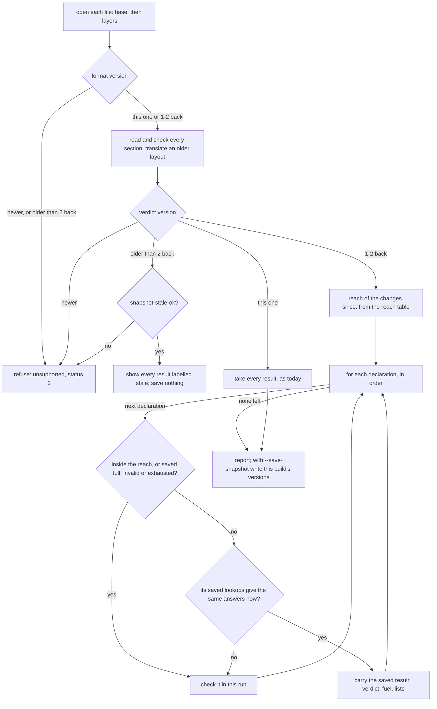

# Reading older snapshots (plan task 6.2.5c)

**Status: designed (proposed, awaiting the owner)**, 2026-11-12, agent SNAPC.
Nothing in this document is built. It amends
[ADR 0020](../adr/0020-checked-snapshot.md) (Amendment 5, proposed) and
needs the owner's [format], [kernel] and [import] decisions
([section 8](#8-review-gates)); the owner's questions are in
[section 11](#11-questions-for-the-owner). The implementation steps are plan
rows 6.2.5c1-6.2.5c8 of the [plan draft](../project/PLAN_DRAFT.md).

The owner (2026-11-12): "the snapshots should attempt to read backward
compatible 1-2 versions prior", and "I'd like to not have to regenerate the
saved version so often"; later the same evening: any future snapshot
addition, such as elaboration data, is added as an optional section, and
refactors keep snapshot bytes identical
([OWNER_DECISIONS.md](../project/OWNER_DECISIONS.md), "Order and snapshot
stability").

## 1. In plain words

A **snapshot** is LeanForth's saved homework. After LeanForth has checked a
whole library -- all of Mathlib, 729,263 declarations, took 3 hours 22
minutes on 8 workers -- it writes every result into one file (2.3 GB), and
a later run loads the results in about 7 minutes instead of checking
everything again ([ADR 0020](../adr/0020-checked-snapshot.md),
[snapshots in the command-line guide](../user/COMMAND_LINE.md#snapshots---save-snapshot-and---snapshot)).

Every snapshot carries two version numbers:

- The **format version** says how the bytes are laid out in the file, as a
  word processor's file format does. It changes when LeanForth stores
  something differently, never when it decides something differently.
  Today it is 1.
- The **verdict version** says which set of checking rules produced the
  results. It changes with any change to the checker that could change a
  stored result: a *verdict* (accepted, rejected, ...), or the *fuel* count,
  LeanForth's count of work steps, which decides when a check gives up. Today
  it is 9. It changed eight times between 13:17 on 2026-11-11 and 09:15 on
  2026-11-12, mostly because faster methods taken from Lean change the fuel
  counts.

**Today** a build refuses a snapshot written under any other version, so
after each change of the verdict version Mathlib has to be checked again
(3 h 22 min on 8 workers), unless one uses `--snapshot-stale-ok` to look at
the old results, every one of them labelled *stale*.

**The proposal:**

1. **An older layout is translated while it is read**, for the two previous
   format versions.
2. **Results written under older rules are kept where the change cannot
   have touched them.** Each change of the verdict version comes with a
   short, machine-readable note of its **reach**: which declarations it can
   possibly affect -- for example "only inductive types with nested
   occurrences", or "everything" when that cannot be narrowed. Loading a
   snapshot of one of the two previous verdict versions, LeanForth
   **carries** every saved result outside the reach of the changes since,
   **re-checks** what is inside, and re-checks too every declaration that
   relied on a result that came out different. A carried result is meant to
   be exactly what this build computes, verdict and fuel; the reach notes,
   and the record of what every check looked up, are what make that true,
   and tests compare carried results with fresh checks.
3. **Additions do not force a regeneration.** New kinds of data (the front
   end's elaboration data first) go into *optional sections*, which a build
   that does not know them skips.
4. **How far back:** two verdict versions and two format versions. Older
   snapshots are refused (exit status 2); `--snapshot-stale-ok` still shows
   them, labelled stale.
5. **Upgrading a snapshot:** `check --snapshot OLD --save-snapshot NEW`
   writes a snapshot of this build's versions, re-checking only what the
   rules require.

**What it saves depends on the reach of each change.** Of the eight changes
so far, four (versions 2, 6, 7 and 8) touched only a narrow set:
inductive types, nested inductive types, or names made inside nested
types. Carrying the rest would have turned the 3 h 22 min Mathlib re-run
into the re-check of that set (estimated at minutes to half an hour; to be
measured). The other four (versions 3, 4, 5 and 9) changed how fuel is
counted for almost every check: nothing can be carried, and the upgrade
costs a full re-check, as today. Merging verdict-changing work in one daily
batch ([question 4](#11-questions-for-the-owner)) and, later, finer notes
recorded by the checker itself (step 6.2.5c8) reduce that.

What does not change: a run without `--snapshot` (a *final* run) reads no
snapshot and re-checks everything from the export; only final runs count
in compatibility numbers; no result is ever shown as this build's unless
this build checked it or the rules below carried it.

## 2. What happens today

From the code (`src/kernel/env-snapshot.fs`, `src/import/snapshot-tier.fs`,
`src/lib/sections.fs`) and [ADR 0020](../adr/0020-checked-snapshot.md) D3,
D6 and Amendment 3:

| Snapshot | Today |
| --- | --- |
| another format version (header field 1, `snap-version` 1; the tier's own `tier-version` 1) | refused, *unsupported*, exit status 2 |
| an older verdict version (header field 2) | refused, *unsupported*, status 2; with `--snapshot-stale-ok` loaded, every result labelled stale, nothing saved |
| a newer verdict version | refused, *unsupported*, status 2 |
| other fuel or allowlist than the run's | refused, *invalid*, status 4 (`--fuel` defaults to the snapshot's) |
| a section more than the 17 of format 1 | refused, *invalid*, status 4 (`snap-table?` asks for exactly 17), so an optional section cannot be added without a new format |
| damaged, cut short, altered | refused, *invalid*, status 4 |

## 3. The design at a glance



## 4. The rules

### R1 Two versions and the window

- This build reads format versions `F` with `Fb - W <= F <= Fb` and takes
  results of verdict versions `V` with `Vb - W <= V <= Vb`, where `Fb` and
  `Vb` are its own (`snap-version`, `lf-verdict-version`) and `W`, the
  **window**, is 2 (one constant, `lf-snapshot-window`, the owner's choice,
  [question 1](#11-questions-for-the-owner)); versions start at 1. The two
  windows are independent: a file can be of an older format and the current
  verdict version, or the reverse.
- A newer format or verdict version is always refused (*unsupported*,
  status 2). A format older than the window is refused whatever the flags
  (the build no longer has its translator). A verdict version older than
  the window is refused unless `--snapshot-stale-ok` is given (R7).
- **What "keeping a reader" means.** On the format side, a *translator* per
  format step (R2.4), kept while its source format is inside the window and
  deleted, as a planned deletion by name, in the commit that moves the
  window past it. On the verdict side there is no old reader at all: an
  older verdict version's file has the current layout (or is translated to
  it) and only its results are older; what is kept is the reach table
  (R3), which is data, and the fixture snapshots that test each version in
  the window (section 6).

### R2 The format: required and optional sections

1. **Required sections** are format 1's seventeen (kinds 1-17 at positions
   0-16: the tier's ten, `snapshot-tier.fs`, and the environment's seven,
   `env-snapshot.fs`). A file lacking one, or holding one at another
   place, kind or unit size, is refused as today (*invalid*).
2. **Optional sections** follow them: kinds 256 and up, ascending, each
   kind at most once, each with a unit size fixed by a registry of optional
   kinds (in `env-snapshot.fs`'s header and ADR 0020).
   Kinds 18-255 are reserved for required sections of a future format: a
   file holding one is refused (*invalid*). An optional section:
   - **may never change a verdict or a stored field.** A build that skips
     it reports the same results, fuel and lists (tested by loading with
     and without it);
   - **unknown** to this build: not read (its table entry is still checked
     by the container: inside the file, aligned, length equal to unit size
     times count, so the file's layout stays fail-closed); named in the
     report as skipped;
   - **known but not used by this run**: not read either;
   - **known and used**: read, its SHA-256 compared and its records checked
     by its own reader; a failure stops the part of the run that needs it
     (*invalid*, status 4), as `--elab-data` refuses damaged data today
     ([ELABORATION_DATA.md](../programming/ELABORATION_DATA.md));
   - **absent** while a newer build would use it: the newer build uses the
     section's documented default, which must be the cautious one (for the
     elaboration data: none, so `--elab-data FILE` is needed, as today; for
     the rule-use marks of step 6.2.5c8: "every rule used", so the reach
     falls back to R3's predicates).
3. **The lowest format that describes the file is written**: format 1 when
   there is no optional section -- byte for byte what is written today, so
   no existing snapshot or test changes -- and format 2 when there is one. A
   format-2 reader reads both (format 1 is format 2 without optional
   sections), so this step needs no translator. A build of today refuses a
   format-2 file as *unsupported*, "format version 2", not as damaged. From
   format 2 on, a new optional kind needs no new format version.
4. **A change to the required sections** (a field added to a slot, for
   example) makes the next format version and ships, in the same commit,
   with a **translator**: a word that turns the required sections of the
   previous format, read and checked against their SHA-256s, into the
   current format's in memory, before the current loader's record checks
   (ADR 0016 C8, ADR 0020 D4), which are never weakened for a translated
   file. Two translators chain for a file two formats back. The format
   version and the tier's `tier-version` move together; a reader knows
   which pairs it reads.
5. **Byte identity** (owner, 2026-11-12: refactors keep snapshot bytes
   identical): a change that bumps neither version writes the same bytes
   in every section but the information section, which names the build
   (ADR 0020 D1). The fixtures of the current version (section 6) are the
   reference; a test compares every section but that one.

### R3 The reach table: what a verdict-version step can affect

Every step of the verdict version, from `k - 1` to `k`, gets an entry in a
**reach table** beside the prose changelog in
`src/kernel/verdict-version.fs`: the version `k`, a set of **reach bits**,
and, for `reach-names`, a list of names. The table is the single source; a
test reads it with one pattern (as `tests/cli/test_leanforth.py` reads the
verdict version today) and fails when a version has no entry or an unknown
bit. A sketch (the words are the implementation's to choose):

```forth
\ The reach of each step (ADR 0020 Amendment 5): version, bits, names.
create lf-verdict-steps
  2 , reach-scratch-names , 0 ,
  3 , reach-all , 0 ,
  ...
  8 , reach-block-nested , 0 ,
  9 , reach-all , 0 ,
```

A declaration `d` is in a step's reach when any of the step's bits holds
for it. Every predicate is decided from what the snapshot holds for `d`,
without checking anything: its declaration record, its saved slot (kind,
outcome, recipe, shape) and its saved lookups with their answers (ADR 0020
Amendment 1, "Lookups": name and kind of every query its check made, and
the slot and outcome each got).

| Bit | `d` is in the reach when | Decided from |
| --- | --- | --- |
| `reach-all` | always | -- |
| `reach-kind-definition`, `-theorem`, `-opaque`, `-axiom`, `-quotient` | `d` is of that kind | its record |
| `reach-block-any` | `d` is a member of an inductive block (type, constructor, recursor), or one of its lookups was answered by a block member's slot or a generated recursor's holder (answer flag 8) | records, lookups |
| `reach-block-nested` | as `reach-block-any`, for blocks with auxiliary types (recipe `>> lf-recipe-aux-shift` not 0) | recipes, lookups |
| `reach-block-mutual` | as `reach-block-any`, for blocks of more than one type | block records, lookups |
| `reach-literal-nat`, `-string`, `reach-projection`, `reach-let` | the construct occurs in `d`'s own terms or in those of a declaration one of `d`'s lookups answered | construct marks (below) |
| `reach-quotient` | a lookup of kind 8 (the quotient's state) or answered by the quotient's slots | lookups |
| `reach-scratch-names` | a lookup key names a name beyond the input (ADR 0020 Amendment 3) | lookups |
| `reach-not-accepted` | `d`'s saved outcome is not *accepted* | slot |
| `reach-names` | a lookup key names one of the step's listed names (a builtin's reduction, for example `Nat.add`'s) | lookups, names |

**Why one level of lookups is enough.** By I2 (ADR 0020 D5), enforced in
test builds by `lf-env-i2-checks`, a check reads only slots that its
recorded lookups answered. The terms it processes come from its own
declaration, from those slots' declarations (a definition is unfolded only
after its name is looked up, so every declaration whose terms it reads is in
its own lookup list), and from what the checker builds itself, which the
step's author must cover (with `reach-names` for builtins, or `reach-all`).

**Construct marks.** One ascending pass over the expression records gives
each record the constructs it contains (a byte: its own tag's bit and its
children's bits; a child always has a smaller number, ADR 0016 C8); a
declaration's marks are those of its type, value and kind data; `d`'s
reach adds those of every declaration its lookups answered. Done only when
an entry in force uses such a bit.

**The obligation on a reach entry (S-R).** *Every check that can run code
the step changed satisfies the entry's predicate, judged from its
declaration and the slots its lookups answered.* The step's author argues
it in the bump commit; the step's [kernel] review checks the argument
against the diff. `reach-all` is the default and the only entry allowed for
a change to the lookup rules (ADR 0012 E5), the fuel model as a whole, the
publisher, the importer's reading of an export, or anything shared by every
check. The evidence the bump commit records (section 6): every golden slot
the step moved, and every `Init` declaration whose stored fields moved in
the both-ways comparison (ADR 0020 D3), lies inside the reach.

**Composition.** For a file of verdict version `V`, the reach is the union
of the entries `V + 1` to `Vb`, every predicate evaluated on the saved
data. This is sound by induction over the steps: a check outside step `k`'s
reach runs none of the code step `k` changed, so with the same answers it
runs the same way under rules `k` as under `k - 1`, and its saved data is
still the data to judge step `k + 1` by.

### R4 The carry pass

The run's input is the loaded declarations in order (as `check --snapshot
FILE` reports them today), or, with an export, the export staged on into
the loaded tier (ADR 0020 D5). For a file of the current verdict version
nothing changes. For each declaration `d` whose saved slot comes from a file
of an older verdict version `Vd` inside the window, the driving task (the
one publisher, ADR 0012 G-P1) decides, when every slot `d`'s saved lookups
answered is final (serially: on `d`'s turn; with `--jobs`: when its
readiness set is final, before it would go to a worker):

- **C1, same content**: as I1.1 (always true for the file's own
  declarations).
- **C2, a reproducible result**: the saved outcome is not *full*,
  *invalid* or *exhausted* (I1.2).
- **C3, outside the reach**: `d` is not in the reach of the steps `Vd + 1`
  to `Vb` (R3).
- **C4, the settings**: the run's fuel limit and allowlist are the file's
  (until step 6.2.5c7: R6's fuel rule).
- **C5, the same answers** (I1.3 with the rule **I3** below): every saved
  lookup of `d`, asked again (`lf-env-replay`), gives the saved answer;
  every slot it returns is final and was either carried or taken from the
  saved one, or checked in this run with **the same answer fields** as the
  saved one; every saved dependency has its slot.

When all hold, `d` is published **carried**: its saved outcome, fuel and
fields, its lookups as this run's answers and its dependencies as their
slots here, provenance *snapshot*, its origin version `Vd`. The publisher
re-checks it as it re-checks a check's (dependencies, the axiom set
computed again, names, kind, ADR 0020 Amendment 1); a difference stops the
run (*invalid*), as the import pass does today. Otherwise `d` is checked in
this run, and its **reason** is kept for the report: `reach` (the first
step whose entry holds), `outcome` (C2), `answers` (the first lookup that
differs) or `settings`.

**I3, the same answer fields.** A slot holds no fuel and no diagnostic
(`/lf-slot` in `src/kernel/environment.fs`: the run keeps them apart), so
no check can read another declaration's fuel or diagnostic. What a check
can read of a slot it looked up is its outcome, its declaration (the same
record of the one tier), its marks (skipped, added, its place in a span),
its axiom set and provenance (joined by the publisher), its warnings, its
recipe and its shape. A slot checked again in this run whose outcome,
marks, axiom set, warnings, recipe and shape equal the saved slot's gives
its users the same answers, so (by I2) their checks run as before. Its fuel
may have moved; its users' cannot because of it. The rule holds for the
import pass of a dependent export too, which lifts ADR 0020 Amendment 2's
open item 4 (a declaration whose lookups reach one checked again is checked
again even when that one did not change).

**Why a carried result is this build's** (the claim [kernel] reviews): by
induction over the input's order. Every slot a carried `d`'s lookups return
is final and gives its users what the saved one gave (taken or carried, by
induction; checked here, by I3). By C3 and S-R, `d`'s check runs no code
changed since `Vd`; by C1 its content is the same; by C4 its settings. By
I2 a check depends on nothing else, so this build's check of `d` makes the
same lookups and ends with the same outcome, fuel and fields: the saved
ones.

**The first version** (step 6.2.5c3) decides in one pass before any check,
as today's import pass does, with C5 as I1.3 (a slot checked in this run is
no match). It is sound and simpler, and it re-checks every user of a
re-checked declaration; step 6.2.5c4 adds I3 and the decision on readiness.

### R5 Dependencies: when a re-checked result changes

A declaration checked again whose answer fields come out different -- its
verdict, recipe, shape, axiom set, warnings or marks -- gives every
declaration whose saved lookups it answered another answer, so C5 fails for
each of them and each is checked again; the same holds for their users, as
far as answers change. One whose answer fields come out equal (only its
fuel or its diagnostic moved) changes nothing for its users. So no
declaration keeps a saved verdict that rested on a result that changed: a
definition rejected now makes its users checked again (and they may be
rejected), and one accepted now where it was rejected makes its users
checked again (and they may now be accepted). The re-checks spread exactly
as far as answers change, never further.

### R6 Layers, tiers, the manifest, hashes and settings

- **Each file of a stack** (a base and its layers, ADR 0020 Amendment 1
  F5) is judged by the windows on its own; a layer may be older or newer
  than its base, both at most `Vb`. The stack is loaded as today (base,
  then layers, `env-layers.fs`), every slot remembering its file's verdict
  version, and the carry pass runs over the merged environment.
- **A declaration in two files of different verdict versions** (a base's
  and a layer's equal unit, Amendment 2) whose stored fields differ is not a
  clash: the newer file's slot is kept and the older one's dropped. With
  equal versions, the rules of today hold (a difference is refused; a twin
  with other lookups is kept beside it, Amendment 3 L1).
- **Lineage** (with format 2): a base written by an upgrade (R8), or
  written again with an optional section added, holds an optional *lineage*
  section: the header SHA-256 and verdict version of each file it was made
  from. A layer whose base field (header fields 8-15) names one of them
  loads on the new base when the new base's tier sections are those the
  layer was numbered on (the identity's first numbers and the tier
  sections' SHA-256s equal); its slots then go through the carry pass with
  their own version, their lookups asked against the new base. Otherwise the
  layer is refused as today (*invalid*, "base snapshot of the layer") and
  must be written again by checking its export against the new base.
- **Tiers and hashes**: every section's SHA-256 is compared before any
  translation; the file's SHA-256 (its header's) is printed in every
  report, as today; the export's identity and manifest sections are read
  and printed unchanged; an upgrade writes the tier sections it read.
- **The fuel limit** (step 6.2.5c7, a [kernel] claim to test first, F-L:
  *a check that ends without running out of fuel uses the same fuel and
  gives the same verdict under any limit at least as large*). With another
  `--fuel` than the file's: a larger limit checks again only the saved
  *exhausted* results; a smaller one checks again also every result whose
  saved fuel exceeds it. Until then, another fuel is refused as today. The
  allowlist must still be the file's.

### R7 What the output says

Nothing taken from a file of an older verdict version is shown as a check
of this run, and nothing stale is shown as this build's verdict.

```text
Nat.add_comm: accepted (from snapshot of verdict version 8, carried: this build's changes since cannot affect it; not re-checked in this run); axioms: none
Lean.Syntax: accepted (checked in this run: inside the reach of verdict version 9's change); axioms: none
snapshot: mathlib.lfsnap (sha256 3f2a…), export sha256 18448e5d…59c6, verdict version 8 (this build: 9), written by LeanForth 2ad871e…
carried: 712,004 results of verdict version 8 that the changes since cannot affect, not re-checked in this run
checked again: 17,259 (16,980 inside the reach of version 9's change, 279 whose lookups' answers changed)
```

JSON (the check report's next version, a [format] decision): the
`snapshot` member gains `carried` (the count and the versions carried from),
`checkedAgain` (counts by reason) and `skippedSections` (optional kinds not
read); each declaration keeps `provenance` (`snapshot` for a taken or
carried one) and gains `carriedFrom` (the verdict version, or null) and,
when checked again, `reason` (`reach` with its step, `answers`, `outcome`,
`settings`).

**`--snapshot-stale-ok` becomes "carry, and show the rest stale instead of
checking it"**: inside the window, carried results as above, and every
declaration that would be checked again shown with its saved result,
labelled stale as today; beyond the verdict window (its format inside its
window), every result stale, as today. It still needs `--snapshot`, still
refuses `--save-snapshot`, and stale results never count anywhere.

### R8 Saving an upgraded snapshot

`check --snapshot OLD --save-snapshot NEW`, with no export (refused today:
"--snapshot and --save-snapshot go together only with an export"), loads
OLD, runs the carry pass, checks what it must, and writes NEW as a base of
this build's versions over the same tier: every slot final, a carried one
with provenance *taken* (as the import pass marks a taken slot), a checked
one as checked; from format 2, a lineage section naming OLD. With an
export, `--save-snapshot` writes a layer, as today. A stack with layers is
upgraded base first (step 6.2.5c7 then loads the old layers through the
lineage). A file is written only after a run in which every slot became
final (ADR 0020 D2), and never with stale results.

### R9 Refusals

Each refusal publishes nothing and frees what was loaded (ADR 0020 D6).

| Case | Outcome | Status |
| --- | --- | --- |
| a newer format or verdict version (any file of a stack) | unsupported, naming both versions | 2 |
| a format older than the window | unsupported: "format F; this build reads Fb-2 to Fb: check the export again" | 2 |
| a verdict version older than the window, without `--snapshot-stale-ok` | unsupported: names the versions this build reads, and the two ways on: check the export again, or look with `--snapshot-stale-ok` | 2 |
| a section of kind 18-255, a required section missing or misplaced, an optional kind twice or out of order | invalid | 4 |
| an optional section this run uses, damaged or malformed | invalid, naming it | 4 |
| a translated file failing the current record checks | invalid, naming the section and record | 4 |
| a carried slot the publisher would publish otherwise | invalid | 4 |
| a layer whose base or lineage does not match | invalid, "base snapshot of the layer" | 4 |
| `--snapshot-stale-ok` with `--save-snapshot`; `--save-snapshot` with layers and no export | misuse | 4 |
| no heap | full | 3 |
| a version in the window without a reach entry | impossible by construction: the build stops loading (`abort` while compiling `verdict-version.fs`) and the reach-table test fails | -- |

## 5. The reach of the steps so far (proposed entries)

From the changelog in `src/kernel/verdict-version.fs` and the golden
snapshots' history in git (`tests/cli/golden-snapshots/`, 250 slots of ten
small exports, compared field by field between the commits that wrote
them, along main's history; agent SNAPC, 2026-11-12). The entries for
steps 2-9 are proposals: step 6.2.5c1's [kernel] review checks each against
its commit's diff.

| Step | Change | Proposed reach | Evidence |
| --- | --- | --- | --- |
| 2 | lookups of names made beyond the input kept as those names | `reach-scratch-names` | no outcome or fuel moved; `Init`: 8 declarations' lookups |
| 3 | an argument not closed first (agent PF); default fuel 100,000,000 | `reach-all` | goldens: 99 of 250 slots' fuel moved, every kind |
| 4 | fuel independent of the tier's numbering | `reach-all` | `Init`: 48,402 declarations' fuel moved |
| 5 | an application typed from its spine's head (Lean's `infer_app`) | `reach-all` | `Init`: 31,445 declarations' fuel moved |
| 6 | blocks' walks visit each shared node once (agent NS) | `reach-block-any` | goldens: 39 slots moved (commit 4d189f6 to 7e21957), all inductive types; `Init`: no verdict moved |
| 7 | C1 walks each (node, depth) pair once (agent FXK) | `reach-block-any` | goldens: none moved (b74a04d to 7301204); `Init`: one declaration, 4 units |
| 8 | nested blocks' passes keep a memo (review MO) | `reach-block-nested` | goldens: 3 moved (7301204 to 2ad871e), all with auxiliary types (recipe 256 or 512); `Init`: `Lean.Syntax`, 2 units |
| 9 | aside typing as Lean's infer-only mode (agent CK) | `reach-all` | goldens: 1 moved (2ad871e to a468abf), `unfold`'s `impliesSelf`, a definition, fuel 65 to 68; `Init`: 9,520 declarations' fuel moved |

So with the window of two, today's build (version 9) would take files of
versions 7 and 8, and both need step 9's `reach-all`: a full re-check.
The Mathlib snapshot planned for tonight's run (verdict version 9,
OWNER_DECISIONS.md "Tonight's run") would be the first one the next bumps
can carry from.

## 6. Tests

- **Fixture snapshots** in `tests/snapshots/v<V>/` for each verdict
  version in the window, with a `README.md` naming the commit and command
  that wrote each file and its SHA-256: the exports `inductive`, `nested`,
  `kinds`, `unfold`, `let-b` and the 59 declarations of
  `tests/author/init-slice.ndjson` (the slice of `Init`), plus a layer
  (`dependent` on `inductive`). Measured tonight: 61,440, 118,784 and
  90,112 bytes for `inductive`, `nested` and `init-slice` (2.6, 23.5 and
  12.0 KB compressed); about 0.6 MB a version, three versions kept. Each
  bump writes the new version's fixtures with the new build and deletes the
  set that leaves the window (a planned deletion, by name). Versions 7 and 8
  are written once by their own builds (commits 7301204 and 2ad871e, in
  temporary worktrees, `scripts/write-snapshot-fixtures.sh`). Older formats
  get fixtures the same way when a format step happens.
- **Byte identity** (R2.5): the build writes the current version's fixtures
  again, every section but the information section byte-equal.
- **The differential** (the main test, in `make test`): for each fixture of
  an older version, the upgrade run (`check --snapshot FIXTURE
  --save-snapshot NEW`) and a fresh check of the export saving a snapshot
  agree on every field the verdict version covers, provenance aside: every
  carried result equals a fresh check's verdict, fuel, axioms, dependencies
  and lookups. The set checked again equals a Python model's prediction from
  the reach table and the saved lookups (as `kept_back` predicts the import
  pass today), so a test fails when the rule carries too little as well as
  too much.
- **The reach evidence at each bump**: the bump commit's tests run the
  differential on the two older fixture sets, and the author runs it once
  on all of `Init` (`Init`'s snapshot of the previous version against a
  fresh check), recording in the commit that every moved field lies inside
  the reach.
- **Planted faults** (`tests/mutants/faults.toml`): step 9's entry
  narrowed to `reach-block-any` (caught by `unfold`); C3 ignored (carry
  everything); I3 comparing the outcome only (caught by the model's
  prediction on a forged fixture whose block recipe differs); the window
  one wider (a forged header of version `Vb - 3` must be refused, status 2);
  an exhausted result carried; the carried label dropped (text and JSON);
  `--snapshot-stale-ok` writing a file; an unknown optional section read
  instead of skipped; a kind 18-255 section accepted.
- **Malformed and mixed versions, all failing closed**: older fixtures cut
  short, a section altered, a header re-hashed with another version, a
  translated record out of range; a stack of a version-8 base and a
  version-9 layer (loads, carried per file), a layer beyond the window
  (status 2), a layer newer than the build (status 2), an upgraded base
  with an old layer (loads through the lineage only when the tier is the
  same).
- **Optional sections**: a forged format-2 fixture with an unknown kind
  (300) reports the same results as without it; a damaged unknown section
  is ignored; a format-1 file is written byte for byte as today.

## 7. Cost

Measured (`gforth-fast`, a shared 10-core machine):

| What | Time | Memory | Source |
| --- | ---: | ---: | --- |
| all of Mathlib checked from its export, `--jobs 8`, fuel 250,000,000, build `b74a04d` (verdict version 6) | 12,134.5 s wall (3 h 22 min), 92,220 s CPU | 29.4 GB peak | `.claude/work/overnight/run.log` |
| its snapshot | 2,301,329,408 bytes | | same |
| that snapshot loaded and every verdict reported again | 425 s wall | 9.5 GB peak | `.claude/work/overnight/snapload-b74a04d.err` |
| all of `Init` checked, `--jobs 8` | 191.5 s wall, 1,362 s CPU | 1.2 GB peak | `run.log` |
| all of `Init` against its own snapshot (import pass of 59,349 declarations: 9.0 s) | 48.7 s wall | | ADR 0020 Amendment 3 |

Estimated, for upgrading the Mathlib snapshot across one step (unmeasured
until step 6.2.5c4):

| Part | Estimate |
| --- | --- |
| load and check the file | about 7 min (as measured above), 9.5 GB |
| the reach: kinds, outcomes, recipes and about 26 million lookups (Init: 36.1 per declaration); construct marks when needed, one pass over 106.1 million expressions | under 1 min |
| ask every carried declaration's lookups again (Init's import pass 9.0 s, times about 12) | 2-5 min |
| check what must be checked again | at the full run's average, about 60 declarations a second on 8 workers; the cost of the set depends on which declarations it holds |
| write the new file | about 1 min (ADR 0020 Amendment 3 predicted 50 s) |

- A step whose reach is the inductive blocks (like 6 and 7): the set is
  Mathlib's block members and whatever their changed answers reach. Their
  number is unknown (the run will print it); at 10% of Mathlib, about
  73,000 at 60 a second, some 20 minutes, so about half an hour in all
  against 3 h 22 min to check Mathlib again.
- A step like 8 (nested blocks only): fewer, probably minutes.
- A step whose reach is everything (like 3, 4, 5 and 9): the whole
  library checked again plus the 7-minute load: no saving, and slightly
  more than regenerating.
- Without I3 (step 6.2.5c3 alone) a block step also re-checks every user of
  a re-checked block: in `Init`, 22,207 of 59,349 declarations rest on
  `Lean.Syntax`'s nested block (ADR 0020 Amendment 2). Step 6.2.5c4 removes
  that.

## 8. Review gates

- **[format]**: the format-2 rule (optional sections, reserved kinds,
  writing the lowest format), the lineage section, the fixtures, and the
  check report's new members. They change what LeanForth's files and
  reports say.
- **[kernel]**: what a carried result vouches for -- the reach vocabulary
  and its obligation S-R, the entries proposed for steps 2-9, I3 (no check
  reads another declaration's fuel or diagnostic) and the fuel-limit claim
  F-L. A wrong rule would report a verdict as this build's without this
  build having checked it. Every later reach entry other than `reach-all`
  is part of its own step's [kernel] review.
- **[import]**: C1-C5 replace the import rule I1 for carried results, I3
  changes what a dependent export's import pass takes, and mixed-version
  stacks and the lineage change what is taken from a file into a run.
- Not [axiom]: the allowlist must still be the file's; an axiom's verdict
  is never carried across an allowlist change.

## 9. Implementation steps

Plan rows 6.2.5c1-6.2.5c8 ([PLAN_DRAFT.md](../project/PLAN_DRAFT.md)) give
each step's acceptance and tests. Steps c1-c5 are for 2026-11-13 (the
owner's first infrastructure task), c6 and c7 next, c8 later.

| Step | What | Size |
| --- | --- | --- |
| c1 | the reach table and window, entries 2-9, `lf-verdict-reach`, the table test | S |
| c2 | fixture snapshots of versions 7, 8 and 9, the script, byte identity | S |
| c3 | the carry pass, first version (one pass, C5 as I1.3); labels, report, `--snapshot-stale-ok`, refusals | M |
| c4 | I3 and the decision on readiness (serial and `--jobs`), for dependent exports too; `Init` measured | M |
| c5 | saving an upgraded base (`--snapshot OLD --save-snapshot NEW`) | S |
| c6 | format 2: optional sections, the lowest format written, the translator rule, the lineage section | M |
| c7 | stacks of mixed versions, layers through the lineage, the fuel-limit rule | S |
| c8 (later) | rule-use marks: each check records which rule families it used, as an optional section, so a fuel-model change reaches only the checks that used it | M |

## 10. Rejected alternatives

- **Keeping each old checker** and running version 8's rules on version 8's
  snapshots: its results are old verdicts (stale by definition), and every
  kept version doubles the reviewed kernel code.
- **Carrying a result because the changelog says "no verdict changed"**:
  the changelog's "fuel only" is measured on samples, fuel is a stored
  field that decides verdicts near the budget, and step 9 did change
  verdicts (on ill-typed reducts). Asked as [question 2](#11-questions-for-the-owner).
- **Converting old fuel counts by a formula**: no formula exists for a
  change of method (steps 3-5, 9).
- **An unlimited window**: every supported version needs fixtures and
  tests, and the union of many steps' reach is soon everything.
- **Naming the base of a layer by a content hash** instead of a lineage
  section: it would change the bytes of every layer written from now on;
  the lineage keeps format 1's bytes.
- **Recording rule-use marks now**: the precise answer for fuel-model
  changes, but a [kernel] change touching every rule family; planned as
  step c8, as an optional section so that existing snapshots keep working.
- **Checking everything again on every bump** (today): the cost the owner
  asked to avoid.

## 11. Questions for the owner

**Answered by the owner on 2026-11-12 (22:15), each as recommended:** two versions back; exact verdict and
fuel; automatic re-check with the count printed first; verdict-moving changes merged once a day
([OWNER_DECISIONS.md](../project/OWNER_DECISIONS.md)). The questions are kept below as asked.

1. **How far back?** *Options:* (a) one version back; (b) two versions
   back, for both the layout and the rules; (c) more. *Recommendation:
   (b).* Your request said 1-2; two costs only about 0.6 MB of test files
   per version and one more kept translator, and it leaves a day
   of slack when the snapshot is upgraded nightly. More would need more test
   files and gains little, since the reach of several changes together is
   soon everything. Older snapshots stay viewable with
   `--snapshot-stale-ok`, labelled stale.
2. **Must a carried result have exactly a fresh check's fuel count?**
   *Options:* (a) yes: a change that may move fuel re-checks everything it
   can reach; (b) no: where a change "only moves fuel", keep the verdict and
   show the old fuel, marked as such. *Recommendation: (a).* Fuel decides
   when a check gives up, so near the limit a fuel change is a verdict
   change; the "fuel only" notes are measured on samples, and change 9 did
   change verdicts. With (a) every result LeanForth shows is exactly this
   build's, as the 100%-Lean rule asks; the cost is that broad fuel changes
   still need a full re-check until step c8 narrows them.
3. **When an older snapshot needs re-checks, should LeanForth just do
   them?** *Options:* (a) yes, automatically, printing first how many
   declarations it will check again and why (`--save-snapshot NEW` keeps
   the upgrade; `--snapshot-stale-ok` gives a quick look instead); (b)
   refuse until the user picks one of those two. *Recommendation: (a).*
   The default gives exact results with no new flag to learn, the first
   line says what it will cost, and the quick look stays one flag away. The
   risk is a long run started by surprise when a change reaches everything;
   the printed count makes that visible at once.
4. **Merge verdict-changing work in one batch a day?** *Options:* (a) yes:
   changes that move verdicts or fuel are merged together, at most once a
   day, before the nightly full run, which saves the new Mathlib snapshot;
   (b) no: merge each when ready, as now. *Recommendation: (a).* Eight
   version changes in 20 hours (11-12 November) would overrun any window of
   two; batched, each day's changes cost one upgrade (or one nightly run),
   and each reach note is reviewed once. The cost is that a kernel speed-up
   can wait up to a day to reach main.
