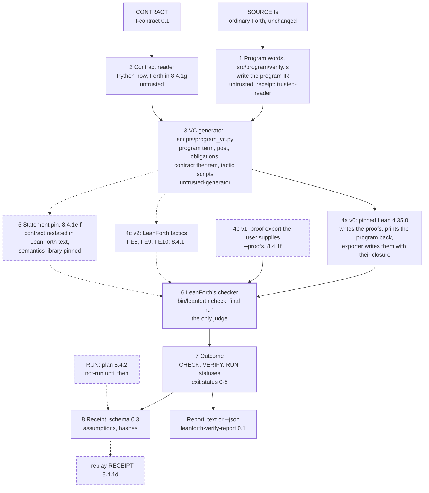

# `leanforth verify`: checking a Forth word against its contract

**Status (2026-11-13): designed (plan 8.4.1); nothing is built.** This
document designs the program track's first user command, `leanforth
verify WORD.fs --contract FILE`, end to end: what it reads, the steps it
runs, what is trusted at each step, what it prints and returns, the
receipt it writes, how tampering is caught, its limits, and the tests and
documentation each step needs. It changes no checker rule, no receipt
schema and no contract syntax; the formats it needs are proposed here and
pass the owner's [format] gate when built. Sub-steps 8.4.1a–n are in
[§12](#12-sub-steps-841an) and in the [plan](../project/PLAN_DRAFT.md);
six questions for the owner are in [§13](#13-questions-for-the-owner).

Today Lean writes every program proof and LeanForth's checker re-checks
Lean's export of it (plan 5.5.1, clamp). This design keeps that order in
the near term and says how the proofs later come from a file the user
supplies and then from LeanForth's own tactics (the front end,
[FRONT_END.md](FRONT_END.md)). In no step does LeanForth write a proof
before the front end exists.

## In plain words

A *contract* says what a Forth word does: for which inputs, what it leaves
on the stack. `leanforth verify` takes the word's source file and the
contract and answers three separate questions, never merged into one:

- **CHECK** — was a proof about the word checked, and by which checker?
- **VERIFY** — is every *proof obligation* of the contract (one small
  theorem per path through the word) settled by a checked proof?
- **RUN** — what did tests of the word on a real Forth show? (Plan 8.4.2;
  until then *not run*.)

The steps: Forth's own interpreter, with LeanForth's program words, turns
the word into the *program IR*, a small language whose meaning is written
in Lean; an untrusted generator turns the IR and the contract into the
obligations and one *contract theorem*, a statement about the IR's meaning;
someone writes the proofs; LeanForth's checker (the kernel) checks them;
the command prints the outcome and writes a *receipt*, a JSON record of
what was checked and on which assumptions.

**Who writes the proofs** changes over time; who judges them does not:

| Stage | Proofs written by | Statement fixed by | Needs |
| --- | --- | --- | --- |
| v0 (near term, 8.4.1b–d) | Lean 4.35.0, from the generator's tactic scripts; `verify` runs it | Lean's elaboration of the generated file (the trust the owner approved for the clamp on 2026-11-12) | pinned Lean, Python 3 |
| v1 (8.4.1e–h) | anyone: a proof export the user supplies (`--proofs`), for example hand-written Lean proofs of the loop words | LeanForth itself, from the IR and the contract | only Gforth when proofs are supplied |
| v2 (8.4.1l–m) | LeanForth's tactics (front end FE5, FE9, FE10) | LeanForth itself | only Gforth |

In every stage LeanForth's checker is the only judge, and the proof's
author is untrusted. What a positive result means: the word's IR meets the
contract for every cell width and input, under the assumptions the receipt
lists. It says nothing about the compiled code or the Forth system that
runs it: those are assumptions (`trusted-runtime`) and, with 8.4.2, tested,
never verified.

## 1. What exists today and what is missing

| Piece | Where | State |
| --- | --- | --- |
| Program words: correctness mode writes the IR from unchanged Forth source (ADR 0019, mode shift) | `src/program/verify.fs` and its helpers | approved [parser] 2026-11-04; IR 0.1 and 0.2 |
| IR semantics in Lean | `tests/reference/program-ir.lean` | reference model, reviewed with the IR |
| Contract language 0.1 | [PROGRAM_VC.md](../programming/PROGRAM_VC.md#the-contract-language-version-01), `tests/program/contracts/*.contract` | 9 contracts (6 words, 3 wrong ones) |
| Verification-condition generator v0 (untrusted) | `scripts/program_vc.py` | 4 words discharged, 3 wrong contracts refuted, the 2 loop words unsupported |
| Lean export with closure and manifest | `scripts/export.sh` | used for clamp (4,277 declarations) and the SHA helper words (2,890) |
| LeanForth's check of that export | `bin/leanforth check --json` | clamp accepted; program, contract and proof mutants rejected (5.5.1) |
| Receipt writer, strict reader, replay | `scripts/program_receipt.py` | clamp only: its paths are fixed in the script |
| Runtime comparison: IR interpreter, host, Lean's model | `src/program/ir-run.fs`, `tests/program/ir-run-table.fs` | clamp tables and the example words |

**Missing**, and what this design adds: a user command; any word other
than clamp end to end (the receipt script names clamp's files); a statement
fixed independently of the proof's author (needed before proofs from
elsewhere can be accepted); the deciding steps in Forth; receipts for
words outside the LeanForth checkout; RUN for any word (8.4.2); a tamper
suite for receipts in general (with plan 5.5.2's replay); and the
coverage review's open finding P12, "no end-to-end *specify → check → run
→ receipt* tests" ([coverage review](../development/TEST_COVERAGE_REVIEW.md#program-track)).

## 2. The command

```text
leanforth verify [OPTION]... SOURCE.fs --contract CONTRACT
leanforth verify --replay RECEIPT [--rerun]
```

| Option | Meaning | Step |
| --- | --- | --- |
| `--contract FILE` | the contract (`lf-contract 0.1`); it names the word | b |
| `--out DIR` | where the work files and the receipt go; default `verify-out/WORD` in the current folder | b |
| `--proofs EXPORT` | check this proof export (Lean's export format, with its manifest) instead of running Lean | f |
| `--json` | the report as one JSON text (§6.4) | c |
| `--detail` | also print the generated statement (`post` and the contract theorem) beside the contract's lines (§10.3) | c |
| `--fuel N`, `--jobs N`, `--memory-per-check MB`, `--checked` | passed to the check, as for `check` | b |
| `--lean-time-limit S` | Lean's time limit in seconds (default 1800, as the scripts' `TEST_TIMEOUT`) | b |
| `--keep-export` | keep the export after the check (it is removed by default, §8) | b |
| `--replay RECEIPT` | read the receipt strictly and rebuild it from the files it names and its evidence; `--rerun` runs every step again and compares | d |

The word is the contract's `word`; the source file may define other words,
which the word may call. No option weakens what is checked: there is no
`--no-manifest`, no axiom option and no way to skip a step (less fuel can
only make a check end *exhausted*).

## 3. Inputs

### 3.1 The word

Ordinary Forth in a file, loaded unchanged in both modes (ADR 0019): run
mode is `include`, correctness mode is the program words, which run the
file through Forth's own interpreter with only their vocabulary visible and
write IR 0.1 (or 0.2 when the file uses output words, `LSHIFT` or `-ROT`).
Anything outside the IR is refused at its token, with the program words'
diagnostic line (`unsupported @13:7: a Forth word outside IR 0.2: …`).
Verify reads the file once with the program words and hashes it before
and after, as `program_receipt.py record` does today; a hash of exactly the
bytes read waits for ADR 0019 §5's runner hash.

### 3.2 The contract

Verify reuses contract language 0.1 unchanged
([PROGRAM_VC.md](../programming/PROGRAM_VC.md#the-contract-language-version-01)):
`id`, `word`, `ir`, `stack`, `inputs`, `statement`, `pre`, `case` with
`out` and `ensure`, and `expect`. No new notation enters canonical Forth:
the contract is a separate text file read by the contract reader, not Forth
grammar, and what is proved is the Lean (later LeanForth) statement the
generator makes from it, which verify shows back (§10.3). Its infix
expressions (`r = min(max(value, lower), upper)`) are the rendering of that
statement, as `AGENTS.md` places infix notation in a rendering layer;
[question 6](#13-questions-for-the-owner) asks whether contracts should
later be written as LeanForth text.

Three rules for verify:

1. **The `ir` line** names an IR file. Verify writes the IR from the
   source and requires the named file to be that IR byte for byte
   (`contract-ir-differs` otherwise), so a stale IR file can never stand
   for the source. A small extension, contract 0.2, would make the line
   optional (8.4.1b proposes it; the [parser] gate of 8.4.1g reviews it).
2. **`expect`** is a test annotation. Verify reports what it found; when
   that differs from `expect` it adds a note and changes nothing else.
3. **`statement`** is prose copied into the receipt; it is unchecked text
   ([receipts](../programming/PROGRAM_RECEIPTS.md#rules-beyond-json-schema)).
   The statement that counts is the generated one.

### 3.3 Proofs

| Source | How verify gets it | When |
| --- | --- | --- |
| Lean, from the generator's tactic scripts | verify runs pinned Lean on the generated file and `scripts/export.sh` on its theorems | v0, default |
| A proof export the user supplies | `--proofs EXPORT` (with `EXPORT.manifest.json`), made by any tool, e.g. Lean proofs written by hand for the loop words | v1, after 8.4.1f |
| LeanForth text with tactics | the generator writes a `.lf` proof script; `leanforth check` checks it | v2, after FE5, FE9, FE10 |

## 4. The steps, end to end



Solid boxes exist today as pieces (the scripts of plan 5.5.1 join them
for clamp); dashed boxes are later steps; no box is the command yet. The
thick box is the only component whose answer can make anything
*accepted*. (The diagram was rendered with `mmdc`, mermaid-cli, on
2026-11-13 and checked by eye.)

| Step | What happens | Component | Trusted? | Fails as (code, exit status) |
| --- | --- | --- | --- | --- |
| 0 Command line | Options read; in v0 the source, the contract and `--out` must lie inside the LeanForth checkout (receipt 0.3's paths) | driver | untrusted | `usage` 4; `outside-folder` 4 |
| 1 Read the word | Correctness mode writes the IR of the whole file; the source is hashed before and after | program words (Forth) | untrusted code, named as the assumption `trusted-reader`: its translation is tested (5,152 runtime cases, golden files, the old reader as oracle), not proved | `source-unreadable` 4; `source-refused` 2, 4 or 3 (the program words' outcome: unsupported, invalid, full); `source-changed` 4 |
| 2 Read the contract | Parse, check the word exists and the `ir` file matches | contract reader | untrusted; its result is shown back | `contract-unreadable` 4, `contract-malformed` 4, `word-not-found` 4, `contract-ir-differs` 4 |
| 3 Generate | The program as a Lean term, `post` from the contract, one obligation per path, the contract theorem against the IR semantics, tactic scripts; or a counterexample and the theorem `refuted` | generator | untrusted (`untrusted-generator`): safe because the contract theorem is stated against `ProgramIR.callWord` itself, so a wrong symbolic step makes a proof fail, never a false theorem; the *translation* of the contract into `post` is what a reader must check (§10.3, risk 1) | `generator-unsupported` 2 (loops, recursion, literals outside −1…1); `ir-needs-receipt-0.4` 2; `paths-limit` 3 |
| 4a Prove (v0) | Pinned Lean compiles the generated file (`-DwarningAsError=true`), prints the program back, reports `#print axioms`; `scripts/export.sh` writes the theorems with every declaration they use and the manifest | Lean, lean4export | Lean's elaboration and export are trusted (`trusted-lean`): the statement LeanForth checks is what Lean made of the file. Lean's own proof check is not relied on | `lean-not-found` 4; `lean-failed` 2 (a tactic script failed: nothing checked, every obligation open); `lean-time-limit` 3; `program-print-back-differs` 5; `export-failed` 5 |
| 4b Supplied (v1) | Read `EXPORT` and its manifest | — | untrusted | `export-invalid` 4 |
| 5 Pin the statement (v1) | The generator also writes the statement as LeanForth text: the program term, `post` and a theorem restating the contract, proved by citing the export's theorem; the semantics library's declarations in the export must be the pinned ones | authoring words, kernel | the kernel decides; the statement text is untrusted but now independent of the proof's author | `statement-differs` 1; `semantics-differs` 1; `proof-missing` 2 |
| 6 Check | `bin/leanforth check --json`, a final run (no snapshot): every declaration of the export, then (v1) the statement text | LeanForth's checker | trusted (`trusted-leanforth`), the kernel under its review gates | `proof-rejected` 1; `proof-undecided` 2; `proof-exhausted` 3; `export-invalid` 4; `internal` 5; `not-proved` 6 (an axiom outside the allowlist, such as `sorryAx`) |
| 7 Decide | Statuses from the check's report only (§6.5); LeanForth's axioms per theorem compared with Lean's `#print axioms` (v0) | driver | untrusted; every status is derived from the kernel's report and replayable | `axioms-differ` 5 (no receipt) |
| 8 Write | Receipt (atomically: `.partial`, then renamed), the report | receipt writer | untrusted; strict reader, schema, rules and replay check it | `receipt-not-written` 4 |

**Where the code lives.** v0 is a driver, `scripts/program_verify.py`
(standard library only), that `bin/leanforth verify` starts; it reuses
`program_receipt.py`'s evidence and receipt functions, generalized from
clamp's fixed paths to any word, and runs `bin/leanforth check --json` for
step 6. Later steps move what decides into Forth: the contract reader and
statement writer (8.4.1g), the receipt writer (8.4.1h), the statement pin
(8.4.1e–f) inside `leanforth check`. Python then stays an optional proof
producer (it drives Lean) and the independent second reader that replays
receipts, the role the owner gave it for the export reader (OQ-4).
[Question 5](#13-questions-for-the-owner) asks whether Python may be needed
by a user command in v0.

**Why v0 drives Lean and does not yet accept a supplied export.** A proof
export can contain a theorem named `ProgramVC.LfClamp0.contract` that
proves something else (`True`, a weaker postcondition, another program),
or redefine the IR semantics so that `callWord` always succeeds. The
kernel would accept it: it checks that each proof proves its own
statement, not that the statement is the contract. In v0 verify writes the
Lean file and runs Lean itself, so the statement is the generated one
(the clamp's trust, approved 2026-11-12). Step 5 makes the statement
independent of who wrote the proof:

- **The restated contract.** The generator writes the contract theorem's
  statement a second time, as LeanForth text: the program as a term built
  from the IR, `post` from the contract, and
  `theorem verify.WORD.contract : STATEMENT := EXPORTED-THEOREM …`. The
  kernel accepts it only if the export's theorem proves exactly that
  statement (up to definitional unfolding, the kernel's ordinary check).
- **The pinned semantics library.** The statement mentions
  `ProgramIR.callWord`, `ProgramIR.Cells.Fits`, `Int`, `List`, `≤` and
  their instances. Every declaration those names reach must be the one of
  a reference export pinned in the repository (pinned Lean's export of the
  semantics and the part of `Init` it uses, re-made byte for byte by `make
  check`), compared by content, as `check --snapshot` already compares a
  dependent export's declarations with its base's ("taken" only when the
  content is identical). A changed definition is `semantics-differs`.

The LeanForth text needs string literals (the IR names words by
`String`): ADR 0017 §14's `s"`, delivered by FE2e or earlier as one
kernel-form word.

## 5. What is trusted

| Assumption (receipt kind) | v0 | v1 (supplied proofs) | v2 (LeanForth tactics) |
| --- | --- | --- | --- |
| The host cell, two's complement, stack room (`host-cells`, `twos-complement`, `stack-capacity`) | yes | yes | yes |
| Gforth runs the words as the IR says (`trusted-runtime`) | yes | yes | yes |
| The program words wrote the IR faithfully (`trusted-reader`) | yes | yes | yes |
| Lean elaborated the generated file and its exporter wrote it faithfully (`trusted-lean`) | yes: the statement and the semantics | only for the pinned semantics library (one reviewed file, pinned by hash) | the same, until the library is written in LeanForth (8.4.1m) |
| The generator (`untrusted-generator`) | made safe by stating the contract against the IR semantics | the same | the same |
| LeanForth's checker (`trusted-leanforth`) | yes: the only judge | yes | yes |
| The contract's translation into `post` | shown back; reviewed at the [parser] gate | the same, written by LeanForth's own table (8.4.1g) | the same |

Untrusted at every stage: the proof's author (Lean's tactics, a user's
file, an AI, LeanForth's tactics), the driver, the report and the receipt
writer. Never claimed by any stage: that compiled code, the runtime or a
backend is verified.

## 6. Output

### 6.1 Text

One block per step, then one summary line with the VERIFY status, the
receipt's path, and the exit status. Verdict lines are `check`'s own
(`NAME: accepted; axioms: …`, `NAME: rejected` with the reason indented).
The summary line uses the receipt's words, never a bare "verified":

| VERIFY | Summary line |
| --- | --- |
| `discharged` | `lf-clamp: contract lf-clamp/0 discharged (2 of 2 obligations; Lean wrote the proofs, LeanForth's checker accepted them); about the IR, under the receipt's 8 assumptions; compiled code is not covered` |
| `open` | `lf-clamp: contract lf-clamp/0 NOT VERIFIED: open: O2 has no accepted proof (…)`, then each open obligation in plain words |
| `refuted` | `lf-clamp: contract lf-clamp/wrong-swapped NOT VERIFIED: refuted: value -3, lower -3, upper -2: the word leaves -3, the contract says -2` |
| `unsupported` | `lf-gcd: contract lf-gcd/0 NOT VERIFIED: unsupported: a loop needs an invariant (plan 4.4.1)` |

`NOT VERIFIED` mirrors `NOT PROVED`: it marks every negative result so that
a reader scanning the output cannot miss it.

### 6.2 Exit status

The CLI's codes and their order of severity (5, 4, 1, 3, 2, 6, 0), with
these meanings for `verify`:

| Status | `verify` |
| --- | --- |
| 0 | every obligation discharged and the contract theorem accepted by LeanForth's checker, each theorem's axioms within the allowlist; receipt written |
| 1 | something rejected: the contract refuted (a counterexample whose theorem LeanForth accepted), a theorem rejected, or (v1) a statement or semantics library that differs; `--replay`: a field differs |
| 2 | undecided: an obligation open (a proof missing, or Lean's tactic script failed), the word or contract outside what the generator supports, LeanForth unsupported or unknown on a theorem |
| 3 | a resource limit: fuel, room, Lean's time limit, the path limit |
| 4 | malformed input: command line, source, contract, an `ir` file that is not the IR, an export or manifest, a file outside the allowed folder, a tool not found |
| 5 | an internal fault: a Forth exception, a tool ending unexpectedly, Lean's printed program not the IR, LeanForth's axioms not Lean's |
| 6 | every obligation has an accepted theorem but one rests on an axiom outside the allowlist (Lean's `sorry` among them): NOT VERIFIED. Always, with no flag ([question 4](#13-questions-for-the-owner)) |

### 6.3 Error codes

Each problem is one object `{code, step, message}` in the report (with
`at`, a source position `@line:column`, and `obligation`, when they apply)
and one line `error: CODE: MESSAGE` in the text. The codes are the ones in
the table of §4 and, for `--replay`, the receipt reader's (`unreadable`,
`not-strict-json`, `superseded-version`, `unknown-version`, `schema`,
`rule` give 4; `replay` gives 1). A code never changes meaning; a new one
is a new report version. The catalogue goes into the planned error-code
reference (plan 3.5.4).

### 6.4 JSON report

`--json` prints one JSON text, `leanforth-verify-report` version 0.1, with
a JSON Schema (`schemas/verify-report-0.1.schema.json`, within the subset
of `tests/support/schema_subset.py`) and golden examples. It is the result
the planned JSON-RPC method `program.verify` will return
([interface contracts](../programming/INTERFACE_CONTRACTS.md)). Every member
but `measured` is the same on every run with the same inputs, tools and
options, `--jobs 1` or `2`; times, memory and the engine are in `measured`,
as in the check report.

| Member | Contents |
| --- | --- |
| `schema`, `schemaVersion` | `leanforth-verify-report`, `0.1` |
| `mode` | `lean` (v0), `proofs` (v1), `leanforth` (v2) |
| `word` | `name`, `stackEffect`, `source` (`path`, `line`, `sha256`), `ir` (`version`, `sha256`) |
| `contract` | `id`, `path`, `sha256`, `lean` (the contract theorem's name), `post` (the generated postcondition as Lean prints it: the statement that is proved) |
| `steps` | each step of §4 in order: `step`, `outcome` (the outcome words of ADR 0008), and its counts |
| `obligations` | each: `id`, `statement` (plain words), `path` (the source positions of the IFs that define it, with the branch taken), `theorem`, `verdict`, `axioms`, `status` |
| `check`, `verify`, `run` | the receipt's three statuses, equal to the receipt's (a test checks) |
| `receipt` | `path`, `schemaVersion`, `sha256`; null when none was written, with the reason among `problems` |
| `problems` | the problems of §6.3, in the order found |
| `exitStatus` | 0 to 6 |
| `measured` | wall and CPU time per step, peak memory, the engine |

The report repeats the receipt's statuses and names its hash rather than
embedding it, so that there is one record of the claim (the receipt) and
the report cannot disagree with it unnoticed.

### 6.5 The receipt

**Which schema.** v0 writes schema 0.3 unchanged for IR 0.1 words whose
source, contract and `--out` folder lie inside the LeanForth checkout
(0.3's paths are relative to it). IR 0.2 words wait for schema 0.4, which
the owner decides at its [format] gate with the SHA helper receipts
([0.4](../programming/PROGRAM_RECEIPTS.md#schema-04-what-ir-02-receipts-need));
verify then writes 0.4 for them (8.4.1k). What v1 and later need, a later
version (0.5, 8.4.1j): paths relative to a project folder with the tools
named by version, the proof's source (`lean-driven`, `supplied-export`,
`leanforth-text`), how the statement was fixed (`lean-elaborated`,
`leanforth-built`), a contract proved whole without generated obligations,
and a result resting on `sorry`. [Question 2](#13-questions-for-the-owner).

**How the statuses are set** (only from LeanForth's report and the
generator's summary):

| Situation | check | verify | Exit | Receipt |
| --- | --- | --- | --- | --- |
| Every theorem accepted, axioms allowlisted | `accepted-by-leanforth` | `discharged` | 0 | yes |
| A counterexample; the theorem `refuted` accepted | `accepted-by-leanforth` | `refuted` | 1 | yes |
| A theorem rejected | `rejected` | `open`, nothing discharged | 1 | yes |
| A theorem unknown or unsupported | `unsupported` | `open` | 2 | yes |
| The check did not finish (fuel, room, internal fault) | `failed` | `open` | 3 or 5 | yes |
| Lean's tactic script failed | `not-checked` | `open` | 2 | yes |
| The generator cannot make obligations | `not-checked` | `unsupported` | 2 | yes |
| The program words refused the source | — | — | 2, 3 or 4 | no: there is no IR |
| A theorem rests on an axiom outside the allowlist | — | — | 6 | not in 0.3 (no status for it); 0.5 |
| LeanForth's axioms differ from Lean's | — | — | 5 | no: one of the two checkers is wrong |
| A development run (`--snapshot`) | — | — | as the verdicts | no: only a final run supports a claim (OQ-3) |

RUN is `not-run` until 8.4.2, with the label *not run*.

**A receipt must** state each part's status from the evidence; say that
Lean (or the user's file) wrote the proofs and LeanForth's checker
re-checked them; list each theorem with its own axioms; list every
assumption of §5 that applies; hash the source, the IR, the contract, the
generated Lean file and the export's manifest.
**It must not** carry a `verified` field or any one-word verdict; say that
LeanForth proved anything; say anything about compiled code or the runtime
beyond RUN with its label *testing is not proof*; name an axiom outside the
allowlist; discharge an obligation with a theorem LeanForth did not accept;
or come from a development run.

## 7. Tampering (roadmap P8.2)

| What is changed | Caught by | Result |
| --- | --- | --- |
| The source, after the receipt | `--replay`: its SHA-256 differs | `replay`, exit 1 |
| The source during the run | hashes before and after the program words' run; later the runner's own hash (ADR 0019 §5) | `source-changed`, exit 4 |
| The contract, after the receipt | `--replay` | exit 1 |
| The contract's `ir` file | compared with the IR the program words write | `contract-ir-differs`, exit 4 |
| The generated Lean file or the evidence record | `--replay` (their hashes); `--replay --rerun` runs every step again | exit 1 |
| The export, against its manifest | the importer's manifest check | `export-invalid`, exit 4 |
| The program term in a supplied export (v1; mutant `program` of `clamp_mutants.py`) | kernel: the contract theorem rejected; the restated contract does not match | exit 1 |
| The postcondition in a supplied export (mutant `contract`) | kernel: `O1`, `O2` rejected; the restated contract does not match | exit 1 |
| A proof term (mutant `proof`) | kernel | `proof-rejected`, exit 1 |
| The contract theorem replaced by a valid proof of a weaker statement, `True` among them | the restated contract only: the kernel alone would accept it | `statement-differs`, exit 1 |
| The IR semantics redefined in a supplied export (`callWord` always succeeds) | the pinned semantics library | `semantics-differs`, exit 1 |
| A receipt's status, hash, count, theorem, axiom, assumption; an added `verified` field; a path outside the folder | strict reader, schema, rules, replay ([today's layers](../programming/PROGRAM_RECEIPTS.md#reading-a-receipt)) | exit 4 or 1 |
| Another word's receipt copied over | `--replay` rebuilds from the files it names | exit 1 |

The P8.2 acceptance, "a broken contract and a tampered artifact rejected",
is met by the wrong contracts (refuted, exit 1) and by every row above
(8.4.1d, and 8.4.1f for the supplied-export rows).

## 8. Resources, fuel and limits

- **Fuel and memory:** `--fuel N` per declaration (default 100,000,000,
  `check`'s), `--memory-per-check MB`, `--jobs N` (default 2, the owner's
  CPU rule for these runs); out of fuel or room is exit 3, never accepted.
- **Time, measured on clamp (2026-11-12):** Lean's compile and export about
  10 s; LeanForth's final check of the 4,277 declarations 45–58 s on two
  workers, nearly all of it the IR semantics and the part of `Init` they
  use, the same for every word. A development run against a snapshot of
  that library takes about 10 s but writes no receipt (only a final run
  supports a claim, OQ-3).
- **Disk:** the export is 23.6 MB per word. Verify keeps the manifest (the
  receipt cites it) and removes the export it wrote when it ends, by name,
  unless `--keep-export`; the export can be made again byte for byte.
  Before a run it removes, by name, only the files an earlier run of verify
  wrote in `--out`, so that no earlier result is ever read as this one's;
  it never deletes anything else.
- **The generator:** paths double with each IF; its counterexample search
  tries 12 values per input (12³ = 1,728 cases for clamp, 12⁶ ≈ 3 million
  for six inputs). 8.4.1b adds limits on both (`paths-limit`, exit 3)
  instead of running without bound.
- **Lean:** `--lean-time-limit` (default 1800 s); Lean's own heartbeat limit
  stays its default.
- **The program words:** lines shorter than 128 characters, the file read
  a block at a time with no limit, the IR buffer growing in the heap until
  refused (`full`, exit 3).

## 9. Portability

- Everything in Forth (the program words, the check, and later the contract
  reader, statement writer and receipt writer) uses Forth-2012 words and
  runs on Gforth 1.0 and 0.7.3; `make test` runs verify's Lean-free tests
  on both (CI's second job).
- The v0 driver uses Python 3's standard library only (`python3 -I`), as
  the receipt scripts do.
- Lean mode needs the pinned Lean 4.35.0 for Linux x86-64
  (`scripts/install-lean.sh`); `capabilities` says whether it is present.
  With `--proofs` (v1) verify needs no Lean.
- The theorems hold for every cell width of at least two bits; only RUN
  (8.4.2) depends on the host's width, and the receipt names it.
- Files: standard input closed, outputs written as `.partial` and renamed,
  paths given relative to the current folder, as `check`.

## 10. Worked example: `lf-clamp`

### 10.1 Mathematics

For integers $v, l, u$ that each fit in a cell: if $l > u$, the word
leaves *false*; if $l \le u$ it leaves $r$ and *true* with
$r = \min(\max(v, l), u)$, so $l \le r \le u$; $r = v$ when
$l \le v \le u$, $r = l$ when $v < l$, $r = u$ when $v > u$. The cells
below the three inputs are kept, for every cell width.

### 10.2 LeanForth Forth syntax

The word, ordinary Forth ([`src/program/clamp.fs`](../../src/program/clamp.fs), lines 12–14):

```forth
: lf-clamp ( value lower upper -- result true | false )
  2dup > if 2drop drop false exit then
  >r max r> min true ;
```

The contract ([`tests/program/contracts/lf-clamp.contract`](../../tests/program/contracts/lf-clamp.contract)),
contract language 0.1, unchanged:

```text
lf-contract 0.1
id lf-clamp/0
word lf-clamp
ir tests/program/ir/clamp.ir
stack ( value lower upper -- result true | false )
inputs value lower upper
statement For integers v, l, u in the cell range: if l ≤ u the word returns ...
case lower > upper
  out false
case lower <= upper
  out r true
  ensure r = min(max(value, lower), upper)
  ensure lower <= r && r <= upper
  ensure lower <= value && value <= upper -> r = value
  ensure value < lower -> r = lower
  ensure value > upper -> r = upper
expect discharged
```

From 8.4.1e the statement is also written as LeanForth text in kernel form.
A **design sketch, not run**, of its first case, $l > u \to out = [0]$,
with the explicit forms pinned Lean 4.35.0 printed for `lower > upper`
(`@GT.gt Int Int.instLTInt lower upper`) and `(0 : Int)`
(`@OfNat.ofNat Int (nat_lit 0) (@instOfNat (nat_lit 0))`):

```text
\ lower > upper -> out = [0]   (sketch; 8.4.1e writes and checks the real text)
GT.gt 0 ^ Int $ Int.instLTInt $ lower $ upper $
Eq 1 ^ List 0 ^ Int $ $ out $
  List.cons 0 ^ Int $ OfNat.ofNat 0 ^ Int $ 0 lit# $ instOfNat 0 lit# $ $ $ List.nil 0 ^ Int $ $
$
->
```

Read postfix, as the kernel form of [ADR 0017](../adr/0017-leanforth-syntax.md)
is: `f a $` applies `f` to `a`, `c 0 ^` gives a constant its universe
argument, `->` makes an implication of the two terms before it. The real
text is long (every instance written out), which is why it is generated,
and why the natural terms of FE2 will later make it readable.

### 10.3 Lean

What the generator writes and Lean elaborates (namespace
`ProgramVC.LfClamp0`, in the generated file; today's committed copy is
[`tests/program/vc/obligations.lean`](../../tests/program/vc/obligations.lean)).
Stacks are top first; `-1` is Forth's *true*:

```lean
def program : Program := [
  ("lf-clamp", .word [.prim .twoDup, .prim .gt, .ifElse [.prim .twoDrop, .prim .drop,
    .prim .false, .exit] [], .prim .toR, .prim .max, .prim .fromR, .prim .min, .prim .true])]

def post (c : Cells) (value lower upper : Int) (out : List Int) : Prop :=
  (lower > upper → out = [0]) ∧
    (lower ≤ upper → ∃ r : Int, out = [(-1), r] ∧ (r = (min (max value lower) upper)) ∧
      ((lower ≤ r) ∧ (r ≤ upper)) ∧ (((lower ≤ value) ∧ (value ≤ upper)) → (r = value)) ∧
      ((value < lower) → (r = lower)) ∧ ((value > upper) → (r = upper)))

theorem contract (c : Cells) (fuel : Nat) (value lower upper : Int) (tail rs : List Int)
    (f1 : c.Fits value) (f2 : c.Fits lower) (f3 : c.Fits upper) :
    ∃ out, callWord c program (fuel + 1) "lf-clamp"
      ⟨upper :: lower :: value :: tail, rs⟩ = .next ⟨out ++ tail, rs⟩ ∧
      post c value lower upper out
```

`post` is the statement a reader must compare with the contract: it is
what is proved. Verify prints it (the text report's `--detail` and the
JSON report's `contract.post`), beside the contract's lines, so that a
mistranslation (risk 1) is visible.

### 10.4 The command (planned output; no command prints this yet)

```console
$ bin/leanforth verify src/program/clamp.fs --contract tests/program/contracts/lf-clamp.contract; echo "exit status $?"
word: lf-clamp ( value lower upper -- result true | false ), src/program/clamp.fs:12, sha256 e4444161…
IR: 0.1, sha256 65187502…, equal to tests/program/ir/clamp.ir
contract: lf-clamp/0, tests/program/contracts/lf-clamp.contract, sha256 841a7163…
obligations: 2, from the untrusted generator program_vc.py 0.1
  O1 (if @13:10 taken): If lower > upper: the word leaves false (bottom first), and the postcondition holds.
  O2 (if @13:10 not taken): If lower ≤ upper: the word leaves min(max(value, lower), upper), true (bottom first), and the postcondition holds.
proofs: written by Lean 4.35.0 from the generator's tactic scripts; Lean printed the program back equal to the IR
export: verify-out/lf-clamp/lf-clamp.ndjson, 4277 declarations, manifest checked
ProgramVC.LfClamp0.O1: accepted; axioms: propext, Quot.sound
ProgramVC.LfClamp0.O2: accepted; axioms: propext, Classical.choice, Quot.sound
ProgramVC.LfClamp0.contract: accepted; axioms: propext, Classical.choice, Quot.sound
check: accepted-by-leanforth: LeanForth's checker re-checked the export and accepted all 4277 declarations; each theorem's axioms equal Lean's #print axioms
verify: discharged (O1, O2), settled by accepted-by-leanforth
run: not-run (plan 8.4.2)
lf-clamp: contract lf-clamp/0 discharged (2 of 2 obligations; Lean wrote the proofs, LeanForth's checker accepted them); about the IR, under the receipt's 8 assumptions; compiled code is not covered
receipt: verify-out/lf-clamp/lf-clamp.receipt.json (schema 0.3)
exit status 0
```

With `--json`, the same as one JSON text (here abridged with `…`):

```json
{"schema":"leanforth-verify-report","schemaVersion":"0.1","mode":"lean",
 "word":{"name":"lf-clamp","stackEffect":"( value lower upper -- result true | false )",
  "source":{"path":"src/program/clamp.fs","line":12,"sha256":"e4444161…"},
  "ir":{"version":"0.1","sha256":"65187502…"}},
 "contract":{"id":"lf-clamp/0","path":"tests/program/contracts/lf-clamp.contract",
  "sha256":"841a7163…","lean":"ProgramVC.LfClamp0.contract","post":"…"},
 "steps":[{"step":"read-word","outcome":"ok"},{"step":"read-contract","outcome":"ok"},
  {"step":"generate","outcome":"ok","obligations":2},{"step":"prove","outcome":"ok","by":"lean"},
  {"step":"check","outcome":"ok","declarations":4277,"accepted":4277},{"step":"write","outcome":"ok"}],
 "obligations":[{"id":"O1","statement":"If lower > upper: …","path":[{"if":"@13:10","taken":true}],
  "theorem":"ProgramVC.LfClamp0.O1","verdict":"accepted","axioms":["propext","Quot.sound"],
  "status":"discharged"}, …],
 "check":"accepted-by-leanforth","verify":"discharged","run":"not-run",
 "receipt":{"path":"verify-out/lf-clamp/lf-clamp.receipt.json","schemaVersion":"0.3","sha256":"…"},
 "problems":[],"exitStatus":0,"measured":{…}}
```

### 10.5 The receipt it yields

Schema 0.3, as the committed clamp receipt
([full text](../programming/PROGRAM_RECEIPTS.md#a-complete-receipt)) with
three differences: the evidence names verify's own generated file and
manifest, RUN is `not-run` (the committed receipt's runtime comparison is
clamp's own table; 8.4.2 makes it general), and so the `trusted-runtime`
assumption says the runtime was not tested here. Hashes verify cannot know
before it runs are shown as `…`; the assumptions' texts are the committed
receipt's, abridged:

```json
{
  "schema": "leanforth-program-receipt",
  "schemaVersion": "0.3",
  "provenance": {"kind": "generated",
    "generator": {"name": "python", "version": "program_verify.py 0.1"},
    "createdAt": "2026-11-…",
    "note": "Written by leanforth verify from the files named below, at the hashes given, and the evidence it recorded. A receipt is a statement of evidence, not an approval; it passes no review gate."},
  "program": {"word": "lf-clamp", "stackEffect": "( value lower upper -- result true | false )",
    "source": {"path": "src/program/clamp.fs", "line": 12, "sha256": "e4444161f4a3436b1a4509338e15fe2aeb47cab1f4327069e31b401bf1dc6a30"},
    "ir": {"version": "0.1", "sha256": "651875025cec88f7ae5b6669b227df28ebd3bbcbc29f11af08370024bf5cfb50"},
    "floatingPoint": false},
  "contract": {"id": "lf-clamp/0", "statement": "For integers v, l, u in the cell range: …",
    "lean": "ProgramVC.LfClamp0.contract",
    "file": {"path": "tests/program/contracts/lf-clamp.contract", "sha256": "841a7163bb05f9f7519606cf49c2cd33b228ea2ce7c50c70dcd512f4a5783af2"}},
  "check": {"status": "accepted-by-leanforth",
    "checker": {"name": "leanforth", "version": "0.1.0-dev, verdict version 9"},
    "theorems": [
      {"name": "ProgramVC.LfClamp0.contract", "axioms": ["propext", "Classical.choice", "Quot.sound"]},
      {"name": "ProgramVC.LfClamp0.O1", "axioms": ["propext", "Quot.sound"]},
      {"name": "ProgramVC.LfClamp0.O2", "axioms": ["propext", "Classical.choice", "Quot.sound"]}],
    "axioms": ["propext", "Classical.choice", "Quot.sound"],
    "evidence": [
      {"path": "verify-out/lf-clamp/obligations.lean", "sha256": "…"},
      {"path": "scripts/program_vc.py", "sha256": "…"},
      {"path": "scripts/export.sh", "sha256": "…"},
      {"path": "verify-out/lf-clamp/lf-clamp.ndjson.manifest.json", "sha256": "…"}],
    "note": "Lean 4.35.0 wrote the proofs of ProgramVC.LfClamp0.contract and its path obligations, from the tactic scripts of the untrusted generator, and its exporter wrote them with every declaration they use, 4,277 in all. LeanForth's checker re-checked that export and accepted all of them: the status is LeanForth's verdict. LeanForth wrote no proof."},
  "verify": {"status": "discharged", "settledBy": "accepted-by-leanforth",
    "generator": {"name": "python", "version": "program_vc.py 0.1"},
    "obligations": [
      {"id": "O1", "statement": "If lower > upper: the word leaves false (bottom first), and the postcondition holds.", "status": "discharged", "theorem": "ProgramVC.LfClamp0.O1"},
      {"id": "O2", "statement": "If lower ≤ upper: the word leaves min(max(value, lower), upper), true (bottom first), and the postcondition holds.", "status": "discharged", "theorem": "ProgramVC.LfClamp0.O2"}],
    "note": "One obligation per path through the word's IR, generated by an untrusted generator; each is discharged by the theorem named with it, which Lean proved and LeanForth's checker accepted."},
  "run": {"status": "not-run", "cases": 0, "failures": 0, "label": "not run"},
  "assumptions": [
    {"id": "A1", "kind": "host-cells", "text": "Every value is one signed host cell; the theorems hold for every cell width of at least two bits."},
    {"id": "A2", "kind": "twos-complement", "text": "Cells are two's complement, …"},
    {"id": "A3", "kind": "trusted-reader", "text": "The program words wrote the IR faithfully: …"},
    {"id": "A4", "kind": "trusted-runtime", "text": "Gforth executes 2DUP, >, IF, … as the IR semantics says; not tested by this run (RUN: not run)."},
    {"id": "A5", "kind": "stack-capacity", "text": "The data and return stacks have room for the word's items; …"},
    {"id": "A6", "kind": "trusted-lean", "text": "Lean 4.35.0 elaborated verify-out/lf-clamp/obligations.lean and its exporter wrote the export faithfully: …"},
    {"id": "A7", "kind": "untrusted-generator", "text": "The obligations come from an untrusted generator (scripts/program_vc.py); safe because the contract theorem is stated against the IR semantics …"},
    {"id": "A8", "kind": "trusted-leanforth", "text": "LeanForth's checker (bin/leanforth check, 0.1.0-dev, verdict version 9) checked every declaration of the export correctly: …"}],
  "tools": [{"name": "lean", "version": "4.35.0", "commit": "eb6cafb7290e8bd5f2937522d8d804f58f02bafc"},
    {"name": "leanforth", "version": "0.1.0-dev, verdict version 9"},
    {"name": "gforth", "version": "1.0.0"},
    {"name": "python", "version": "program_vc.py 0.1"}]
}
```

### 10.6 The other outcomes on clamp

| Run | Output's last lines | Exit |
| --- | --- | --- |
| `--contract tests/program/contracts/wrong-clamp-swapped.contract` (claims r = max(min(v, l), u)) | `…refuted: value -3, lower -3, upper -2: the word leaves -3, the contract says -2`; the theorem `refuted` accepted by LeanForth; receipt with verify `refuted` | 1 |
| The source edited after the receipt, then `--replay` | `error: replay: $.program.source.sha256: …` | 1 |
| v1: `--proofs` with an export lacking `O2`'s proof | `NOT VERIFIED: open: O2 has no proof in the export`; receipt with verify `open` | 2 |
| v1: `--proofs` with an export whose `contract` proves `True` | `error: statement-differs: …`; `NOT VERIFIED` | 1 |
| v1: `--proofs` with `O2` proved by `sorry` | `ProgramVC.LfClamp0.O2: accepted; …; NOT PROVED: depends on sorryAx`; the contract holds if O2 is true (the conditional report of ADR 0021 Amendment 1); `NOT VERIFIED` | 6 |
| `--fuel 30` | `ProgramVC.LfClamp0.contract: exhausted` …; receipt with check `failed` | 3 |

## 11. Tests and documentation

Every step's tests cover the owner's classes
([coverage review](../development/TEST_COVERAGE_REVIEW.md#owners-coverage-classes)).
`make test` runs everything that needs no Lean, from committed fixtures and
a recorded evidence file, on Gforth 1.0 and 0.7.3; `make check` runs verify
end to end with pinned Lean on every committed contract.

| Class | Verify's tests |
| --- | --- |
| 1 Pass, fail, every outcome | discharged: clamp, checked add, checked abs, in-range; refuted: the three wrong contracts; unsupported: gcd, factorial (loops), a word with a literal 2, an IR 0.2 word before 0.4; open: an injected Lean failure, a supplied export missing a proof (v1); rejected: the three clamp mutants (v1, and in v0 through a test hook that swaps the export); NOT PROVED: a `sorry` proof (v1); no failure ever gives exit 0 or a `discharged` receipt |
| 2 Malformed input | every contract parse error with its line and column; missing and repeated fields; an input named `c`; a word not in the file; a stale `ir` file; source bytes outside printable ASCII, a line of 128 characters, a missing file; command-line mistakes; a truncated export, a wrong manifest; receipts with duplicate keys, fractions, lone surrogates, deep nesting, an added `verified` |
| 3 Interfaces | each exit status 0–6 reached, with its exact text; the order of severity; the JSON report against its schema and against the text; the report's statuses equal the receipt's; every code of §6.3 reached by a test and documented (both directions) |
| 4 Workflows | the clamp end to end from another folder; `--replay` and `--replay --rerun`; standard input closed; outputs written atomically; a source in a subfolder; v1: a user's proof export of gcd's contract |
| 5 Resources | `--fuel` too small (exit 3); Lean's time limit; the path and counterexample limits; the program words out of heap (`full`); a large source file; 64-bit run, theorems for every width |
| 6 State | a second run in the same `--out` never reads the first's files (removed by name first); a failed run leaves no file that looks complete; two runs give the same receipt and report bytes (but `createdAt` and `measured`); `--jobs 1` and `--jobs 2` equal |
| 7 Regression pins | golden text and JSON for clamp discharged, wrong-clamp-swapped refuted, gcd unsupported, an open case; the golden receipt |
| 8 Lean compatibility | each theorem's axioms equal Lean's `#print axioms`; the clamp mutants rejected by LeanForth (and once by Lean's official checker, recorded); v1: LeanForth's restated statement accepted against Lean's proofs for every committed contract |

**Planted faults** (`tests/mutants/faults.toml`), each caught by a named
test: the driver counts a rejected theorem as accepted; a missing theorem
treated as discharged; the `trusted-lean` assumption dropped; `--replay`
skipping the source hash; the exit status of `open` set to 0; the
`contract-ir-differs` comparison skipped; (v1) the restated-contract check
skipped; the semantics pin skipped; the axiom comparison skipped.

**Documentation** for each step, as it lands: a section `verify` in
[the command line](../user/COMMAND_LINE.md) with every output above run as
a test; a user guide "Verifying a Forth word" (`docs/user/`) with the clamp
in three forms, every command's input and output in full, and what a
receipt does and does not say; the [AI tools](../user/AI_TOOLS.md) row and
rules; the error codes in plan 3.5.4's catalogue; the program diagram of
[workflows](../user/WORKFLOWS.md#verifying-a-forth-program), whose dashed
box becomes the command; `capabilities` and `help`.

## 12. Sub-steps 8.4.1a–n

Each is reviewable alone. Stages use the
[done checker's words](../development/DONE_CHECKER.md); every step with
Forth code gets the logged Forth review, the style ratchet and coverage as
`AGENTS.md` requires. Roadmap: P8.1 (commands, schemas, error codes) is c
and g; P8.2 (the end-to-end example, replayable receipt, rejections) is
b, d and f; P8.3 (documentation, honest RUN) is c, n and 8.4.2.

| Step | What | Acceptance | Needs | Gates | Size |
| --- | --- | --- | --- | --- | --- |
| 8.4.1a | This design | The owner's answers to §13 recorded | — | — | S |
| 8.4.1b | Driver v0 (`scripts/program_verify.py`): one word and one contract, the 5.5.1 pipeline generalized from clamp's fixed paths: program words → IR (the `ir` line compared), generator for that contract alone (with path and search limits), pinned Lean (program printed back, `#print axioms`), export with closure and manifest, `leanforth check --json` (final run), Lean's axioms against LeanForth's, receipt 0.3 written atomically, RUN `not-run`; refuted receipts | The four discharged words give `accepted-by-leanforth` and `discharged` receipts that `program_receipt.py validate` accepts; the three wrong contracts `refuted`; gcd and factorial `unsupported`; the SHA words refused as needing 0.4; outside the checkout refused | 5.5.1 | [bypass] | M |
| 8.4.1c | The command and its report: `bin/leanforth verify`, options, text, exit statuses, `leanforth-verify-report` 0.1 with its schema and golden examples; `capabilities`, `help`, COMMAND_LINE.md and AI_TOOLS.md | Every exit status 0–6 and every code reached by a test with its exact output; the report valid against its schema and equal to the text | 8.4.1b; questions 3, 5 | [format] | M |
| 8.4.1d | Replay and tampering (plan 5.5.2 for these receipts): `--replay` and `--replay --rerun` for any receipt verify writes; the rows of §7 that need no supplied export | Each tampering of §7 rejected with its code; planted faults caught | 8.4.1b | [bypass] | M |
| 8.4.1e | The statement in LeanForth text: the generator also writes the program term, `post` and the restated contract as kernel-form text; in Lean mode verify checks it against Lean's export (a cross-check of Lean's elaboration) | For every committed contract the restated contract is accepted against Lean's proofs; a contract changed in the text only is rejected; string literals in kernel form (ADR 0017 §14's `s"`), as a word of their own or from FE2e | 8.4.1b; `s"` (FE2e, or a small kernel-form word) | [parser], [bypass] | M |
| 8.4.1f | Supplied proofs (`--proofs EXPORT`): the reference export of the semantics library pinned in the repository (re-made byte for byte by `make check`), declarations compared by content; the restated contract checked against the supplied export; no Lean run | The supplied-export rows of §7 rejected (mutants, `True`, a weaker `post`, a redefined `callWord`); Lean's own export accepted as if supplied; hand-written Lean proofs of gcd's and factorial's generated contract statements accepted: the first loop words with a discharged contract | 8.4.1e; question 1 | [bypass], [import] | M |
| 8.4.1g | Contract reader and statement writer in Forth (Python kept as the second reader): contract 0.1 (and 0.2 with the `ir` line optional), the same tree and refusals; the operator table from contract expressions to kernel terms, each row compared with pinned Lean's elaboration | Python and Forth agree on every committed contract and a hostile corpus; each operator's term equal to Lean's | — (can start now) | [parser] | M |
| 8.4.1h | Receipt writer in Forth (`lib/json-write.fs`, `lib/sha256.fs`); Python stays the independent replayer | Byte-identical receipts to the Python writer's on every case of 8.4.1b; validation by the Python reader | — (can start now) | [bypass] | M |
| 8.4.1i | `sorry` and NOT PROVED in program proofs (ADR 0021 Amendment 1): obligations closed by `sorry` reported open with their statements; "the contract holds if each open part is true"; exit 6; never inserted by verify | A supplied proof with `sorry` gives exactly that report; the wording and JSON fields decided | 8.4.1f; question 4 | [format] | S |
| 8.4.1j | Receipt 0.5: paths relative to a project folder and tools by version; proof source; statement route; a contract proved whole; results resting on `sorry`; development runs never | Schema, examples, the strict reader and replay; 0.3 and 0.4 receipts still read | 8.4.1f; question 2 | [format] | S–M |
| 8.4.1k | IR 0.2 words (the SHA helper words): receipt 0.4 once the owner decides it; contract operators for 32-bit words (AND, XOR, shifts, rotations, the FIPS 180-4 functions as named specification constants) | `sha-rotr`, `sha-ch`, `sha-maj`, `sha-big-sigma0` verified with their existing Lean proofs supplied (8.4.1f) or generated | 8.4.1f; the owner's 0.4 decision | [format], [parser] | M |
| 8.4.1l | Proofs by LeanForth tactics: the generator writes each obligation's proof as LeanForth text (`by-intro:`, `by-cases`, `by-refine`, `simp only`, `omega`), checked by `leanforth check`; mode `leanforth` | The four discharged words verified with no Lean run but the pinned semantics library; terms compared with Lean's for the same scripts | FE5, FE9, FE10, 8.4.1f | [parser], [bypass] | L |
| 8.4.1m | The IR semantics written in LeanForth (`Cells`, `Prim`, the nested inductive `Instr`, `run`, `callWord`), each declaration identical to Lean's export | With 8.4.1l, verify needs no Lean at all | FE6, FE7, FE8 | [parser] | L |
| 8.4.1n | User guide and done check | The done checker runs `bin/leanforth verify src/program/clamp.fs --contract tests/program/contracts/lf-clamp.contract`, a wrong contract and a tampered receipt and reports the stage | 8.4.1c, 8.4.1d | — | S |

**Can start now, without the owner or the front end:** b (its [bypass]
gate comes at the end, as 5.5.1's did), d after b, g, h, and the
kernel-form `s"` word that e needs. **Wait for the owner:** c (questions 3
and 5), f (question 1), i (question 4), j (question 2), k (the 0.4
decision). **Wait for the front end:** l (FE5, FE9, FE10) and m (FE6–FE8).

## 13. Questions for the owner

1. **Should `verify` run Lean itself, or only check a proof file the user
   supplies?** *Recommendation: both, in that order.* First `verify` runs
   pinned Lean itself (8.4.1b): then the statement Lean proves is the one
   `verify` wrote from your word and contract, the trust you approved for
   the clamp on 2026-11-12. Accept a proof file from elsewhere (`--proofs`)
   only once LeanForth writes the statement itself and pins the IR's
   meaning (8.4.1e–f), because a supplied file can prove a different
   statement under the expected name, and the checker alone cannot tell.
   That step also lets the loop words (gcd, factorial) be verified with
   proofs written by hand.
2. **Which receipt format?** *Recommendation: keep 0.3 for the first
   version; decide 0.4 separately; add what `verify` needs later as 0.5.*
   0.3 already says everything the first version needs, for words inside
   the LeanForth folder, so no format decision blocks the command. 0.4
   stays the two changes proposed for the SHA words. 0.5 (8.4.1j) would add
   receipts for your own projects outside the folder, who supplied the
   proof, how the statement was fixed and results resting on `sorry`: one
   small decision when those exist.
3. **What does `verify` say and return when a proof is missing or fails?**
   *Recommendation:* the line `NOT VERIFIED: open` with each open
   obligation in plain words, a receipt saying `open` with nothing
   discharged, and exit status 2 (undecided, the same as unsupported),
   never 0. A success line says `discharged`, never the bare word
   "verified", because the receipt keeps CHECK, VERIFY and RUN apart and
   the compiled code is not covered. A new exit status just for open
   obligations would make scripts handle one more number for no new
   meaning; the JSON report says which case it is.
4. **May a program proof use `sorry`, and what then?** *Recommendation:
   yes, exactly as for theorems (ADR 0021 Amendment 1), in proofs you
   supply or later write in LeanForth; `verify` never inserts it.* The
   obligation it closes stays open; the report says the contract holds if
   each open part is true and lists them; the result is NOT VERIFIED with
   exit status 6 always, with no flag. Unlike `check`, `verify` has no
   Lean verdict to mirror, and a script must never mistake a word resting
   on `sorry` for one whose contract is discharged. Receipt 0.3 cannot
   record it, so until 0.5 the report alone says it.
5. **May the first version of a user command need Python 3 and pinned
   Lean?** *Recommendation: yes, for the first version only.* `bin/leanforth
   verify` would start a Python driver (standard library only) that runs
   the program words, the generator, pinned Lean and LeanForth's checker:
   the pipeline that already works for the clamp, ready months earlier.
   Both are already needed to develop LeanForth, but `AGENTS.md` asks your
   approval for a new runtime dependency. The steps that decide move into
   Forth (8.4.1e–h), after which checking a proof file you supply needs
   only Gforth; Python stays as the independent second reader.
6. **In what form should contracts be written later?** *Recommendation:
   keep today's contract files (version 0.1) now, and after the front end's
   natural terms (FE2) also accept a contract written as LeanForth text
   beside the word, which would become the canonical form.* Today's files
   use infix mathematics (`r = min(max(value, lower), upper)`) in a
   separate file read by untrusted code, which is fine as an input format;
   `AGENTS.md` keeps canonical LeanForth to Forth words, with infix
   notation as rendering. One file holding the word and its contract, both
   in Forth words, is also easier to keep in step.

## 14. Rejected alternatives

- **Check a supplied export from the start.** Without a statement fixed
  independently of the proof (step 5), a proof of `True` under the expected
  name would pass.
- **Trust the theorem's name.** The same hole.
- **The generator writes kernel proof terms directly, no tactics.** The
  obligations need linear integer arithmetic (`omega`); its proof terms
  are large and are what tactics are for (Lean now, FE10 later).
- **One `verified` field or one-word verdict.** It merges CHECK, VERIFY and
  RUN, which every receipt schema since 0.1's review refuses.
- **Fill a failed obligation with `sorry` to check the rest.** That is
  error recovery, which ADR 0021 D3 forbids and Amendment 1 keeps
  forbidden.
- **Receipts from development runs (snapshots).** Only a final run supports
  a claim (OQ-3); development runs print verdicts, labelled, and write no
  receipt.
- **Port the generator to Forth first.** It produces proofs, which are
  untrusted wherever they come from; moving the deciding steps (statement,
  receipt) into Forth gains trust, moving the generator does not.
- **A new exit status for open obligations** (question 3).

## 15. Risks

1. **The contract's translation into `post` is untrusted and its mistakes
   are silent**: a weaker `post` is still proved. Shown back in three forms
   (§10.3), reviewed row by row at 8.4.1g's [parser] gate, tested by the
   wrong contracts' refutations and, from 8.4.1e, by LeanForth's own
   translation agreeing with Lean's.
2. **Lean's elaboration of the generated file** (instances, coercions) is
   trusted in v0; 8.4.1e checks it against LeanForth's own statement.
3. **Time**: every final run re-checks the IR semantics' 4,277-declaration
   closure (45–58 s on two workers), whatever the word. Development runs
   against a snapshot are faster but write no receipt.
4. **Disk**: 23.6 MB per export, removed after the check unless kept.
5. **Python and Lean in a user command** until 8.4.1e–h (question 5).
6. **The model may differ from Gforth** (`trusted-reader`,
   `trusted-runtime`): tested on thousands of cases, not proved; RUN
   (8.4.2) tests each verified word; translation validation is 8.4.3.
7. **Receipt paths**: 0.3 confines v0 to the LeanForth folder; users'
   own projects need 0.5.
