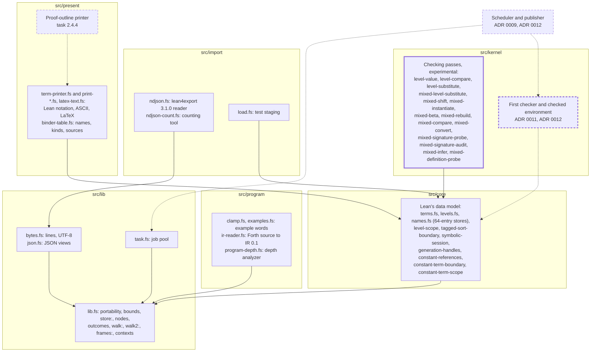
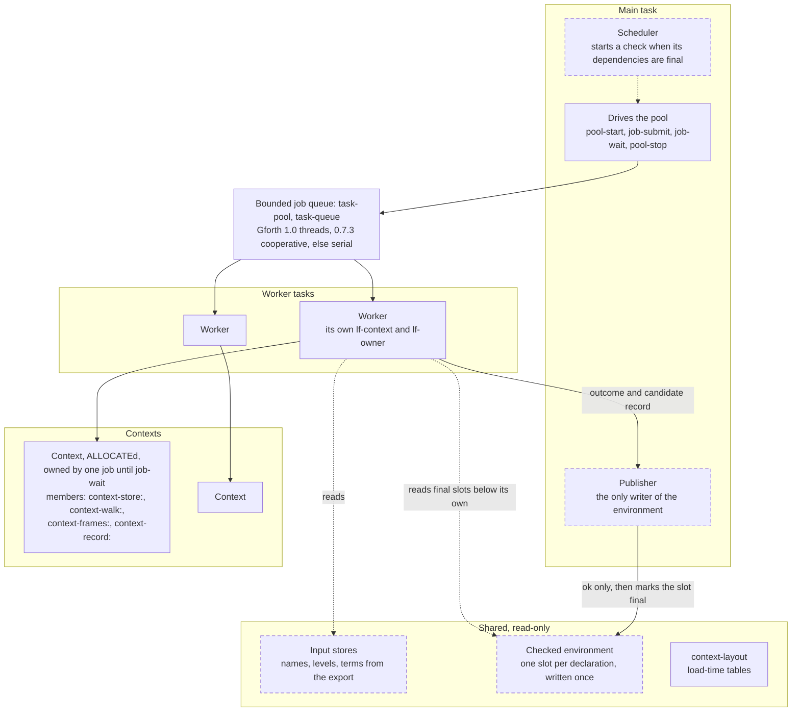
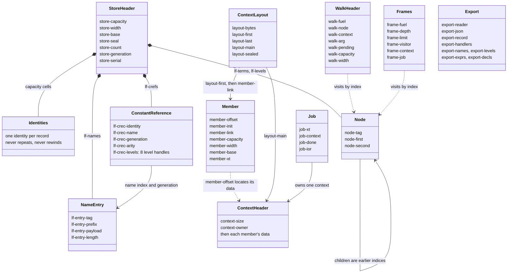
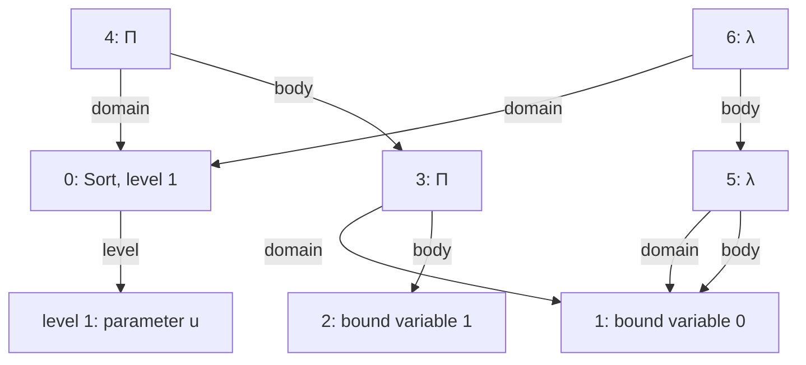

# Architecture and principal data structures

How the Forth code is organised, where the trust boundary will be, how
parallel checking is laid out, and what the main records look like. As of
2026-11-02 (commit `fc558cc`); every name below is a real file or word
unless a box is dashed, which marks a plan. Nothing is trusted yet: the
checker in `src/kernel/` becomes trusted only after the review gate in
`AGENTS.md`. The user-level view is in [workflows](../user/WORKFLOWS.md);
the folder rules are in the [source layout](../../src/README.md).

## Layers and trust

Each module `require`s exactly the modules whose words it uses, and
dependencies point one way: `lib` ← `core` ← `kernel`. `import`, `program`
and `present` use the library and the data model but nothing in `kernel`,
and the checker never loads `present`. `src/main.fs` requires the top
modules: the definition probe, the loader, the NDJSON reader, the three
program files, the IR reader and the term printer.

Arrows point from a module to what it uses. The thick border marks the
part that is to become the trusted checker; the data model and library
beneath it fall under the same review, because its verdicts depend on them.
Everything that reads input — `bytes.fs`, `json.fs`, `ndjson.fs`,
`ir-reader.fs` — is untrusted and fail-closed: it can refuse input, or at
worst hand over a different claim, but it cannot decide *accepted*. The
printer in `src/present/` is presentation only: a wrong name changes the
text, never a verdict.

| Folder | Files | State today |
| --- | ---: | --- |
| `src/lib/` | 12 | Records only: stores, walks and frames are passed by address; contexts and the job pool exist, but no module keeps its state in a context yet |
| `src/core/` | 10 | Each module's state is in named records listed on its "State:" header line, still one global copy per module |
| `src/kernel/` | 14 | Same; the passes return the shared outcomes; none returns *rejected* yet |
| `src/import/` | 3 | The reader keeps all state in the `export:` record passed to it |
| `src/program/` | 4 | Example words, depth analyzer, IR reader with one reader record |
| `src/present/` | 8 | Term printer with its print-job record and the presentation side table (64 term entries, 32 declarations) |

## Tasks, contexts and the shared environment

[ADR 0009](../adr/0009-reentrant-state-and-parallel-checking.md) (accepted)
puts all of one check's mutable state in a *context*, so several checks can
run as Forth tasks in one image;
[ADR 0012](../adr/0012-checked-environment.md) (design accepted) adds the
shared library of accepted declarations with a single publisher. The job
pool and contexts exist (`src/lib/task.fs`, `src/lib/context.fs`); moving
the modules' state into contexts, the scheduler, the publisher and the
environment do not.

Rules that already hold in code: a context is idle or owned by exactly one
job; a task may select only a context it owns; a job may not submit, wait
for, make or free contexts or jobs; `job-wait` gives 0 only when the word
returned with a balanced stack, and 0 never means a check was accepted;
nothing may `ALLOT` or compile while jobs run. Measured on the 12-thread
development machine, twelve workers ran twelve test jobs about 5.7–6.3
times faster than one task ([library inventory](FORTH_LIBRARY.md)). Each
context holds a full copy of every module's stores, so memory grows with
the number of workers ([scale assessment](../project/SCALE_ASSESSMENT.md)).

## Principal records

All state lives in records defined with `BEGIN-STRUCTURE` and named fields.
Record layouts are host-specific (cell size, alignment) and are never
written to files; identities and indices, not addresses, cross module
boundaries.

- **Stores** (`src/lib/store.fs`): a header, then one identity cell per
  record, then the records. `store-new` hands out the next index and a new
  identity; a reset (`store-clear`) advances the generation and invalidates
  every index; a spent serial or generation *poisons* the store so every
  check fails. A *handle* is an index with its identity, so a handle from
  before a reset or rollback no longer matches (`src/core/generation-handles.fs`).
- **Term and level nodes** (`src/lib/node.fs`): a tag and two fields.
  Terms (`src/core/terms.fs`): tag 1 concrete `Sort` (unused by the
  checker), 2 bound variable (de Bruijn index), 3 application (function,
  argument), 4 λ and 5 Π (domain, body), 6 symbolic `Sort` (level index,
  `src/core/tagged-sort-boundary.fs`) and 7 constant (reference index and
  identity, `src/core/constant-term-boundary.fs`). Levels
  (`src/core/levels.fs`): 0 zero (always record 0), 1 successor, 2 max,
  3 imax, 4 parameter (an opaque positive identifier).
- **Names** (`src/core/names.fs`): a prefix name and a string or number
  component; equal names are stored once, string bytes in a 2,048-byte pool.
- **Walk and frames records** (`src/lib/walk.fs`, `src/lib/frame.fs`): the
  fuel, the current node and a bounded work stack of one walk; or the fuel,
  depth limit and visitor of a bounded recursive pass. Running out of fuel
  gives *exhausted*, out of room *full*.
- **Contexts** (`src/lib/context.fs`): a header (size, owner) followed by
  the data of every declared member at its offset. The member records
  themselves live in the dictionary, linked from `context-layout`, which
  also points at the main context and is sealed by the first
  `context-new`.
- **Export record** (`src/import/ndjson.fs`): the line reader, the JSON
  view, the decoded record handed to handlers, the handler table and the
  counters of one reader.

One term as it is stored — the polymorphic identity of
[Concepts](../user/CONCEPTS.md#term), $\lambda (A : \mathrm{Sort}\ u)\ (x : A).\ x$
of type $\Pi (A : \mathrm{Sort}\ u),\ A \to A$. Indices are the term-store
indices that example prints; node 1 is shared.

## Data planned at Mathlib scale

The pinned Mathlib export has 105,894,257 expression nodes, 4,241,558 names
and up to 30 universe arguments per constant, against 64-entry stores and 8
level arguments today. The [scale assessment](../project/SCALE_ASSESSMENT.md)
lists the changes: heap-allocated and growable stores, hash-consing of
names, levels and terms, variable-length argument lists, explicit stacks
instead of host recursion in the rebuild passes, and per-declaration
scratch released after each check (plan tasks 6.2.0–6.2.3).
