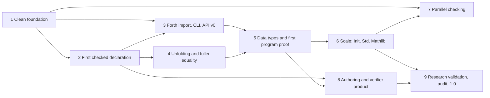

# LeanForth — next-level project plan (draft for owner review)

**Status: draft; the owner answered §8 on 2026-11-02** (recorded in
[owner decisions](OWNER_DECISIONS.md#planning-answers-2026-11-02-later-the-same-day));
the phases themselves are not yet approved. Prepared 2026-11-02 by a Claude Code planning
agent from the documents listed in Appendix B. It changes nothing in the
repository, approves no checker rule, and replaces no existing document until
the owner says so. Anything guessed is marked *speculative*. Numbers come from
the cited files or from read-only commands run today (Appendix B).

**Answered since drafting:** OQ-13 — the machine has an AMD Ryzen 5 7600X
(6 cores, 12 threads), 39 GiB RAM visible to WSL (about 25 GiB free) and only
13 GB of free disk at first; the owner then freed space (160 GB free) and
approved the Mathlib download (OQ-9).

**Owner to-dos added 2026-11-02 (not yet placed in phases):**
- *Binary quick import.* If importing Mathlib from NDJSON is slow, a
  serialized binary snapshot of the decoded records could load much faster.
  *Measured 2026-11-02:* the Forth reader decodes and checks all of Mathlib
  in 1 min 43 s (`gforth-fast`, 17 MB), against 6.5 min to produce the
  export and an estimated hours of checking, so it is **not worth building
  now**; revisit only if reading becomes a large share of a run.
  Worth it only if measured parsing dominates (the scale assessment estimates
  about a minute to parse all of Mathlib in Forth). A snapshot of *decoded,
  unchecked* records is a cache the checker still re-checks; reusing
  *checked* results is allowed in development and research mode only,
  labelled, and never in a final full-trust run (OQ-3 answer). Measured
  again 2026-11-11: loading Mathlib's first sixth takes 52 s against 95-145
  minutes of checking. The snapshot of *checked* results that is worth
  building is task 6.2.5.
- *Profiling alongside the tests.* `make profile-existing` and
  `make profile-history` exist (roadmap M1–M4) but are not run regularly or
  in CI. Add a report-only profiling job and keep a measurement history.

**How to read it in 20–30 minutes.** Read §1 (where we stand, 3 min), §3 (the
nine phases on one page, 5 min) and §8 (questions for you, 10 min). Skim the
task tables in §4 and the sample proof output in §7. §5 and §6 are reference
material for whoever does the work.

---

## 1. Where the project really stands

**Bottom line.** In 98 commits since 2026-10-30, LeanForth has built a careful
set of *experiments*, a strong test and CI setup, and a lot of design
documentation. It does **not yet have a proof checker**: LeanForth has never
accepted or rejected a single proof. Nothing in the code is trusted.

### What works today (all of it untrusted)

- **A Forth data model for Lean's building blocks.** Expressions (terms),
  universe levels and structured names are stored in fixed tables of 64
  entries each, with detection of stale references
  (`src/core/terms.fs`, `levels.fs`, `names.fs`). These are now being rebuilt
  on a small shared library in `src/lib/` (bounded stores, tagged nodes, an
  outcome vocabulary and walk records — the last two not yet committed).
- **Experimental checking steps** in `src/kernel/` (shift, substitution, beta
  reduction, cautious comparison, type inference, a definition probe). On the
  tiny pinned Lean examples they reach the right answer, but only by
  *assuming* that earlier declarations are correct, and when Lean says a proof
  is wrong they answer "unknown": there is no "rejected" answer yet
  (`docs/development/TEST_COVERAGE_REVIEW.md`, finding cov-T11).
- **Comparisons with Lean.** 29 paired comparison targets (774 rows) check the
  experiments against pinned Lean 4.35.0; about 40 Lean comparisons run in CI
  on every push. The latest CI run
  ([41520874066](https://github.com/pmilford/LeanForth/actions/runs/41520874066),
  commit `f09a243`) passed.
- **Reading Lean's export format** exists only as a strict *Python* development
  preview (`tests/support/ndjson_preview.py`). It handles 15 of the 24 record
  kinds; any real Lean file that mentions `Nat`, `Bool` or `Eq` contains a data
  type ("inductive") record it cannot handle, so its reach beyond toy examples
  is 0%. There is no Forth reader for Lean's format or for JSON.
- **Program track.** Six ordinary Forth words (clamp, checked add, abs,
  in-range, factorial, gcd, in `src/program/`) have extensive finite tests.
  Lean reference models prove properties *of models* of these words, and
  thousands of model-versus-Forth comparisons agree. Nothing connects the
  Forth source text to its model, and no program proof has been checked by
  LeanForth.
- **Engineering.** Pinned Gforth 1.0.0 and Lean 4.35.0, CI on two Gforth
  versions, Lean tests that fail on `sorry`, timeouts on every test, a
  documentation link check, Forth style metrics. The coverage review measured
  92.5% block coverage of the theorem-path Forth; of deliberately planted
  faults, 7 of 15 are caught in the theorem path and 43 of 46 in the program
  track.

### What is untrusted

Everything. All eight ADRs (0001–0008 in `docs/adr/`) are proposals. The only
human review (2026-10-30) approved continuing but left one technical question
about type comparison open (`docs/reviews/2026-10-30-human-review.md`). The
owner decisions of 2026-11-02 (`docs/project/OWNER_DECISIONS.md`) say *how* a
checker change will be approved — Lean as referee, Lean-comparison tests, an
independent AI review and owner approval of a plain summary — but no change
has been through that process yet.

### What is missing

**The front end (2026-11-12).** LeanForth today is only the checking half of Lean (the kernel): it re-checks proof terms that Lean produced and exported (NDJSON), including all of Lean's `Init`. It has none of Lean's front end, the larger half: no elaborator (implicit arguments, numerals, unification), no type classes or coercions, no tactics, no pattern matching or recursion compilation, no evaluation. So it cannot yet turn a written theorem into a proof; Lean does all of that before the export. LeanForth text checked by the kernel is on a branch, not merged; there is no program verifier. Phase 8 below covered the front end in only two rows (8.3.1, 8.3.2); it is being re-planned (owner, 2026-11-12).

In the order this plan addresses it: a checker with the three outcomes
(accepted, rejected, unsupported/unknown); a checked environment of
declarations; definition unfolding; data types (needed for `Nat`, `Eq` and
nearly all real Lean code); a Forth reader for Lean's export; capacity beyond
64 entries, hashing and sharing; saving checked results; readable proof
output; a command-line tool and a versioned JSON interface for AI tools;
parallel checking; user manuals and diagrams; any link from Forth program text
to a checked proof.

### Honest measures

| Measure | Value | Source |
| --- | --- | --- |
| Proofs accepted or rejected by LeanForth | 0 | PROJECT_PROGRESS.md |
| Lean import acceptance tasks done (roadmap T6) | 0 of 4 | PROJECT_PROGRESS.md |
| Full-Mathlib acceptance tasks done (roadmap T9) | 0 of 5 | PROJECT_PROGRESS.md |
| Mathlib declarations independently checked | 0; denominator unknown (Mathlib not yet pinned) | PROJECT_PROGRESS.md |
| Forth source, current path (lib, core, kernel, import, program, main) | about 2,950 lines | `scripts/code-inventory.py`, today |
| Forth source, superseded `legacy/` awaiting retirement | about 2,680 lines in 28 files | same |
| Forth tests and support / Lean reference files | 10,663 lines / 3,584 lines | same |

Important consequence for planning: **phases 2–4 below check only toy
inputs.** Real Lean library code — even `n + 0 = n` — needs data types, which
arrive in phase 5. The plan says so rather than hiding it.

---

## 2. How this plan is organised

- **Three levels.** A *phase* is a milestone with an outcome you can see. A
  *work package* (WP) groups related work inside a phase. A *task* is small
  enough to review on its own. IDs read phase.WP.task: `2.3.1` is phase 2,
  work package 3, task 1. Workstreams `W1`–`W7` run through all phases.
- **Both tracks, every phase.** Each phase has theorem-track (T) and
  program-track (P) work; the program track shares the checker from phase 2 on.
- **Rolling detail.** Phases 1–3 are detailed enough to work from; phases 4–5
  are detailed at work-package level with first tasks; phases 6–9 are at
  work-package level. Re-plan at the end of each phase, as AGENTS.md's
  "follow the critical path" rule intends.
- **Sizes.** **S** — one focused commit, reviewable in one sitting (roughly up
  to 300 changed lines with tests). **M** — a work batch of two to four
  related commits with one review. **L** — several batches and at least one
  gate; split into S/M tasks before starting. No dates: the roadmap
  deliberately avoids them, and so does this plan.
- **Gates** (AGENTS.md "Review gates", decided by the owner's process of
  2026-11-02):
  - **[kernel]** a checker rule or checker code change: (1) follows Lean's
    published kernel behaviour; (2) pinned-Lean differential tests agree and
    reach accepted, rejected and unsupported/unknown, including deliberately
    wrong and mutated proofs, and no failure is ever reported or stored as
    accepted; (3) an independent AI review of the exact change has no
    unresolved findings; (4) the owner approves a plain-language summary.
  - **[import]** what the importer hands to the checker; **[format]** proof
    certificates, receipts, saved results; **[axiom]** any change to the axiom
    allowlist (owner approves exact statements); **[bypass]** anything that
    could produce an "accepted" status other than through the checker;
    **[runtime]** compiler, FFI, host or thread assumptions; **[parser]**
    mathematical parser or notation semantics. Each uses the same four-part
    process.
  - **[owner]** policy, deletion, new dependency or network use;
    **[forth-review]** the independent Forth reviewer
    (`.claude/agents/forth-reviewer.md`) for meaningful Forth changes — not a
    human gate.
- **Existing IDs are kept.** Roadmap items T1–T10, P1–P10, Q1–Q10, C1–C4,
  D1–D3, M1–M4, R1–R3 and the coverage-review findings (X, N, cov-T, cov-P)
  stay valid; Appendix A maps them to tasks. Status words remain not started,
  in progress and done.
- **Outcomes** follow `src/lib/outcome.fs` (ADR 0008): ok, invalid, exhausted,
  unknown, rejected, unsupported. For you, the three that matter are
  *accepted*, *rejected* and *unsupported/unknown*; invalid input and
  exhaustion are reported separately and never count as accepted.

---

## 3. The plan on one page

| Phase | What you will be able to see | Theorem track | Program track | Needs | Main gates |
| --- | --- | --- | --- | --- | --- |
| **1 Clean foundation** (in progress) | Same behaviour, smaller clearer code; `src/legacy/` gone; one command each for coverage and planted-fault reports | refactor core and kernel onto `src/lib/`; retire legacy | example words and depth analyzer onto the library; better comparison tables | — | [forth-review], [owner] for deletion |
| **2 First checked declaration** | The five pinned Lean examples print *accepted; axioms: none*; every deliberately broken copy prints *rejected* or *unsupported*, never accepted; a readable proof of `composition` | rejection rules, checked environment, declaration checker, readable proofs v0 | clamp receipt: real Forth source → program IR → proof obligations (checked by Lean, labelled not-yet-LeanForth) → runtime tests | 1 | [kernel] ×3, [format], [owner] |
| **3 Lean input in Forth, CLI and API v0** — release 0.1 | `leanforth check file.ndjson` with no Python; `leanforth print`; `leanforth serve` speaking versioned JSON-RPC with schemas and golden examples | Forth JSON and Lean-export reader; capacity stage S1 | `leanforth program` prints program receipts | 1 (reader), 2 (end to end) | [import], [format], [bypass] |
| **4 Definitions that compute** | Declarations that need earlier definitions unfolded are accepted; "unknown" answers fall measurably; proofs say "by definition of f" | unfolding, universe-level equality, eta, proof irrelevance, let, caches | loops with invariants and bounded memory in the IR; obligations still Lean-checked | 2 | [kernel] per feature |
| **5 Data types; first real Lean code** — release 0.2 | `n + 0 = n` and `0 + n = n` (by induction), with every declaration they depend on, checked from real Lean output and printed readably | inductive types, recursors, structures, literals, quotients, axiom allowlist v1 | **first program fact checked by LeanForth itself** (clamp contract) | 3, 4 | [kernel] per feature, [axiom], [owner] |
| **6 Scale toward all of Mathlib** | Per stage — all of `Init`, then Std, a Mathlib slice, all of Mathlib — counts of accepted, rejected, unsupported and limit, zero false acceptances, measured time and memory | data structures from the scale report, corpus pinning, profiling, gap ledger | larger verified programs as features allow | 5 | [kernel] for checker data structures |
| **7 Parallel checking (12 cores)** | `--jobs 12` gives exactly the `--jobs 1` verdicts, faster | per-task contexts, process sharding, optional Gforth threads | same machinery | 1 (design), 6 | [kernel], [bypass], [runtime] |
| **8 Writing proofs and verified programs in LeanForth** | A user writes a theorem or a Forth word with its contract in LeanForth's Forth syntax and checks or verifies it | Forth syntax, term builder; the untrusted front end FE1–FE12 (elaboration, classes, tactics, data types, matching, recursion, `simp`, evaluation; [design](../design/FRONT_END.md)) | `leanforth verify`, RUN with assertions, translation validation | 2, 3, 5 | [parser], [bypass], [runtime] |
| **9 Research validation, audit, 1.0** | Published Lean results reproduced; an outside expert audit; release 1.0 | R1–R3, upgrade procedure, second Forth host | larger programs, tensor contracts | 6, 8 | [owner] |



**Lanes that can run at the same time** (useful when several agents work;
AGENTS.md's concurrent-commit rule still applies): (a) the checker critical
path 2 → 4 → 5; (b) library, reader, CLI and API (phase 3, startable after
phase 1); (c) the program track; (d) documentation and diagrams (W1, W2);
(e) test tooling (W4); (f) scale preparation (W7, phase 6.2) once the scale
report arrives.

**If you approve, the next ten tasks are:** finish 1.2.1–1.2.2 and commit
1.1.1–1.1.2 (in progress now); 1.1.3 store marks; 1.4.1 `make coverage`;
1.1.6 exceptions ADR; 1.3.1 legacy migration map; 2.1.1 rejection rules ADR;
2.1.4 Lean differential matrix; 3.1.1 shared byte reader; 2.5.1 receipt schema.

---

## 4. Phases in detail

Columns: **Acceptance** is what must be true to call the task done;
**Needs** lists task dependencies; **Gates** uses the words of §2.

### Phase 1 — Clean foundation (in progress)

**Outcome.** Behaviour unchanged, code smaller and clearer, and the test
tools needed for the checker exist. `make check` passes on a tree without
`src/legacy/`. **Roadmap:** Q9, Q10, X4, X5, X8, X9, cov-T7, cov-T8, cov-T10,
cov-T12, cov-T13, cov-P8, cov-P9, C2 (design).

**Exit criteria.** (1) No module in `core/`, `kernel/` or `program/` defines
its own status codes, and the 34 status-translation words are gone.
(2) Every remaining global is documented long-lived module state; no
`VARIABLE` is used to pass values between words (FORTH_STYLE.md §3).
(3) No word over ten lines without a justification comment. Baseline for
`core/` plus `kernel/`: 218 words, 23% over ten lines, 225 globals
(DEVELOPMENT_ROADMAP.md, Q10). (4) `src/legacy/` deleted with owner approval
after migration evidence. (5) `make coverage` and `make mutants` work.

**WP 1.1 Library (`src/lib/`)**

| ID | Task | Acceptance | Needs | Gates | Size |
| --- | --- | --- | --- | --- | --- |
| 1.1.1 | Outcome vocabulary `lib/outcome.fs` (ADR 0008 steps 1–2); *drafted, uncommitted* | Unit tests for every value, `outcome-sane`, flag-versus-status rule; ADR 0008 marked accepted for code structure only | — | [forth-review] | S |
| 1.1.2 | Walk records `lib/walk.fs`: bounded work stack and fuel per record; *drafted, uncommitted* | Tests: two interleaved walks, exhaustion by fuel and by stack, bad tags invalid | 1.1.1 | [forth-review] | S |
| 1.1.3 | Store marks: `store-mark` and `store-rollback` replace the hand-written saving of counts in about 33 modules | Rollback after partial failure tested; a mark from before a reset is refused | — | [forth-review] | S |
| 1.1.4 | Tag dispatch tables: a defining word for execution-token tables indexed by a validated tag | Out-of-range tag gives invalid; one walker converted as example | 1.1.1 | [forth-review] | S |
| 1.1.5 | Heap stores: `store:` variant using `ALLOCATE`/`FREE`, same checks | Same test suite as `store:` passes; allocation failure gives exhausted; prerequisite for 3.3 and 7.2 | 1.1.3 | [forth-review] | M |
| 1.1.6 | ADR 0009 (proposed number): exceptions — when to use `CATCH`/`THROW` (§6.10) | Decision recorded with rejected alternatives; one module piloted | 1.1.1 | [forth-review] | S |
| 1.1.7 | ADR 0010: wordlists and module boundaries (§6.9); apply to `lib/` first | `lib/` words in their own wordlist; `make smoke` still silent | — | [forth-review] | M |
| 1.1.8 | Reusable libraries (owner, 2026-11-03): each general-purpose library in `src/lib/` (bignum, JSON reader and writer, bytes, u32, stores, SHA-256, the compact store) requires only what it uses, keeps helpers private (1.1.7), has a short README with an example, and a test that loads it from outside the project; optional signed-integer layer over bignum; LeanForth-specific choices (such as `bytes.fs`'s strict framing) become options | Each library runs its example from an unrelated folder on both Gforths; reusability table in FORTH_LIBRARY.md updated | 1.1.7 | [forth-review] | M |

**WP 1.2 Refactor `core/` and `kernel/` bottom-up (Q10).** Every task keeps
behaviour identical (old and new tests pass, Lean comparisons unchanged),
gets a Forth review and records `make forth-metrics` before and after.

| ID | Task | Acceptance | Needs | Gates | Size |
| --- | --- | --- | --- | --- | --- |
| 1.2.1 | Data-model modules: level scope, Sort boundary, symbolic session, generation handles (*in progress in the working tree*) | Exit criteria (1)–(3) hold for these files | 1.1.1–1.1.3 | [forth-review] | M |
| 1.2.2 | Constant references and constant-term boundary and scope onto `store:` and walk records | as above | 1.2.1 | [forth-review] | M |
| 1.2.3 | Universe passes: level substitute, value, compare, mixed level substitute | as above | 1.2.1 | [forth-review] | M |
| 1.2.4 | Signature probe and audit | as above | 1.2.2, 1.2.3 | [forth-review] | M |
| 1.2.5 | Term passes: mixed shift, instantiate, beta | as above | 1.2.2 | [forth-review] | M |
| 1.2.6 | Mixed compare and convert | as above | 1.2.5 | [forth-review] | M |
| 1.2.7 | Mixed infer (longest word, 59 lines) and the definition probe; delete the last translation words | as above; translation words = 0 | 1.2.4, 1.2.6 | [forth-review] | M (two batches) |
| 1.2.8 | `import/load.fs` and `program/` (examples, depth analyzer) onto the library; scratch variables become a walk record | as above; program tests unchanged | 1.1.2 | [forth-review] | S |
| 1.2.9 | Module headers state purpose, trust, dependencies, state, re-entrancy; refresh FORTH_LIBRARY.md and `src/README.md` | Reviewer checklist passes for every file | 1.2.1–1.2.8 | — | S |

**WP 1.3 Retire legacy (Q9)**

| ID | Task | Acceptance | Needs | Gates | Size |
| --- | --- | --- | --- | --- | --- |
| 1.3.1 | Map each of the 14 legacy-dependent Lean comparisons and each legacy unit test to a current-path replacement | Table in DECISIONS.md; nothing unmapped | — | — | S |
| 1.3.2 | Migrate shift, instantiate and beta comparisons (plain and tagged) | Same or more rows; per-row verdicts pinned | 1.3.1, 1.2.5 | — | M |
| 1.3.3 | Migrate compare, convert, universe, binder and application comparisons; pin per-row verdicts (cov-T10) | as above | 1.2.6 | — | M |
| 1.3.4 | Migrate inference, declaration, signature and constant-probe comparisons, including the user of `symbolic-infer-oracle.lean` | as above | 1.2.7 | — | M |
| 1.3.5 | Evidence: coverage and planted-fault results on the current path at least as strong as on legacy | Report committed | 1.4.1, 1.4.2 | — | S |
| 1.3.6 | Delete exactly the listed legacy paths, their tests and Make targets; update docs | Owner approved the path list; `make check` passes | 1.3.5 | [owner] | S |

**WP 1.4 Test tooling** (see also W4)

| ID | Task | Acceptance | Needs | Gates | Size |
| --- | --- | --- | --- | --- | --- |
| 1.4.1 | `make coverage` (X5): package the review's Gforth `coverage.fs` wrapper | Per-folder block coverage printed; documented in TESTING_STRATEGY.md | — | — | S |
| 1.4.2 | `make mutants` (X4): checked-in list of planted faults and known-equivalent ones, run in a temporary copy | Caught/survived report; never edits the working tree | — | — | M |
| 1.4.3 | Harness self-tests (X8): each Lean comparison script must fail on a known-wrong table | One negative check per script in `make test` | — | — | M |
| 1.4.4 | Tester checks the return stack (cov-T12); reviewer checklist and a metrics heuristic flag statuses used as flags (X9) | New checks fail on planted examples | 1.1.1 | — | S |
| 1.4.5 | Deferred theorem-path tests: arena exhaustion inside mixed passes (cov-T7), corrupted counts and generation saturation (cov-T8), mixed-infer gaps (cov-T13) | Planted-fault catch rate rises; recorded | 1.2.7 | — | M |
| 1.4.6 | Allocation-failure injection: a test-only hook makes the k-th allocation fail, for every k | Every run ends exhausted or invalid with all stores rolled back | 1.1.3 | — | M |
| 1.4.7 | Determinism: run each Forth suite twice and compare output bytes | Part of `make test` | — | — | S |

**WP 1.5 Program track (P)**

| ID | Task | Acceptance | Needs | Gates | Size |
| --- | --- | --- | --- | --- | --- |
| 1.5.1 | Comparison tables print flags, depth and return-stack markers (cov-P8) | Comparisons detect a planted flag or depth fault | — | — | S |
| 1.5.2 | Depth analyzer: a read-count seam; running out of fuel distinguishable from invalid input (cov-P9) | Remaining surviving planted fault caught | 1.2.8 | — | S |
| 1.5.3 | Formal contracts for the five other example words in the style of `ClampContract`, each with a refuted wrong variant (P2.3) | Lean proves each contract and refutes each wrong variant | — | — | M |

### Phase 2 — First checked declaration

**Outcome.** For the five pinned fixtures (`composition`, `identity`,
`type-identity`, `poly-identity`, `constant-fixture` in `tests/reference/`)
LeanForth prints *accepted; axioms: none*. For every deliberately broken copy it prints *rejected* or,
where the expected-results table says so, *unsupported* — never accepted. A
readable proof of `composition` is printed (§7). Program track: a clamp
receipt connects the actual Forth source to proof obligations and runtime
evidence. **Roadmap:** Q5, Q6, Q7, T4.1–T4.2, T5.1–T5.4, T8.1 (part), P1,
P6.1, P7.2, T10.4 (start).

**Scope** (owner decision 2): sorts with concrete and symbolic levels, bound
variables, application, λ, Π and references to *earlier checked*
declarations; safe non-recursive definitions and theorems; no unfolding
(owner decision 3: cautious first); no axioms (owner decision 4). Everything
else is unsupported. **Input path:** the existing test-only transport
(Python preview → byte stream → Forth). It is untrusted decoding; it cannot
make a wrong proof right, only hand over a different claim, which the printed
statement lets a human see. Phase 3 replaces it.

**Exit criteria.** The [kernel] gate passed for the checker; every check
reaches every outcome in tests; replay gives identical verdicts; owner
approval recorded in `docs/reviews/`; PROJECT_PROGRESS.md updated.

**WP 2.1 Rules and evidence, before code**

| ID | Task | Acceptance | Needs | Gates | Size |
| --- | --- | --- | --- | --- | --- |
| 2.1.1 | ADR 0011: *definite rejection* — which failures Lean's rules make definite in this fragment (Sorts at different concrete levels, applying a term whose type reduces to a Sort, a declared type that is not a type, a theorem whose type is not a proposition, wrong number of universe arguments, unknown, forward, self or duplicate names) and which must stay unknown (anything eta, proof irrelevance or unfolding might equate) | Each rule cites Lean 4.35.0 source; plain-language summary drafted | 1.1.1 | [kernel] | M |
| 2.1.2 | Settle the question left open on 2026-10-30: comparing under binders whose domains differ (ADR 0003) | Plain-language answer, Lean evidence, tests | — | [kernel] | M |
| 2.1.3 | ADR 0012: checked-environment implementation of ADR 0006 — append-only store, snapshot identity, staging then publish, handles bound to a snapshot, transitive axiom set | Answers questions 2, 5, 6 of CHECKED_ENVIRONMENT_REVIEW.md | 1.1.3 | [kernel], [import] | M |
| 2.1.4 | Lean differential matrix (completes Q5): every fixture plus mutants (wrong argument, wrong universe, swapped binder, non-proposition theorem, missing, forward or self constant, wrong universe arity, malformed, oversized); Lean's verdict **and its error reason** (N10); expected LeanForth outcome | Table and Lean oracle file; every LeanForth outcome appears at least once per check | — | — | M |
| 2.1.5 | ADR 0011 amendment (owner, 2026-11-03: "identical to Lean"): Lean's `infer_pi` rejects a Π whose body is not a type (`ensure_sort` on the body); LeanForth answers *unknown* there today | Rule cites Lean 4.35.0 source; Lean-checked rows added to the table; gate passed | 2.2.1 | [kernel] | S |

**WP 2.2 Checker implementation**

| ID | Task | Acceptance | Needs | Gates | Size |
| --- | --- | --- | --- | --- | --- |
| 2.2.1 | Return *rejected* from comparison and inference where ADR 0011 allows (ADR 0008 step 3) | Every rejection row of 2.1.4 agrees with Lean; no unknown row turns into rejected without a rule | 2.1.1, 1.2.7 | [kernel] | M |
| 2.2.2 | Checked environment v0 per ADR 0012 | Publish only after full success; stale and cross-snapshot handles fail; failure leaves the snapshot unchanged | 2.1.3 | [kernel] | M |
| 2.2.3 | `check-declaration` for definitions and theorems: closed terms, universe scope, type is a Sort, value's type converts to it, theorem type is a proposition | Accepted handle only on full success; unsupported features give unsupported | 2.2.1, 2.2.2 | [kernel], [bypass] | M |
| 2.2.4 | Failure-path suite: every check reaches accepted, rejected, unsupported, invalid and exhausted; nothing failing is stored or reported as accepted (owner decision 2 addition) | Suite in `make test`; allocation-failure injection (1.4.6) applied | 2.2.3 | — | M |
| 2.2.5 | Evidence and replay: run record (input SHA-256, tool versions, verdicts) and a replay test | Replay gives byte-identical verdicts | 2.2.3 | [format] | S |

**WP 2.3 Gate and approval**

| ID | Task | Acceptance | Needs | Gates | Size |
| --- | --- | --- | --- | --- | --- |
| 2.3.1 | Independent AI review of the exact diff by a fresh agent given the code, not our conclusions | No unresolved findings; review file in `docs/reviews/` | 2.2.4 | — | S |
| 2.3.2 | Plain-language summary for the owner: what it does, evidence, risks, recommendation | Owner approval recorded with date and commit | 2.3.1 | [owner] | S |
| 2.3.3 | Label every accepted result *experimental — not independently audited* (withdrawn by the owner, 2026-11-12); update PROJECT_PROGRESS.md (T5, Q5–Q7) | Label tested in output | 2.3.2 | — | S |

**WP 2.4 Readable proofs v0** (untrusted printer; parallel lane; design in §7)

| ID | Task | Acceptance | Needs | Gates | Size |
| --- | --- | --- | --- | --- | --- |
| 2.4.1 | ADR 0013: derivation log — optional records emitted by the checker (rule, inputs, result, context depth, step id) | Verdicts identical with the log on, off and full (tested) | 2.2.3 | [kernel] (no-behaviour-change review) | M |
| 2.4.2 | Presentation side table: binder names, binder kinds, source record ids — never read by the checker's comparisons | Byte transport keeps binder names (today it drops them, NDJSON_PREVIEW.md) | — | [import] | M |
| 2.4.3 | Term printer: names restored from de Bruijn indices without capture; ∀, →, Prop, Type | Golden tests including shadowed names | 2.4.2 | — | M |
| 2.4.4 | Proof-outline printer for λ/application proofs; text, Markdown and JSON (step schema of INTERFACE_CONTRACTS.md); rationale from fixed templates tagged `structured-template` | Golden output for `composition`, `fixtureUse`, identity | 2.4.1, 2.4.3 | — | M |

**WP 2.5 Program track (P)**

| ID | Task | Acceptance | Needs | Gates | Size |
| --- | --- | --- | --- | --- | --- |
| 2.5.1 | Receipt schema v0 (P1.1–P1.2): CHECK, VERIFY and RUN statuses kept separate; assumptions list; JSON Schema | Schema plus valid and invalid examples | — | [format] | M |
| 2.5.2 | Program IR v0 (P6.1): straight-line words plus `IF`/`ELSE`/`THEN`/`EXIT`, signed cells, failure, source locations; versioned | Specification and Lean model of the IR | 1.5.3 | — | M |
| 2.5.3 | Reader from restricted Forth colon definitions (the six example words) to IR; anything else unsupported | All six words translate; unsupported words refused with a diagnostic | 2.5.2 | [parser], [runtime] | M |
| 2.5.4 | IR interpreter versus host word versus Lean model on the existing tables | Closes the "nothing ties `lf-clamp` to `clampCode`" gap (cov-P10) for the IR route | 2.5.3 | — | M |
| 2.5.5 | Verification-condition generator v0 (untrusted, P7.2): IR plus contract → obligations as Lean statements; Lean proves them | Receipt says *checked by Lean reference, not by LeanForth*; a wrong contract is refuted | 2.5.4 | [bypass] | M |
| 2.5.6 | Clamp receipt v0 and its printed form (§7) | Golden output | 2.5.1, 2.5.5 | — | S |

### Phase 3 — Lean input in Forth, a command-line tool and API v0 (release 0.1)

**Outcome.** `leanforth check FILE.ndjson` runs on Forth alone and prints a
verdict per declaration; `leanforth print` shows a readable proof;
`leanforth program` prints program receipts; `leanforth serve` speaks
versioned JSON-RPC over standard input and output (no network listener) with
JSON Schemas and at least ten golden examples, as AGENTS.md and
INTERFACE_CONTRACTS.md require. **Roadmap:** T6.1–T6.2, T10.2, N7 (schema),
N13, X6, P8.1 (start), M1, D3 (start).

**WP 3.1 Reading bytes and JSON** (library; can start right after phase 1)

| ID | Task | Acceptance | Needs | Gates | Size |
| --- | --- | --- | --- | --- | --- |
| 3.1.1 | `lib/bytes.fs`: one bounded line reader with strict framing (valid UTF-8, no byte-order mark, no CR, final line feed); replaces the eleven test stream readers' framing (N13) | Same framing failures as the Python preview | 1.1.1 | [forth-review] | M |
| 3.1.2 | `lib/json.fs`: streaming tokenizer and bounded record view, no recursion, explicit depth, string and digit limits; integers kept as digit strings | Unit tests for every token and limit at and one past its bound | 3.1.1 | [forth-review] | M |
| 3.1.3 | `lib/json-write.fs`: deterministic writer (fixed key order, escaping) | Round trip with 3.1.2 | 3.1.2 | — | S |
| 3.1.4 | Fuzz harness (X6): seeded mutations of every fixture; Forth reader and Python preview must agree on outcome class and line | Thousands of seeded cases in `make check`; seed recorded | 3.2.1 | — | M |

**WP 3.2 Lean export decoder (`src/import/`)**

| ID | Task | Acceptance | Needs | Gates | Size |
| --- | --- | --- | --- | --- | --- |
| 3.2.1 | Names, levels and the supported expression kinds → candidate stores, with export-index to store-index tables; malformed, unsupported and limit classified exactly as NDJSON_PREVIEW.md | All preview contract tests pass against the Forth decoder | 3.1.2, 2.4.2 | [import] | M |
| 3.2.2 | Declaration records → checker in stream order; each declaration transactional | Fixtures accepted end to end; mutants as in 2.1.4 | 3.2.1, 2.2.3 | [import], [bypass] | M |
| 3.2.3 | Shape-check the nine kinds not yet handled (let, projection, literals, metadata, axiom, opaque, quotient, inductive) and report unsupported | Same classification as the preview on the 142 real records it was validated on | 3.2.1 | [import] | M |
| 3.2.4 | Round trip: re-emit each decoded record and compare bytes with the input (catches a decoder that silently reads a different term) | Identity on all fixtures and accepted fuzz cases | 3.1.3, 3.2.1 | — | S |
| 3.2.5 | Move fixture tests from the byte transport to the Forth reader; the Python preview stays as a test oracle only | No Python on the `leanforth check` path | 3.2.2 | — | M |
| 3.2.6 | Checksum manifest (owner, 2026-11-03): the export script writes the file's SHA-256, line and record counts, Lean version and Mathlib commit beside each export; import computes SHA-256 in Forth during its single read and checks the manifest by default (*invalid* if missing or wrong, unless skipped on request) | A file cut off between two lines, a changed byte and a missing manifest are each refused; SHA-256 agrees with `sha256sum` | 3.2.1 | [import] | M |
| 3.2.7 | Upgrade test (owner, 2026-11-03): for each new Lean or Mathlib release, export it and compare the Forth reader with the independent Python reader record by record; report every new record kind or field | Rehearsed on one newer export; differences listed, none hidden | 3.2.4 | — | M |

**WP 3.3 Capacity stage S1**

| ID | Task | Acceptance | Needs | Gates | Size |
| --- | --- | --- | --- | --- | --- |
| 3.3.1 | Configurable store capacities (heap stores, 1.1.5), set by a command-line option; exhaustion reported as a limit | Same verdicts at small and large capacities on all fixtures | 1.1.5 | [kernel] (no-behaviour-change) | M |
| 3.3.2 | Measured-limits table (roadmap D3): largest inputs handled, time and memory (W3) | Table in a limits document with reproduction commands | 3.3.1 | — | S |

**WP 3.4 Command-line tool**

| ID | Task | Acceptance | Needs | Gates | Size |
| --- | --- | --- | --- | --- | --- |
| 3.4.1 | **Status (2026-11-04 late): in progress** — `check` and `print` work on whole libraries; `program`, `version`, `capabilities` not started. `bin/leanforth` wrapper (finds pinned Gforth) and an entry point in `src/main.fs`: `check`, `print`, `program`, `version`, `capabilities` | Works from any directory; prints nothing unexpected | 3.2.2 | [bypass] | M |
| 3.4.2 | Exit codes: 0 all accepted, 1 something rejected, 2 unsupported or unknown, 3 resource limit, 4 malformed input, 5 internal fault; align the Python preview's codes (today malformed is 1) | Tests reach every code | 3.4.1 | — | S |
| 3.4.3 | **Status (2026-11-04 late): in progress** — `--json` works (`check-report-0.1`), awaits its [format] gate. Output formats: text by default, `--json` receipts (2.5.1 schema extended to theorems) | Deterministic bytes across runs | 3.1.3 | [format] | S |

**WP 3.5 JSON API v0 for AI tools**

| ID | Task | Acceptance | Needs | Gates | Size |
| --- | --- | --- | --- | --- | --- |
| 3.5.1 | Envelope and versioning: JSON-RPC 2.0, `schemaVersion`, request id, error object; `checked`, `under-assumptions`, `runtime-tested`, `unverified` as separate fields | Design in INTERFACE_CONTRACTS.md marked implemented-part versus plan | 2.5.1 | [format] | M |
| 3.5.2 | Methods `system.capabilities`, `proof.check`, `proof.pretty`, `program.receipt` | Malformed and oversized requests fail closed with a structured error; nothing but the checker sets `checked` | 3.5.1, 3.4.1 | [bypass] | M |
| 3.5.3 | `schemas/*.json` and at least ten golden request/response pairs in `examples/api/`, run in `make test` | Golden pairs byte-identical | 3.5.2 | — | M |
| 3.5.4 | Error-code catalogue (a new page in `docs/programming/`) and an LLM guide v0 | Every code emitted by the code appears in the catalogue (tested) | 3.5.2 | — | S |

**WP 3.6 Documentation for release 0.1** (W1): user manual "check a Lean
file with LeanForth" built around `composition` in three forms; CLI and API
references; installation refreshed. Size M.

### Phase 4 — Definitions that compute (unfolding and fuller equality)

**Outcome.** Declarations whose checking needs earlier definitions unfolded
are accepted; on the test corpus the share of "unknown" answers falls and is
reported; printed proofs say "by definition of f". This is owner decision 3's
"unfolding next". **Roadmap:** T4.3, T8.1–T8.2, N11.

| ID | Task | Acceptance | Needs | Gates | Size |
| --- | --- | --- | --- | --- | --- |
| 4.1.1 | ADR 0014: Lean's definitional-equality procedure for the supported forms — unfolding with reducibility hints and Lean's lazy strategy; theorems, axioms and opaque declarations never unfold | Cites Lean 4.35.0 source; plain-language summary | phase 2 | [kernel] | M |
| 4.1.2 | Universe-level equality by Lean's level normalisation (replaces sampled concrete checks; ADR 0004, 0007) | Differential cases with parameters, `max`, `imax` | phase 2 | [kernel] | M |
| 4.1.3 | Rules for eta, proof irrelevance, `let` and metadata nodes | One ADR section each | 4.1.1 | [kernel] | M |
| 4.2.1 | Implement level equality | Gate passed | 4.1.2 | [kernel] | M |
| 4.2.2 | **Status (2026-11-04 late): in progress** — steps b-c (whnf, delta, quick equality check) merged, gate review running; d-e not started. Implement unfolding (delta) | Gate passed; unfolding steps logged for the printer | 4.1.1 | [kernel] | M |
| 4.2.3 | **Status (2026-11-05): works end to end (was "implemented"; done check: [audit](../development/done-checks/2026-11-12-audit.md)), approved by the owner on 2026-11-11 (OWNER_DECISIONS.md, "Lean rules [kernel]"), merged and used by `leanforth check` (let-b 14/14, let-zd 10/10).** `let` expressions in the importer and checker (zeta) | Gate passed | 4.1.3, 3.2.3 | [kernel], [import] | M |
| 4.2.4 | **Status (2026-11-05): works end to end (was "implemented"; done check: [audit](../development/done-checks/2026-11-12-audit.md)), approved by the owner on 2026-11-11 (OWNER_DECISIONS.md, "Lean rules [kernel]"), merged and used by `leanforth check`.** Function eta | Gate passed | 4.1.3 | [kernel] | S |
| 4.2.5 | **Status (2026-11-05): works end to end (was "implemented"; done check: [audit](../development/done-checks/2026-11-12-audit.md))** (branch `pe-proof-irrel-eta`; follow-up `le-loose-ends`: an unknown constant looked up inside a comparison ends the check with Lean's `unknownConstant`), [kernel] approved by the owner on 2026-11-11 (OWNER_DECISIONS.md, "Lean rules [kernel]"), merged and used by `leanforth check` (irrelevance 1/1). Proof irrelevance | Gate passed | 4.1.3 | [kernel] | M |
| 4.2.6 | **Status (2026-11-05): works end to end (was "implemented"; done check: [audit](../development/done-checks/2026-11-12-audit.md))** (branch `ax-axioms-quot`, agent AX), [kernel] approved by the owner on 2026-11-11 (OWNER_DECISIONS.md, "Lean rules [kernel]"), merged and used by `leanforth check`. Opaque declarations (never unfold) | Gate passed | 4.2.2 | [kernel], [import] | S |
| 4.2.7 | **Status (2026-11-05): integrated (was "in progress"; PROJECT_PROGRESS.md lists it merged and owner-approved 2026-11-11)** — Lean's caches in `kernel/caches.fs` (ADR 0014 Amendment 1), branch ca-caches, [kernel] review owed; with the derivation log on they are off (4.2.7b: log a hit). Caches v1 (weak-head normal form, inference, equality) keyed per ADR 0006; never cache unknown or exhausted as success | Verdicts identical with caches on and off on every corpus | 4.2.2 | [kernel] | M |
| 4.2.7c | **Status (2026-11-10): not started.** The caches' resource gap (review rvCACHE L3, ADR 0014 Amendment 1): keeping scratch for the caches, plus one extra frame per cached visit, can turn a check Lean decides into *full*; on *full* with kept scratch, discard it and retry the check uncached | A check that is *full* only because of kept scratch decides on retry; verdicts otherwise unchanged; fuel accounting documented | 4.2.7 | [kernel] | S |
| 4.2.7d | **Status (2026-11-12): works end to end (was "done"; done check: [audit](../development/done-checks/2026-11-12-audit.md); done check owed for a "done" row)** (merged c19a2f5, agent CK; review rvCK not blocking, its finding fixed in 700c4a1; owner approved 2026-11-12; ADR 0014 Amendment 10, verdict version 9): aside, no lambda domain is typed; typeExpected, funExpected and invalidProj reject as Lean's infer-only typing throws them; and is_def_eq types a Pi with its typer (steps 4, 11, 14), as Lean's `infer_pi` may throw on an ill-typed Pi -- before, `tests/cli/shared-depths.lean` P5's `pibad`, which Lean rejects, was accepted. P5 (10 rows and `p5all`) agrees with pinned Lean and the official checker; 6 new planted faults caught; Init: 59,349 accepted, every record main's but fuel (+0.03%). Was **not started** (owner approved, task K1 of review rvKN finding 3). Where Lean's infer-only typing throws on an ill-typed term met during reduction (`ensure_pi`/`ensure_sort`), LeanForth's aside typing gives *unknown* instead of *rejected* (`mixed-infer.fs` 470-472). First make the aside typing of lambdas and lets follow Lean's infer-only mode (`infer_lambda` 131-133 and `infer_let` 215 do not type binder domains, let types or values), then reject as Lean does; a pinned-Lean case with an ill-typed term reached by reduction; fuel moves, so a verdict-version bump. |
| 4.3.1 | Differential cases N11: eta, proof irrelevance, unfolding, universe arity, undeclared universe parameters, with Lean's error reasons | In `make check` | 4.1.* | — | M |
| 4.3.2 | Report the unknown rate on fixtures plus a synthetic corpus | Number and denominator in PROJECT_PROGRESS.md | 4.2.* | — | S |
| 4.4.1 | (P) IR v1: loops with invariants (factorial, gcd), bounded memory operations (copy, swap) (P6.3) | IR interpreter agrees with host and Lean model | 2.5.4 | [parser] | M |
| 4.4.2 | (P) Verification conditions v1 for loops and memory; still Lean-checked, labelled | Wrong invariants refuted | 4.4.1 | [bypass] | M |
| 4.4.3 | **Status (2026-11-12): works end to end (was "notation table v1 done"; done check: [audit](../development/done-checks/2026-11-12-audit.md)): notation table v1 used by `leanforth print` (untrusted presentation); "by definition of f" steps not started.** Printer v1: constants with a notation table (`src/present/notation-table.fs`, `print-notation.fs`; `=`, `≠`, `<`, `≤`, `>`, `≥`, `∣`, `∈`, `+ - * / % ^`, `-a`, `∧ ∨ ↔ ¬`, `∃ x y, p`, numerals, `Nat.succ n` as `n + 1` in mathematics, `ℕ ℤ ℚ ℝ`) in Lean, ASCII, LaTeX and Unicode-math modes with Lean's precedences and hidden implicit arguments; `--kernel` keeps the kernel form; `tests/present/notation.fs`, goldens, the Lean form of the demos compared with pinned Lean's `#check`; not yet: set-builder, big operators (`∑`, `∏`), field notation (`n.succ`), binder predicates, line breaking; "by definition of f" steps | Golden output | 4.2.2, 2.4.4 | — | M |

### Phase 5 — Data types and the first real Lean code (release 0.2)

**Outcome.** `Nat.add_zero` (n + 0 = n) and `Nat.zero_add` (0 + n = n, proved
by induction) — together with every declaration they depend on, exported
from pinned Lean 4.35.0 — are accepted, and their printed proofs show the
computation step and the induction's base and step cases (§7). Program
track: **the first program fact checked by LeanForth itself** — the clamp
contract — with a receipt that keeps source proof and runtime evidence
apart. **Roadmap:** T6.3–T6.4, T8.3–T8.4, P5.1–P5.3, owner decision 4.

Declaration kinds, for orientation:

| Lean feature | In plain words | Phase |
| --- | --- | --- |
| theorem; non-recursive definition | a named proof; a named value | 2 (definitions not unfolded until 4) |
| opaque definition; `let` | a definition that never unfolds; a local definition | 4 |
| axiom | a statement accepted without proof — only the allowlisted three | 5 |
| inductive type, constructors, recursor | data types such as `Nat`, `List`, `Eq` and their induction principles | 5 |
| structure and projection | records, such as a pair and its first component | 5 |
| number and string literals | `37`, `"abc"` | 5 |
| quotient | building new types from equivalence classes (fractions) | 5 |
| mutual and nested inductive types | several data types defined together | 5 (last) |
| unsafe and partial definitions | code Lean itself does not trust logically | unsupported for now, a gap: Lean's kernel accepts an unsafe axiom or opaque declaration and rejects a safe one that uses it; plan task 5.2.7 gives Lean's verdicts (the pinned exporter and Lean's replay skip unsafe constants) |

| ID | Task | Acceptance | Needs | Gates | Size |
| --- | --- | --- | --- | --- | --- |
| 5.1.1 | ADR 0015: inductive declarations — parameters, indices, universe constraints, positivity, constructor types | Lean source cited; plain summary | phase 4 | [kernel] | L (split) |
| 5.1.2 | ADR: recursors — the checker builds each recursor itself and compares it with the exported one; iota reduction | as above | 5.1.1 | [kernel] | M |
| 5.1.3 | ADR: elimination from `Prop`, K-like reduction (`Eq`), structures, projections, structure eta | as above | 5.1.2 | [kernel] | M |
| 5.1.4 | ADR: literals — `Nat` literals and the `Nat` operations Lean's kernel computes directly (list to confirm against 4.35.0 source), `String` literals | as above | 5.1.2 | [kernel] | M |
| 5.1.5 | ADR: quotients (`Quot`, `Quot.mk`, `Quot.lift`, `Quot.ind`) | as above | 5.1.2 | [kernel] | M |
| 5.2.1 | **Status (2026-11-04 late): in progress** — 5.2.1a done and approved; 5.2.1b merged, gate not passed (two wrong acceptances being fixed); 5.2.1c in progress: K-like reduction (R2, Lean's `to_cnstr_when_K`) ported on branch `kl-k-like` (2026-11-05), gate open. Implement non-recursive inductives (`Bool`, `And`), then recursive (`Nat`, `List`), then indexed (`Eq`) — one gate each | Each gate passed with Lean-rejected mutants | 5.1.1–5.1.3 | [kernel], [import] | L (three M) |
| 5.2.1d | **Status (2026-11-11): not started.** The recursor builder (`inductive-recursor.fs`) opens each binder it walks into on an inference scope, as Lean's `is_rec_argument` (`mk_local_decl_for`), so K and structure eta can type a variable of a constructor's telescope there. Closes the temporary gap *unknown* (diagnostic 81) where Lean accepts, rows `k.field-variable` and `k.field-after-binder-variable` (`tests/core/inductive-table.py`, ADR 0015 amendment of 2026-11-11) | Both rows accepted as Lean; mutants rejected; the gap rows removed | 5.2.1b | [kernel] | M |
| 5.2.2 | **Status (2026-11-10): integrated (was "in progress"; PROJECT_PROGRESS.md lists it merged and owner-approved 2026-11-11)** — projections (J1, J2) and R3 merged; R4 structure eta and R5 unit-like types in `defeq.fs` done (agent SE), [kernel] review owed; the comparison's projection steps (Lean's `is_app` in `is_def_eq_app`, steps 8 and 9, `try_unfold_proj_app`, `cheap_proj`) done on branch `pj-proj-steps` (agent PJ; 12 Lean-checked rows, `proj.index-differs` rejected as by Lean, all 43 task rows at the table's column; `Init`'s first 1M lines 6,488 → 6,712 accepted, unknown 1,686 → 162, these waiting only on two declarations exhausted at the default fuel), [kernel] review owed. Structures and projections | Gate passed | 5.2.1 | [kernel], [import] | M |
| 5.2.3 | **Status (2026-11-10): works end to end for the string part (was "string part implemented"; done check: [audit](../development/done-checks/2026-11-12-audit.md))** (branch `st-string-literals`: string literals staged, typed `String`, `string_lit_to_constructor` and its three callers ported, printed as Lean quotes them; [kernel][import] approved by the owner on 2026-11-11 (OWNER_DECISIONS.md, "Lean rules [kernel]"), merged and used by `leanforth check`; the Forth form's `str#` is a follow-up). `lib/bignum.fs` and literal support (§6.12) | Bignum differential against Lean and Python integers; gate passed | 5.1.4 | [kernel] | M |
| 5.2.4 | **Status (2026-11-05): works end to end (was "implemented"; done check: [audit](../development/done-checks/2026-11-12-audit.md))** (branch `ax-axioms-quot`; follow-up `le-loose-ends`: a quotient record of Lean's name with another type or universe parameters is accepted with a warning and typed as Lean's own), [kernel] approved by the owner on 2026-11-11 (OWNER_DECISIONS.md, "Lean rules [kernel]"), merged and used by `leanforth check`; temporary gaps (follow-up of 5.2.4, ADR 0015 Q1): a quotient record of another name is rejected (diagnostic 96) where replay ignores it; the four constants come one per record, not all at the first. Quotients | Gate passed | 5.1.5, 5.3.1 | [kernel] | M |
| 5.2.5 | **Status (2026-11-10): works end to end (was "5.2.5a (mutual) merged; 5.2.5b (nested) implemented"; done check: [audit](../development/done-checks/2026-11-12-audit.md)): 5.2.5a (mutual) merged; 5.2.5b (nested) implemented** (branch `ni-nested`: Lean's auxiliary-block translation, the restored `T.rec`, `T.rec_1`, ... and the typing of the nested occurrences; `Lean.Syntax` accepted; [kernel] approved by the owner on 2026-11-11 (OWNER_DECISIONS.md, "Lean rules [kernel]"), merged and used by `leanforth check` (nested 107/107); temporary gap: a nested block's recursor that no slot holds is unknown until the rebuild translates too). **2026-11-11:** review rvUNNI not blocking for 5.2.5b; its fixes (branch `fx8-unni`, agent FX8): T0's projection clause (`_nested` structure names, M3), `T.rec_<digits>` no longer read modulo 2^64 (L1), rows for both and Lean's own nested blocks through an indexed family and a mutual block (`tests/cli/nested.lean`). Mutual and nested inductive types | Gate passed | 5.2.1 | [kernel] | L |
| 5.2.6 | **Status (2026-11-04 late): not started.** Importer: Lean's verdict per declaration for a file that is not closed, instead of the whole-file *invalid* of ADR 0016 C4 (a temporary default-mode difference from Lean; review rvI21 R4-4, 2026-11-04). Pinned Lean 4.35.0 rejects a declaration that names a constant no declaration has (`unknownConstant`), and its replay refuses a constructor or recursor whose type is not in the file ("No such constructor", "No such recursor"); the rest of the file is checked. **Also closes (review rvKC L1, 2026-11-10):** a number of 2^32 or more in a name part, a projection index, an inductive count or a rule's field count makes the stage *full* for the whole file where pinned Lean 4.35.0 decides (`def Big.4294967296 : Sort 1 := Sort 0` is accepted; a projection index above 2^32 − 1 is a per-declaration `invalid_proj_exception`); the Lean-checked reproducer is `tests/core/wide-cases/big-name.lean` with its export, a row of `tests/core/test_stage.py` whose expected outcome becomes ok/per-declaration when this task is done (the fields hold 32 bits; wider numbers need a second word or the names' text). **Also closes (agent IMP, 2026-11-10):** an index above max-n (2^63 − 1) in a name, level or expression record makes the read *full* (exit 3) where Lean's Export/Parse.lean accepts any natural number; documented as temporary in `docs/development/NDJSON_READER.md`. **Also (agent FX6, 2026-11-10):** a repeated member at the top level of a record line (Lean keeps the last) and a level height of 2^32 or more (Lean truncates it modulo 2^32) are refused where the official checker accepts. | Pinned-Lean rows for each case; the inductive table's `names.reserved-nested-prefix` and `quotinit.without-eq` checked declaration by declaration; malformed records still *invalid* | 5.2.1 | [import] | S–M |
| 5.2.7 | **Status (2026-11-10): works end to end (was "implemented"; done check: [audit](../development/done-checks/2026-11-12-audit.md))** on branch `un-unsafe` (agent UN), [kernel] approved by the owner on 2026-11-11 (OWNER_DECISIONS.md, "Lean rules [kernel]"), merged and used by `leanforth check`: an unsafe or partial declaration is skipped as Lean's replay skips it (`Replay.lean` 180–183: rejected unchecked, reported *skipped* with exit status 0, any use an unknown constant, its name taken), and so is a block of unsafe members; 14 replay rows, arena 140 and 141 rejected, no other arena or `Init` 1M-line verdict changed; part (b), a block with both safe and unsafe members (Lean never writes one), stays unsupported. **2026-11-11:** review rvUNNI's blocking B1 fixed (branch `fx8-unni`, agent FX8): a block with an unsafe member whose two constructors share a name is rejected, as lean4export's parser refuses it, never skipped; a skipped declaration no longer takes the name of a generated `T.rec`/`T.rec_k` the file leaves out (M1); reports and run records are schema 0.2, 0.1 kept unchanged (M2, [format] decision pending); part (b) also covers L2 (B0's shape checks and the importer's closedness on skipped content are stricter than replay: crafted files only, fail closed). Unsafe and partial declarations (inventory INV B3): today diagnostic 42 declines them. Lean's kernel checks an unsafe or partial declaration under its own rules and rejects a safe declaration that uses an unsafe constant; LeanForth must give Lean's verdicts (arena cases 140_falseFromUnsafe and 141_falseFromPartial: Lean rejects, LeanForth declines). The pinned exporter leaves unsafe constants out: the Mathlib export has 0 unsafe and 0 partial declarations (grep, 2026-11-10), so only hand-made files reach this | Pinned-Lean rows (official checker) for unsafe, partial and a safe user of each; arena 140 and 141 rejected | 5.3.1, 4.2.6 | [kernel] | S |
| 5.2.8 | **Status (2026-11-10): not started.** Retire the test-only variants (inventory INV A4, A11): the old batch loader `src/import/load.fs` and the probe mode of inference (`lf-mixed-infer`, `mixed-signature-probe.fs`, `mixed-signature-audit.fs`, `mixed-definition-probe.fs`, `lf-mixed-convert`) with the tests that only they serve, after listing the exact paths; their diagnostics 33 and 64 retire with them or are reused | `make check` passes; no src/ word left without a caller on the check path or a stated purpose | — | [kernel] | S–M |
| 5.3.1 | **Status (2026-11-05): works end to end (was "implemented"; done check: [audit](../development/done-checks/2026-11-12-audit.md))** (branch `ax-axioms-quot`; `src/core/axiom-allowlist.fs` v1; follow-up `le-loose-ends`: a listed axiom counts as proved only when `Eq`, `Iff`, `Nonempty`, `Quot`, `Quot.mk` in its statement are Lean's own), [axiom][format] owner approval open; `--standard-axioms-only` not built. Axiom allowlist v1: a versioned file with the exact Lean 4.35.0 statements of `propext`, `Classical.choice`, `Quot.sound`, the only axioms that count as *proved*; `Lean.ofReduceBool` and `Lean.trustCompiler` never on it. Owner, 2026-11-03 (amending decision 4): any other axiom (`sorryAx`, a user's axiom, an altered statement) gets Lean's verdict, labelled **NOT PROVED: depends on** it, with its own exit code, and so does everything that uses it; `--standard-axioms-only` answers *unsupported* instead | Tests for altered and unlisted axioms in both settings; a NOT PROVED result is never stored or reported as proved | 5.1.5 | [axiom], [owner] | S |
| 5.3.3 | Revisit the axiom rule (owner, 2026-11-04: "consider changing the axiom rule"). Today: only `propext`, `Classical.choice` and `Quot.sound` count as proved; any other axiom gets Lean's verdict marked NOT PROVED; `Lean.ofReduceBool` and `Lean.trustCompiler` are never on the list. Bring the owner the options in plain words with their consequences, for example: count proofs that use `Lean.ofReduceBool` (what `native_decide` produces) as proved-with-a-trusted-compiler, and how LeanForth would evaluate `Lean.reduceBool` without Lean's compiled code; a user-chosen axiom list per run; how Mathlib and other libraries use each axiom | Options note with counts from Init and Mathlib; owner decision recorded | 5.3.1, 5.3.2 | [axiom], [owner] | S |
| 5.3.2 | **Status (2026-11-05): integrated (was "in progress")** — names of the listed axioms on every line, NOT PROVED axioms named, run records list every axiom; full sorted `#print axioms` list not yet. Transitive axiom report on every accepted theorem (CLI, API, printed output) | Matches Lean's `#print axioms` on the corpus | 5.3.1 | [format] | S |
| 5.4.1 | Corpus C-Nat: export the dependency closures of `Nat.add_zero` and `Nat.zero_add`; manifest with hashes | Every declaration accepted; mutants rejected; printed proofs golden | 5.2.1–5.2.3 | — | M |
| 5.5.1 | **Status (2026-11-12): works end to end (done check docs/development/done-checks/2026-11-12-program-track.md); owner gates [bypass], [runtime] approved by the owner 2026-11-12** (branch `program-551`, not merged). Lean proves the clamp contract and its two path obligations; `python3 scripts/program_receipt.py export OUT` has pinned Lean export them with their closure (4,277 declarations, pinned by `tests/program/vc/lf-clamp.ndjson.manifest.json`); `bin/leanforth check` accepts all of them (58 s, `--jobs 2`), with each theorem's axioms equal to Lean's `#print axioms`; the receipt (schema 0.3) states LeanForth's verdict, `accepted-by-leanforth`, and says Lean wrote the proofs and LeanForth re-checked them. The program, contract and proof mutants of `tests/program/clamp_mutants.py` are rejected by LeanForth, and once, by one manual run with the arena build outside the repository, by Lean's official checker; `make check` (`reference-program-ir-run`, `reference-program-mutants`) records the evidence again and checks the mutants. What 5.5.1 needed of 5.4.1 (a theorem's closure exported with a manifest, `scripts/export.sh`) exists; 5.4.1's own corpus is not built. Gates: [format] receipt 0.3 is the owner's label decision of 2026-11-12; [bypass] and [runtime] questions open. (P) Clamp obligations proved in Lean, exported with their closure, checked by LeanForth (P5.2) | Receipt: the source proof's result as LeanForth's verdict, with axioms, assumptions and trust boundaries; mutated program, contract or proof rejected | 5.4.1, 2.5.5, 5.2.5 (the IR's Lean model uses a nested inductive type; W9 review) | [bypass], [format], [runtime] | M |
| 5.5.2 | (P) Replay the program receipt independently; source verification reported apart from runtime evidence (P5.3) | Replay identical | 5.5.1 | — | S |
| 5.6.1 | Printer v2: recognise induction (`Nat.rec` and Lean's compiled recursion), rewriting (`Eq.mpr`, `congrArg`) and equation chains; label *reconstructed from the proof term* | Golden output for both `Nat` theorems | 5.4.1 | — | M |

### Phase 6 — Scale toward all of Mathlib

**Outcome per stage.** A pinned corpus with a denominator; counts of
accepted, rejected, unsupported and limit; zero false acceptances on mutated
inputs; measured time and memory. **Roadmap:** T7, T9.1–T9.4, M1–M4, D3, N8,
N12.

| Stage | Corpus | Gate to pass |
| --- | --- | --- |
| S1 | the fixtures (phase 3) | done in 3.3 |
| S2 | all of Lean's `Init` | every declaration has an outcome; no false acceptance |
| S3 | Std and the parts of Lean core Mathlib uses | same |
| S4 | a Mathlib slice chosen with you (for example the closure of a basic logic and order file) | same, plus the unsupported ledger reviewed |
| S5 | all of Mathlib and its package dependencies (exact list from Mathlib's `lake-manifest.json`) | full reproducible run; T9.4 acceptance |

**Scale numbers are deliberately left blank** for the separate scale
workstream (W7):

| Stage | Declarations | Expression nodes | Memory budget | Time budget, 1 core / 12 cores | Data-structure changes |
| --- | --- | --- | --- | --- | --- |
| S2–S5 | *[scale report]* | *[scale report]* | *[scale report]* | *[scale report]* | *[scale report]* |

| ID | Task | Acceptance | Needs | Gates | Size |
| --- | --- | --- | --- | --- | --- |
| 6.0.1 | Intake the scale report: turn its estimates and recommended data-structure changes into tasks and stage budgets | Table above filled; tasks added under 6.2 | scale report | [owner] | S |
| 6.1.1 | Pin the Mathlib commit matching Lean 4.35.0; manifest of every declaration with hashes (T9.1). *Commit pinned and denominator recorded 2026-11-02 (729,263 constants); per-declaration manifest still to do.* | Denominator recorded in PROJECT_PROGRESS.md | — | [owner] (network, disk) | M |
| 6.2.0 | **Status (2026-11-04 late): in progress** — parts (a) and (b) done and approved [kernel]; part (c), the other fixed capacities, done (agent KC), its [kernel] review pending. Variable-length universe argument and parameter lists (Mathlib has up to 30; no fixed limit since 2026-11-04, part (a)) and no fixed depth (Mathlib's expressions nest up to 1,221; part (b), approved by the owner 2026-11-04: every pass keeps its pending work on explicit stacks in the heap, `src/lib/frame.fs` and growable walks, compared with Lean at depths 2,000 and 10,000); and, part (c), 2026-11-04, until its review, none of the checker's other fixed capacities that gave *full* where Lean decides (review rvI21 R4-4): a check's dependencies (16 before; a growable list, its place found by halving), an environment's dependency pool (65,536 before; it starts with the room it is made with, `lf-env-pool-start` 65,536 for `check`, `cli-pool` 64 for `check --record`, and the publisher copies it into a larger block before a publication that needs more), an inductive block's constructors (512 before; their cells grow; its parameters, indices and fields grow since part (b)) and the signature index's candidates (32 before, the probe mode without an environment); each *full* now only when the heap refuses. Lean's verdict on 41 and 1,001 dependencies, a pool of 66,066 (`test-dependencies-differential`, `-fed`) and a block of 600 constructors (`ind.many-constructors`); on Lean's `Init` the 31 declarations that ended *full* at 16 dependencies are *unknown* (27, unfolding: 4.2.2) or *unsupported* (4), no other verdict changed. Run records 0.1 keep `dependenciesPerCheck` 16 as a legacy value (RUN_RECORDS.md item 3). Left to their own tasks: a block of more than about 1,020 constructors is *full* at its recursor's build, which takes about N² term nodes of the feed's room (6.2.2, 6.5.5), and from about 3,640 the reader's 65,536 tokens a line refuse the file (a format guard, 6.2.4) | Every Mathlib signature representable; no pass depth tied to the Forth return stack; limits documented | 6.0.1 | [kernel] | M |
| 6.2.1 | **Status (2026-11-11): integrated (was "in progress"; PROJECT_PROGRESS.md lists it merged and owner-approved 2026-11-11); step S4 of the compact-store plan done on branch `s4-levels` (agent S4, [kernel] review pending):** levels are hash-consed and references interned (name, generation, level list) beside their stores, constants and symbolic Sorts are shared again (a found one given only while its stamps hold), a constant keeps its reference's identity in its stamp rather than a 32-bit field (review rvS36 L1), so a node's number is its skeleton class: the skeleton memo and key table are retired and the result caches key a node by its identity; Lean's `==` at every pair and the `has_param_univ` skip of universe substitution (ADR 0016's S4 note, ADR 0014 Amendment 5). First 1M lines of `Init`: 8,696 → 8,699 accepted, the 3 moves to Lean's verdict, fuel −16%, check CPU −27%; all of `Init` 55,750 → 55,772 accepted, 16 → 7 exhausted, 3,583 → 3,570 unknown, every move to Lean's verdict, fuel −20%, check CPU −23%. Stamps stay until one tier holds terms, levels and references (step S5). **Step S3 done on branch `s3-hashcons`, its [kernel] review pending.** The term store hash-conses (equal records are one node, found through a `lib/htab.fs` table, entries undone by Algorithm R on rollback; symbolic Sorts, constants and free variables never shared) in records of four 32-bit fields with ADR 0016 C1's data word, computed when a node is made; the caches' hooks read Lean's node facts from it; universe substitution's two columns and the three stamp columns became per-call sets and a stamp map. Same verdict for every declaration of the first 1M lines of `Init` (fuel 1.4% less, 4,157 declarations use less, none more); full `Init` 54,535 → 54,556 accepted, the 21 moves all from exhausted or its dependent unknowns to Lean's verdict (listed in ADR 0016, C9); peak memory 1,580 → 1,279 MB, check CPU +2-5%. Remaining for 6.2.1: interned levels and universe lists, so that a node's number is its skeleton class and the skeleton memo retires (step S4); hash-consing of names already done in the stage. (A preparatory piece done 2026-11-11, step S2 of the compact-store plan, its [kernel] review pending: one read layer. The term and level stores' headers are checked once, at a pass's root (a handle, `lf-term-root?`, `lf-level-root?`, the pair and count checks); every read after that checks only that its index is allocated. Lean's cached node data is one data word, `lf-term-data@` (ADR 0016 C1), served by the caches' skeleton memo until the records keep it; tests reach records and identity serials only through `tests/support/store-faults.fs`. On the first 1M lines of `Init` (`check --fast --fuel 100000`) 152 M header checks instead of 298 M and 2-5% less check CPU, every verdict, fuel count and the trial digest unchanged.) (Another preparatory piece done 2026-11-11, step S1 of the compact-store plan, its [kernel] review pending: the checker no longer saves and restores store counts by hand; every rollback goes through one joint scratch mark of the term, level and reference stores, the local context following the terms (`src/core/scratch-marks.fs`), restored newest first and refused, invalid, when out of order. Every verdict and fuel count on the first 1M lines of `Init` and the trial digest unchanged.) Hash tables and hash-consing for names, levels and terms (§6.2) | Same verdicts; measured memory change | 6.0.1 | [kernel] | M |
| 6.2.2 | **Status (2026-11-11): integrated (was "in progress"; PROJECT_PROGRESS.md lists it merged and owner-approved 2026-11-11)** -- compact-store plan step S5, parts 1-3 (agent S5, branch `s5-in-place`; [kernel] review pending; [ADR 0016's note](../adr/0016-compact-store.md#c9-migration-and-the-plan-tasks-it-covers)): the checker reads a staged export's expressions in place (the term store's input view), the feed copies only lets, projections, `mdata` and the nodes above them (2.7% of `Init`), the copying feed stays behind `lf-feed-copy!`, and each check's scratch grows (the rooms below became the setting `lf-input-room!`, 0 = no limit but memory); all of `Init` accepted both ways, peak 546 MB in place against 1,061 MB copied. Parts 4-5 (agent S5B, **merged 2026-11-11**, review rvS5B not blocking; owner's approval owed [kernel]): lets and projections are binary nodes of their own read in place from their `letE` and `proj` records, so the feed copies only `mdata` and the nodes above it; the printer reads binder names from the records; the full copy and `lf-feed-copy!` are deleted (the CLI's AsCopied pins the reports it gave); all of `Init` and Mathlib's first sixth give main's verdicts, with 0.03-0.04% less fuel (7 declarations of the two use 1-36 steps more). Left: the symbolic-Sort and constant stamps and the scratch identities, which stay while levels and references roll back apart from the terms (one tier for all families, ADR 0016's note). (Since review rvKC M1, 2026-11-10, the feed raises the term store again after the expressions, `feed-room`, so each check gets exactly `feed-term-room` above the nodes the feed made, however many lets (4 nodes for 2 numbers) and projections (2 for 1) the file has; before, Mathlib's 242,083 lets and 38,389 projections took about half of the room.) Growable stores; per-declaration scratch released after each check; streaming import without holding the whole file; the feed's fixed scratch rooms above the input (`feed-term-room` 1,048,576 terms, `feed-level-room` 65,536 levels, `feed-cref-room` 262,144 references per check, which keep one check from taking the machine's memory; to become a resource setting, or to grow, here; they are what makes a block of more than about 1,020 constructors *full*, whose recursor LeanForth builds in about N² term nodes, plan task 6.2.0 part (c)) and the small default capacities that `bin/leanforth check` still reads an export into (64 terms, levels and names, 32 references and declarations) | Peak memory bounded by the largest declaration plus the environment | 6.0.1 | [kernel] | M–L |
| 6.2.3 | Further changes from the scale report (compact nodes, possibly file-backed environment) | per task | 6.0.1 | [kernel] | *[scale report]* |
| 6.2.4 | The remaining fixed tables outside the verdict, made growable or argued fixed (plan task 6.2.0, part (b), 2026-11-04): the derivation log's capacities (1,024 records, 256 open rules, 2,048 term and 512 level copies, 256 copied references with 2,048 arguments, 4,096 tasks per copy -- a hard cap per copy; at any of them the log is truncated, the verdict unchanged); the printers' (8 universe parameters per printed declaration, 64 notes in 4,096 bytes, 32 presentation declarations, 32 outline sets, the log view's 1,024-byte buffer); the authoring words' (512 items, 256 entries, 4,096 spelling bytes, 16 open orders, 256 definitions, 32 known names in 1,024 bytes, 16 namespaces, 256-byte texts, 1,024-byte lines). Format guards stay fixed on purpose and are documented: JSON nesting 64 and 65,536 tokens per export line, lines of 64 MiB, manifest and run-record sizes; and, named by review rvKC B-L3, the re-exporter's guards, which mirror the reader's (`reexport-buffer-limit` 256 MiB, four times the reader's longest line, `reexport-depth` 64, `reexport-key-room` 4,096 bytes, `data-most` 256 mdata members), run replay's for a record of the fixed 0.1 schema (`rp-token-limit` 16,384 tokens, `rp-depth` 8, `rp-path-room` 128 bytes), and the interpreter record's 16 search-order word lists (`run-settings-order-max`; Forth-2012 asks for 8). Presentation choices, also fixed on purpose: the check report's 10 declarations of most fuel (`ck-top-room`) and run replay's 32 findings kept (`rp-kept`). Run records 0.1 write `parameters` and `referenceLevels` as 64, a legacy value, not a limit (record 0.2 corrects them). `leanforth print`'s tables are the print path's rewrite's (agent PR) | Each table grows with the heap or is documented as a deliberate bound; printing, outlines and authoring at Mathlib's sizes | 6.2.0 | — | M |
| 6.2.5 | **Status (2026-11-11 evening): in progress -- SN0 design (ADR 0020), SN1 sections, SN2 tier save/load, SN3 environment save/reload (report 0.3), SN4 dependent imports and layers, SN5 stale flag (`--snapshot-stale-ok`), golden verdict guard and rvSN4 fixes are merged; reviews owed/owner approval owed [kernel][format][import]. `Init` against its own snapshot: all 59,349 taken, 48.7 s against 749 s fresh. Open: review rvSN4 blocking finding B1 (a taken slot's fuel can differ from a fresh check's; PF task 6, so exhausted slots are never taken), load cost target not met (Init snapshot 133 MB loads in 22.7 s; Mathlib predicted 2.1 GB, about 90 s), replay deferred, the Mathlib snapshot not yet saved (next full run saves it). Earlier status: design started (agent SN0); implementation after S5B and S7 merge, in parallel with the full Mathlib compatibility runs, before Physlib (6.1.8) (owner, 2026-11-11: "plan for snapshot sounds good"; "make the snapshot slightly higher priority").** Checked-environment snapshot: check a library once, save its checked environment to a binary file, load it in seconds to check new proofs or a dependent library (Physlib on Mathlib) -- as Lean loads pre-checked `.olean` files instead of re-checking `import Mathlib`. Replaces the 64-name `check --record`/`replay` ("--record on any size"). Owner's requirements (2026-11-11): **position independent** -- every reference an index or offset inside the file, no address, word-size and byte-order fixed (AGENTS: architecture-independent serialized terms), so it loads anywhere, memory-mapped or read; and **not tied to the LeanForth build**, so non-breaking changes (printer improvements, speed changes that keep every verdict) keep it valid. Proposed identity in its header: the export's SHA-256 and manifest; a *snapshot format version* (layout; a change needs a converter or a rebuild); and a *verdict version* of the checker's rules, bumped by any change that could change a verdict (a Lean rule, the fuel model, an audit), kept by a change shown not to (the both-ways comparison: identical verdicts on all of `Init`, the arena and a Mathlib sample); a loader refuses a snapshot whose versions or hashes differ. Under the OQ-3 answer, results taken from a snapshot are labelled as such (development and research mode) and a full-trust run re-checks from the export | Mathlib checked once, saved, reloaded in another process at another address with identical verdicts; a dependent file checked against the loaded snapshot gives the same verdicts as checking everything; a printer-only change and a verdict-preserving speed change both load the old snapshot; a verdict-version bump, a wrong export hash, a truncated or altered file all refused (planted faults); load time and memory measured | 6.1.1, 6.2.2 | [format], [import], [kernel] (what a loaded snapshot vouches for) | L |
| 6.2.5b | **Status (2026-11-12): works end to end (was "done"; done check: [audit](../development/done-checks/2026-11-12-audit.md); done check owed for a "done" row)** (merged c19a2f5, agent CK; review rvCK not blocking; owner approved 2026-11-12): L1 for an import pass, a layer's unit whose lookups differ from its loaded twin's is kept beside it (`nested`'s aux case: 108 of 108 taken, was 94; loaded alone, merged as before), ADR 0020 Amendment 3 corrected; G1 `let-b` in the guard. Was **not started** (owner approved, tasks L1 and G1 of review rvSS). L1: when a layer's declaration equals a loaded one in content, outcome and fuel but its name lookups differ, keep the layer's slot (`src/kernel/env-layers.fs` merge rule), so nested blocks re-checked in the layer run are replayed from it (now: correct verdicts, a few re-checked); correct ADR 0020 Amendment 3's "unchanged". G1: add an export with `==` lets to the verdict-version guard's golden snapshots, so a missed version bump for lets is caught. |
| 6.2.5c | **Status (2026-11-13): integrated (steps c1-c5, merged 2026-11-13 from `snap-compat` 5a9d65a; owner approved [format][kernel][import] 2026-11-13; review [2026-11-13-snap-compat.md](../development/forth-reviews/2026-11-13-snap-compat.md); a done check owed before "works end to end"); c6-c8 designed, slice SC1** (2026-11-12: the owner answered its four questions as recommended, OWNER_DECISIONS.md, 22:15) -- [SNAPSHOT_COMPATIBILITY.md](../design/SNAPSHOT_COMPATIBILITY.md) and [ADR 0020 Amendment 5](../adr/0020-checked-snapshot.md) (agent SNAPC; nothing built); the owner's first infrastructure task of 2026-11-13 (OWNER_DECISIONS.md, "Order and snapshot stability"). Was "not started; longer term" (owner, 2026-11-12: "the snapshots should attempt to read backward compatible 1-2 versions prior"; "I'd like to not have to regenerate the saved version so often"). Read snapshots saved by the two previous format and verdict versions instead of refusing them: an older *format* translated on load; for an older *verdict* version, every saved result outside the *reach* of the steps since (a machine-readable entry per step beside the changelog in src/kernel/verdict-version.fs) and whose lookups give the same answers is *carried*, the rest checked again; re-checks spread to users exactly as far as answers change; new data (elaboration data) in optional sections older builds skip; never a stale verdict reported as this build's. Split into 6.2.5c1-c8 below (c1-c5 for 2026-11-13) | Snapshots of the two previous versions load; every carried result equal to a fresh check's (verdict and fuel); results that may differ re-checked; tests with saved snapshots of each supported older version | 6.2.5, 6.2.5b | [format], [kernel], [import] | M (c1-c8, sized in their rows) |
| 6.2.5c1 | **Status (2026-11-13): integrated** (merge 5a9d65a; see 6.2.5c). The reach table ([SNAPSHOT_COMPATIBILITY.md](../design/SNAPSHOT_COMPATIBILITY.md) R3): `lf-verdict-steps` in src/kernel/verdict-version.fs (version, reach bits, names), the window constant (2), `lf-verdict-reach ( version -- bits )` (the union of the steps since), the proposed entries for steps 2-9 (design section 5) with each commit's diff checked; a loading-time `abort` when a version in the window lacks an entry | A Python test reads the table with one pattern and fails on a missing version or an unknown bit; Forth unit tests of the union for every pair of versions in the window; planted faults: an entry dropped, the union taking one step too few | 6.2.5c | [kernel] | S |
| 6.2.5c2 | **Status (2026-11-13): integrated** (merge 5a9d65a; see 6.2.5c). Fixture snapshots ([SNAPSHOT_COMPATIBILITY.md](../design/SNAPSHOT_COMPATIBILITY.md) section 6) in tests/snapshots/v7, v8 (written once by the builds at 7301204 and 2ad871e in temporary worktrees) and v9 (this build): exports inductive, nested, kinds, unfold, let-b, tests/author/init-slice.ndjson and the layer dependent-on-inductive, about 0.6 MB a version, each README naming commit, command and SHA-256; `scripts/write-snapshot-fixtures.sh REV`; the byte-identity check of R2.5 | Every fixture's SHA-256 as its README says; today's build writes the v9 set again with every section but the information section byte-equal; v7 and v8 load with --snapshot-stale-ok (all stale) and are refused without it (status 2) | 6.2.5c1 | [format] | S |
| 6.2.5c3 | **Status (2026-11-13): integrated** (merge 5a9d65a; see 6.2.5c). The carry pass, first version (R4 with C5 as I1.3: decided in one pass before the checks, as the import pass, src/kernel/env-import.fs): files of the two previous verdict versions load; the reach evaluated (kinds, outcomes, recipes, lookups; construct marks by one ascending pass over the expressions when an entry needs them); carried slots published with their origin version, the rest checked (--jobs); text and JSON labels and reasons (the check report's next version); --snapshot-stale-ok as "carry, show the rest stale"; refusals beyond the window (status 2) | The differential: for every older fixture, every carried result equal to a fresh check's verdict, fuel, axioms, dependencies and lookups, and the set checked again equal to a Python model's prediction; planted faults: step 9's entry narrowed (caught by unfold), the reach ignored, an exhausted result carried, the window one wider (forged header), the carried label dropped, stale-ok writing a file; malformed and cut-short older fixtures fail closed | 6.2.5c1, 6.2.5c2 | [kernel], [import], [format] | M |
| 6.2.5c4 | **Status (2026-11-13): integrated** (merge 5a9d65a; see 6.2.5c). I3 and the decision on readiness (R4): a slot checked again in this run answers the same when its outcome, marks, axiom set, warnings, recipe and shape equal the saved ones; the take-or-check decision made by the driving task when a declaration's saved lookups' slots are final (serially in order; with --jobs before handing it out); the same rule in a dependent export's import pass (ADR 0020 Amendment 2 open item 4) | The differential of c3 with users of a re-checked block carried; a forged fixture with a block's recipe changed makes its users checked again (the model's prediction); planted faults: answers compared by outcome only, shape ignored; lf-env-i2-checks zero on every fixture; one run of Init's previous-version snapshot against a fresh Init check, every field equal, time and memory recorded | 6.2.5c3 | [kernel], [import] | M |
| 6.2.5c5 | **Status (2026-11-13): integrated** (merge 5a9d65a; see 6.2.5c). Saving an upgraded base (R8): `check --snapshot OLD --save-snapshot NEW` without an export (refused today) writes NEW of this build's versions over the same tier, carried slots marked taken; misuse refused with layers or --snapshot-stale-ok | NEW's verdict-covered fields equal those of a fresh check's snapshot of the same export, provenance aside, for every older fixture; NEW loads as the current version with every result taken; the command-line guide's snapshot workflow updated | 6.2.5c4 | [format] | S |
| 6.2.5c6 | **Status: not started.** Format 2 (R2): optional sections (kinds 256 and up, skipped when unknown or unused, checked when used, never changing a result), kinds 18-255 refused, the writer writing format 1 without an optional section, the translator rule for later format steps, the lineage section written by an upgrade; the registry of optional kinds; the first user is the elaboration data (FE rows), stored as an optional section | A forged format-2 fixture with an unknown kind reports the same results; a damaged unknown section is ignored; a known one damaged is refused when used (status 4); a kind-18 section refused; format-1 files byte-identical to today's; planted faults: an unknown section read, a reserved kind accepted | 6.2.5c5 | [format] | M |
| 6.2.5c7 | **Status: not started.** Stacks of mixed versions and the lineage (R6): each file judged by the windows; a shared declaration of two versions keeps the newer slot; a layer loads on an upgraded base through its lineage when the tier is the same; the fuel-limit rule after its claim F-L is tested (Init and the goldens at two limits: every result that did not run out the same) | A version-8 base with a version-9 layer loads with the fresh check's results; an upgraded base with its old layer loads (and is refused when the tier differs); a layer beyond the window or newer than the build refused (status 2); planted faults: the older slot of a shared declaration kept, the lineage ignoring the tier | 6.2.5c6 | [kernel], [import] | S |
| 6.2.5c8 | **Status: not started; later.** Rule-use marks: each check records which rule families it used (an optional section, absent meaning every rule used), so a step that changes how fuel is counted in one family reaches only the checks that used it, not every declaration | A step's reach given by families agrees with the differential on the fixtures and Init; old snapshots without the section fall back to R3's predicates | 6.2.5c7 | [kernel], [format] | M |
| 6.3.1 | Unsupported-feature ledger per stage: every unsupported reason counted | Drives the next feature priorities | 3.2.3 | — | S (recurring) |
| 6.4.1 | Corpus differential (T7): Lean's verdict for each declaration, plus mutated subsets that must be rejected; optional second referee (lean4lean, nanoda; N12) | Mismatches triaged, none hidden | 6.1.1 | — | M |
| 6.4.2 | Lean's own test suites (owner, 2026-11-04: "review the lean test suites and plan to be able to run them - I assume as ndjson exports?"): review the pinned Lean 4.35.0 repository's tests and any published test collections for independent kernel checkers, classify them (kernel-relevant; elaborator, parser, tactic or compiler only, which a kernel checker cannot run), and build a harness: each test file Lean accepts is compiled with the pinned toolchain and exported to NDJSON with its manifest, and LeanForth must give Lean's verdict on every declaration; tests where Lean's kernel refuses a declaration are captured as exports of the refused declaration (the method of `tests/reference/inductive-expected.lean`, which writes refused cases through Lean's `Kernel.Environment.add`) | Classification table with counts; harness runs the kernel-relevant tests in `make check` or a nightly target; every disagreement triaged, none hidden; temporary gaps named with the task that closes them | 6.4.1 | — | M–L |
| 6.5.1 | Profiling M1–M4 (W3) applied to each stage | Per-stage report | 3.3.2 | — | M |
| 6.5.2 | Resource report for every check (owner, 2026-11-04: "after a proof or other is run, we should report cleanly the fuel, memory, cpu usage"): after each declaration and each run, `leanforth check`, `print` and the JSON API report fuel used against the limit, peak memory per store and in total, CPU and wall time, and which limit ended a check that ran out (*exhausted* or *full*), in plain words and as data; run records carry the same figures (a run-record schema version, [format] gate). Applies to program receipts too | One table per run in the CLI, fields in the API and records; figures stable across repeated runs where they are deterministic (fuel, store counts) | 3.4.1, 2.2.5 | [format] | M |
| 6.5.3 | Large proofs: limits and how to split them (owner, 2026-11-04: "for larger ones, no doubt there will be problems to solve related to memory, or fuel, perhaps by subdividing into smaller sub-proofs ... how do lean programmers do this now?"). Survey how Lean users handle expensive proofs today: `maxHeartbeats` and `maxRecDepth` options and the kernel's "(kernel) deterministic timeout" and deep-recursion errors; splitting a proof into separate lemmas and `have` steps; avoiding kernel computation with large `decide` (and why `native_decide` is not acceptable here: it trusts the compiler); controlling unfolding (`irreducible`, `opaque`); measuring with `set_option profiler true` and Mathlib's `#count_heartbeats`. Then design LeanForth's side: per-declaration fuel and memory limits that can be raised for one declaration, a report of which sub-term cost the most, and checking independent declarations in parallel (ADR 0009's job pool, at most 10 workers) | Survey written with sources; worst Mathlib declarations measured (Init and Mathlib top-20 by fuel and memory); design note with owner questions | 6.5.2, 6.6.1 | [owner] | M |
| 6.5.4 | **Status (2026-11-11): integrated (was "in progress").** The worker count is a setting, `check --jobs N` (default 1 until the owner chooses; at most the machine's cores run at once); speed-up measured from 1 to 10 workers on `Init` (7.6.1). When the host refuses worker threads the pool keeps the workers it made and fails closed (exit 3 if it can make none; merge of `pool-fail-closed` 2026-11-13, [runtime] approved by the owner, review [2026-11-13-pool-fail-closed.md](../development/forth-reviews/2026-11-13-pool-fail-closed.md)); follow-ups: a rare hang when a thread dies during start-up (predates the fix) and Gforth 0.7.3's freeing of a refused task, untested. Not done: the default, more workers than cores (the pool runs at most one thread per core), the written comparison with Lean's re-check. Number of workers (owner, 2026-11-04: "the 10 workers can probably be increased, as many may be waiting for sub-processes?? Is lean parallel? if not why not?"). Checking workers compute without waiting, so beyond the machine's cores (10 logical CPUs here) extra workers only take turns; make the worker count a setting that defaults to the core count, measure speed-up from 1 to the core count and beyond on Init and Mathlib slices, and compare with Lean: Lean 4.35.0 elaborates with several threads (`Elab.async`, on for the command line, `-j`), `lake` builds files in parallel, one declaration's kernel check is single-threaded, and Lean's export re-checker (`Lean/Replay.lean`) checks declarations one at a time. LeanForth's job pool (ADR 0009) can check independent declarations in parallel once their dependencies are published | Speed-up curve recorded; default chosen; comparison with Lean's re-check written down | 6.5.2 | — | S–M |
| 6.5.5 | **Status (2026-11-11): integrated (was "in progress"; PROJECT_PROGRESS.md lists it merged and owner-approved 2026-11-11)** — compact-store step S6 parts (a), (d), (e) (agent S6A, branch `s6a-replace`, ADR 0014 Amendment 3, [kernel] gate open, fuel model for the owner): every substitution is Lean's `replace`, with a (node, offset) memo per call (`src/kernel/replace-memo.fs`) and nodes skipped by their data word; has_loose_bvars, has_fvar and loose ranges read from the data word; inferred types keyed by the term closed with its scope (Lean's key), closings remembered per scope, so an argument is no longer closed in full inside each larger one; `Init`'s first 1M lines 12 → 6 exhausted, 518 → 501 unknown, fuel −20%; all of `Init` 54,556 → 55,587 accepted, 90 → 27 exhausted, 4,703 → 3,735 unknown, fuel −22%, CPU −17%, every newly decided verdict Lean's; `test-depth-deep-differential` (10,000 deep) 162 s → 6 s. Part (c) (agent S6C, branch `s6c-audits`, ADR 0014 Amendment 4, [kernel] gate open): the structural audit checks each node once per check instead of once per comparison or rebuild (a memo keyed by node identity and by the epoch of the generations it reads; every call site kept), and V1 and U2 read the root's data word; on top of parts (a), (d), (e) all of `Init` 55,587 → 55,750 accepted, 27 → 16 exhausted, 3,735 → 3,583 unknown, fuel −33%, every newly decided verdict Lean's; `Array.extract_append._proof_1_1` alone 15.8M → 8.4M fuel (still above the default 2M). Left: `instantiate_lparams` per node (S6 (b); its `has_param_univ` skip done in step S4), and the check's fixed 2^20-term scratch room past which the caches stop keeping; Lean's == at every pair (identity, data word, per-call pair cache) done in step S4 (ADR 0014 Amendment 5). Earlier (2026-11-10): shared terms cost their nodes, not their paths, in the U2/V1/structural audits, `mixed-open.fs`'s passes, inference's loose-variable count and a constant's type without universe arguments (agent EX, branch `ex-exhausted`, ADR 0014 Amendment 2, [kernel] gate open; `tests/cli/sharing.lean`), and, 2026-11-11, the level substitution of a constant's type with universe arguments (review rvPSE M1, agent FX7, branch `fx7-mls`, [kernel] gate open; `tests/cli/sharing-universe.lean`); left: an argument closed with the whole scope and both types audited at every comparison (9 Array.Extract `omega` proofs of `Init` need 10–20 million fuel). (Also done 2026-11-10, 2026-11-10, step S0 of the compact-store plan, its [kernel] review pending: a universe-level substitution of a term or level and a level normalization no longer cost the whole store per call; each takes a new stamp instead of erasing a column and builds only the nodes it reached, sorted into the old order. On the first 1M lines of `Init` (`check --fast --fuel 100000`) the check took 55 s of CPU instead of 363 s, with every verdict and fuel count unchanged.) Work linear in a term's depth (temporary gap from plan task 6.2.0, part (b), 2026-11-04): today a lambda, application or Pi chain n deep costs about n*n steps -- each reduction and instantiation audits or visits the term below it, an application's argument is closed in full before it is put into the Pi body, and the rejection analysis infers the rest of a type aside at every binder -- so a 10,000-deep chain takes 1 to 12 minutes and up to 150 million fuel where Lean takes milliseconds (`test-depth-deep-differential`). Cached loose-bound-variable ranges and inferred types (ADR 0014 Q10, Q12), as Lean's kernel has, and audits only where input enters | The depth tables at 10,000 in seconds; the same verdicts; the fuel model documented, with the trial digest's change explained | 6.2.0 | [kernel] | L |
| 6.5.6 | **Status (2026-11-04 late): not started.** Forth memory checker (owner, 2026-11-04: "forth memory checker later is good"): a debug allocator wrapping `ALLOCATE`/`RESIZE`/`FREE` with guard words before and after each block, a table of live blocks, poison on free and on a moving resize, and a guard sweep after each declaration; a checked mode of the store words' unchecked accessors (`store-slot` and kin). Portable, no new dependency (chosen over Valgrind) | The whole suite and `Init` run with it on give identical verdicts; planted overruns and stale-address writes are caught | 6.2.0 | — | M |
| 6.5.7 | **Status (2026-11-10): not started; longer term (owner, 2026-11-10: "are numeric overflows in the allocated space clear causes of unknown so we could increase the size of the work area?").** Audit every allocated work area (term, level, name and reference stores, scratch tiers, bignum scratch, frame stacks, caches and their keep thresholds, dependency pool, authoring tables, the 8-universe limit of the LeanForth form) so that running out of any of them is always reported as *full* (never *unknown*), with a diagnostic naming the exact area and the size it needed; then make each area grow on demand or be settable from the command line, and retry a *full* check with a larger area automatically where that is safe (with 4.2.7c) | A table of every area: how it fails, its diagnostic, how to enlarge it; a test per area that fills it and gets *full* naming it; no *unknown* caused by an overflow | 6.2.4, 4.2.7c | — | M |
| 6.5.8 | **Status (2026-11-12): integrated (was "in progress"; the owner approved PERF1 in the third approval round of 2026-11-12)** — first pass (agent PERF1, branch `perf1`, ADR 0014 Amendment 11, [kernel] review owed): a sampling profiler of `gforth-fast`'s Forth return stack (ptrace, outside the repository: `.claude/work/PERF1/` of that worktree) on all of `Init`; three costs that are not Lean's work made cheaper with the same answers (the term table's findability hook asked only of an equal record, the audit memo's switch asked once, the level-scope audit kept for unchanged entries); `Init` checking CPU −17.4%, every report and every declaration's fuel equal. Left: the environment's validity checks at every gate (about 15%), (c) C or assembler. (Until 2026-11-12: not started; longer term, owner's go needed.) Profile and accelerate the hot words (owner, 2026-11-10: "detailed profiling of time spent in low level and medium level forth word in leanforth during for example, mathlib import and checking and also during large proof checking. there may be some low hanging fruit for either better algorithms (my first choice) or rewriting a word in c or assembler (or both). I'm betting we can double the speed or more by better algorithms in a few places and double again or better with c or assembler"). (a) A word-level profiler (calls, inclusive and exclusive time per word, optional and outside the verdict) run on Mathlib staging and checking slices and on the largest proofs; (b) better algorithms first, each with the same verdicts; (c) then, only for measured hot primitives, optional C (Gforth's `c-library`/`c-function`, which needs a C compiler) or assembler (`code`/`abi-code` with Gforth's `arch/amd64/asm.fs`, present in the pinned Gforth 1.0) versions behind a switch, with the portable Forth word kept as the reference, run on Gforth 0.7.3 and differential-tested against the fast version. A fast word inside the checker enlarges the trusted base and passes the [kernel] gate; architecture-specific code never replaces the portable path (AGENTS.md portability) Measured 2026-11-11: our Gforth 1.0.0 is built from source by `scripts/install-gforth.sh` with Gforth's own engine flags (gcc 13.3.0, `-O2 -march=x86-64`, `-fno-gcse -fno-inline -fno-reorder-blocks -fno-toplevel-reorder -fno-lto` and others, which keep primitives' code copyable); dynamic native code works (a loop 0.59 s against 3.35 s with `--no-dynamic`, 5.7 times). Add a check that it stays active after any rebuild; compiler-flag changes (`-march=native`, no PIE) are not worth their risk before profiling. | Profile tables before and after; speed-up per change measured on Init and a Mathlib slice; identical verdicts and fuel; the fallback path still passes `make check` and Gforth 0.7.3 `make test` | 6.2.1-6.2.3, 6.5.5 | [kernel], [runtime] | M-L |
| 6.5.9 | **Status (2026-11-12): integrated (was "in progress"; the owner approved PERF1 in the third approval round of 2026-11-12)** — the byte table per scratch node made (ADR 0016 Amendment 3: 85-91 bytes before, 45-51 after): the presentation side table's 40-byte entry, never written by `check`, is no longer a column of every context's term store (agent PERF1; arena `reachability` at `--jobs 2`: peak 3.29 → 1.98 GB, reports and fuel equal). Left: identities, audit marks, the table, the owner's decision. (Until 2026-11-12: not started; later, speed and memory phase.) Term memory per node (owner, 2026-11-11: "review why the term memory is so much bigger on leanforth than lean. Do we gain anything? Lose anything?"). Agent PF measured about 94 bytes per term node in LeanForth against about 33 in Lean (arena `perf/app-lam`; `.claude/work/PF/ROOTCAUSE.md`, cause C5). Account for every byte of a node and its index entries (hash-cons table, cached facts such as loose-variable range and hash, scratch versus input store, alignment, 64-bit cells for 32-bit fields); compare with Lean's `expr` layout (shared pointers, cached data word); for each extra field say what it buys (speed, safety audits, the snapshot's position independence, Gforth portability) and what a smaller layout would cost | Byte-by-byte table LeanForth vs Lean; list of fields that buy nothing; a proposed smaller layout with predicted memory for Init and Mathlib and its effect on speed, verdicts (none allowed) and the snapshot format; owner decision | 6.5.5, 6.2.5 | [owner] | M |
| 6.6.1–6.6.4 | Run stages S2, S3, S4, S5: run, report, triage, fix | Stage table complete with denominators | previous stage | [kernel] for fixes | L each |
| 6.1.6 | Other Lean libraries (owner, 2026-11-03: "soon … a few small ones and the biggest one perhaps", not yet): build a few small libraries and the largest available with Lean 4.35.0 (candidates: Batteries, Aesop, Lean's own compiler and elaborator, the FLT project, PFR, Carleson, PhysLean, the Equational Theories project, Cedar, SampCert), export them with manifests and import them | Each loads, every name and reference resolved, or the failure is recorded as a finding | importer gate | [owner] (network, disk) | M |
| 6.1.7 | **Status (2026-11-05): not started; very long term.** The Stacks project in Lean (owner, 2026-11-05: "review the stacks project and attempt to import and use it on examples https://stacks.axiommath.ai/"): review the project (what it formalizes, its Lean and Mathlib versions, its size and dependencies), export it with the pinned toolchain or the version it needs, check it with `leanforth check`, and use it on worked examples (statements and outlines printed in the three forms) | A review note with sizes and versions; an export checked with counts per verdict and every gap named with its task; a few examples printed | 6.1.6, all of Mathlib (stage S5) | — | L |
| 6.1.8 | **Status (2026-11-10): not started; longer term, owner's go needed.** Physical units and physics libraries (owner, 2026-11-10: "several other lean libraries that sound interesting, one or two implement physical units and one is designed for physics, add them to the attempt to use list. I'm interested in seeing an interesting units based sample proof too"). Candidates found 2026-11-10 (not yet reviewed): lean-units (github.com/ecyrbe/lean-units: dimensions, SI, extra SI and Imperial units, quantities; Reservoir lists Lean 4.24.0), LeanDimensionalAnalysis (github.com/ATOMSLab/LeanDimensionalAnalysis; paper arXiv:2509.13142, which proves the Lennard-Jones potential dimensionally homogeneous) and Physlib (github.com/leanprover-community/physlib, formerly PhysLean/HepLean, merged with Lean-QuantumInfo; built on Mathlib). For each: find a commit that builds with Lean 4.35.0 (or record the version gap), export it with the pinned exporter, check it, and report coverage against Lean. Plus one interesting units-based sample proof (for example kinetic energy or the Lennard-Jones homogeneity) in mathematical notation, LeanForth and Lean, checked by LeanForth. Printing units readably needs operator and unit notation in the printer (today it prints binders in Lean, ASCII and LaTeX notation, but arithmetic and units in their kernel form): plan 8.6.6 and 8.6.7, untrusted presentation | Each library's commit, export manifest and verdict counts vs Lean; the sample proof accepted, its wrong twin rejected | 6.1.6, 6.2.1-6.2.3 | [owner] | M per library |
| 6.7.1 | Usable library (T9.3): name and type search, dependency and axiom inspection in CLI and API (`library.search`) | Representative workflows scripted | S3 | — | M–L |

### Phase 7 — Parallel checking on the 12-core machine

**Outcome.** `leanforth check --jobs 12` gives exactly the verdicts of
`--jobs 1` on every stage corpus, faster, with documented limits.
**Roadmap:** C1–C4. Design in §6.11.

| ID | Task | Acceptance | Needs | Gates | Size |
| --- | --- | --- | --- | --- | --- |
| 7.1.1 | **Status (2026-11-11): integrated (was "done"; done check owed for a "done" row)** (ADR 0009 facts; `src/lib/task.fs`, its tests; the audit of every table added since 2026-11-02 in ADR 0009 Amendment 2). Investigate (C1): Gforth 1.0 threads (`newtask`, `initiate`, `User` variables, `mutex`, `cond`, `send-event`, `stick-to-core` in `unix/pthread.fs`, marked *gforth-experimental* and built through Gforth's C interface); which state is shared; behaviour on Gforth 0.7.3 | Written inventory; small thread test on Gforth 1.0 | — | [runtime] | S–M |
| 7.2.1 | **Status (2026-11-11 evening): merged (agent SH, `0627845`), [kernel] review and owner approval owed.** Every module's state is a context member (ADR 0009), a parallel check's fuel no longer depends on a worker's earlier checks (the level scope memo lasts one check), and the workers of `check --jobs N` now share one read-only copy of the input, for every export, by default (0 verdict differences on `Init` at 1-12 workers; Mathlib's first sixth on 8 workers 7.7 -> 4.7 GB; full Mathlib on 8 workers predicted about 13 GB, 3.1 h quiet). Not done: the scheduler's "seen" stamp array (`src/kernel/env-schedule.fs`), one 4-byte entry per term number (about 0.42 GB for all of Mathlib, twice the expressions since S5's parts 4-5), to be indexed per record as the audit's units are (review rvS5B D1). Context record (C2): all mutable state of one check reachable from one record (stores, walk records, caches, fuel, log, diagnostics) | No-behaviour-change review; two contexts interleaved in one process give serial results | 1.1.5, 1.2.* | [kernel] | M |
| 7.3.1 | **Status (2026-11-11): works end to end (was "done"; done check: [audit](../development/done-checks/2026-11-12-audit.md); done check owed for a "done" row), merged, review rvS7 not blocking, owner-approved 2026-11-12 (PROJECT_PROGRESS.md); used for the full Mathlib run (4 workers, 5.74 h)** (agent S7, branch `s7-jobs`; ADR 0012 Amendment 2): `check --jobs N` (default 1) with the scheduler `src/kernel/env-schedule.fs`; text and JSON output identical to `--jobs 1` on every test export and on all of `Init`; Gforth 0.7.3's cooperative tasks run the same tests. Forth task pool (owner choice, ADR 0009): one image, shared read-only published environment, per-task contexts through a `USER` pointer, one publisher; the task words behind one adapter file per host | Parallel verdicts equal serial on S2–S3; serial path still mandatory; interleaving also tested on Gforth 0.7.3's cooperative tasks | 7.1.1, 7.2.1 | [kernel], [runtime] | L |
| 7.4.1 | (Dropped: operating-system process sharding; the owner prefers Forth tasks. Reconsider only if one image's memory limits parallelism.) | — | — | — | — |
| 7.5.1 | **Status (2026-11-11): tested alone (was "in progress")**: planted faults (readiness skipped, early checks handed over, a shared cell written, a THROW in a worker) caught; stress of the nested-blocks export at 3 and 8 workers; cancellation not built. Validate (C3): interleaving stress, cancellation, exhaustion in one worker, stale handles | No cross-job effect | 7.3.1 | — | M |
| 7.6.1 | **Status (2026-11-11): integrated (was "in progress").** All of `Init` at 1, 2, 4, 6, 8 and 10 workers (`docs/user/COMMAND_LINE.md`, "Parallel checking"): check phase 1,136 s serial, 183 s at 8 workers (6.2x), 209 s at 10, on a machine shared with other agents' runs; about 210 MB and 2.5 s of feeding per worker; outputs identical. Mathlib's first sixth at 8 workers: 1,130 s wall, 7.8 GB peak (ADR 0012 Amendment 2). Not done: 12 workers (the machine has 10), a curve on an idle machine. Measure (C4): throughput and memory for 1 to 12 workers | Documented scaling curve | 7.5.1 | — | S |
| 7.7.1 | Investigate GPU offloading (owner, 2026-11-03): candidates are untrusted bulk work (hashing, decoding, pre-filtering); never inside the trusted kernel, CPU path always kept (AGENTS.md) | Written assessment with measurements; owner decides | 7.6.1 | [owner], [runtime] | M |

### Program-track goal: most of Forth-2012 Core (owner, 2026-11-02)

The program track's destination is verifying words written in most of the
Forth-2012 Core word set ([owner decision](OWNER_DECISIONS.md#program-track-goal-most-of-forth-2012-core-2026-11-02-night)).
Each stage extends the program IR, its Lean model, the Forth reader, the IR
interpreter's three-way comparison (interpreter, host word, Lean model) and
the verification-condition generator together, with refuted wrong programs:

| ID | Stage | Fits after | Acceptance |
| --- | --- | --- | --- |
| G1 | Core arithmetic and stack words: double-cell and unsigned arithmetic, comparisons, `DO`/`?DO`/`LOOP`/`+LOOP`/`LEAVE`/`I`/`J`, `RECURSE` | 4.4.1 (IR v1) | Every Core word of this group has an IR rule, a Lean semantics and a three-way comparison; wrapping and edge cases (min, max, zero divisor) tested |
| G2 | Memory model: cells, characters, `ALLOT`ed buffers, `@ ! C@ C! +! MOVE FILL`, with ownership, bounds and no-overlap contracts (AGENTS.md's aliasing rule) | 4.4.2 | Copy/fill/swap verified; an overlapping or out-of-bounds use refuted |
| G3 | Execution tokens with known targets (`'`, `EXECUTE`, `DEFER`/`IS`), `CATCH`/`THROW` with stated exception semantics | phase 5 | Higher-order example and an error-handling example verified |
| G4 | Data defined with `CREATE`/`DOES>`, `VALUE`/`TO`, `CONSTANT`, `VARIABLE`, as declared data | phase 8 | A table-driven word verified against its declared table |
| G5 | Characters, strings and I/O (`TYPE`, `EMIT`, `ACCEPT`, files) as effects with stated assumptions | phase 9 | A text-processing word verified with its I/O assumptions in the receipt |

**Flagship program target: SHA-256** (owner, 2026-11-03: "the forth program
correctness is equally important, but, lets not slow down the lean for it
… perhaps SHA-256 should be a good one?"). Prove that LeanForth's own
`src/lib/sha256.fs` (written for the import checksum, plan 3.2.6) computes
exactly FIPS 180-4 SHA-256 for every message. Why it fits: the standard
specifies every step and publishes test vectors; it needs the features the
program track must support anyway (32-bit wrapping arithmetic, bit
operations, counted loops, buffers); it is real code the product relies on;
and published verified implementations exist to compare with. It runs in
the program-track lane and never delays the theorem track. Stages:

| ID | Stage | Fits after | Acceptance |
| --- | --- | --- | --- |
| SHA-1 | Lean specification of FIPS 180-4 SHA-256, written from the standard, checked against the NIST test vectors by Lean's kernel (no `Lean.ofReduceBool`) | now (Lean only) | Spec agrees with every NIST vector; reviewed against the standard's text |
| SHA-2 | **Status (2026-11-04 late): in progress** — ROTR, Ch, Maj, Σ0 proved by Lean (4 of SHA-256's 8 helper functions; SHA-256 itself is not proved); SHR, Σ1, σ0, σ1 remain. **2026-11-12 (branch `program-551`):** Lean's proofs of the four exported with their closure (2,890 declarations) and accepted by `bin/leanforth check`; sha-ch's old proof over a changed body, and a changed proof, rejected (`tests/program/sha_export_check.py`); no receipt until schema 0.4 ([format] gate). The helper words (ROTR, SHR, Ch, Maj, Σ0, Σ1, σ0, σ1) as straight-line IR words with 32-bit masking; IR additions they need (`lshift`, 32-bit constants beyond today's literal limit) | IR 0.2 (small extension of IR 0.1) | Each word's IR proved equal to its spec function for all 32-bit inputs; wrong variants refuted |

IR 0.2 also takes the owner's request of 2026-11-04 (approving the program
words): "reconsider the refusal of redefinintions - for example sometimes
adding a dup . into a word definition for debugging helps - surely they can
nest the names?" Redefinition follows Forth's own early binding (each use
names the definition current where it is compiled, and each version of a
name is its own IR name), and output words such as `.`, `CR`, `EMIT` and
`.S` are allowed as effects that leave the stack proof unchanged; designed
in an ADR 0019 amendment before coding, under the [parser] gate.
| SHA-3 | Message schedule and one compression round, then the 64-round block compression: counted loops with invariants | G1 (IR v1 loops, plan 4.4.1) | Block compression proved equal to the spec for every block and state |
| SHA-4 | Padding, buffers and the incremental interface (init, update, final) over memory | G2 (memory model) | The whole word set proved to compute the spec for every message and every split into updates; receipt ties the exact source file to the proof |
| SHA-5 | The proof checked by LeanForth itself, not by Lean | phase 5 (first program fact checked by LeanForth; the clamp's since 5.5.1) | Receipt states LeanForth's verdict (schema 0.4, the first for IR 0.2) |

Always *unsupported* inside verified words: `IMMEDIATE`, `POSTPONE`,
`[COMPILE]`, `EVALUATE`, `STATE` games and run-time dictionary changes.

### Phase 8 — Writing proofs and verified programs in LeanForth

**Outcome.** A user writes a theorem, or a Forth word with its contract, in
LeanForth's Forth syntax; `leanforth check` or `leanforth verify` checks it;
the manuals show each example in mathematical notation, LeanForth Forth and
Lean. **Roadmap:** T10.1–T10.4, P6–P9, D1.

| ID | Task | Acceptance | Needs | Gates | Size |
| --- | --- | --- | --- | --- | --- |
| 8.1.1 | ADR 0017: LeanForth Forth syntax — term-building words, binders, source spans, no bracket with two meanings; whether a math wordlist may reuse names like `+` (§7). *Start the design in phase 2 so documentation can show a labelled sketch* | Syntax reviewed with examples for the three forms | 2.4.3 | [parser] | M |
| 8.1.2 | Term builder words and a Forth-syntax printer; printing then reading gives the identical term | Property test over all corpus terms | 8.1.1 | [parser] | M |
| 8.2.1 | **Status (2026-11-12): works end to end** (done check [docs/development/done-checks/2026-11-12-lf-files.md](../development/done-checks/2026-11-12-lf-files.md)) for 8.2.1a, 8.2.1c and 8.2.1d (`leanforth check [--env EXPORT | --snapshot FILE] FILE.lf`, [ADR 0017 Amendment 2](../adr/0017-leanforth-syntax.md#amendment-2-leanforth-text-checked-by-the-kernel-2026-11-12); hand-written kernel terms, no elaborator or tactics; gates [parser], [bypass], [import] approved by the owner 2026-11-12; done once a done check says so); 8.2.1b, e, f, g not started. LeanForth run by Forth itself (ADR 0017 Amendment 1, accepted by the owner 2026-11-04; replaces the separate authoring process of OQ-1's 2026-11-02 answer): with LeanForth loaded, Gforth's interpreter runs LeanForth text from files (`leanforth check [--env EXPORT] FILE.lf`, `lf-include`), typed at the prompt (`lf-prompt`) or from Forth programs (`lf[ … ]lf`, `param:`, `example`), with only LeanForth's sealed word lists visible and a library as a vocabulary; each declaration is built in the kernel's stores and checked by the kernel of `leanforth check`. Results of a session read *checked in this session* until saved and re-checked in a fresh process. Done as steps 8.2.1a–g | The A5 probes as tests on both Gforths; a randomized hostile-text run leaves the dictionary laid down while loading and the checked environment unchanged; every example file of `tests/author` checked, with the three forms; inline and prompt verdicts equal fresh-process verdicts; tests reaching accepted, rejected and unsupported/unknown; every case pair of the library resolves exactly (ADR 0017 Amendment 1, A16) | 3.4.1, 8.1.2 | [parser], [bypass]; 8.2.1g [kernel] | M (seven S steps) |
| 8.2.1a | **Status (2026-11-12): works end to end** (done check [docs/development/done-checks/2026-11-12-lf-files.md](../development/done-checks/2026-11-12-lf-files.md)) (implemented 2026-11-04, tests on Gforth 1.0 and 0.7.3 and nine planted faults; since 2026-11-12 every `leanforth check FILE.lf` runs its text under these rules; [parser] gate approved by the owner 2026-11-12, reviews logged in the done check). Runner rules for the kernel's process (Amendment 1, A5): refuse to start unless `STATE` is 0 and check it after each line; refuse control bytes other than TAB and invalid UTF-8; a dictionary reserve before group words; a private word list for the group-defining `EVALUATE`; a test that the sealed lists hold only `CREATE … DOES>` words; a named line for Forth exceptions | p01, p03, p04, p05, p07 as tests on both hosts, each refusal with a stable code; planted faults (no `STATE` rule, a VALUE in LF-WORDS, no reserve) caught | 8.1.2 | [parser] | S |
| 8.2.1b | **Status: not started.** Authoring words at the kernel's scale: shared nodes through a hash table (`src/lib/htab.fs`) or not shared, `lfa-shift` on `src/lib/frame.fs` steps, every authoring table growable in the heap (their part of 6.2.4) | Today's tests unchanged; a text of 100,000 nodes; a term nested 1,221 deep; round trips | 8.2.1a, 6.2.0 | [parser] | S–M |
| 8.2.1c | **Status (2026-11-12): works end to end** (done check [docs/development/done-checks/2026-11-12-lf-files.md](../development/done-checks/2026-11-12-lf-files.md)) (`leanforth check FILE.lf`: the declarations a text made are written as export records, `src/author/export.fs`, read by the importer stage, `stage-produce`, and checked as an export's, the same report; the whole file is checked when it ends, not at each `end NAME` (8.2.1g); a text that stops is not checked; an axiom NOT PROVED as in an export; the check at each `end NAME` (8.2.1g), `lf-include`, `example` and the three-form verdict lines are only designed; `bin/leanforth capabilities` lists LeanForth text, and `check --jobs N` (N > 1) with a text prints a note that it checks one declaration at a time (branch speed-lf, 2026-11-12); checking a text's declarations on workers is not started; tests: `tests/author/check_author.py` checks all 25 fixtures (19 accepted as their Lean sources, 6 stopped) and 4 wrong twins (rejected; pinned Lean refuses them), 19 command cases, faults `lf-*`; [bypass] and [parser] gates approved by the owner 2026-11-12). The words to the kernel: `end NAME` adds an input declaration and checks it; `leanforth check FILE.lf` and `lf-include` without a library; `example`; verdict lines with the statement in three forms (8.6.2) | `tests/author`'s fixtures accepted with the three forms (Lean compiled with pinned Lean, statements equal to `#print`, terms equal node for node); mutated proofs rejected; an axiom unsupported; a declaration whose text failed is not checked (exit 4) | 8.2.1a, 8.6.2 | [bypass], [parser] | S |
| 8.2.1d | **Status (2026-11-12): works end to end** (done check [docs/development/done-checks/2026-11-12-lf-files.md](../development/done-checks/2026-11-12-lf-files.md)) for `--env` and `--snapshot` by full name (`--env EXPORT` and `--snapshot FILE` with a text: the library's declarations kept in the stage, `stage-extend`, its constants found by full name, `src/author/library.fs`, through the look-ahead on both hosts; `import-stub` refused in every checked run; a one-part name reaching a library constant through a namespace stops, error 55, until `protected` is recorded by the export pipeline; LF-LIB with host adapters, p09/p11/A16's case tests over all of `Init` and removing `import-stub` are open; fixtures 07, 08, 14, 19 and 20 checked against exports of `Init` and of a class, terms equal to Lean's; [bypass] and [import] gates approved by the owner 2026-11-12; only designed: LF-LIB with host adapters, `protected` from the export pipeline, Init's 31 case pairs and the removal of `import-stub`). The library as a vocabulary (Amendment 1, A4, A16): LF-LIB with a whole-name hash index and host adapters (Gforth 1.0 `wordlist-class`, 0.7.3 `mappedwordlist`), the per-line look-ahead as the portable path, library constants in Lean's name resolution, `protected` recorded by the export pipeline, `import-stub` refused with a library and then removed; the case-twin note | p09 and p11 as tests; every case pair of `Init` (31) resolves exactly and no wrong-case spelling resolves, on both hosts; a file using `True.intro` and `And.intro` checked against `Init` with verdicts equal to the same theorems' Lean export; names only in the file, only in `Init`, in both (N2, as Lean); a protected `Init` constant through a namespace | 8.2.1c | [bypass], [import] | S–M |
| 8.2.1e | **Status: not started.** Sessions and inline words (Amendment 1, A7): `lf-session`, `lf-prompt`/`lf-done`, `lf[ … ]lf`, `lf-run`, `param:`, `>lf-param`, `>lf-const`, `>lf-nat`, `>lf-level`, `lf-term[ … ]lf`, term-building and result words; scratch rolled back after each check; examples never published; the session label; line numbers restarting for each text | p06 and p10 as tests; one row each for accepted, rejected, unknown, unsupported; a parameter missing or left over; the `STATE` refusal; a scripted prompt session; a planted forgery by a user program, shown and documented as outside the label | 8.2.1c, 8.2.1d | [parser], [bypass] | S–M |
| 8.2.1f | **Status: not started.** Saving and re-checking: `lf-write`, `lf-save`; `leanforth check` on the saved file gives the same verdicts | p06b as a test: same verdicts, statements identical; shared with 8.6.2's round trip | 8.2.1e | [format] once a receipt carries it | S |
| 8.2.1g | **Status (2026-11-12): not started; not needed for 8.2.1c-d** (the whole file is checked when it ends, ADR 0017 Amendment 1, A3 "now"). The kernel's input grows one declaration at a time after the environment exists (an ADR 0012 amendment), so `end NAME` checks and publishes exactly one declaration (Amendment 1, A3) | The environment's tests and the failure-path suite with declarations added one by one; verdicts identical to a whole-input run | 8.2.1c | [kernel] | M |
| 8.3.1 | **Status (2026-11-12): designed: replaced by FE1–FE4** ([front end](#phase-8-front-end-fe1fe12-2026-11-12-replaces-831-and-832) below; [design](../design/FRONT_END.md), [ADR 0021](../adr/0021-front-end.md) proposed). Was: untrusted elaboration helpers: implicit arguments, metavariables, unification | see FE1–FE4 | — | — | — |
| 8.3.2 | **Status (2026-11-12): designed: replaced by FE1, FE5 and FE9–FE11** (below). Was: untrusted tactics: intro, exact, apply, rfl, rewrite, induction, a small simplifier | see FE1, FE5, FE9–FE11 | — | — | — |
| 8.3.3 | **Status (2026-11-05): not started; long term.** Review making LeanForth a symbolic calculator, algebraic simplifier and general-purpose solver, including integrals and differential equations (owner, 2026-11-05). As AGENTS.md requires, every engine is untrusted: it proposes a result with a certificate or proof term, and only the kernel's check makes it a theorem; otherwise the answer is labelled unverified. Review prior art (computer algebra systems, Mathlib's `ring`, `field_simp`, `norm_num`, `polyrith`, `positivity`, integration and ODE libraries) and what LeanForth's Forth form adds | A review note with a proposed design and plan tasks | 8.3.1, 8.3.2, Mathlib (S5) | [owner] | L |
| 8.4.1 | **Status (2026-11-13): designed** ([design](../design/VERIFY_COMMAND.md); nothing built; sub-steps 8.4.1a–n below; six owner questions in the design's §13). (P) `leanforth verify WORD.fs --contract …` (P8): IR, obligations, proofs (Lean-authored or LeanForth tactics), checker, receipt. Near term (v0): the command runs pinned Lean on the generator's file as 5.5.1's scripts do for clamp (Lean writes the proofs, LeanForth's checker re-checks its export), for any IR 0.1 word with a contract, and writes receipt 0.3; then (v1) a proof export the user supplies, checked against a statement LeanForth writes itself with the IR semantics pinned; later (v2) proofs by LeanForth tactics | Broken contract and tampered receipt rejected (P8.2) | 5.5.1; the tactic route: FE5, FE9, FE10 (8.3.2's successors) | [bypass], [format], [parser], [import] | L |
| 8.4.1a | **Status (2026-11-13): designed** ([design](../design/VERIFY_COMMAND.md)). The design of `leanforth verify`: inputs, steps, trust per step, exit statuses and codes, JSON report, receipt, tampering, limits, tests, worked example | The owner's answers to the design's six questions recorded | — | — | S |
| 8.4.1b | **Status (2026-11-13): tested alone** (branch `verify-b`; [PROGRAM_VERIFY.md](../programming/PROGRAM_VERIFY.md); `bin/leanforth verify` is 8.4.1c, so no `bin/leanforth` command reaches it yet). `python3 scripts/program_verify.py SOURCE.fs --contract CONTRACT` ran every committed contract end to end with pinned Lean and LeanForth's checker (`tests/program/verify_lean_check.py --all`): the four words `accepted-by-leanforth`/`discharged`, the three wrong contracts `refuted`, gcd and factorial `unsupported`, the four SHA words refused (`ir-needs-receipt-0.4`); every receipt read by the strict reader and pinned by a golden copy; `make test` reaches every outcome, exit status and problem code with stand-ins for Lean and the checker, `make check` runs clamp and the swapped contract for real; 16 planted faults. Gate [bypass] open: the owner's summary is prepared. ([§12](../design/VERIFY_COMMAND.md#12-sub-steps-841an)) Driver v0, `scripts/program_verify.py`: 5.5.1's pipeline generalized from clamp's fixed paths to one word and one contract (program words → IR with the contract's `ir` line compared; generator for that contract alone, with path and search limits; pinned Lean with the program printed back and `#print axioms`; export with closure and manifest; `leanforth check --json`, final run; Lean's axioms against LeanForth's; receipt 0.3 written atomically; RUN not run; refuted receipts) | The four discharged words give `accepted-by-leanforth`/`discharged` receipts the strict reader accepts; the three wrong contracts `refuted`; gcd and factorial `unsupported`; the SHA words refused as needing receipt 0.4 | 5.5.1 | [bypass] | M |
| 8.4.1c | **Status (2026-11-13): tested alone** (branch `verify-b`; `bin/leanforth verify` starts the driver, `--json` prints `leanforth-verify-report` 0.1 (`schemas/verify-report-0.1.schema.json`), `--write-ir` (review M6), exit statuses and codes as the owner decided on 2026-11-13; `capabilities` and `help` wait for a Forth change with its own review; [manual](../programming/PROGRAM_VERIFY.md)). The command `bin/leanforth verify` and its report: options, text output, exit statuses 0–6 with the CLI's order, error codes, `leanforth-verify-report` 0.1 with its JSON Schema and golden examples; `capabilities`, `help`, the command-line manual and the AI-tools page | Every exit status and every code reached by a test with its exact output; the report valid against its schema and equal to the text | 8.4.1b; owner questions 3 and 5 | [format] | M |
| 8.4.1d | **Status (2026-11-13): tested alone** (branch `verify-b`; `--replay` rebuilds a receipt from its files and the evidence record it names by SHA-256, `--rerun` runs every step again; each tampering of the manual's table refused with its code in `make test`). Replay and tampering for verify's receipts (5.5.2 for them): `--replay`, `--replay --rerun`; the design's §7 rows that need no supplied export | Each tampering rejected with its code; planted faults caught | 8.4.1b | [bypass] | M |
| 8.4.1e | **Status (2026-11-13): designed.** The statement in LeanForth text: the generator also writes the program term, `post` and the restated contract in kernel form; in Lean mode checked against Lean's export (a cross-check of Lean's elaboration); string literals in kernel form (ADR 0017 §14's `s"`, a word of its own or FE2e) | Every committed contract's restated statement accepted against Lean's proofs; a contract changed only in the text rejected | 8.4.1b; `s"` | [parser], [bypass] | M |
| 8.4.1f | **Status (2026-11-13): designed.** Supplied proofs, `--proofs EXPORT`: a reference export of the IR semantics pinned in the repository, declarations compared by content; the restated contract checked against the supplied export; no Lean run | The clamp mutants, a contract theorem proving `True`, a weaker `post` and a redefined `callWord` rejected; Lean's own export accepted as if supplied; hand-written Lean proofs of gcd's and factorial's generated contract statements accepted | 8.4.1e; owner question 1 | [bypass], [import] | M |
| 8.4.1g | **Status (2026-11-13): designed.** Contract reader and statement writer in Forth (Python kept as the second reader): contract 0.1, and 0.2 with the `ir` line optional; the operator table from contract expressions to kernel terms, each row compared with pinned Lean | Python and Forth agree on every committed contract and a hostile corpus; each operator's term equal to Lean's | — | [parser] | M |
| 8.4.1h | **Status (2026-11-13): designed.** Receipt writer in Forth (`lib/json-write.fs`, `lib/sha256.fs`); Python stays the independent replayer | Byte-identical receipts to the Python writer's on every case of 8.4.1b | — | [bypass] | M |
| 8.4.1i | **Status (2026-11-13): designed.** `sorry` in program proofs (ADR 0021 Amendment 1): the obligations it closes reported open with their statements, "the contract holds if each open part is true", exit 6; verify never inserts it | A supplied proof with `sorry` gives that report; wording and JSON fields decided | 8.4.1f; owner question 4 | [format] | S |
| 8.4.1j | **Status (2026-11-13): designed.** Receipt schema 0.5: paths relative to a project folder and tools by version; proof source; statement route; a contract proved whole; results resting on `sorry` | Schema, examples, strict reader and replay; 0.2–0.4 receipts still read | 8.4.1f; owner question 2 | [format] | S–M |
| 8.4.1k | **Status (2026-11-13): designed.** IR 0.2 words (SHA helper words): receipt 0.4 once decided; contract operators for 32-bit words | `sha-rotr`, `sha-ch`, `sha-maj`, `sha-big-sigma0` with discharged contracts, their Lean proofs supplied or generated | 8.4.1f; the owner's 0.4 decision | [format], [parser] | M |
| 8.4.1l | **Status (2026-11-13): not started** (outlined in the design's §12). Proofs by LeanForth tactics: the generator writes each obligation's proof as LeanForth text, checked by `leanforth check` | The four discharged words verified with no Lean run but the pinned semantics library; terms compared with Lean's | FE5, FE9, FE10, 8.4.1f | [parser], [bypass] | L |
| 8.4.1m | **Status (2026-11-13): not started** (outlined in the design's §12). The IR semantics (`Cells`, `Prim`, the nested inductive `Instr`, `run`, `callWord`) written in LeanForth, each declaration identical to Lean's export | With 8.4.1l, verify needs no Lean at all | FE6, FE7, FE8 | [parser] | L |
| 8.4.1n | **Status (2026-11-13): written** (the user guide is [PROGRAM_VERIFY.md](../programming/PROGRAM_VERIFY.md), with the done-check list, a hostile contract among it; the done checker has not run it). User guide "Verifying a Forth word" and the done check | The done checker runs verify on clamp, a wrong contract and a tampered receipt | 8.4.1c, 8.4.1d | — | S |
| 8.4.2 | (P) RUN with optional runtime assertions; receipts say runtime-tested, never verified, for the backend (P9.1–P9.2) | Model, IR interpreter and host compared on valid and invalid inputs | 8.4.1 | [runtime] | M |
| 8.4.3 | (P) Translation validation for a bounded subset (P9.3) | Adversarial compiler outputs rejected | 8.4.2 | [runtime], [kernel] | L |
| 8.5.1 | Same schemas exposed as MCP tools and editor integration (INTERFACE_CONTRACTS.md, handoff §6) | Golden tests shared with 3.5.3 | 3.5.3 | [owner] (new dependency) | M |
| 8.6.1 | **Status (2026-11-04 late): done.** LaTeX output mode of the term and proof printers (owner, 2026-11-03), beside Unicode and ASCII; untrusted presentation | Golden LaTeX for the pinned examples; renders with a standard LaTeX install | 2.4.4 | — | S |
| 8.6.2 | **Status (2026-11-04 late): done.** The statement in three forms in every printed outline and `leanforth print` (owner, 2026-11-04: "as well as mathematical notation, potentially Lean notation, we should be showing the problem statement in LeanForth"): the outline's header gives the statement in LeanForth words (the printer's Forth mode, `src/present/print-forth.fs`), in Lean's notation (today's Statement line) and in mathematical notation (LaTeX, 8.6.1); an option chooses which; untrusted presentation | Golden outlines for the pinned examples show all three forms; the LeanForth form, read back by the authoring words (8.1.2), builds the identical statement term | 2.4.4, 8.1.2, 8.6.1 | — | S |
| 8.6.3 | **Status (2026-11-05): integrated (was "first cut in progress"), `bin/leanforth print --lf EXPORT` (cli/print-lf.fs): the pinned examples, Nat.add_zero and the first 200 declaration records of Init written (136 of 283 constants whole, 133 as import stubs, 14 listed with no stub: private names with a numeric part) and read back to identical terms; fixes of review rvPARSE (2026-11-10, branch fx2-print-lf-fixes): constants of a dotted declaration are written with `root:`, and a Lean name with a part spelled between guillemets («1», «ab») is listed as not written (the words have no spelling for it: a part `«ab»` of Lean is the name `ab`, and the reader reads «digits» as a string part); a spelling for such parts is open under this task; open: numeric parts in declaration names, inductive declarations, a growable authoring table (its tables are fixed: 1,024 declarations), checking the written text with `leanforth check FILE.lf`.** A whole Lean export as one `.lf` file (ADR 0017 Amendment 1, A2: the Lean → LeanForth way of writing LeanForth text): every checked declaration of an export written by the printer's Forth mode, in file order, statement and proof, so that `leanforth check FILE.lf` reads it back; names a token cannot spell (a dot inside a part) and forms the words cannot write yet (literals, `let`, projections, data types: ADR 0017 §§14–15) reported, never silently dropped; untrusted presentation | The pinned examples and a slice of `Init` written and read back to identical terms, checked with the same verdicts as their export; every declaration not written is listed with its reason | 8.6.2, 8.2.1c | — | S |
| 8.6.4 | **Status (2026-11-10): not started; longer term (owner, 2026-11-10).** Very clear LeanForth usage from Lean exports: a user guide that walks from a Lean file to its export, `leanforth check`, `print` and `print --lf`, with every command's input and output shown in full, for a reader who knows neither Lean's kernel nor Forth | The guide's examples run as tests (outputs golden); a reader test by someone outside the project | 8.6.3, 8.2.1c | — | S |
| 8.6.5 | **Status (2026-11-10): not started; longer term (owner, 2026-11-10).** A detailed and concise LeanForth language guide with clear examples and a one-to-one Lean translation of each (every word, binder, universe, namespace and declaration form beside the Lean it stands for); replaces scattered material in LEANFORTH_WORDS.md as the reader's entry point | Every example checked both ways (Lean compiled with pinned Lean, LeanForth read back to identical terms) | 8.6.3, 8.2.1c | — | M |
| 8.6.6 | **Status (2026-11-12): works end to end for the first five entries (as a re-check of Lean's export; was "first five entries done"; done check: [audit](../development/done-checks/2026-11-12-audit.md)); the full gallery is longer term (owner, 2026-11-10).** Next entries (owner, 2026-11-12): 2×2 matrix multiplication is not commutative (counterexample A = [[0,1],[0,0]], B = [[0,0],[1,0]] accepted, and a fake proof of AB = BA rejected); infinitely many primes; the page to say plainly that Lean produced each proof (tactics elaborated into a proof term) and LeanForth re-checked the exported term independently, and to explain tactic proofs (`by …`). `docs/user/DEMOS.md`: Gauss's sum, the first n odd numbers, commutativity of addition, Cantor's theorem and the irrationality of √2, from Lean core only, each proved by pinned Lean, accepted by LeanForth, with a rejected wrong twin and the statement in mathematics, Lean and LeanForth words, built by `make test-demos` from `tests/demos/demos.golden` and rechecked by `make reference-demos`; no proof outline yet (the checker's log is cut at 1024 steps for these proofs, and no template covers induction), no infinitely-many-primes demo (needs more than core). Pretty-printed examples: a gallery of printed proofs and statements (plain, LaTeX, three forms, outlines), from small lemmas to Init and Mathlib theorems, generated from checked runs | Gallery built by a make target from golden outputs; each entry names its export and verdict | 8.6.1, 8.6.2 | — | S |
| 8.6.7 | **Status (2026-11-10): not started; long term (owner, 2026-11-10).** Mathematical notation to LeanForth translation: an untrusted translator from written mathematics (LaTeX or MathJSON) to LeanForth text, whose output the kernel checks like any other input; never confers validity | Round trips on the gallery's statements; mistranslations caught by the checker, never accepted silently | 8.6.5, 8.3.1 | [parser] | L |
| 8.6.8 | **Status (2026-11-11): not started; longer term (owner, 2026-11-11: "translator for lean to leanforth test with navier stokes as well as others").** The Lean → LeanForth translator of 8.6.3 (`print --lf`, ADR 0017 Amendment 1, A2: a whole Lean export written as one `.lf` file that `leanforth check FILE.lf` reads back) taken to full scale and tested on real libraries: all of Init, all of Mathlib, the Lean Kernel Arena's large tests (navier-stokes-euler: 129,842 declarations, about 641,000 lines of Lean source; cslib, cedar, reachability, con-leche, std) and Physlib. Needs 8.6.3's open items (numeric and «» name parts, inductive declarations, literals, `let`, projections, a growable authoring table instead of the fixed 1,024 declarations) and the snapshot (6.2.5) so a library's `.lf` text can be checked on top of Mathlib's. Translates Lean's *exports* (kernel terms), not `.lean` source: tactics and elaboration stay Lean's; untrusted presentation, the kernel re-checks what is read back | For each library: every declaration written (or reported as not writable, never dropped); the .lf file checked gives the same verdicts as the export, and the terms read back are identical to the export's (hash comparison); size and time of writing and re-checking measured; Navier–Stokes' two main theorems shown in LeanForth words beside Lean's 286-line statement file | 8.6.3, 6.2.5, LG | [parser] [format] | L |
| 8.6.9 | **Status (2026-11-11): not started; next after the overnight Mathlib run (owner asked to pretty-print Navier–Stokes).** `leanforth print` takes `--jobs N` and `--snapshot FILE` like `check`, so printing a theorem of a large library reuses a saved check instead of re-checking the whole export one declaration at a time (Navier–Stokes today: about 4-5 h before the first line). Presentation only; the outline is printed only for declarations the run (or the snapshot it vouches for) accepted | `print --name NavierStokes.Comparator.navier_stokes_breakdown_R3 --snapshot NS.lfsnap EXPORT` prints the statement in LeanForth words, Lean notation and mathematical notation in minutes; outputs identical to a fresh `print` on small exports | 6.2.5, 7.2.1 | — | S |
| 8.6.10 | **Status (2026-11-12): not started; planned as FE2 (with FE1 first; [front end](#phase-8-front-end-fe1fe12-2026-11-12-replaces-831-and-832) below).** Natural LeanForth for writing statements and definitions. The owner on the demos' LeanForth form (`Eq 1 ^ Nat $ HAdd.hAdd 0 ^ 0 ^ 0 ^ Nat $ Nat $ Nat $ instHAdd 0 ^ Nat $ instAddNat $ $ m $ n $ …`): "I find it unusable. we need to make the leanforth much more natural to write, otherwise it will be only usable as an 'assembly' language with a mathematics to leanforth translator … We should be much closer to that nice lean version" (the binder lines are fine). Needs an untrusted elaborator that fills in universe levels, implicit arguments and type-class instances as Lean's does; the kernel checks the result, so it confers nothing. Design choice to settle first, with the owner: (a) postfix Forth words with elaboration, e.g. `m n + n m + =` (keeps AGENTS.md's rule that the canonical language is ordinary Forth words), or (b) a Lean-like infix front end (`m + n = n + m`) as a notation layer translating to those words (near 8.6.7). The printed statement must not say `axiom` for a theorem's type | `add_comm`'s statement written in about as many symbols as Lean's; every elaborated term identical to Lean's elaboration of the same statement (pinned-Lean comparison); wrong inputs refused, never mis-elaborated silently | 8.6.3, 8.6.5, 8.2.1c | [parser] | L |
| 8.6.11 | **Status (2026-11-12): not started; planned as FE1 ($0 + n = n$), FE5 (`add_comm`) and FE10 (Gauss's sum, which needs `simp` and `omega`) below.** First theorem proved natively in LeanForth, with no Lean in the loop: the owner asked whether `m + n = n + m` had been proved from the LeanForth input; it had not (Lean elaborated the tactics and built the proof term; LeanForth re-checked Lean's export independently; the LeanForth words on the demos page are printed output). Write the statement (8.6.10) and its proof in LeanForth, with small untrusted tactics (`induction`, `rewrite`, `exact`) that build the proof term; the kernel checks it; then export the term and confirm that pinned Lean accepts it too | `add_comm` (and Gauss's sum) proved and accepted from a hand-written `.lf` file; a wrong proof rejected; Lean accepts the exported term | 8.6.10, 8.3.1, T10 | [parser] | L |
| 8.6.12 | **Owner, 2026-11-19: this row now also owns S2's showcase page (each S2 proof step by step with its goal and English line, in DEMOS.md's three forms), moved here from S2's acceptance.** **Status (2026-11-12): not started (owner, 2026-11-12: "each line of a pretty printed proof to give the English version of how we moved from previous line of a proof").** Explained proofs: `leanforth print` shows a proof line by line, each line a statement in mathematical notation and, beside it, in English, how it follows from the previous line ("by the definition of +", "by the induction hypothesis 0 + k = k", "by computation"). For proofs LeanForth's own tactics build (FE1 on), each tactic step records the goal before and after and the rule it used, and the English comes from a fixed template per tactic and rule (tagged *structured-template*); for proofs imported from Lean's export the steps are reconstructed from the proof term (tagged *reconstructed from the proof term*). Every line points to a step that was actually checked; nothing invents a premise (§7) | `leanforth print --name zero_add'` on FE1's file prints, under "Proof, by induction on n": "Case n = 0: 0 + 0 = 0 — by computation"; "Case n = k + 1, assuming 0 + k = k: 0 + (k + 1) = (0 + k) + 1 — by the definition of +; = k + 1 — by the induction hypothesis"; golden output for the five demos and FE1, in Unicode, ASCII and LaTeX; a damaged log refused | FE1g, 6.6, 2.4.x | — | M–L |

### Phase 8, slices (owner, 2026-11-13)

The owner's decision of 2026-11-13 ([DESIGN_STAGE_REVIEW.md](../development/DESIGN_STAGE_REVIEW.md)) cuts the front
end's, `leanforth verify`'s and snapshot compatibility's sub-steps into slices that each end in a command a user can
run. A slice is the unit of design review, status and done check; the sub-step rows below stay as the detailed
reference for what each slice contains. A slice's design is reviewed before its code continues (plan 9.4.7).

| Slice | Status | Contains | Acceptance (a command a user can run) |
| --- | --- | --- | --- |
| S1 | **Status (2026-11-14): done** (done check [2026-11-14-s1.md](../development/done-checks/2026-11-14-s1.md): on all of `Init`, `bin/leanforth check --jobs 2 --env init.ndjson --elab-data init.elab.ndjson tests/front/s1-rfl.lf` accepts t, 18 min, its terms node for node pinned Lean's; design [S1_INTERFACE.md](../design/S1_INTERFACE.md) reviewed and approved by the owner 2026-11-13; merge A of branch `s1-meta` (the undo trail, the Meta configuration and stuck signal, whnf in fed mode, the error ranges) tested alone, on main since 2026-11-13 (review [2026-11-13-s1-meta-a.md](../development/forth-reviews/2026-11-13-s1-meta-a.md)); merge B (the library route: the front end reads the library from the stage while a text runs; the stand-in `0 + 0 = 0` by-rfl accepted through `leanforth check`) tested alone, on main since 2026-11-13, [import] approved by the owner (review [2026-11-13-s1-meta-b.md](../development/forth-reviews/2026-11-13-s1-meta-b.md)); branch `s1-synth` (the M6 binding, FE1e2 keys and FE1e3 instance tables) tested alone, on main since 2026-11-13, [parser] and [import] approved by the owner (review [2026-11-13-s1-synth.md](../development/forth-reviews/2026-11-13-s1-synth.md)); FE1e5 (`synth.fs`: Lean's synthInstance? as tabled resolution, trySynthInstance and synthPending, which set the unifier's hooks; defeq.fs's instance-typed assignment) integrated (`s1-synth-b` merged to main 2026-11-14 after a Forth review and two re-checks ([review](../development/forth-reviews/2026-11-13-s1-synth-b.md)), [parser] approved by the owner: `tests/front/synth.fs`, 20 planted faults caught; `make reference-synth` compares 30 searches over Init with pinned Lean's `#synth`, the answer node for node and the candidates tried in order: 24 equal, among them S1's three stuck problems after Lean's one candidate, `OfNat Nat 0` and `Add Nat`; the five with an out-parameter answer unsupported until S2 merge A's lazy delta, equal to Lean's with merge A (on main 2026-11-14), and `BEq Nat` until plan row FE1e5b), the s1-synth re-check's L1-L3 fixed there; FE1g-3 and FE1g-4 on main (row FE1g); FE1c's isDefEq, FE1e1 and FE1g-1 on main; branch `s1-elab` (integrated: merged to main 2026-11-14 after a Forth review, two fix rounds and three re-checks ([review](../development/forth-reviews/2026-11-13-s1-elab.md)), [parser] and [bypass] approved by the owner): FE1e6-7, the declaration glue, `#check` (error 140 inside a declaration, 141 inside a `by` block), `--elab-fuel`, `lf-tac-elab` with mayPostpone and `}lf-elab-synth`, codes 125-140 written and tested alone; on the S1 slice `theorem t : 0 + 0 = 0 := by rfl` written in LeanForth is elaborated (node for node pinned Lean's) and accepted by the kernel through `leanforth check`, the `#check` midpoint prints `0 + 0 = 0 : Prop`, the wrong twin fails with Lean's message (`tests/front/check_elab.py`, [ELABORATION.md](../user/ELABORATION.md))) | FE1e2-FE1e8, FE1g-3, FE1g-4, FE1d2, FE1c's lazy delta | `leanforth check` accepts tests/front/s1-rfl.lf (`theorem t 0 0 + 0 = := by by-rfl end t`; Lean `theorem t : 0 + 0 = 0 := by rfl`) written in LeanForth, elaborated with Lean's instances, the term checked by the kernel; a wrong statement refused as Lean refuses it |
| S2 | **Status (2026-11-19, evening): done (done check, fourth run: [2026-11-19-s2-done.md](../development/done-checks/2026-11-19-s2-done.md), DONE at 306ccbc0). The coverage debt is paid by branch `s2-debt` (merged), and the showcase page is moved to plan 8.6.12 (owner, 2026-11-19).** Earlier status, superseded: **Status (2026-11-19): integrated; works end to end per the done check of 2026-11-19 ([2026-11-19-s2.md](../development/done-checks/2026-11-19-s2.md), NOT DONE) and its third run after the tactic move ([2026-11-19-s2-recheck.md](../development/done-checks/2026-11-19-s2-recheck.md), NOT DONE: every functional item still passes); branch `s2-rest` is merged into main (944f36e1). Not done: the documents of that check (fixed by branch `s2-docs`: the showcase example, the proof-set sample in the language reference, the syntax page's numeral and `+` limit, the README line, this row and the owner record of the step log's [bypass] gate), S2's coverage debt, paid on branch `s2-debt` (written and tested alone, not merged: no baseline entry says "S2 coverage debt"; `src/front/tactics/case.fs` runs under the unit tests; the 10,000-deep kabstract and Meta.check target in `tests/front/s2-units.fs`; faults it found are 9.4.8l AA and AB), and the showcase page in DEMOS.md's three forms (plan 8.6.12); the whole-code review's PB2 (the step log's accepted test) is fixed (fix-cli-present, 1ebb7d4a: the step log decides accepted with the kernel's test, `decl-accepted?`).** Earlier status (2026-11-18): integrated, not done. Merge B (smart unfolding) and s2-steps (`check --steps`) merged to main 2026-11-17 and pushed ([review](../development/forth-reviews/2026-11-17-s2-finish.md); [format] approved by the owner). Done check [2026-11-18-s2.md](../development/done-checks/2026-11-18-s2.md): NOT DONE. On all of `Init` the FE1 rewriting file, `n + 0 = n` by `by-rfl` and by `Eq.refl n`, and the owner's proof set are accepted with axioms none, their terms node for node pinned Lean's (re-established by the checker from Lean's own export), 11 of 13 wrong twins refused with Lean's message and none accepted, and the step log validates. Short of done: `scripts/showcase-steps.sh` is broken (exit 1); `01-zero-add.lf` (`by-case:`) stops with error 80; `by-rfl` on `n + (m + 0) = n + m + 0` stops with error 93 where Lean accepts; the `Eq.refl` wrong twin answers unsupported (a coercion, FE4) where the design wants Lean's message; several user pages still describe S2 as missing; the whole-code reviews' blocking items (branch `fix-batch`) and S2's coverage debt and reuse items are open. Branch `s2-rest` (2026-11-19: written and tested, then merged into main, 944f36e1; Forth review [review](../development/forth-reviews/2026-11-19-s2-rest.md) fixed on the branch after a merge of main (format 3.2 fixtures): findings 1-5 closed (`tests/front/s2-lambda-impl.lf` 133 and `s2-lambda-strict.lf` accepted against `implicit-lambda.ndjson`, Lean twins accepted; shared `lf-tac-arg` and `lf-tac-.name`; `s2-case.lf`'s c_order and c_rest node for node pinned Lean's, wrong twins `s2w-case-under.lf` and `s2w-case-newer.lf` with Lean's messages; `lf-whnf-stuck` keeps a let variable that may reach a metavariable out of its shortcut; D.6 and ELABORATION.md), 6 a plan note in 9.4.8l (O); re-check, tier and a done check on format 3.2 data pending): the showcase script was already fixed on main (`tests/front/check_showcase.py`); `by-case:` is Lean's `case` (`src/front/tactic-case.fs`, a port of evalCase, getCaseGoals with findTag? and renameInaccessibles; errors 210, 211), `01-zero-add.lf` accepted, its term pinned Lean's, with `tests/front/s2-case.lf` (suffix, prefix, a shadowed hypothesis, `_`) and seven wrong twins with Lean's first messages (the hint's tag previews, an editor diff, not printed); an explicit argument whose declared binder is explicit skips the implicit-lambda refusal (useImplicitLambda, `elab-app.fs`), so `congrArg Nat.succ ih` elaborates; `by-rfl` on `n + (m + 0) = n + m + 0` is closed in the shared isDefEq's unfolding (getStuckMVar? of a term without metavariables is none, `whnf.fs`: the smart unfolding of `Nat.add n (m + 0)` stuck on `m` is none, as Lean's smartUnfoldingReduce?), and the proof set runs as appendix G writes it; the `Eq.refl` twin waits for FE4 (mkCoe's coerce? before the type mismatch), `w_not_inductive` and `w_mvar_pattern` for FE2's `->` and `forall`. The older text of this row that calls merge B and s2-steps not started is superseded. Earlier status (2026-11-14): integrated, merge A and s2-tactics (`s2-tactics` merged to main 2026-11-14 after a Forth review, a fix round and a re-check ([review](../development/forth-reviews/2026-11-14-s2-tactics.md)), no owner gate (S2_INTERFACE §10): `by-induction-with` and `by-rw[ ]` accept tests/front/01-zero-add-rw.lf ($0 + n = n$), 04-nested-ih.lf and the owner's proof set ps-succ-add, ps-add-comm, ps-mul-add, ps-length-append, axioms none, their 16 type and value lines node for node pinned Lean's (on the S2 slice; 01-zero-add-rw and ps-add-comm also on all of Init, the reviewer's run), nine wrong proofs refused with Lean's messages; not done (no done check yet; merge B and s2-steps not started); `s2-unfold` merged to main 2026-11-14 after a Forth review and two re-checks ([review](../development/forth-reviews/2026-11-13-s2-unfold-a.md)), the full tier on tree 5604afb8fa3a, and the owner's [import] approval of data format 3 (the `sunfold` and `match_pattern` data); merge B, s2-tactics and s2-steps not started) (design note [S2_INTERFACE.md](../design/S2_INTERFACE.md) written and design-reviewed 2026-11-13 ([review](../development/design-reviews/2026-11-13-s2.md): B1, B2, M1-M4 fixed in the text), approved by the owner 2026-11-13 with both FE1 forms and the step log's [format]; its merge A precedes s1-elab (S1 amendment)). Merge A: Lean's `unfoldDefinition?` (`unfold.fs`, without the smart path, which answers unsupported) and `isDefEqDelta` (`defeq-delta.fs`) on `whnf.fs`'s heap-frame machine, on the library words (9.4.8a); elaboration data format 3 (formats 1 and 2 refused): every `f._sunfold` body (389 in `Init`, 387 of exported definitions, 25 of them naming a `_proof_` lemma the export lacks: foreign, unsupported at use) and the `match_pattern` tag, read and checked (data errors 41-45), `lf-menv-smart?` answering from it; the s1-meta-b re-check's lookups fixed (`lf-meta-const-decl ( const -- d outcome )`, full or unsupported never an unknown constant; `wc-induct-data` reports full as full). Pinned-Lean comparisons, main → merge A: `check_unfold.py` facts 146 → 176 of 176 and 38 of 41 unfolding cases; `check_whnf.py` 75 of 86 → 78 of 89; `check_defeq.py` 102 of 120 → 122 of 138; `make reference-synth` unverified instances 617 → 538 (needing delta 616 → 537; plan S3a-ops C1, branch `ops-c1`, 2026-11-20: 538 → 430, 0 refused, once the keys unfold as reduceDT does; the rest wait for inferType of lambda-headed applications and nested lambdas, plan FE1c, string-literal keys, S5, and like gaps); all of `Init`'s data read, every count equal to pinned Lean's. S2 merge A also owes FE1e5's out-parameter tests (s1-synth-b re-check M-b: faults F5 `assignOutParams` at default transparency and F11 the cache storing the answer, and the out-parameter part of synth.fs's coverage allowance, incl. `sy-cache-value`). Owed by merge B: `check_defeq.py` cases for the lazy-delta branches no slice case reaches (unfoldDefEq by height, comparing heads, a reducible side, packed instances on the right: `defeq-delta.fs`'s coverage allowance of 48 blocks). Not started: merge B (the smart path), s2-tactics, s2-steps | FE1g-5 to FE1g-8, FE1c's lazy delta, FE1d2's `_sunfold` bodies, FE1h | FE1 itself: `0 + n = n` by `by-induction` and `by-rw`, with the step log; FE1's acceptance; and the owner's proof set (2026-11-13), each written in LeanForth, its term compared node for node with pinned Lean's and checked by LeanForth's kernel: $x + 0 = x$ (`by-rfl` and the term `Eq.refl x`), $0 + n = n$, $n + m = m + n$ (induction on m, rewriting with Init's `Nat.add_zero`, `Nat.zero_add`, `Nat.add_succ`, `Nat.succ_add`), $n + (m + k) = (n + m) + k$, $n \cdot (m + k) = n \cdot m + n \cdot k$, and `(xs ++ ys).length = xs.length + ys.length` on lists (or in S5 if its notation needs natural statements); each proof's Lean form within S2's tactics checked by pinned Lean (2026-11-13, all nine forms of S2-S4 pass; [S2_INTERFACE.md](../design/S2_INTERFACE.md) appendix G); then (owner, 2026-11-14) a showcase page of these theorems written in LeanForth, each proof derived by LeanForth's tactics, kernel-checked and printed annotated, step by step with the goal and an English line (s2-steps' step log and plan 8.6.12), in DEMOS.md's three forms **Owner, 2026-11-19: the showcase page is moved to plan 8.6.12 and is no longer part of S2's acceptance (it needs 8.6.12's English line for each step).** **Owner, 2026-11-18:** the wrong twin of the `Eq.refl` proof (`s2w-add-zero.lf`) leaves S2's done list and joins FE4's acceptance, where its coercion belongs; S2 is done-checked once `by-case:` and the `by-rfl` gap are fixed (branch `s2-rest`). |
| S3 | **Status (2026-11-19): designed; S3a done (done check [2026-11-19-s3a-done.md](../development/done-checks/2026-11-19-s3a-done.md), main 84d614a5: `bin/leanforth check` on the slice and on Init's snapshot accepts the 16 theorems with no axiom and refuses the nine wrong twins with Lean's messages; branch `s3a-decide` merged and pushed; Forth review [2026-11-19-s3a-decide.md](../development/forth-reviews/2026-11-19-s3a-decide.md): merge after fixes, the kernel's answers identical to main's on 9,568 probe cases, the fixes made; acceptance list [s3a-checklist.md](../development/done-checks/s3a-checklist.md), every line but the coordinator's tier filled: `by-decide` proves group A, 12 on decide's slice node for node pinned Lean's, all 16 on Init's snapshot, nine wrong twins with Lean's messages), S3b designed. Architect word list and acceptance checklist written (`.claude/work/briefs/S3-DECIDE-WORDLIST.md`). Cut in two (owner rule "no question for trivial changes", decided by the assistant on the architect's recommendation): S3a, one branch of about 1,900 lines: `by-decide` on closed decidable facts about Nat and Bool (the word list's group A: `2 + 2 = 4`, `10 < 20`, gcd 1071 462 = 21, 100 mod 7 = 2, Bool `and`, with wrong twins for false, free variables, no instance, failed to reduce), which first needs Lean's Meta `reduceNat?` ported into the front end's whnf (today every closed `Nat.*` application of one or two arguments answers unsupported, so `decide` stops at its first step), the kernel's Nat operation table shared as `src/core/nat-ops.fs`, `by-native-decide` as a refusal word, and an exponent above 256 answered unsupported until the front end can print Lean's warning; S3b, about 1,400 lines: bounded `forall` (37 is prime), the full stuck diagnosis, `transform.fs`/zetaReduce (Lean's zetaReduce, Meta/Transform.lean:198-215, is not yet ported: until S3b, `by-decide` on a goal with a free variable that holds a let variable or a let or have expression answers unsupported, 93, never 251; review s3a-decide B2), `Nat.pow` above 256, isDefEqNat, and the FE1i rows that need `forall`, `(3 : Int)`, 18-digit numerals or `>`. Gaps the architect's probes found, not S3's: numerals over 9 digits give error 35, list terms give 121 (each a plan item under FE2/FE1e5b). Slice S3a-ops (word list `.claude/work/briefs/OPS-WORDLIST.md`), step C1 done (done check [2026-11-20-ops-c1-done.md](../development/done-checks/2026-11-20-ops-c1-done.md), main b9ba3243, merged and pushed 2026-11-20; Forth review [2026-11-20-ops-c1.md](../development/forth-reviews/2026-11-20-ops-c1.md) with its re-check; the theorems laid out in [decide-showcase.txt](../user/examples/decide-showcase.txt); steps C2-C4 followed the same day (below); checklist [ops-c1-checklist.md](../development/done-checks/ops-c1-checklist.md)): the instance keys unfold definitions as Lean's DiscrTree reduceDT does (`lf-meta-unfold`, Lean's unfoldDefinition?, `src/front/discr-keys.fs`), so `6 7 * 42 =` (error 120 before) and `20 10 GT.gt`, `10 10 GE.ge`, `3 4 Ne` (93/139 before) are accepted by `by-decide` (`tests/front/tactics/decide/dc-ops.lf`, `dc-ops-init.lf`; 15 theorems, six wrong twins). Left: `3 12 Dvd.dvd` with `by-decide` answers 93 (`x-dc-dvd.lf`): `Nat.decidable_dvd`'s keys hold `(fun a b => a ∣ b) ?a ?b`, whose isProof test needs inferType of an application with a lambda head, which `src/front/infer.fs` answers unsupported (`if-leaf`, infer.fs:132-136; nested lambdas, plan FE1c), so the instance stays unverified. Steps C2-C4 done (done check [2026-11-20-ops-symbols-done.md](../development/done-checks/2026-11-20-ops-symbols-done.md), main a35f8d00, merged and pushed 2026-11-20; for `∣` the word is done and `by-decide` on it is not, 93; Forth review [2026-11-20-ops-symbols.md](../development/forth-reviews/2026-11-20-ops-symbols.md): B1-B3 and L1-L5 fixed in `ccbe966a` and `26761ac1`, reader.fs's style baseline raised to one global for its notation table on the owner's yes, OWNER_DECISIONS "One counted table in the reader"; owner's yes of 2026-11-20, [OWNER_DECISIONS.md](OWNER_DECISIONS.md) "Two answers of 2026-11-20, morning", with the condition that every symbol can be typed; checklist [ops-symbols-checklist.md](../development/done-checks/ops-symbols-checklist.md)): the words `- / %` (`binop%`), `≠ < > ≥` (`binrel%`), `^` (`rightact%`, its exponent elaborated apart: Lean's toTree, analyze and applyCoe, `src/front/elab-term.fs`) and `¬ ∧ ∨ ↔ ∣` (the root constants `Not And Or Iff Dvd.dvd`), each typed as Lean's ASCII notation `<= >= /\ \/ <->` or, where Lean has none, as `Ne`, `Not`, `Dvd.dvd`; one line per word's meaning (`lfn-operator:`, `src/front/reader.fs`, checked against the notation table's Unicode or ASCII row), the words made by `src/author/words.fs`'s `lfa-natural-words`; the talk's ten theorems and four more with symbols and typed in ASCII accepted, axioms none, every term node for node pinned Lean's and the ASCII file's equal to the symbol file's: nine of them in each spelling (`tests/front/tactics/decide/dc-symbols.lf`, `dc-ascii.lf`) and every symbol word on Nat variables (`sy-vars.lf`, 22 statements proved from a hypothesis False) on decide's slice in every test run (`check.py`, 62 theorems node for node, review B3); the five whose `- / ^` need Init (`dc-symbols-init.lf`, `dc-ascii-init.lf`) and the words on Int variables, numeral powers and `∣` (`sy-vars-init.lf`, 35) on Init's snapshot in `make reference-decide-init`, part of `make daily` (116 theorems of 11 files); eight wrong twins with symbol words refused with Lean's messages; `3 12 ∣` with `by-decide` still 93 (`x-sy-dvd.lf`, the gap above), its `#check` printed as Lean's. C5's slice roots unchanged: the first instances Lean tries for `/` (`System.FilePath.instHDivString`) and NatPow (`Fin.instNatPow`) would grow decide's slice from 1,027 to 4,286 and 1,836 declarations, so the files with numeral `/` and `^` run against Init only. To do before the front end's instance search is run on Mathlib (review ops-c1 L1, 2026-11-20): measure, with `reference-synth`'s step 1 on Mathlib's elaboration data, whether the keys LeanForth recomputes under the final environment's reducibility differ from those Lean stored when each instance was declared (`mkInstanceKey`, Meta/Instances.lean:104-108; a `[local reducible]`, `irreducible_def`, `attribute [irreducible]` or `unseal` after the instance can make them differ). One difference is error 113, which refuses the whole data at every later query: it fails closed, but can turn instance search off for a whole run (0 of 2,938 on Init); keep the refusal and report the count. Test data for isBadKey's literal and string heads (review ops-c1 B3, Main.lean:218-225): neither slice holds a reducible definition whose body is a Nat or a String literal; declare one of each with `src/author/declarations.fs` in `tests/front/instances.fs`, pin each one's key at a root (Lean's `.lit`; a string answers unsupported, S5) and plant a fault that drops each tag from `dk-key-heads`.** Earlier: status (2026-11-13): designed | FE1i-1 to FE1i-3 | `by-decide` on the Init examples of the FE1i design; from the owner's proof set (2026-11-13): `2 + 2 = 4` and other decidable facts by `by-decide` |
| TB1 | **Status (2026-11-19, night): done (done check [2026-11-19-tb1.md](../development/done-checks/2026-11-19-tb1.md): the acceptance list run again, three proofs of the checker's own accepted or refused as pinned Lean does, on S2's slice of Init; merged, main 4540a2c0; Forth review [2026-11-19-tactic-batch-1.md](../development/forth-reviews/2026-11-19-tactic-batch-1.md) with B1-B3 fixed in 323a29e1). A limit the check found: an implication cannot be written in a statement yet (`->` is plan FE2), so a goal with something to introduce is met only inside a proof.** Earlier status: tested alone (branch `tactic-batch-1`, not merged, no Forth review of the batch yet; it carries branch `tactic-fidelity` and the fixes of that branch's Forth review; every line of the acceptance list run on the branch's head, the results in the list; the word list's departures in the branch's report; acceptance list [tactic-batch-1-checklist.md](../development/done-checks/tactic-batch-1-checklist.md); owner's parser gate "Tactics in batches", 2026-11-19, in [OWNER_DECISIONS.md](OWNER_DECISIONS.md)) | tactic batch 1: `by-left`, `by-right`, `by-exfalso`, `by-intros`, `by-clear`, each a port of Lean 4.35.0's tactic on the tactic library (the architect's word list `.claude/work/briefs/TACTIC-BATCH1-WORDLIST.md`; `by-exists` moved after S3), and `by-intro` on implicit and strict-implicit binders as Lean's `intro` | each word's right proofs accepted with their terms node for node pinned Lean's and their wrong twins refused with Lean's messages (`tests/front/tactics/NAME/check.py`, plain and `--lean`), every line of the checklist run |
| TB2 | **Status (2026-11-21): integrated (batch 1 of several, on its branch); inventory written; batch 1 (`by-change`, `by-show`, `by-swap`, `by-specialize`, `by-revert`, `by-delta`, `by-contradiction`, `by-trivial`, `by-absurd`; `tests/front/tactics/batch-a/`) integrated on branch `tb2-batch1` and tested (its tier and the Forth review's six findings fixed; [review](../development/forth-reviews/2026-11-21-tb2-batch1.md)), not merged, not done-checked. Batch 2a (`by-have:`, `by-have`, `by-let:`, `by-suffices:`, `by-have-goal:`, `by-replace:`, on tactic shapes as data in `src/front/tactic-syntax.fs` and Lean's mkLetFVars in `src/front/telescope.fs`; `tests/front/tactics/batch-b/`) tested on branch `tb2-batch2a`, not reviewed, not merged, not done-checked; its macro word (mechanism G) not built: no tactic of the batch is a pure Lean macro of existing rows.** Plan task from that review (finding 6, not started): `by-contradiction`, and `by-trivial` through it, answers not supported yet (99, exit 2) at the first hypothesis of an indexed family such as `≤`, even when a later hypothesis closes the goal by an earlier rule, where Lean's `cases` fails and passes on (`tests/front/tactics/batch-a/x-cn-le.lf`, `x-tr-le.lf`); it closes with the `cases` port (batch 5, family (b)). Small tactics in batches of 8 to 12 by family, ordered by use in Mathlib ([TACTIC_INVENTORY.md](../development/TACTIC_INVENTORY.md): 15 words exist, 36.9% of 564,299 counted uses by keyword; 84 small tactics are another 32.6%; `simp` and its family 20.4%). First the table-driven case harness (one row a theorem, script and expected outcome; `.lf`, Lean twin, wrong twin and standard faults generated; one command compares with pinned Lean), then families (a) to (d) of the inventory, each one branch with one word list, one Forth review, one tactic tier and one done check. `simp` is designed in parallel (its lemma set must come from Lean with the elaboration data). |
| S4 | **Status (2026-11-13): designed** (FE1i-4 `lib/bigint.fs` on main, no caller yet) | FE1i-4 to FE1i-9 | `by-omega` as Lean's omega by default, improvements behind an opt-in flag (owner, 2026-11-13); from the owner's proof set (2026-11-13): `n < n + 1` and other linear facts by `by-omega` |
| S5 | **Status (2026-11-13): designed** | FE2a-FE2e | natural statements: binders, applications, `let`/`have`/`show`, literals |
| S6 | **Status (2026-11-13): designed** | FE2f-FE2j | structures and notation, declarations and commands, the natural printer and Init's round trip |
| S7 | **Status (2026-11-17): not started** (owner, 2026-11-17: named slice, towards proofs about real numbers and trigonometry; needs type classes, FE3, and `simp`'s rewriting core first; no design yet) | Lean/Mathlib's `ring` (and `ring_nf`) as `by-ring` | `by-ring` proves commutative-ring identities such as $(a + b)^2 = a^2 + 2ab + b^2$ over `Nat`, `Int` and Mathlib's `Real`, its terms accepted by the kernel and the cases compared with pinned Lean |
| S8 | **Status (2026-11-17): not started** (owner, 2026-11-17: named slice; after S7, whose normal form it uses; no design yet) | Mathlib's `norm_num` (its core and the arithmetic extensions) as `by-norm-num` | `by-norm-num` proves numeral facts such as $2^{10} = 1024$, $7 / 2 < 4$ over the rationals and reals, and `Nat.Prime 37`, compared with pinned Lean |
| V1 | **Status (2026-11-13): designed** (the design review's B1 fixed on main by the hotfix; the owner answered the V1 questions 2026-11-13, OWNER_DECISIONS "`leanforth verify`, slice V1"; 8.4.1b, c, d and n tested alone, merged to main 2026-11-13 with the V1 review's fixes probed; the owner approved V1's [bypass], [format] and [parser] gates 2026-11-13; its done check is owed; slowed by the owner 2026-11-13, V2-V4 parked) | 8.4.1b, c, d, n | `leanforth verify WORD.fs --contract …` for IR 0.1 words with proofs written by Lean, its report, replay and tampering, the user guide, a done check |
| V2 | **Status (2026-11-13): designed** | 8.4.1e-h | the statement written by LeanForth; supplied proof exports; the contract reader and receipt writer in Forth |
| V3 | **Status (2026-11-13): designed** | 8.4.1i-k | `sorry` in program proofs, receipt 0.5, the SHA helper words |
| V4 | **Status (2026-11-13): designed** (after FE5 and FE8) | 8.4.1l, m | proofs by LeanForth tactics; the IR semantics in LeanForth |
| SC1 | **Status (2026-11-13): designed** (c1-c5 integrated 2026-11-13) | 6.2.5c c6-c8 | snapshots of mixed versions and snapshot format 2 |

### Phase 8, front end: FE1–FE12 (2026-11-12, replaces 8.3.1 and 8.3.2)

**What it is.** LeanForth's own front end: the untrusted part that turns
what a person writes (natural LeanForth: `0 n + n =`, `n by-induction`)
into the full proof term that LeanForth's kernel checks, as Lean's
elaborator and tactics do for Lean. Today it does not exist at all:
LeanForth re-checks proof terms that Lean made, and a LeanForth text must
spell out the whole kernel term (`tests/author/20-zero-add.lf` on branch
`lf-files-2`). Design, Lean's measured sizes and the full FE1
specification: [front-end design](../design/FRONT_END.md); architecture and
trust boundary: [ADR 0021](../adr/0021-front-end.md) (proposed). Rule for
every row: untrusted, every result checked by the kernel through the
export-record route (ADR 0021 D1), no `sorry` except Lean's own explicit
`sorry`, reported NOT PROVED (ADR 0021 Amendment 1, row PD1 below), no
error recovery, every unported feature
*unsupported* at its token, Lean's behaviour by default (identical
statements; identical terms for FE1–FE8; ADR 0021 D5). Status words are
the stages of [DONE_CHECKER.md](../development/DONE_CHECKER.md); "INIT"
below means the full `Init` as a snapshot with its elaboration data
(`--snapshot init.lfsnap --elab-data init.elab.ndjson`), the input the done
checker uses. Sizes: S, M, L as in §2; "ports" gives the Lean 4.35.0 lines
of the parts concerned (measured, [design §2.2](../design/FRONT_END.md#22-the-pieces-their-sizes-and-what-they-need)).
Recommended order (owner question 5): FE1, FE2, then FE3–FE5, FE6, FE7,
FE8, FE9, FE12 (its reduction part, which `decide` needs), FE10, FE11.

| ID | Task | Acceptance (user-visible) | Needs | Gates | Size |
| --- | --- | --- | --- | --- | --- |
| FE1 | **Status (2026-11-12): not started (designed: [design §8](../design/FRONT_END.md#8-fe1-in-full-0--n--n-proved-natively)).** First theorem proved natively in LeanForth, the first step of 8.6.11: $0 + n = n$ written in natural LeanForth with `by-induction`, `by-rfl` and `by-exact`, no hand-written proof term, no Lean tool in the run. The minimal elaborator: general algorithms, only the cases this proof reaches; steps FE1a–h | `bin/leanforth check --snapshot init.lfsnap --elab-data init.elab.ndjson tests/frontend/01-zero-add.lf` prints `zero_add': accepted; axioms: none` and exits 0; the term equals pinned Lean's for `tests/frontend/01-zero-add.lean` node for node (`Nat.recAux`, `Eq.refl`, `congrArg … (Nat.add 0 n)`, universe arguments, binder names `n a`); the wrong twin (`0 + n = n + 1`) stops at `by-rfl` with the goal printed and nothing checked (exit 4); a planted front-end fault that hands over a wrong term is rejected by the kernel (exit 1); tests in every class of [design §8.4](../design/FRONT_END.md#84-fe1s-tests-by-class-of-the-coverage-review) | 8.2.1c, 8.2.1d (branch `lf-files-2`, to be merged) | [parser], [bypass], [owner] (design questions 1–4) | L (8 steps; ports parts of about 30,000 Lean lines; *speculative* 4,000–7,000 Forth lines) |
| FE1a | **Status (2026-11-12): integrated** (branch fe1 merged; review docs/development/forth-reviews/2026-11-12-fe1ab.md; natural text read and compared with pinned Lean's macro expansion, every natural declaration stops as unsupported until FE1e-FE1g; [parser] gate open; left: natural Prop/Type/fun/forall/->, numerals over 9 digits, arity through unfolding (FE1c)).** Natural reader for FE1's words: numerals, names that take their explicit arguments from the stack, `'`, `$`, `+` and `=` (or `HAdd.hAdd`, `Eq`: question 1), `:= by`, the `kernel-form` marker; a syntax store with line and column | `0 n + n =` builds the tree `binrel% Eq (binop% HAdd.hAdd 0 n) n` (Forth tests with stack-effect guards); every malformed use refused with a stable code; the kernel-form fixtures of `tests/author` (22 on `main`, 25 on `lf-files-2`) give the same terms with the marker | 8.2.1c | [parser] | S–M |
| FE1b | **Status (2026-11-12): tested alone** (review 2026-11-12-fe1ab.md; no command makes metavariables yet; the export writer refuses any; left: `mkBinding` and scope checks in FE1c (the beta of an assigned `?f a` and delayed-assignment substitution are in, on `fe1c-lnorm`); [bypass] gate open).** Metavariable context: expression and level metavariables, local contexts, assignment, instantiation, delayed assignment; the export writer refuses any metavariable (ADR 0021 D2) | unit tests: assign, instantiate, occurs check, stale numbers refused; a declaration holding a metavariable is refused before the kernel | FE1a | [bypass] | M |
| FE1c | **Status (2026-11-12): tested alone (some pieces, merged into main 2026-11-12 from `fe1c-lnorm` ef346d5: level unification with Lean's normalize, instantiate1/abstract/headBeta, mkLevelMax'/IMax', instantiateLevelParams, assignment marks; 153 cases equal to pinned Lean, 2 answered unsupported; reviews 2026-11-12-fe1c.md and -fe1c-lnorm.md not blocking; the environment view, whnfCore and the first inferType cases tested alone on branch `fe1c-2`; on `fe1c-lnorm`, reviewed clean through 9dd5b10 (2026-11-13-fe1c-lnorm-2.md and its re-checks): those reviews' fixes (marks as serials of which only the latest open one closes, a CATCH around level unification, the occurs check through delayed assignments), the shared Sort/constant rebuild `level-map.fs`, and instantiateMVars's beta step and delayed assignments, 179 of 187 cases equal).** `Meta`'s `whnf`, type inference and `isDefEq` for FE1: first-order and pattern unification, level unification, lazy unfolding by height, transparency default and instances, `Nat` literals and offsets, caches, fuel (ADR 0021 D6: no use of `src/kernel/`). Written: level unification (`src/front/level-defeq.fs`, Lean's `isLevelDefEqAux` under `checkpointDefEq`: both sides instantiated and normalized; a pair Lean postpones answers unsupported), `Level.normalize` and `Name.cmp` (`level-normalize.fs`), marks and rollback of metavariable assignments (`mvars.fs`; a mark is its depth, only the latest open one closes), the shared rebuild of a Sort or constant over new levels (`level-map.fs`), `instantiateMVars`'s beta step and delayed assignments (`mvars.fs`, as Lean's C++ `instantiate_mvars`: a ready delayed head is `fun xs => value` beta-reduced against all n >= max(k, 1) arguments), bound-variable instantiation, abstraction and head beta (`instantiate.fs`), level equality and `mkLevelMax'`/`mkLevelIMax'` (`level-simp.fs`), universe-parameter instantiation (`level-params.fs`); `make reference-front` runs 187 cases through pinned Lean and LeanForth: 179 equal; two level unifications answer unsupported until `solveSelfMax` and `decLevel?` of a max are ported, and six instantiations (a let in a delayed value among them) until instantiate1 lifts loose bound variables, betaRev's zeta is ported and Lean's second instantiation of an assigned head's beta result (a ready delayed metavariable landing at a head) is ported. Still to do in FE1c's Meta pieces: those; instantiateMVars's beta step at every prefix of an application (review 2026-11-13, L3: `?f a1 .. an` with n = 25: 48 ms and 925 new terms; 50: 320 ms, 3,725; 100: 3,025 ms, 14,950) brought to Lean's one step per application, and the delayed step likewise (re-check N4: `?d x^n`, k = 1: n = 50: 2,600 new terms; 100: 10,200; 200: 40,400; `mv-any-delay` scans every metavariable record per call); a test of `ld-run`'s CATCH branch (re-check T1: tests/support/heap-watch.fs needs a mode whose k-th allocation THROWs), and on a THROW the walks' heap blocks (memos, stacks, the spine table, pair blocks) freed too, not only the assignments rolled back (I1); `docs/design/FE1G_TACTICS.md` to show the marks' stack effects ( -- mark outcome ) and ( mark -- outcome ) (I3); `Level.normalize` at Lean's cost (now about n^2 comparisons and new levels for a max of n arguments). Written and tested alone on `fe1c-2`: the environment view (`meta-env.fs`: a declaration by name, its reducibility status from FE1d's data, Lean's `canUnfoldDefault` and `getUnfoldableConst?` under the six transparency modes; `make reference-front`'s `check_unfold.py`: 44 declarations of an `Init` slice, kinds, statuses and 528 unfolding answers equal to pinned Lean's; matcher, projection-function, auxiliary-recursor and smart-unfolding facts answer unsupported for definitions until FE1d2) and `whnfCore` with `getStuckMVar?` (`whnf.fs`: beta, zeta, metavariable and let-variable heads, projections and iota with their parts reduced first on a heap stack of frames, fuel; `check_whnf.py`: 39 of 48 cases equal to pinned Lean's, 9 answer unsupported: a definition at the head or in a part (FE1d2), structure eta and K-like recursors (need `inferType`), `Nat` offsets, quotients, `instantiateMVars`' beta), and `inferType`'s first cases (`infer.fs`: constants, variables, metavariables, sorts, applications of them, lambdas through a telescope closed by `mkForallFVars`, and pis (`getLevel`, `mkLevelIMax'`, `Level.normalize`); arguments put in with `instantiateBetaRevRange` (`beta-inst.fs`), so a lambda motive's type is beta-reduced; 26 of 30 cases equal to pinned Lean's, two of them only once Lean's mdata, which `lean4export` leaves out, is dropped (FE1d2); let, projection, a pi over a pi and a beta step under a binder (`liftLooseBVars`) answer unsupported). Forth review of `fe1c-2` (2026-11-12-fe1c-2.md): M1, M2, L1-L5, I3, I4 and S1, S3-S6 and S2 (the shared spine words, `meta-spine.fs`, within `src/front`) fixed on the branch, re-check pending. Tested alone, on main since 2026-11-13 (merge of `fe1c-3` 96f32f33; Forth review [2026-11-13-fe1c-3.md](../development/forth-reviews/2026-11-13-fe1c-3.md): B1, M1-M3, L1-L5 and style S3, S4, S7 fixed, the re-check not blocking; follow-up R1: before FE1e or FE1g make locals with implicit binder types, a non-constant head's binder kind read from an input node must answer unsupported or come from the local's declaration; `src/author/build.fs:94,101` still drop `lf-pres-binder!`'s outcome; reached by no user command before FE1e): term `isDefEq` (`defeq.fs`, Lean's `isExprDefEqAuxImpl` under `checkpointDefEq` on heap frames: quick checks, binders, proof irrelevance, `whnfCore` of both sides, eta, `Nat` offsets with Lean's `mkOffset`, `isDefEqApp`/`isDefEqArgs` in `getFunInfoNArgs` order, unit-like structures, `processAssignment` with `checkAssignment` and `mkLambdaFVars` with eta, first-order approximation, `processAssignment'`; helpers `term-eqv.fs`, `prop-quick.fs`, `assign-check.fs`, `nat-offset.fs`, `fun-info.fs`); `make reference-front`'s `check_defeq.py`: 87 of 107 cases equal to pinned Lean's (with instances and implicit transparency, `Nat` values at 2^63 and 2^64 - 1 and sums past 2^63), 20 answer unsupported (lazy delta and `whnfCore`'s matcher facts: FE1d2, including FE1's acceptance case `Nat.succ ?a =?= 0 + (k + 1)`, which needs `Nat.add`'s smart unfolding, and `whnf` in `processAssignment'`; `synthPending` with class facts and `getUnfoldableConst?` at instances transparency: FE1e/FE1e1; unification hints; projections and structure eta with fields; `reduceNat?`; `inferType` of a let); `tests/front/defeq.fs` unit tests (every outcome; heap refusals through offsets, eta, arguments, binders and abstraction; the local context and its view as on entry) and 42 planted faults (`fe-defeq-*`; one equivalent, one gap: no recursive one-constructor type in the `Init` slice). Binder kinds for `getFunInfoNArgs` come from the head's declared type (a constant's input records); a store binder that the binder table names answers unsupported, since the store shares equal nodes (review M1; the importer's merging of input binders that differ only in kind stays a risk), and every binder copy (`instantiate.fs`, `mvars.fs`, `level-params.fs`, `infer.fs`, `beta-inst.fs`) answers full when the binder table has no room. Unification hints (branch `s2-tactics`, its review's M1): the hint table is not read; `Init`'s only hint (`Not p =?= p -> False`, Init/Hints.lean) is a pinned fact for elaboration data of `Init` alone: a side whose whnfR (DiscrTree.getMatch's key, withReducible) is no `Not` application has no candidate and a `Not` side answers unsupported; with any other library a failure at a definition head answers unsupported, until the hints are in the data (plan task). Still to do (review I1, I2): at `checkTypesAndAssign`, a metavariable whose type is an instance (`synthPending` of its type) must answer unsupported until FE1e; the walks' memos (`assign-check.fs`, `mvars.fs`) are sized to the whole term store, so each assignment check costs O(store), not Lean's O(term): bring them to the term's size; style S1, S2, S5, S6 (nested frame-register structures, named views of the x and y registers, tag masks, a shared call-or-false word). Not started: `whnf` with lazy delta and smart unfolding (needs FE1d2), `reduceNat?`, the rest of `inferType` (let and nested telescopes, projections, `liftLooseBVars`), lazy delta in `isDefEq`, caches. | `Nat.succ ?a =?= 0 + (k + 1)` assigns `?a := Nat.add 0 k`, as pinned Lean does; a table of unification cases compared with Lean; exhausted fuel never succeeds | FE1b | — | M |
| FE1d | **Status (2026-11-12): integrated (Forth review docs/development/forth-reviews/2026-11-12-fe1d.md and its re-check not blocking; done check not yet run; [import] and [parser] gates open; [ELABORATION_DATA.md](../programming/ELABORATION_DATA.md)).** `scripts/export-elab.sh` writes the data of `Init` (2,938 instances, 34 default instances, 7,609 reducibility statuses, 6 eliminators; 145 records of declarations the export leaves out); `make reference-elab-data` finds them equal to pinned Lean's own counts and samples and read whole by LeanForth against `Init`'s export; `check --elab-data FILE` reads and checks it before a text runs (on the snapshot of all of `Init` in 14 s and 0.6 GB, run by the implementer), 63 damaged files refused; nothing uses it yet (FE1e, FE1g); the manifest's entry is not done. Elaboration data, first slice (ADR 0021 D10): a Lean program run with pinned Lean (`scripts/export-elab.sh`) writes instances, default instances, reducibility and eliminators of an export; LeanForth reads and validates them (`--elab-data FILE`, or the manifest's entry) | the records for `Init` equal what pinned Lean reports for the same attributes (counts and a sample); malformed, missing or mismatched records refused (fail closed) | 3.2.6 | [parser], [import] | S–M |
| FE1d2 | **Status (2026-11-13): designed; part tested alone in format 2 of the elaboration data (FE1e1, on main since 2026-11-13, merge 437feb84; the owner approved [import][format] 2026-11-13): matcher information, projection-function information (not `getAuxParentProjectionInfo?`) and the auxiliary-recursor and no-confusion marks are written, read and checked; the `_sunfold` bodies are designed ([ELABORATION_DATA.md](../programming/ELABORATION_DATA.md#smart-unfolding-bodies-designed-not-built)), not built; structural-recursion argument positions and mdata not started; nothing uses the data yet.** Elaboration data, second slice, for the front end's `whnf` (found by FE1c, branch `fe1c-2`: Lean's `whnf` asks these of every definition it meets, and an export does not carry them): matcher information (`getMatcherInfo?`), projection-function information (`getProjectionFnInfo?`, `getAuxParentProjectionInfo?`), the auxiliary-recursor tags (`isAuxRecursor`: `casesOn`, `recOn`, `brecOn`, `below`, ...), and the smart-unfolding `_sunfold` definitions with their structural-recursion argument positions (`getStructuralRecArgPos?`), which `lean4export` leaves out (none in `Init`'s export; `Nat.add._sunfold` exists in pinned Lean); and the metadata (mdata) of types and values, which `lean4export` writes only when asked and the importer keeps without its data (Lean's type of `Nat.add` marks its arguments `borrowed`; the front end's `inferType` gives it without) | `tests/front/check_unfold.py`'s 117 unsupported facts answered and equal to pinned Lean's; `whnf` of `Nat.add 0 (k + 1)` equal to pinned Lean's | FE1d | [import] | S–M |
| FE1e | **Status (2026-11-12): designed ([FE1E_APPLICATIONS.md](../design/FE1E_APPLICATIONS.md)); sub-step FE1e1 tested alone, on main since 2026-11-13 (merge 437feb84; [import][format] approved by the owner 2026-11-13; review [2026-11-13-fe1e1.md](../development/forth-reviews/2026-11-13-fe1e1.md)); FE1e2 and FE1e3 tested alone on branch `s1-synth` (2026-11-13, not merged), the rest not written.** For the hand-over (FE1f, review fe1f I-b): Lean counts a theorem's universe parameters in its statement alone only when the theorem's header type has no metavariable left once the header is elaborated (`Lean/Elab/MutualDef.lean` of pinned Lean, lines 1236-1241: `elabAsync` under the options `Elab.async`, on by default, and `deprecated.oldSectionVars` off); otherwise it elaborates header and proof together and counts both, as for a definition; the elaborator must tell the hand-over which path Lean took (today `lf-handover` always takes the statement-alone rule for a theorem). Before it uses the elaboration data: check each instance's and default instance's class against the head of its type's conclusion (with reducible unfolding, as Lean's `addInstance`), review fe1d M1 (design §4: the class, the discrimination-tree keys and the out-parameters recomputed at first use). Application elaboration (implicit and instance arguments, expected type first), numerals and default instances, `binop%`/`binrel%`, instance synthesis (tabled resolution as Lean's, candidates in Lean's discrimination-tree order), the synthetic-metavariable rounds. Sub-steps (design §7): FE1e0 the unifier's flags and stuck signal, done in FE1c (reviews I1, I2); FE1e1 elaboration data format 2: keys, ranks, classes, tags, left-out instances, and plan row FE1d2's matchers, projection functions and auxiliary-recursor and no-confusion marks (S–M; **tested alone**, 2026-11-12, branch fe1e1: written by the exporter, read and checked by `leanforth check --elab-data`, compared with pinned Lean on all of `Init`, where the ranks and priorities give Lean's own candidate order for 19 instance problems; format 1 now refused; nothing uses the data yet; FE1d2's `_sunfold` bodies designed in [ELABORATION_DATA.md](../programming/ELABORATION_DATA.md#smart-unfolding-bodies-designed-not-built), not built); FE1e2 discrimination-tree keys (M); FE1e3 instance table, `getUnify` and the class check (M); FE1e4 metavariable trail and snapshots (S–M); FE1e5 tabled resolution (L); FE1e6 pending metavariables, default instances, `elabAppArgs` (M–L); FE1e7 `binop%`/`binrel%`, `elabType`, `#check` (M); FE1e8 tests, faults, user page (S–M). Owner question: Lean's work limits (design §8) | `0 n + n = #check` prints `0 + n = n : Prop`, and its term equals pinned Lean's `#check` term node for node; LeanForth's elaboration trace equals the golden trace of design §1.2–1.3; the 26 comparison cases and the instance-search table of design §6.1 equal pinned Lean's; the damaged elaboration data of design §4 refused at first use | FE1c, FE1d | [parser] | L (was M: tabled resolution with snapshots and the discrimination tree) |
| FE1e5b | **Status (2026-11-13): not started** (from FE1e5, branch `s1-synth-b`) What FE1e5 answers unsupported, each with its code in `src/front/synth.fs`: a goal or subgoal whose type is or reduces to a pi (117: getInstances' and tryResolve's binders, getSubgoals' mkForallFVars, mkLambdaFVars with eta, removeUnusedArguments?; Init's `BEq Nat` reaches it through `DecidableEq Nat`); an answer that keeps metavariables of the search (118: abstractMVars, openAbstractMVarsResult); Lean's `check` of a result that holds metavariables (121); a local instance of the class (instances.fs); in `src/front/defeq.fs`, the instance-typed assignment whose types differ at instances transparency where the type is a pi, and isDefEqOnFailure's comparison again after synthPending fills a stuck metavariable (unstuckMVar) | `BEq Nat` and every other gap of `make reference-synth` equal to pinned Lean; each case tested, with faults | FE1e5, S2 merge A | [parser] | M |
| FE1e3b | **Status (2026-11-13): not started** (from the s1-synth review's H2) FE1E §4 step 4: each class record's out-parameters and out-levels recomputed from the class's type (`checkOutParam`, Lean/Elab/Class.lean:106; `computeOutLevelParams`, line 140) at the first instance problem, with steps 1-3 (`lf-inst-classes`, `src/front/instances.fs`); a difference refuses the data (a new code in 110-124). Until then a class's out-parameters rest on pinned Lean (ELABORATION_DATA.md, "Trust") | every Init class's out-parameters recomputed equal to the data's (`make reference-synth`); a class record with a wrong `out_params` refused at the first query; tests and faults | FE1e3 | [parser] | S |
| FE1f | **Status (2026-11-12): tested alone, the hand-over only** (merged 2026-11-12 from `fe1f` 452fabc; Forth review [2026-11-12-fe1f.md](../development/forth-reviews/2026-11-12-fe1f.md) blocking on M1 and M2, fixed, re-check not blocking; N1 (a theorem's and an axiom's universe parameters from the statement alone, a definition's from statement and value, as pinned Lean) and N2 fixed in b8085b9, merged; L-a (an unused parameter, 75, reported before a hole, 74, as Lean) fixed in 9ddc99f, merged; [bypass] gate open; not reachable from user input until FE1e): `src/front/handover.fs` instantiates the elaborated type and value, refuses a hole still reachable (error 74, rolled back) and a universe parameter neither its type nor its value uses (error 75, as Lean's `sortDeclLevelParams`, checked with pinned Lean), refuses malformed terms (76: no node, a theorem or definition without a value, an axiom with one), records the declaration; `src/core/reach.fs` and `lf-author-export-reached` write only what the declarations reach, a level it does not write is never written as zero, so an unused hole blocks nothing; a text with a handed-over declaration, also one that turns to the kernel form, is written so; its records go through `stage-produce` to the kernel. `tests/front/handover.fs` drives it with a stand-in elaborator: accepted, rejected and refused as the kernel-form file, records byte for byte equal, an axiom, a definition and a theorem in one text (`tests/front/three.lf`); 24 new planted faults caught, 6 updated ones too. No user command reaches it until FE1e gives the elaborator: `tests/front/00-add-zero.lf` stops with error 71 (exit 2). Left: the elaborator's header (binders to free variables, universe parameters collected from level metavariables, `levelMVarToParam`), the done check; review fe1f L7.2 (one `heap-hold` in `lib/bytes.fs` for the three copies of the allocation phrase) and I1 (re-entrant reach marks). Declarations: header, universe parameters, the hand-over of the finished term as export records | `tests/frontend/00-add-zero.lf` (`n 0 + n =` proved by `:= n Eq.refl`, a natural term proof) accepted; its term equals Lean's for `theorem add_zero' (n : Nat) : n + 0 = n := Eq.refl n` | FE1e | [bypass] | S |
| FE1g | **Status (2026-11-19): done with S2 ([2026-11-19-s2-done.md](../development/done-checks/2026-11-19-s2-done.md)).** Earlier: **Status (2026-11-13): designed (FE1g-3 and FE1g-4 tested alone, on main since 2026-11-13 (fast-forward to b171fc9c, part of slice S1): the tactic runner (`tactic-run.fs`: heap frames, focus, saved states, own fuel, errors 80 and 89-93 with Lean's goal text, the value closed over the binders and handed over), `by-sorry` (NOT PROVED with the open parts listed), `by-intro:`, `by-exact` (no coercion), `by-rfl`, on stand-in statements; terms equal to pinned Lean's, including two-binder statements; reached by no user command before S1's elaboration; review [2026-11-13-fe1g3.md](../development/forth-reviews/2026-11-13-fe1g3.md) not blocking, fixes re-checked; follow-ups: the `tb` register record (M2), S-L1-S-L3, a fault on `lfa-more,`, `lf-tac-defeq`'s throwing exit untested); [FE1G_TACTICS.md](../design/FE1G_TACTICS.md); FE1g-2 tested alone, on main since 2026-11-12 (`src/front/tactic-syntax.fs`: tactic proofs read whole, their blocks' shape checked, a record of the steps kept; until FE1g-3a every one stopped at `end` with error 80; Forth review logged; the owner's [parser] answers on `k ih` and `| TAG NAMES =>` still open); FE1g-1 tested alone, on main since 2026-11-13 (merge d5db8388: each metavariable's own local context, goal tags, the goal list, `.goals` text; 15 of 18 goal states print as pinned Lean's `trace_state`, 3 differ by term-printer gaps of plan 8.6; reached by no user command before FE1g-3; Forth review [2026-11-13-fe1g1.md](../development/forth-reviews/2026-11-13-fe1g1.md) not blocking, fixes re-checked; `src/core/local-context.fs` gained a have (Lean's nondep let) with every kernel verdict and fuel count unchanged; follow-ups: the printer groups a let and a have apart where Lean's `==` ignores nonDep (plan 8.6), and if a front-end have ever reached the kernel, the kernel's whnf would have to unfold it as Lean's kernel does; the general persistent sequences are the library `src/lib/runs.fs`); FE1g-3a (the runner as far as it goes before FE1e) written and tested alone on branch `fe1g3`, not on main, Forth review pending (`src/front/tactic-run.fs`, design §4.8: `end NAME` runs the proof on the statement FE1e's hook `lf-front-by-statement` gives, until FE1e error 71 as for a term proof; blocks as heap frames, focus, done with Lean's "unsolved goals" and goal text (error 89), "No goals to be solved" (90), the run's own fuel (91), saved states for choice points, every tactic but `by-sorry` not supported yet with its plan step (80); `by-sorry` as Lean's `sorry` tactic, the theorem accepted NOT PROVED through the kernel and its open part listed after the verdicts, tested with stand-in statements through `cli-check`; gaps: Lean's sorry label (plan PD1), type inference during a text's run (93 until FE1e lets the Meta layer see the library), the open parts' JSON form and wording ([format]); reached by no user command before FE1e); FE1g-4 written and tested alone on the same branch (`src/front/tactic-basic.fs`, design §4.9: `by-intro:`, `by-exact`, `by-rfl` as Lean's `intro`, `exact`, `rfl`; `intro h; exact h` and `rfl` on `p = p` give pinned Lean's terms node for node and the kernel accepts them through `cli-check` with stand-in statements; Lean's error texts for introN, Type mismatch and rfl; gaps: `0 + n = n` by `rfl` needs lazy delta in FE1c's isDefEq and the library in the Meta layer during a text's run (FE1e), `by-exact` needs FE1e's term elaborator, `intro rfl`, `let` goals and non-explicit binders answer not supported yet); Forth review of `fe1g3` (2026-11-13, not blocking): M1 and L1-L10 fixed on the branch (two- and three-binder proofs node for node against pinned Lean and through the kernel, the record's parents on the chain of open blocks, error 94 in Lean's words with `check_tactics.py` comparing the catalogue, settings put back on every exit; re-check pending); still to do, as written in the review: M2, the tactics' register record `tb` (tactic-basic.fs) replaced by a step record on a slab stack before FE5 nests tactics; S-L1, `lfr-holder?` an or-chain where a row field would do; S-L2, an error code used as a flag (`lfa-error?`); S-L3, about 25 lines of test scaffolding repeated in tests/front/tactic-run.fs and tactic-basic.fs moved to tests/front/tactic-support.fs; seen while fixing L3: isDefEq of `(fun x => x) p =?= p` answers unsupported, as does inferType of that application (FE1c); FE1g-3's remainder (FE1e's `:= by` calling in) and FE1g-5 to FE1g-8: works end to end (S2 done check 2026-11-19, third run: [2026-11-19-s2-recheck.md](../development/done-checks/2026-11-19-s2-recheck.md)); the acceptance proofs traced in pinned Lean 4.35.0: `induction` uses `Nat.recAux`, `rw [Nat.add_succ, ih]` builds two `Eq.mpr`/`congrArg` steps, `rfl` is four alternatives in a fixed order; binder names Lean invents carry macro scopes and are compared with them erased; owner questions on the spelling of alternatives and on `by-rw` in FE1).** Proof state and tactics: the goal list, `.goals`, `by-induction` (eliminator from the elaboration data, motive, one goal per case), `by-induction-with` and its alternatives `| tag names =>`, `by-case: … =>`, `by-end`, `by-rfl`, `by-exact`, `by-intro:`, `by-rw[ … ]`; goals left at `end` are an error; each tactic step records its goal before and after and the rule it used, for the explained proofs of 8.6.12. Sub-steps: FE1g-1 undo trail of the metavariable context, goal tags, per-goal local contexts (replacing FE1b's count), goal list, proof state, `.goals` (M; FE1b, shared with FE1c); FE1g-2 reader words and blocks (S–M; FE1a, can start now); FE1g-3 runner, errors, fuel, hand-over (M; FE1e, FE1f); FE1g-4 `by-exact`, `by-intro:`, `by-rfl` (S–M; FE1c); FE1g-5 `by-induction`, alternatives, `by-case:` (M; FE1c, FE1d); FE1g-6 `by-rw[ ]` (M; FE1c at reducible transparency); FE1g-7 step log and `tactic-steps-1` schema (S); FE1g-8 terms and goals compared with pinned Lean node for node, wrong proofs, faults (M) | `.goals` after `n by-induction` prints the two goals as Lean's `case zero` and `case succ`; the terms of the design's §2 (alternatives with `rw`, `case` with `exact`, `rfl`, `intro`, `exact`) equal pinned Lean's node for node; each wrong proof of its §2.5 refused with Lean's first error kind and the goals | FE1f, FE1c, FE1e | [bypass] | M |
| FE1h | **Status (2026-11-19, evening): done with S2 ([2026-11-19-s2-done.md](../development/done-checks/2026-11-19-s2-done.md)); its coverage debt is paid.** Earlier: **Status (2026-11-19): works end to end, coverage debt open (S2 done check 2026-11-19, third run: [2026-11-19-s2-recheck.md](../development/done-checks/2026-11-19-s2-recheck.md)).** Earlier status (2026-11-12): not started. Tests of every coverage class, planted faults (`fe-…` in `tests/mutants/faults.toml`), the user page with the three forms, the done-checker run on INIT | design §8.4 complete; done checker DONE on FE1's command | FE1g | — | S–M |
| FE1i | **Status (2026-11-12): designed ([FE1I_AUTOMATION.md](../design/FE1I_AUTOMATION.md)); FE1i-4 tested alone (2026-11-13, branch `fe1i4-bigint`, not merged, Forth review pending: `src/lib/bigint.fs`, Lean's `Int` over `lib/bignum.fs`; `make test-bigint` and `make reference-bigint` agree with a model of Lean's definitions and with pinned Lean's own `Int` on 17,906 pairs, 13 operations each; no tactic uses it yet); the other sub-steps not started; brought forward by the owner (2026-11-12: "Yes bring forward the leanforth finds a proof by itself").** Design findings: LeanForth's kernel already accepts pinned Lean's exported proofs of the three target lines (1,484 declarations accepted, axioms as Lean's: `propext, Quot.sound` for the `omega` ones, none for `decide`), so no kernel feature is missing; Lean's `omega` fails on some true statements (no dark or grey shadow, no unfolding, products not reordered), so the design recommends porting Lean's algorithm with its iteration order (owner question 1); `omega`'s proof is a helper theorem `NAME._proof_1_1`, so FE1f's hand-over gains auxiliary declarations. Sub-steps (design §7.4): FE1i-1 `by-decide` for δ, projections and literal folding (S–M); FE1i-2 its diagnosis (S); FE1i-3 bounded `∀`, `∧`, `∨`, `¬` (S, with FE1d2); FE1i-4 `lib/bigint.fs` (S–M); FE1i-5 Lean's hash-table order (S–M); FE1i-6 the omega core, compared with Lean's own core (M); FE1i-7 facts, atoms, linear combinations, proofs (L); FE1i-8 `by-omega` with `falseOrByContra` and the helper theorem (S–M); FE1i-9 the test files, the outcome corpus compared with pinned Lean, faults (M); FE1i-4 to 6 need no front end (owner question 3). Owner question 2 proposes adding `2 2 + 5 =` to the refusals, since `decide` refuses `n 1 + n =` for its variable, not for being false. The first proofs LeanForth finds by itself from one word, right after FE1: `by-decide` (a closed decidable statement, e.g. `2 2 + 4 =`) and a first slice of `by-omega` (linear arithmetic over `Nat` and `Int`, e.g. $0 + n = n$ and $n + m = m + n$), ported from Lean's `Decide` and `Omega`; the found term is checked by the kernel like any other; the rest of FE10 stays where it is | `leanforth check` of `tests/frontend/02-auto.lf` with `0 n + n = := by-omega`, `n m + m n + = := by-omega` and `2 2 + 4 = := by-decide` accepted with no proof written by the user; a false statement (`n 1 + n =`) refused by each; pinned Lean accepts the same three with `by omega` / `by decide` | FE1 (FE1c with δ, FE1d2, FE1e5, FE1f, FE1g-3/4); FE1i-4 to 6: none | [bypass] (auxiliary declarations in the hand-over) | L (design §7.4: *speculative* 3,300–5,000 lines of Forth) |
| FE2 | **Status (2026-11-12): designed ([FE2_TERMS.md](../design/FE2_TERMS.md); nothing built; pinned Lean 4.35.0's terms for 40 acceptance cases and 10 wrong inputs recorded; scope additions: local instances (FE1e had left them to FE3), the natural sorts, `->`, `fun`, `forall` and `_` that FE1a left, `sorry` (ADR 0021 Amendment 1), the remaining operator words, nested `by` blocks; left to later rows: coercions FE4, `match` and patterns FE7, recursion FE8, structure instances FE6, `autoParam` tactics with their tactic, `·`; elaboration data format 4 for structures (format 3 is S2's smart-unfolding bodies); three owner questions: `_` for inferred binder types, Lean's symbols `@ : ⟨ ⟩ .name ^` and the other operators as words, field notation taking only the object). Question 2 answered for the operators (owner, 2026-11-20, [OWNER_DECISIONS.md](OWNER_DECISIONS.md) "Two answers of 2026-11-20, morning"): `< > ≥ ≠ - / %`, `¬ ∧ ∨ ↔ ∣` and `^` ("to the power", `rightact%`) are words, each with a typed spelling; built in slice S3a-ops (row S3); `@ : ⟨ ⟩ .name` still open.** Sub-steps (design §8): FE2a reader words part 1 and the arity rule with `whnf` (S–M; FE1a, FE1c, FE1g-1); FE2b binders, `∀`, `→`, `fun` with propagation, local instances (M; FE1e, FE1g-1); FE2c postponement and implicit lambdas (M; FE2b); FE2d `@`, named and eta arguments, `optParam` (M; FE1e, FE2a); FE2e `let`, `have`, `show`, ascription, `sorry`, literals, `▸` (M; FE2b, FE1g); FE2f elaboration data format 4, field notation, anonymous constructors (M; FE1d, FE2d); FE2g notation table version 2 (S–M; FE1e7); FE2h auto-bound implicits, universes, `variable`, `section`, commands, nested `by` (M; FE1f, FE2b); FE2i the printer's natural mode (M); FE2j comparisons, `02-statements.lf`, the Init round trip and gap ledger, faults, user page, done check (M–L). Natural terms and statements (delivers 8.6.10): implicit, strict-implicit, instance and named arguments, the explicit form inside natural text, holes `_` (error 52 lifted), `fun` with inferred binder types, `let`, `have`, `show`, type ascription, anonymous constructors, casts (`h ▸ e`), `variable`, `section`, auto-bound implicits, universe inference, postponement; the printer's natural mode; a gap ledger of differences from Lean | `bin/leanforth check --snapshot init.lfsnap --elab-data init.elab.ndjson tests/frontend/02-statements.lf` prints `#check` lines equal to pinned Lean's for `add_comm`, `Nat.succ_le_succ`, `List.length_append` and others, `add_comm` written in about as many symbols as Lean's; the round trip over Init (each statement printed in natural form, read back, elaborated) reports "K of 59,349 identical" with every failure listed, the count rising to all | FE1 | [parser] | L (ports about 20,000 Lean lines: elaborator core, declarations, the rest of `Meta`'s unification) |
| FE3 | **Status (2026-11-12): not started.** Type classes: `class` and `instance` declarations, priorities, out- and semi-out-parameters, default instances, tabled resolution with loops, the instance discrimination tree, `#synth` | `#synth` lines of `tests/frontend/03-classes.lf` equal Lean's; of the instance problems met in FE2's Init round trip, "K of N answers identical"; a planted priority fault caught | FE2 | [parser] | L (ports 4,291) |
| MF1 | **Status (2026-11-18): integrated, not done** (branch `mf1`; Forth review "ready to merge once fixed", fixes made; no done check). Mathlib's elaboration data loads ([MATHLIB_FRONT.md](../design/MATHLIB_FRONT.md) §8): format 3.1, inert nodes for `save_info`, `noImplicitLambda` and Mathlib's `TermCongr` hole, never used (unsupported); an anonymous binder; a default instance named twice of one class at two ranks ([ELABORATION_DATA.md](../programming/ELABORATION_DATA.md#format-31-inert-metadata)). Written and tested on branch `data-bk` (2026-11-18, in review, not merged; Forth review [2026-11-18-data-bk.md](../development/forth-reviews/2026-11-18-data-bk.md), its findings fixed on the branch or planned): Mathlib's 27 unification hints listed by pinned Lean (`tests/front/unif-hints.lean`, [ELABORATION_DATA.md](../programming/ELABORATION_DATA.md#unification-hints-not-in-the-data)): one keyed at a definition, 26 at a projection, which O7 had not foreseen, so `defeq.fs` (`de-hint-key?`) answers unsupported at a projection head too; tested (`tests/front/defeq.fs`, the list in `test_elab_data.py`, fault `fe-hint-proj-key`); the Mathlib slice fixture (§6: `scripts/mathlib-slice.py`, `tests/front/mathlib-slice.roots`, `make reference-mathlib-slice` in `make check` and the front end's tier: 5,469 declarations, `x + 0 = x + 0` for a real `x` accepted, cached after a first 362 s); L3 (an inert `key` that is no text is malformed, error 10; fault `fe-ed31-inert-key-type`); the fixture's cold steps run only with `MATHLIB_SLICE_BUILD=1` (a tier never starts the 9 GB import: a cold cache is SKIPPED, NOT A PASS, exit 3, which a tier counts as failed; review data-bk L3; `tests/scripts/test_mathlib_slice.py`). Open: binding the shared Mathlib manifest (`elab_records_sha256`, by the orchestrator in the main checkout); the review's L2 (error 93 on an inert body does not name the body); the done check | `scripts/export-elab.sh mathlib.elab.ndjson mathlib.ndjson Mathlib` exits 0 (format 3.1) and `check --snapshot mathlib.lfsnap --elab-data mathlib.elab.ndjson tests/author/01-identity.lf` exits 0 (both run 2026-11-18 by the implementer: 144 s and 254 s) | — | [format] (approved 2026-11-18) | S |
| FE1c-bk | **Status (2026-11-18): written and tested, in review** (branch `data-bk`, not merged; Forth review [2026-11-18-data-bk.md](../development/forth-reviews/2026-11-18-data-bk.md): M1, L1, L2, L4 and the style items fixed on the branch, M2 within `elab-data.fs` fixed and across modules plan 9.4.8n (12); re-check and done check pending). Lean's own binder kinds in the elaboration data, format 3.2 ([ELABORATION_DATA.md](../programming/ELABORATION_DATA.md#format-32-binder-kinds)): lean4export writes one node for types equal up to binder kinds, so a declaration could read another's and the front end inserted the wrong implicit arguments. The exporter writes, per declaration whose export kinds differ from Lean's, one text per leading Pi binder (its kind, then its domain's leading binders'): 687 of `Init`'s 55,659 declarations with a binder; the reader checks the numbers against the export's type and fails closed (errors 10, 11, 12, 37, 46); Meta's environment (`lf-menv-kinds`, `lf-menv-kinds-in`) and the natural reader's arity (`lfc-arity`) use them. The committed slices' data (s1, s2, whnf) regenerated (7-8 records each). The fed mode reads the records too (`tests/front/meta-env.fs` over the whnf slice's format-3.2 data; faults `fe-bk-fed-*`). Open: binder names (named arguments, the export merges them too); a kind read from a term node rather than a constant's type (R1 of FE1c-3) still answers from the node; regenerating the main checkout's shared Init and Mathlib data as format 3.2 and binding their manifests after the merge | `tests/front/check_bk_init.py` (in `make reference-elab-data`): `bk_mod`, `bk_not_lt`, `bk_lt_one` of `tests/front/bk-init.lf` elaborated on all of `Init` node for node as pinned Lean's, each stopping without the records; the wrong twin refused with Lean's "Type mismatch" | FE1c, MF1 | [import], [format] (approved 2026-11-18) | S |
| FE4 | **Status (2026-11-12): not started.** Coercions: `↑`, the `Coe` classes, `CoeFun`, `CoeSort`, insertion on mismatch and in `binop%` trees | `#check` of Init's statements with coercions (`Int.natCast_add` and others) equal to Lean's; FE2's round-trip count covers them | FE3 | [parser] | M (ports 369 plus parts of the elaborator) **Added 2026-11-18 (from S2's done check):** `tests/front/s2w-add-zero.lf`, the wrong twin of the `Eq.refl n` proof of n + 0 = n, must be refused with Lean's "Type mismatch" (today error 131, a coercion: unsupported). |
| FE5 | **Status (2026-11-12): not started.** Core tactics (delivers 8.6.11): `by-intro:`, `by-exact`, `by-apply`, `by-refine`, `by-rfl`, `by-induction` (generalizing, `using`, custom eliminators), `by-cases`, `by-constructor`, `by-rw`, `by-assumption`, `by-contradiction`, `by-exfalso`, `by-subst`, `by-injection`, `by-unfold`, `by-show`, `by-have:`, `by-obtain`, `by-calc`, `by-symm`, `by-trivial`, focusing and combinators (`by-case:`, `by-next`, `by-first`, `by-try`, `by-all-goals`); goals as JSON for AI tools | `bin/leanforth check --snapshot init.lfsnap --elab-data init.elab.ndjson tests/frontend/05-demos.lf` accepts native proofs of the two [demos](../user/DEMOS.md) that need no `simp` or `omega`, `add_comm` (`induction`, `rw`, `exact`, `▸`) and Cantor's theorem (`have`), each term identical to pinned Lean's for the same script; their wrong twins stop with tactic errors; planted faults rejected by the kernel (Gauss's sum, the odd numbers and √2 use `simp` and `omega`: FE10) | FE1, FE2 | [bypass] | L (ports 12,248: tactic framework and core tactics) |
| FE6 | **Status (2026-11-12): tested alone (part FE6a only: `casesOn` and `recOn` merged 2026-11-12; on branch `fe6a` also `ctorIdx` and `casesOn` for several motives. Built from the recursor, type and constructors as Lean 4.35.0 does, compared over Init's export (`make reference-constructions`): casesOn 597 = 436 equal + 161 equal up to binder names/infos + 0 unsupported, recOn 576 = 539 + 37, ctorIdx 397 = 0 + 397; against pinned Lean's environment, binders exact for 565, 544 and 328, the rest differing as the shared export does (review 2026-11-12-fe6a.md M1, not blocking). Owed before the front end uses these definitions: an exact source of binder names and binder information (the elaboration data, or an export without sharing). The rest of FE6 not started: `noConfusionType`/`noConfusion` need the Meta layer's inference and definitional equality, `below`/`brecOn` its level inference).** Data types written in LeanForth: `inductive`, `structure` (projections, `extends`, default values), `class`; the generated definitions `casesOn`, `recOn`, `ctorIdx`, `noConfusionType`, `noConfusion`, `below`, `brecOn`, `sizeOf` instances and lemmas, `injEq` and `inj` | `tests/frontend/06-data.lf` declares `MyNat` and `Point`; `check` accepts every declaration, generated ones included, and each equals pinned Lean's export of the same source node for node | FE2 | [parser]; [kernel] only for a kernel feature not yet there | L (ports 8,074, and Lean's C++ `casesOn`) |
| FE7 | **Status (2026-11-12): not started.** Pattern matching: `match`, equation-style definitions, matchers over `casesOn`, exhaustiveness and overlap, literal, nested and inaccessible patterns, match equations and splitters | `def pred` and `def isZero` written natively accepted; their matchers and equations identical to Lean's; a non-exhaustive match refused as Lean refuses it | FE6 | [parser] | L (ports 6,008) |
| FE8 | **Status (2026-11-12): not started.** Recursion: structural (`brecOn`), well-founded (`termination_by`, `decreasing_by`), mutual and nested; equation lemmas, `unfold`, functional induction | `sumTo` and `sumOdd` of the demos (equation-style) and `gcd` (well-founded) defined natively, each definition and its equation lemmas identical to Lean's; a definition Lean cannot prove terminating refused likewise; the program track's models (5.5.1, 8.4.1) can be written natively | FE7, FE5 | [parser] | L (ports 10,316) |
| FE9 | **Status (2026-11-12): not started.** `simp`: `by-simp`, `simp only`, `dsimp`, `simp_all`, `simpa`, arithmetic normalisation, simp sets from the elaboration data and `@[simp]` in text, congruence lemmas; Lean's 279 built-in simprocs as Forth words, most used first | of the one-line `by simp …` proofs in pinned Init's sources, "K of N re-proved from LeanForth text", every proof kernel-accepted, statements identical, terms compared (design question 7); one comparison test per simproc | FE5, FE3 | [axiom] (`propext` reported) | L (ports 9,327) |
| FE10 | **Status (2026-11-12): not started (its first slice moved to FE1i).** Decision procedures: `by-decide`, `by-omega`, later `by-grind`; `native_decide` and `bv_decide` permanently unsupported (`Lean.ofReduceBool`, AGENTS.md) | `bin/leanforth check --snapshot init.lfsnap --elab-data init.elab.ndjson tests/frontend/10-demos.lf` accepts native proofs of the remaining three demos (Gauss's sum, the odd numbers, √2: `simp only`, `omega`), terms compared with Lean's; `by-decide` and `by-omega` re-prove Init's statements proved by `decide` and `omega` ("K of N"); `by-native-decide` answers unsupported (exit 2) | FE9, FE8, FE12 (reduction) | [axiom] | L (ports 2,106; `grind` 45,688) |
| FE11 | **Status (2026-11-12): not started; one row per tactic when started.** Mathlib's tactics: `ring`, `norm_num` (81 extensions), `linarith`, `positivity` (119 extensions), `field_simp`, `gcongr`, `fun_prop`, `aesop`, `simps` and the rest; Mathlib's elaboration data and snapshot | per tactic: its `MathlibTest` file written in LeanForth, "K of N proved", every proof kernel-accepted against Mathlib's snapshot | FE9, FE10, FE3, FE4, 6.2.5 | [axiom] | L, many rows (Mathlib/Tactic 81,374; aesop 17,489) |
| FE12 | **Status (2026-11-12): not started.** Evaluation: `#reduce` and `#eval` by reduction with big natural numbers; later definitions compiled to Forth words, never evidence (ADR 0021 D14) | `#eval` of Gauss's sum at 100 prints `5050` as Lean's `#eval` does; compiled and reduced results agree on 10,000 seeded inputs; a non-terminating evaluation stops as exhausted | FE8 (`#reduce`: FE2) | [runtime] for compiled code | M, then L (the compiler: Lean's is 26,777) |
| FE-L | **Status (2026-11-12): not started (not planned, owner question 6).** Reading `.lean` source files; needs Lean's extensible parser and an evaluator for Mathlib's Lean code | — | — | [owner] | — |

### Phase 8, proof development: PD1–PD15 (long term, after strict Lean compatibility; 2026-11-12)

**What it is.** Help for developing hard proofs, by a person or an AI tool: open parts closed by `sorry` and tracked
in a ledger, conditional theorems, what-if checks, counterexample search, statement checks, proof sessions, a JSON
protocol with budgets, and more (owner, 2026-11-12: "We may want to have a mode that helps with developing proofs
… force one to be true to check the other … Imagine the process driven by a person and/or by an ai"). Research note
with the literature, 17 ideas, workflows and trust rules: [proof development](../design/PROOF_DEVELOPMENT.md).
**Order:** PD1 is Lean behaviour, decided by the owner ([ADR 0021 Amendment 1](../adr/0021-front-end.md)), and fits
with FE1g and FE5; PD2–PD15 are **long term, after strict Lean compatibility (FE1–FE12)** unless the owner brings one
forward (the note's question 3). Rules for every row: untrusted, every result the kernel's; never "proved" with an open
part; no axiom added; everything beyond Lean opt-in, never the default, recorded in [BEYOND_LEAN.md](BEYOND_LEAN.md)
when designed; the note's §6 trust rules.

| ID | Task | Acceptance (user-visible) | Needs | Gates | Size |
| --- | --- | --- | --- | --- | --- |
| PD1 | **Status (2026-11-12): not started; decided by the owner (ADR 0021 Amendment 1), Lean behaviour.** The explicit `sorry` as Lean 4.35.0 has it: a term `sorry` and a tactic word (`by-sorry`; spellings at the [parser] gate), with `admit` and `stop`; Lean's labelled `sorryAx` term; the kernel checks the rest; NOT PROVED with `sorryAx` named; the development report (everything else checked by the kernel; the statement holds if each open part is true; each open part with its statement in three forms, its position and its dependents); no error recovery | `leanforth check` of a fixture with the owner's two-part theorem and one `sorry` exits 0 as Lean does, prints NOT PROVED with `sorryAx`, and lists the open part `0 + n = n` with its line, column and the theorem that uses it; the term equals pinned Lean's, the label compared by its form; a theorem using it is NOT PROVED with the same open part; `--strict-axioms` exits 6, `--standard-axioms-only` answers unsupported; a failed tactic still stops the text; never in a count of proved results | FE1f (term), FE1g (tactic) | [parser], [format] | S–M |
| PD2 | **Status (2026-11-12): not started; long term.** The assumption ledger (note, Idea 1): open parts read from the checked terms with Lean's labels (not from the source text), stable identifiers, status, the declarations that depend on each (directly and transitively), fuel; a ledger command or report section, text and JSON; later every kind of assumption (assumed names, axioms outside the allowlist, a re-checked export, a receipt's runtime assumptions) | On the note's primes example the ledger lists the two open parts with their dependents; a `sorry` inside an imported library lemma is found; a planted fault that skips a `sorryAx` occurrence is caught; identical ledgers across runs and on both Gforths | PD1, 8.6.2, 5.3.1 | [format] | M |
| PD3 | **Status (2026-11-12): not started; long term.** Open parts as hypotheses (note, Idea 2): an opt-in switch writes and checks the conditional theorem "if the open parts hold, the statement holds", each open part closed over the hypotheses it uses, reported as PROVED (conditional) under its own name, never as the original | On the primes example the conditional theorem is accepted with axioms `propext` and `Quot.sound` only, its statement equal to pinned Lean's elaboration of the same text (note §9, probe 6); applying it to proofs of the open parts gives the original theorem; open parts whose hypotheses cannot be generalised answer unsupported | PD2, FE2 | [parser] | M |
| PD4 | **Status (2026-11-12): not started; long term.** What-if checks and a kernel-computed blueprint (note, Ideas 3 and 4): `--assume NAME`, `--only NAME`; a blueprint command whose node statuses (proved, proved if, open, refuted, stopped) come from verdicts and the ledger; text, JSON and a graph file | `--assume` on a lemma gives the same report as the text with that proof replaced by `sorry`; blueprint statuses equal the verdicts on five fixtures, one per status; the graph renders | PD2, PD3 | [format] | M |
| PD5 | **Status (2026-11-12): not started; long term.** Counterexample search on small instances with refutations the kernel checks (note, Idea 5): a test command and tactic word, bounded enumeration within a fuel budget; a counterexample becomes a checked refutation theorem; otherwise "no counterexample up to N — testing, not proof" | The note's wrong lemma (no `2 ≤ m`) refuted at `m = 1` by a theorem the kernel accepts (pinned Lean accepts the same text); a true statement reports testing only; an exhausted budget reported as exhausted | FE12, FE1i, PD1 | — | M–L |
| PD6 | **Status (2026-11-12): not started; long term.** Statement checks and faithfulness (note, Ideas 6 and 7): contradictory hypotheses (with a checked proof of `False` from them), unused hypotheses, trivially true statements, truncating subtraction and division, inserted coercions and defaulted numerals; the intended statement (mathematics through 8.6.7, or a reference file) compared with the proved one and an equivalence proved when they differ | The note's vacuous example flagged with a checked proof of `False`; an unused hypothesis reported; `Nat` subtraction listed; an equivalence theorem between two forms of one statement produced and accepted; verdicts identical with the checks on and off | FE2–FE4, FE1i, 8.6.2, 8.6.7 | [parser] | M–L |
| PD7 | **Status (2026-11-12): not started; long term.** Proof sessions (note, Idea 8): at the prompt, `.goals`, `mark:`, `back:`, `undo`, a tree of branches, saving and resuming; restores by store marks; session results labelled until re-checked in a fresh process | A scripted session with two branches ends with the same term as the straight script; a restore leaves the stores exactly as marked; the saved text re-checked fresh gives the session's verdicts | FE5, 8.2.1e | [bypass] | M |
| PD8 | **Status (2026-11-12): not started; long term.** The JSON prover protocol for AI tools (note, Idea 9): versioned JSON Schema, stable error codes, budgets (fuel, memory, time) on every request, the outcome vocabulary, deterministic answers; open, goals, apply, mark and restore, test, check, ledger; "proved" only from a fresh kernel check with its axiom report | Golden request and answer pairs; byte-identical answers on repeated runs; every outcome reached; an exhausted budget never answers ok; the note's §5.2 agent script runs end to end on the primes example | PD7, PD2, 3.5.3, 8.5.1 | [format]; [owner] for any new dependency | M–L |
| PD9 | **Status (2026-11-12): not started; long term.** Fuel profile and difficulty estimates (note, Idea 10): fuel per tactic step, goal and open part, front end and kernel apart; exhausted against refuted | On FE1's file the per-step fuel sums to the run's total; verdicts identical with the profile on and off | FE5, W3 | — | S–M |
| PD10 | **Status (2026-11-12): not started; long term.** Incremental re-checking (note, Idea 11): declaration hashes over statements, proofs and dependencies; only changed declarations and the dependents of a closed open part re-checked, on a snapshot | Over a scripted sequence of edits, every step's verdicts equal a fresh check; closing an open part re-checks exactly its dependents | 8.2.1g, 6.2.5, PD2 | [kernel] if the environment changes | M |
| PD11 | **Status (2026-11-12): not started; long term (the ports are Lean behaviour: FE rows when started).** Library search and a parallel portfolio (note, Idea 12): Lean core's `exact?`, `apply?`, `rw?`, `simp?` and `try?` ported; an opt-in portfolio on the job pool with a fuel budget per candidate, all successes reported with their fuel | Suggestions equal pinned Lean's on a table of `Init` goals; the portfolio gives the same results with one and with several workers; every suggestion kernel-checked before it is shown as working | FE9, FE10, FE3 | — | L |
| PD12 | **Status (2026-11-12): not started; long term.** Proof minimisation and robustness (note, Idea 13): remove steps and hypotheses, `simp` to `simp only`, drop unused `have`s, each candidate re-checked; fragile steps listed under perturbations (another snapshot, renamed hypotheses, less fuel) | On the demos, minimised scripts accepted and never longer; fragile steps listed; the original kept until a smaller one is accepted | FE5, FE9, PD10 | — | M |
| PD13 | **Status (2026-11-12): not started; long term.** Explained partial proofs and skeletons (note, Ideas 14 and 15): 8.6.12's printer with open parts shown in place; a numbered outline turned into a skeleton of `have`s closed by `sorry`; `calc` and `suffices` skeletons whose steps the portfolio tries | `leanforth print` on the primes example with open parts prints each in place ("We still need: …") in Unicode, ASCII and LaTeX; a five-step outline gives a skeleton that checks with five open parts; a four-step `calc` reports which steps closed and which remain | 8.6.12, PD1, PD11 | — | M |
| PD14 | **Status (2026-11-12): not started; long term.** Statement mutation testing (note, Idea 16): drop a hypothesis, `≤` to `<`, change a constant, swap quantifiers; re-run the proof and the counterexample search on each mutant | On the demos' statements, mutants are refuted or reported; a planted vacuous statement is flagged because its mutants stay proved | PD5, PD12 | — | M |
| PD15 | **Status (2026-11-12): not started; long term.** A shared queue of open parts with an attempt journal (note, Idea 17): open parts exported as stand-alone texts, taken by people or agents, submissions checked in context in parallel, an open part closed only by a kernel acceptance with allowlisted axioms; every attempt journaled, never counted | Two scripted agents and one scripted person close the primes example's open parts in parallel; a wrong submission is rejected and the part stays open; the journal replays deterministically | PD2, PD8, PD10 | — | M–L |
| PD16 | **Status (2026-11-17): not started; long term (owner, 2026-11-16).** Modules for LeanForth text: theorems of another `.lf` file used by name, by an `import` or `require` of `.lf` files (today `import` stops with error 51, and a text reaches only `lf-words`, `lf-locals` and `lf-consts`), or by a snapshot layer saved from a checked `.lf` file and named with `--snapshot` | A file proves a lemma; a second file names that lemma and is accepted; editing the first file's lemma makes the second file's check use the new statement or stop; no declaration of the first file is trusted without its own kernel check | FE2, 8.2.1g | [import] | M |
| PD17 | **Status (2026-11-17): not started; long term (owner, 2026-11-16).** An escape to Forth for user tactics and metaprograms: Forth words a user writes, which build terms or tactic steps, run in a sealed vocabulary that cannot reach the authoring state, the stores or the kernel; untrusted, so only the kernel's check of the finished term decides | A user tactic written in Forth closes a goal and the kernel accepts the term; the same tactic made to build a wrong term is rejected by the kernel; a planted tactic that tries to change the authoring state or reach a kernel word is refused | FE5, ADR 0017 Amendment 1 | [bypass], [parser] | M–L |
| PD18 | **Status (2026-11-17): not started; long term (owner, 2026-11-16).** Numerals beyond one cell in LeanForth text: today a numeral is a plain decimal of at most 9 digits (`lfa-digits-max`, `src/author/source.fs`; a longer one is error 35), although the kernel's natural-number literals are of any size, as Lean's; read longer digit strings as big numbers (`src/lib/bigint.fs`) | `12345678901234567890 1 + 12345678901234567891 =` closed by `by-rfl` and accepted, its term equal to pinned Lean's; the 9-digit limit removed from the language reference | FE2 | [parser] | S |
| PD19 | **Status (2026-11-17): not started; long term (owner, 2026-11-17).** A proof-writing helper, the first step towards automated proofs. The owner: Lean and Mathlib have over 200 tactics and "it is hard for a human to combine them correctly"; the owner's approach: build a first proof, test it, find which steps or sub-terms fail, replace only those, and keep the attempts as a tree of different proof approaches. Everything here is untrusted: only the kernel accepts a proof. Parts, each a later row when started: (a) **attempt and localise**: run a draft proof, and from the step log (`--steps`) and the error position report the first failing step, its goal, and the smallest sub-term or open part that fails, with the other parts kept (uses PD1's `sorry`, PD13's skeletons); (b) **repair by replacement**: for a failed step try a ranked list of alternatives (the tactics registered through the plug-in interface, each with its cost in fuel), check each candidate with the kernel, and keep what closes or shrinks the goal; (c) **the attempt tree**: every state is a goal list, every edge a tried step with its outcome and fuel; branches are saved, compared, resumed and pruned, and equal goals are recognised so work is not repeated (builds on PD7's sessions and PD15's attempt journal); (d) **a tactic guide for people**: for the current goal, list which tactics can apply and why, in plain words, with the result of each shown before choosing (as Mathlib's `hint` runs a registered list and Lean's `exact?`, `apply?`, `rw?` and `simp?` print the call that worked; PD11); (e) **sketch first, fill later**: accept a proof outline of intermediate claims with holes, check that the outline alone implies the goal, then fill the holes independently and in parallel (the idea of Draft, Sketch and Prove; PD3, PD4); (f) **search**: best-first search over rule sets with safe and unsafe rules and backtracking (as Aesop), and tree search over tactic steps (as GPT-f, HyperTree Proof Search and AlphaProof do with learned guidance), with budgets in fuel and a parallel portfolio on the job pool; (g) **premise selection**: pick the few library theorems likely to help from all of Mathlib by shared symbols and discrimination-tree keys first, learned ranking later (as Sledgehammer's relevance filter, Magnushammer and LeanDojo's ReProver); (h) **hammers**: send the goal with selected premises to an external automatic prover or SMT solver and rebuild its answer as a proof the kernel checks (Sledgehammer, CoqHammer, Lean's Duper and LeanHammer); the external tool is never trusted; (i) **refute before proving**: try small counterexamples first so that time is not spent on a false goal (PD5; Quickcheck, Nitpick, Plausible); (j) **repair from the error message**: give a model the failed proof and the checker's message and ask for a corrected one (as Baldur), and whole-proof drafting by an AI tool through the JSON protocol (PD8), each result re-checked; (k) **learn from the user's own proofs**: suggest the next step from steps that worked on similar goals in this file and library (as Tactician), using saved step logs as the record; (l) **tidy what was found**: minimise the accepted proof and make it robust (PD12), and print it explained (plan 8.6.12). Background and sources: [PROOF_DEVELOPMENT.md](../design/PROOF_DEVELOPMENT.md), section 2. Needs first: the step log (S2), the tactic plug-in interface, and enough tactics to choose between (S3, S4, `simp`). First slice when started: (a) and (d) on the tactics that exist. | For a draft proof with one wrong step, a command names the failing step and its goal and lists the tactics that close or shrink it, each checked by the kernel; the user picks one and the proof is accepted; a session shows the tree of attempts and replays it | the step log (S2), tactic plug-ins, S3, S4, `simp`; PD1, PD7, PD8, PD11–PD13, PD15 | [bypass] none intended (every result is the kernel's); a new AI-facing format for the attempt tree ([format]); external provers in (h) need the owner's approval as new dependencies | L, in parts |
| PD20 | **Status (2026-11-18): not started; long term (owner, 2026-11-18).** LeanForth-specific libraries. The owner: the tactic library is "one instance of a LeanForth specific library, rather than a general purpose library - what other LeanForth specific libraries should we be developing?" Candidates, each to be sized by the architect before the slices that would use it are briefed, and each landing with its first caller: (1) an **elaborator library** (insert implicit arguments, coercions, unifier calls, expected-type propagation) shared by the term front end and every tactic; (2) a **simp/rewriting library** (discrimination-tree lookup, congruence, rewriting under binders, simp-set handling) shared by `simp`, `rw`, `norm_num` and `ring`; (3) a **numerals and arithmetic-normal-form library** (literals, `OfNat`, rational arithmetic, polynomial normal forms) for `norm_num`, `ring`, `omega` and `decide`; (4) a **goal and proof-state library** beyond the tactic library's goal layer (combinators, backtracking, focusing, error messages as Lean words them); (5) a **pinned-Lean comparison library** for tests (run a text in Lean and in LeanForth, compare terms node for node, make wrong twins), now copied between test runners; (6) a **Lean-printing library** (names, terms, goals and messages as Lean prints them) shared by the report, the step log, the outline and error texts; (7) a **library-data access layer** (one reader for snapshot, elaboration data and simp data, lazy by class or branch); (8) a **verified-programs library** for the parked V2-V4 path (stack-effect and memory models). | | | | |
| PD21 | **Status (2026-11-19): not started; long term (owner, 2026-11-19).** Many theorems in one run, with the libraries loaded once. The owner: an individual theorem has "a long startup time, then short execution (see for example the s2 showcase)" (measured 2026-11-19: 11-12 s to load all of Init from its snapshot, under a second for the proof; about 4 to 5 minutes for all of Mathlib); "add a interactive? or pipe input or similar feature to allow running multiple individual theorems without reloading init, mathlib etc between theorems". Three ways of going on after a theorem are needed: (a) reset to just the loaded libraries; (b) reset to some of the loaded libraries (a named layer or mark); (c) no reset, so later theorems build on the new proofs. Uses: "part of an AI first solver, but also in development of proofs by humans". Design notes for the architect: a long-running `leanforth` that reads texts from a pipe, standard input or a prompt and answers each with its verdict record (the JSON of `check`, one record per text, so tools can drive it); the resets are rollbacks to scratch marks and environment layers (snapshots' layers of 6.2.5, the per-context stores, `lf-scratch-mark`), which the kernel must make exact (no state of a rolled-back theorem may survive: a trust-boundary point, under the kernel and import gates); each worker of a parallel run is such a session. Related rows: 8.2.1e (sessions and inline words), PD7 (proof sessions: goals, marks, undo), PD19 (the proof-writing helper), 9.4.8p (re-entrancy), and the start-up speed items (a start-up image). | `leanforth` checks a stream of `.lf` texts against Init or Mathlib loaded once, each answered in about the proof's own time, with the three resets (a)-(c) tested, including a theorem that must not see a rolled-back one; a done check on the S2 showcase set: one load, ten proofs | 6.2.5, 8.2.1e, 9.4.8p | [kernel], [import] for the resets; [format] for the stream of verdict records | L, in parts |

### Phase 9 — Research validation, outside audit and release 1.0

| ID | Task | Acceptance | Needs | Gates | Size |
| --- | --- | --- | --- | --- | --- |
| 9.1.1 | R1: reproduce several published Lean results of several pages; record sources, versions, licences, assumptions; compare with Lean | Checked results with axioms reported | S4 | — | L |
| 9.1.2 | R2: a longer recent theorem | as above | 9.1.1 | — | L |
| 9.1.3 | R3: an open-problem investigation with transparent status; failed attempts kept | A solution is reported only with a checked proof of the exact statement | 9.1.2 | — | L |
| 9.2.1 | Outside Lean-expert audit (owner decision 1); results carry no label since 2026-11-12 (owner) | Audit report and owner decision recorded | phase 5 at least | [owner] | — |
| 9.3.1 | Upgrade procedure for later Lean and Mathlib releases (T9.5) | Rehearsed on one upgrade | S5 | — | M |
| 9.4.1 | Portability: a second Forth host and a 32-bit host (X7, T1.4). **Owner, 2026-11-10 (longer term): add one or two more Forth systems.** Candidates to evaluate: SwiftForth (FORTH, Inc.; Windows, Linux, macOS), VFX Forth (MPE; Windows, Linux, macOS), Win32Forth (Windows, free) and pForth (portable ANS Forth written in C); choose by licence, Forth-2012 coverage, 64- and 32-bit availability and how they run in CI | Portable suite passes there; limits documented | — | [runtime] | M–L |
| 9.4.2 | **Status (2026-11-10): not started; longer term (owner, 2026-11-10).** Review the Forth language checker (`scripts/check-portable-forth.py`, `make forth-metrics`, the independent Forth reviewer `docs/development/FORTH_REVIEWER.md` with `.claude/agents/forth-reviewer.md` and `.codex/agents/forth-reviewer.toml`) and see how it can be improved; then write it up as a separate, reusable skill or agent with its own documentation and examples, so other Forth projects can use it | A review note with findings acted on; the skill or agent published in a form others can install, run on a second Forth code base | — | — | M |
| 9.4.3 | **Status (2026-11-10): not started; longer term (owner, 2026-11-10: "my longer term goal is to not require python for this project").** Remove the Python requirement. Inventory of 2026-11-10: 89 files, about 23,000 lines (beside 66,000 lines of Forth); `bin/leanforth` needs none. On a user's path: the export manifest (`scripts/export_manifest.py`, called by `scripts/export.sh`) and the program track's `scripts/program_vc.py` and `scripts/program_receipt.py`. Development only: the test harnesses (58 files under `tests/`, most comparing with pinned Lean), the planted-fault runner, the doc and style checks, metrics, coverage, the Lean cache and the measurement scripts under `docs/development/measurements` (68 Makefile lines call `python3`). Order: the user's path first (in Forth, using `lib/json.fs`, `lib/sha256`), then the harnesses | `make test` and `make check` run with no Python installed; the same verdicts and outputs | — | — | L |
| 9.4.4 | **Status (2026-11-10): not started; longer term (owner, 2026-11-10: "review the codebase for more reusable components and build appropriate reusable libraries").** Measured 2026-11-10: 64,482 lines of Forth — `src/` 37,222 (22,855 without blank and comment lines) in 140 files, `tests/` 27,260 in 185 files; by folder `kernel` 11,216, `lib` 5,659, `import` 4,769, `core` 4,709, `present` 3,839, `program` 2,993, `cli` 2,164, `author` 1,816. Libraries (`src/lib/`, 25 files: bignum, JSON reader and writer, SHA-256, UTF-8 bytes and text rule, 32-bit fields and hashing, slab stores, hash tables, hash-consed sets and pools, frame stacks, walks, the job pool, contexts, wordlists) are 15% of `src/` lines and 14% of its 8,660 colon words; 57% of the words are used exactly once (expected with FORTH_STYLE.md's one- or two-line words; a factoring signal, not a reuse one). Review for more reusable parts and make them standalone libraries (own tests and docs, ADR 0010 hygiene): candidates the NDJSON reader and re-exporter for lean4export's format (already byte-identical on all of Mathlib, plan 3.2.4), a general allocator with the debug mode of 6.5.6, the store and DAG-walk machinery, the printer's LaTeX and text escaping, the planted-fault runner; decide what stays LeanForth-specific and why | A review note with measured reuse; each new library loads alone, has tests outside the checker and an example; verdicts and outputs unchanged | 6.5.6 | — | M |
| 9.4.5 | **Status (2026-11-12): integrated (was "in progress"; the process is enforced by `make test`, the backlog is not done) (owner, 2026-11-12: "do the forth style review and refactor. be careful … add the extra testing — the guidelines are for 110% test coverage … fix the guidelines and the process").** Forth quality backlog and process: Forth style reviews had silently stopped for the changes merged from 2026-11-06 (`fcce360`) to `3ac0558` (about 13,000 inserted lines; only correctness reviews ran) and `make coverage` had stopped collecting counts. Process (done in the same commit as this row): every Forth change reviewed and logged (`docs/development/forth-reviews/LOG.md`), enforced by `scripts/check-forth-quality.py` in `make test` with a style ratchet; coverage ratchet in `make check` (agent CV); AGENTS.md, FORTH_REVIEWER.md, DONE_CHECKER.md and the agent briefs updated. Backlog: reviews of the whole of `src/` (FRK kernel, FRI import/core/lib, FRP cli/present/author/program), then refactoring batches by file that preserve every verdict, diagnostic and fuel count exactly and keep Init's CPU time and memory within ±3% (refactoring kept apart from performance work), each preceded by the missing tests of its words in every coverage class and followed by a logged re-review; kernel batches also get a correctness review and the owner's approval | The three reports and every batch logged; long words, deep shuffles and return-stack operations lower than the 2026-11-12 baseline in every refactored file; Init reports and fuel identical; coverage ratchet holds; planted faults for every risky word caught | 9.4.2 | [kernel] for kernel batches | L |
| 9.4.6 | **Status (2026-11-13): tested alone; decided by the owner 2026-11-13 (all four recommendations; [OWNER_DECISIONS.md](OWNER_DECISIONS.md) "Less repeated testing"); the rules are in AGENTS.md. The scripts are written and tested on throw-away repositories (`make test-tiers`): tested-tree records (`scripts/tested-tree.py`, `make once`), the change tiers (`scripts/test-tier.py`, `make tier`), `scripts/push.sh` by tier with the daily full run, and one instrumented run of `make test` per full tier (`make coverage-check` plus the new `make check-rest`). Not yet integrated: no push has run with them** ([TEST_WORKFLOW_REVIEW.md](../development/TEST_WORKFLOW_REVIEW.md); [TESTING_STRATEGY.md](../development/TESTING_STRATEGY.md), "Change tiers and tested-tree records"). Less repeated testing of small work (owner, 2026-11-13: "we are doing too many similar tests on small task results, that is slowing down progress"): a recorded pass per tested tree reused at merge and push; tests chosen by change tier (`scripts/changed-tests.py` with the `require` graph), the full suite once a day and before a tag; one instrumented run per push instead of `make check` plus `coverage-check`; pushes by checkpoint; one full run per branch; reviewers probe instead of repeating; libraries land with their first caller; follow-ups in the branch that caused them | On the next three small tasks: full-suite runs per task and machine time to reach GitHub measured as in the review (today about 12 runs and 2-3 hours for `lib/sort.fs`), every test of every file the change reaches still run on the pushed tree, planted faults and style reviews unchanged | 9.4.5 | [owner] (changes AGENTS.md rules) | M |
| 9.4.7 | **Status (2026-11-13): designed; decided by the owner 2026-11-13 (all four recommendations; [OWNER_DECISIONS.md](OWNER_DECISIONS.md) "Design stage"); the rule is in AGENTS.md; the reviews of the existing front-end designs and of VERIFY_COMMAND done 2026-11-13, both blocking ([design-reviews/LOG.md](../development/design-reviews/LOG.md))** ([DESIGN_STAGE_REVIEW.md](../development/DESIGN_STAGE_REVIEW.md)). The design stage: an independent design review before code with the owner's one-page approval, designs of about 300 lines, the plan cut into user-visible slices (section "Slices" of Phase 8) | The next three designs reviewed before code; no slice merged whose design was not reviewed; the slices' acceptance commands run by the done checker | 9.4.6 | [owner] (changes AGENTS.md rules) | S |
| 9.4.8 | **Status (2026-11-13): designed (decided by the owner 2026-11-13, [OWNER_DECISIONS.md](OWNER_DECISIONS.md) "Library reuse", raised to high priority for the whole code base, kernel included, the same day; the rule is in AGENTS.md, the Forth reviewer's procedure and the design checklist; the audit of `src/front` and of the 2026-11-12 library candidates is running)** Library reuse and expert-quality code (owner, 2026-11-13: "this is really a bad problem and should never happen … write reusable high quality code"): a reviewed stable sort (`lib/sort.fs`) had no caller while new code hand-wrote one, and of the 2026-11-12 backlog reviews' library candidates (heap, memo, integer map, JSON comparison, bit set and binary search, bounded stacks, the command-line option table, TeX escaping, progress timer, line reader) none was extracted. Process: look before writing, a library first when something general is missing with every copy replaced in the same branch, a "Reuse" part in every design and brief, duplication a blocking review finding. Work: the audit's library plan, one library per branch beside the S slices, the libraries S2's code would otherwise duplicate first | Every library proposed by the audit and the 2026-11-12 reviews built with all its copies replaced, or retired with a reason; `lib/sort.fs` and `lib/bigint.fs` used; no new re-implementation merged (Forth review log) | 9.4.5, 9.4.7 | [kernel] for kernel copies | M |
| 9.4.8a | **Status (2026-11-13): integrated** (part a merged to main 2026-11-13: `slab-push`/`-pop`/`-2push`/`-2pop`/`-last`/`-drop`, `slab-all?`, `slab-2all?`, `ok-each`, `ok-fold`, `outcome-first!`, `all?`, `ok-all?`, `ok-true?`, `index?`, `cells-index`, `cells-has?`, the `lf-term-*?` predicates and `lf-name-dotted?`, with about 21 push and pop copies, 2 sorts, about 40 loops, about 60 tag tests and 14 bounds copies replaced; reviews [2026-11-13-reuse-1a.md](../development/forth-reviews/2026-11-13-reuse-1a.md); the remaining part b items and the reviews' new ones move to the two batches of 9.4.8k) Branch `reuse-1`, outside the kernel ([audit](../development/forth-reviews/2026-11-13-library-audit.md) actions 1, 3, 4, 5, 10): `slab-push`/`-pop`/`-2push`/`-2pop`/`-last` in `lib/slab.fs` (about 27 copies); `lib/sort.fs` in `front/level-normalize.fs` and `import/ndjson-emit.fs`; `ok-each`, `ok-fold`, `outcome-first!` in `lib/outcome.fs` (`aux-then`, `and-then` and the hand-written outcome loops outside `kernel/`); term-tag predicates and `lf-name-dotted?` in `core/` (about 30 one-line tests, the spine and statement-match copies); `index?` and `cells-index` in `lib/bounds.fs`. After `s1-meta-b` and `s1-synth` merge, before `s2-unfold` merge A, which then uses them Part b (after `s1-meta-b`, `s1-synth` and `reuse-1` part a merge) also takes the s1-meta-b review's B4 (2026-11-13): `slab-push`/`-pop` lib-decode.fs:106-108, meta-env.fs:129; `ok-each` lib-decode.fs:242,324,359,369; `index?` meta-env.fs:153, lib-decode.fs:307; `lf-term-pi?` meta-env.fs:322; a new `room-result ( x true \| false -- x outcome )` in lib/outcome.fs replacing `lbd-made`, `lm-made` and 8 inline copies; `expr-pi? ( e tier -- flag )` in core/compact-exprs.fs (4 copies); `wc-structure-like?` = `de-nonrec?`. From the s1-synth review (2026-11-13): instances.fs `it-push`/`it-pop`, discr-keys.fs `lf-dt-cons` on slab push/pop; `dk-lam?`, `it-pi?` and constant tests on the term predicates; 8 outcome loops (discr-keys.fs:162,167,195; instances.fs:260,263,268,271,397) on `ok-each`; `lf-inst-verified?` on `index?`; `dk-sort?` = whnf.fs `wc-sort?` → `lf-term-sort?`; the phrase `swap lf-term-second@ swap lf-meta-instantiate1` (instances.fs:109, fun-info.fs:132, infer.fs:171, whnf.fs:438) → `lf-meta-open ( pi x -- body outcome )`. From the s1-meta-b re-check (2026-11-13): `me-kind-known?` (meta-env.fs:318) = `lf-pf-kind?`; `ok-or-none ( x outcome -- x outcome | -1 outcome )` in lib/outcome.fs for `me-decoded`, `idl-assign`, `gl-result` and the copies at whnf.fs:241,415, bignum.fs:686, beta-inst.fs:184, input.fs:438, stage-records.fs:339, snapshot-layer.fs:245 (kernel inductive-nested.fs:139, mixed-open.fs:303-304 in 9.4.8e); dag-walk.fs's note of the private words lib-decode.fs uses; lib-decode.fs:396-416's `ok-with` chains as step tables; menv-run.fs's redefined `name-add`/`valued?`; menv-run.fs:126 and `dw-want`/`dw-want2` tests. | every non-kernel copy the audit lists replaced; each library's tests, faults and profile; no verdict, diagnostic or front-end comparison changed | 9.4.8 | — | S |
| 9.4.8b | **Status (2026-11-13): designed** Branch `reuse-2` ([audit](../development/forth-reviews/2026-11-13-library-audit.md) actions 2, 6): `lib/memo.fs` as written by `reuse-k1` (2026-11-13; no second memo library); `front/dag-walk.fs` moved to `lib/` on `slab.fs` with the memo as an option, and one image walk for `instantiate.fs` and `beta-inst.fs` (37 identical words); `lib/blocks.fs` with `heap-claim`/`heap-release` moved out of `bytes.fs`; the hand-grown arrays as slabs. Before `s2-unfold` merge B, which edits `instantiate.fs` and `beta-inst.fs` Also from the s1-meta-b review (B3, B5): `dw-want` in dag-walk.fs replacing 7 copies (mvars.fs:318, level-normalize.fs:169, instantiate.fs:96, goal-print.fs:138, tactic-basic.fs:133, assign-check.fs:116, level-params.fs:64); `dw-open`/`dw-walk`/`dw-close` for lib-decode.fs's kept walks (today it reaches into dag-walk's private words); `lbd-block`, `lbd-memo-ready` to blocks.fs. | the copies outside `kernel/` replaced; the front end's comparisons with pinned Lean unchanged | 9.4.8a | — | M |
| 9.4.8c | **Status (2026-11-13): designed** Branch `reuse-3` ([audit](../development/forth-reviews/2026-11-13-library-audit.md) action 8): `lib/frame.fs` in the front end's `defeq.fs` and `whnf.fs` in place of their own continuation machines, or a recorded reason why not. After `s2-unfold` merge A, before `s2-tactics` | `check_defeq.py`, `check_whnf.py` and `check_unfold.py` unchanged; fuel differences measured and explained, never forced | 9.4.8a | — | M |
| 9.4.8d | **Status (2026-11-13): integrated (batch `reuse-out` merged to main 2026-11-13, [kernel] approved by the owner): `lib/decimal.fs` (`in-decimal`, `u>decimal`, `n>decimal`, `ud>decimal`, `d>decimal`, `.decimal`, `decimal>number`, `decimal-digits?`; `digits>u`, `decimal>u`, `cell-digits` moved from `json.fs`) in place of 23 copies in 15 modules, the kernel's four included; `lib/bits.fs` (`cell-bits`, `log2-ceiling` public, `bits>cells`, `bit@`, `bit-on`, `lower-bound`; `bit-off` dropped after review reuse-out, no caller) in place of 6 cell-width counts, 2 log2 loops, 3 bit sets and 2 binary searches; tests on Gforth 1.0 and 0.7.3, 10 planted faults caught; the front end's copies (ctor-idx.fs `digits`, discr-keys.fs `dk-digits`, mvars.fs `mv-bisect`) to the front batch; identity on all of Init (`bin/leanforth check --json --no-manifest --jobs 2 --save-snapshot`, git archives of main `05616cca` and the branch `67eb2615`): 59,349 declarations accepted in both, none differing in any field, fuel 654,719,715 in both, 16 of the snapshot's 17 sections byte for byte the same and the 17th (information) differing only in the enclosing checkout's commit (evidence .claude/work/RKOUT/identity.txt); again after review reuse-out's fixes (the branch merged with main, `in-base`, `u>hex`, `skip-zeros`, 13 more kernel loops, `2dup-under`), main `cbc7cc36` against the branch's source at `7a3b7597`: 59,349 declarations accepted in both, none differing in any field, fuel 654,719,715 in both, and the two snapshot files byte for byte the same (evidence .claude/work/RKOUT/identity-2.txt)** Branch `reuse-4` ([audit](../development/forth-reviews/2026-11-13-library-audit.md) actions 7, 9): `lib/decimal.fs` (number text with `BASE` restored after a `THROW`, `digits>u` from `json.fs`) and `lib/bits.fs` (`cell-bits`, `log2-ceiling` from `htab.fs`, bit sets, `lower-bound`), copies outside `kernel/` replaced. With S3 or S4, which need them Also discr-keys.fs:135 `dk-digits` (= ctor-idx.fs:59, export.fs:236, print-job.fs:122) on `u>decimal`. | the copies replaced, tests, faults, profiles | 9.4.8a | — | S |
| 9.4.8e | **Status (2026-11-13): integrated (batches `reuse-k1` and `reuse-out` merged to main 2026-11-13, [kernel] approved by the owner after two kernel reviews and a re-check): `reuse-out` adds the kernel's loops on `ok-each`, `all?`, `any?`, `ok-all?` and the new `ok-any?` (about 45, the seven named below among them), `lf-sch-push`/`-pop` on `slab-push`/`-pop`, the `ok-or-none` (inductive-nested.fs) and 8 `room-result` copies, the decimal, bits and blocks copies, a sorter per snapshot record (review reuse-k1 M2); after review reuse-out (B1) 13 more: `lf-nest-type`, `lf-nest-rec-names`, `lf-ind-t0`'s two, `lf-ind-t1`, `lf-ind-names=`, `lf-params-has?`, `lf-params-distinct?`, `snap-adds`, `snap-loads`, `canon-names`, `lay-looks-same?`, `imp-pass`, each with a planted fault (`lay-looks-last` a gap, 9.4.8k follow-up 2), and the reviewer's six caught faults planted (M1); not converted, with reasons in 9.4.8k: mixed-open.fs:303-304 (an early exit, not the phrase), the further candidates; identity on all of Init (`bin/leanforth check --json --no-manifest --jobs 2 --save-snapshot`, git archives of main `05616cca` and the branch `67eb2615`): 59,349 declarations accepted in both, none differing in any field, fuel 654,719,715 in both, 16 of the snapshot's 17 sections byte for byte the same and the 17th (information) differing only in the enclosing checkout's commit (evidence .claude/work/RKOUT/identity.txt); again after review reuse-out's fixes (the branch merged with main, `in-base`, `u>hex`, `skip-zeros`, 13 more kernel loops, `2dup-under`), main `cbc7cc36` against the branch's source at `7a3b7597`: 59,349 declarations accepted in both, none differing in any field, fuel 654,719,715 in both, and the two snapshot files byte for byte the same (evidence .claude/work/RKOUT/identity-2.txt)** `reuse-k1`: `lib/sort.fs` in the kernel's six sorts (the snapshot's dependency, lookup and name lists, `env-layers.fs`'s use of them, `Level.normalize`'s arguments, both level substitutions' reached nodes); new `lib/memo.fs` for the result caches, Lean's replace memo and the NDJSON index maps; new `lib/pqueue.fs` for the scheduler's ready queues. Identity on all of Init (`bin/leanforth check --json --no-manifest --jobs 2 --save-snapshot`, main `f0c5a6f5` against the branch's source at `07ed9e13`): 59,349 declarations accepted in both, no declaration differing in any field, fuel 654,719,715 in both (none differing), and the two snapshot files byte for byte the same (SHA-256 `1dcdcdee…`); the libraries' tests on Gforth 1.0 and 0.7.3, 31 planted faults new or re-targeted, each caught. The rest (actions 1, 4, 7, 9 in the kernel) is a later batch `reuse-k2`; further candidates noticed: the comparison's pair set (`mixed-compare.fs` `lf-meq-…`) and `core/constant-term-boundary.fs`'s pair set (a memo of no values), `mixed-level-substitute.fs`'s reached set. Branch `reuse-k`: the kernel's copies of actions 1-4, 7, 9 and the scheduler's heap as `lib/pqueue.fs` (action 11), in one kernel batch; and (review reuse-1a B2) its loops onto `all?`/`ok-all?`: the all-while-ok loops `lf-blk-indices-free?` (check-block.fs), `lf-dq-level-pairs` (defeq.fs), `lf-ind-args-free?` and `lf-ind-ctors-plain?` (inductive-block.fs), the any-while-ok loops `lf-ind-some-arg?` (inductive-block.fs), `lf-nest-mentions?` (inductive-nested.fs) and `lf-whnf-open-args?` (whnf.fs), and the kernel's flag loops of the same shape | every verdict, diagnostic and snapshot byte identical on Init; fuel identical where the work is the same, and each fuel difference measured per declaration and explained, never forced (owner, 2026-11-13); [kernel] review and the owner's approval | 9.4.8a-d | [kernel] | M |
| 9.4.8f | **Status (2026-11-13): integrated** (reuse-out-2, branch, 2026-11-13: the detector finds copies through roles and every defining word (`+field`, `field:`, `context-slab:`, ...), a copy form beside the shape form (a called word replaced by the hash of its own body, numeric constants by their value), minimum 6 tokens (was 8), and every baseline group carries a `reason` (`false positive:`, `family, table-driven later:`, `accepted:`, `planned:`), checked; on main dc50d8eb the old detector found 201 groups (127 outside `src/front`), the new one 382 (231); instantiate.fs/beta-inst.fs 11 → 37 matched words at any size, 24 at six tokens; tests on throw-away trees in tests/scripts/test_check_duplicates.py) (merged to main 2026-11-13, run by `make test`: `scripts/check-lib-callers.py`, `scripts/check-duplicates.py` with `tests/duplicates-baseline.json`, the LOG.md plan-row rule in `scripts/check-forth-quality.py`, and `scripts/lib-index.py` writing [LIBRARY_WORDS.md](../development/LIBRARY_WORDS.md); in `make test`; unit tests in `tests/scripts/`; not yet through the review gates and the done checker; the design/done-check comparison of a Reuse table with `require` lines is still open) Checks that keep reuse from failing again (audit (c)): `make test` fails for a `lib/` file that nothing outside `lib/` requires unless an allowlist entry names a plan row; a duplicate-word detector (word bodies compared with module prefixes stripped) held as a ratchet like the style baseline; a library a review proposes needs a plan row before the review is logged; the design review and the done check compare a design's Reuse table with the code's `require` lines | the checks in `make test`, tested on planted duplicates and an uncalled library; today's counts as the baseline | 9.4.8 | — | S |
| 9.4.8g | **Status (2026-11-13): designed** Library profiles (owner, 2026-11-13): the five parts of FORTH_LIBRARY.md's "What each library documents" for every `lib/` file (the audit's table: none complete), the callers' sizes measured on an Init run with an optional counter; and (review reuse-1a L3, left out of its fix) `sort.fs`'s order given a context, `sorter-context! ( x sorter -- )` with an order `( x1 x2 ctx -- n )`, so that `ndjson-emit.fs`'s `member-order` no longer passes its view through the record field `emit-view` used as a register | every row of the audit's profile table complete | 9.4.8a | — | S |
| 9.4.8h | **Status (2026-11-13): designed** The Forth reviewer finds reuse failures (owner, 2026-11-13: "it should have found all these library and reuse issues"): FORTH_REVIEWER.md step 3a and a Reuse section in every report, both mandatory and blocking, in both agent definitions; its evaluation repeated with planted reuse defects — a branch with a hand-written sort, a module started as a renamed copy of another, a new library word with no caller — on a fresh reviewer | the reviewer finds all three planted defects; the result recorded in FORTH_REVIEWER.md's evaluation | 9.4.8f | — | S |
| 9.4.8i | **Status (2026-11-13): not started** (owner, 2026-11-13, longer term) A faster sort for short lists in `lib/sort.fs` (up to its cut-over of 32 records, sorted today by insertion with up to n(n−1)/2 comparisons): only if worthwhile, judged by benchmarking and tracing the callers' list sizes on real runs (9.4.8g's call mixture: how often lists of 32 or fewer arrive, and their sizes). Candidates to measure: binary insertion (fewer comparisons, the same moves), small sorting networks, a lower cut-over; stability kept; where a caller charges fuel per comparison (the kernel's level normalization) a change of fuel is measured and explained, never forced | the call mixture measured; a benchmark of the candidates against today's insertion at the measured sizes; adopted only with a measured gain on Init or Mathlib | 9.4.8g | [kernel] if a kernel caller's fuel changes | S |
| 9.4.8j | **Status (2026-11-13): tested alone** (branch `reuse-out-2`: `scripts/mutants.py --check` and `--history` fail for a commit of `main..HEAD` that changes an existing fault's replacement text without naming the fault, `make test` runs `--history` (in `test-mutants`); `scripts/test-tier.py`'s full tier runs the faults whose entries changed or whose old text lies on or next to a changed line (74 of the 1,052 faults on this branch's files; `make mutants` takes `MUTANT_TEST_TIMEOUT`); tests on throw-away repositories in tests/mutants/test_mutants.py and tests/scripts/test_test_tier.py; the 13 faults of B1 were restored by s1-synth's fix) Planted faults that stop loading are caught (the s1-synth review's B1, 2026-11-13: one commit overwrote the replacement text of 13 existing faults, 8 of them in the kernel, so those files no longer loaded and the guards were silently off; `mutants.py --check` reported 0 stale and no tier runs `make mutants`): `scripts/mutants.py --check` also fails when an existing fault's replacement text changed in a commit that does not name that fault, and each change tier runs the faults whose entries or target files the change touches | the 13 faults restored; a planted overwrite of a fault caught by `make test`; the tier's fault run recorded | 9.4.6 | — | S |
| 9.4.8k | **Status (2026-11-19): tested alone. Branch `reuse-d` (on `reuse-c`; written and tested alone, not merged, no Forth review of its own yet): duplicate groups 248 → 208 by shared words (`dag-walk.fs`'s walk words, `elab-data.fs`'s record forms and member readers, `constructions.fs`'s declaration and fold words, `bounds.fs`'s array words, `first-nonzero`, `cell-tally` and `epoch+`, `outcome.fs`'s `ok-apply`, `bytes.fs`'s `counted-nth`, `store.fs`'s `store-most`, `json.fs`'s `json-kind-at?`, `meta-spine.fs`'s `lf-meta-app-head`), four [kernel] sites in form; its word list and report `.claude/work/pending-reports/2026-11-19-reuse-d.md`. Earlier (2026-11-13): integrated (the batch outside the front end merged to main 2026-11-13, [kernel] approved by the owner; review [2026-11-13-reuse-out.md](../development/forth-reviews/2026-11-13-reuse-out.md); was: branch `reuse-out` on `reuse-k1`, awaiting the Forth review and the owner's [kernel] approval; the front batch designed).** Done in `reuse-out`: 9.4.8d; 9.4.8e as there; `lib/blocks.fs` (`block-zeroed`, `block-resize`, `heap-claim`/`heap-release` from `bytes.fs`, 12 copies); `cells=` (reuse-k1 B1), `in-ranges?`, `any?`, `ok-any?`, `ok-or-none`, `room-result`, `expr-pi?` with their copies outside `src/front`; the all?/any? copies of review reuse-1a's re-check, the three snapshot-tier forged-file tests and faults, the slab docs; reuse-k1's B1, H1 (put-deps; the o-sort, lay-deps and lay-all-new faults recorded as gaps: no fixture or Forth layer sweep reaches them), M1, M2, M4, L3, L6, L7, and L4's `outer-put`, `lf-cache-make`. Not done, each a follow-up of this row: L1 (an mls heap-refusal test above 32 reached terms), L2 (`lf-lsubst-sorted`'s scratch from its own cells), L4's `put-pair` record and `lf-cache-value!`, L5 (a table of the checked caches); core/input.fs's `lf-input-all?` pair stays (it runs every store's mark or rollback; stopping early would change what is rolled back); the further candidates (`lf-meq` set, `lf-pair-table`, the mls reached set) fit `memo.fs` as sets but stay: tests/support/context-canon.fs reaches into their tables by name (a memo-aware canon first), and the mls set's entries are also the reached list its sort and build walk. Review reuse-out (2026-11-13) fixed on the branch after its merge with main `cbc7cc36`: B1 (13 kernel loops, 9.4.8e), B2 (`starts-grow` on `block-resize`, `limb-bits` on `cell-bits`, `ir-run.fs` on `cell-digits`, `n>decimal`, `u>decimal` and `skip-zeros`; `in-base` and `u>hex` in `decimal.fs` in place of `nt-hex`, `lf-lv-hex`, `lf-tex-hex`), M1 (29 faults: the reviewer's six, M2's two, L3's three, the loops', the libraries'), M2 (the plan's names of a type's data and of a one-rule recursor's tested), L1 (`lb-mid` over any signed range, tested at the extremes), L2 (`digits>u` past leading zeros), L3 (`lf-blk-u`, `lf-nest-digits` and `lf-env-aux-k` under `HEX`), L4 (`sn-le-sorter-signed` equivalent on 64-bit hosts), L5 (FORTH_LIBRARY.md's rows, bounds.fs's interface line, `bit-off` dropped), S1 (`2dup-under` in outcome.fs for 26 `>r 2dup r>` outside `src/front`), S2 (`first-wide` an `any?` over a record). Numbered follow-ups of review reuse-out: (1) M4, reuse-k1 H1's three heap-refusal gaps (`o-sort`, `lay-deps` and `lay-all-new` out of room; faults `sn-canon-sort-full-lost`, `lay-deps-full-lost`, `lay-all-new-full-lost`, recorded as gaps): a Forth layer-load refusal sweep with `fan40` or `wide60` as the layer, and an export with 33 outer names so that `o-sort` merges through heap scratch; (2) a layer unit differing from its twin only in its last lookup (fault `lay-looks-last`, a gap); (3) the kernel's early-exit loops of other shapes the review did not list (`lf-ind-unique?`, `look-in?`, `lf-axd-shared`, check-block.fs:150's member search) checked against `any?` and `all?`. Duplicate groups 214 -> 198; identity on all of Init (`bin/leanforth check --json --no-manifest --jobs 2 --save-snapshot`, git archives of main `05616cca` and the branch `67eb2615`): 59,349 declarations accepted in both, none differing in any field, fuel 654,719,715 in both, 16 of the snapshot's 17 sections byte for byte the same and the 17th (information) differing only in the enclosing checkout's commit (evidence .claude/work/RKOUT/identity.txt); again after review reuse-out's fixes (the branch merged with main, `in-base`, `u>hex`, `skip-zeros`, 13 more kernel loops, `2dup-under`), main `cbc7cc36` against the branch's source at `7a3b7597`: 59,349 declarations accepted in both, none differing in any field, fuel 654,719,715 in both, and the two snapshot files byte for byte the same (evidence .claude/work/RKOUT/identity-2.txt). The rest of the reuse work in two large batches (owner, 2026-11-13: "the reuse is progressing slowly with too little change per pass, can we safely do more work in each task?"), each with unit tests per change, identity on Init at the end (verdicts, diagnostics, snapshot bytes; fuel identical or explained) and one review: **outside the front end** (`reuse-out`, kernel included, under the [kernel] gate): 9.4.8d (`decimal.fs`, `bits.fs`), the kernel copies of 9.4.8e and its further candidates, `blocks.fs` and the copies of 9.4.8a part b, 9.4.8b and the reviews' new items that lie outside `src/front` (`any?`, the `all?` copies in core, present, cli, program and import, `ok-or-none`, `room-result`, `expr-pi?`, the snapshot-tier malformed-input tests, the slab docs); then **the front end** (`reuse-front`, after `s2-unfold` merge A): 9.4.8b's walker and memo, 9.4.8c's `frame.fs`, every remaining copy in `src/front` (part b's list, `m-ihs?`, `eq-peel`, goal-print.fs:104, `no-run`, `lf-meta-open`, `lf-term-sort?`, `me-kind-known?`), from the s1-synth re-check: `slab-claim-one` (instances.fs `it-node-new`, `it-val-new`, `it-root-add`, `it-push`; discr-keys.fs `lf-dt-cons`), `slab-fill-to ( n x slab -- outcome )` (`it-slab-ready`, `it-grow-to`/`it-put`), `lf-meta-with ( i*x xt flags mode -- j*x )` (`it-at-default`, tactic-basic.fs:126), and the instance root index on htab.fs with a root's values by rank through a public `elab-value-at` (FE1e3), `lf-meta-push` (meta-spine.fs, 8 callers) on `slab-push` and the `eq-levels` test; from review s2-unfold-a (2026-11-13; its B1 copies of a constant's name, levels and arity replaced on `s2-unfold`): nat-offset.fs:86 `no-app` (= `lf-meta-app` after its outcome test), the mkAppN loops mvars.fs:723 `mv-apply` and defeq.fs:551 `de-fo-lhs` (→ `lf-meta-apply-all`), tactic-basic.fs's `lfb-spine` (= `lf-meta-args#` with the head); in the kernel ([kernel] gate) the same copies of core/constant-term-boundary.fs's `lf-const-slot`/`lf-const-name`: `lf-whnf-cref` (kernel/whnf.fs:318) and its 15 `lf-whnf-cref lf-crec-name @` phrases, `lf-ind-const-name` (inductive-block.fs:189), `lf-nest-levels` and inductive-nested.fs:539 From the reuse-out re-check (2026-11-13), for the next outside-front pass: import/ndjson.fs:412 `strip-zeros` on `skip-zeros` (under the [import] gate); cli/print-lf.fs:169 `fl-num` on `u>decimal`; a fault for `lf-params-distinct?`; `in-base`'s precondition (base 2-36) documented; kernel/inductive-block.fs:261 `lf-ind-item@` = core/input.fs:318 `lf-param@`; front/elab-data.fs:565's `>r 2dup r>` on `2dup-under` (front batch). From review s1-elab (2026-11-13, its fix round 2026-11-14): one guard word in lib/outcome.fs for `dup 0< if drop outcome-ok else … then` ("none is ok"; duplicate group 41c780bc6e5c: front/elab-app.fs `lf-elab-ensure`, kernel/env-schedule.fs `lf-sch-root`, the kernel copy under its gate). The next passes take the duplicate report as their work list: each group merged, replaced by a table-driven word, or accepted with a written reason (owner, 2026-11-13: tasks still too small). From s1-synth-b's fix round (2026-11-13): synth.fs's five `1 X slab-claim` (`slab-claim-one`); hand-written pops `lbd-pop`, `lf-meta-pop`, `mv-redo-pop` (`slab-pop`); `-1 slab-commit` as `slab-drop` at defeq.fs:202, whnf.fs:155, lib-decode.fs:443, meta-env.fs:344; kernel env-schedule.fs `lf-sch-empty` on `slab-cut` (outside-front pass). From the s1-synth-b re-check (2026-11-13): `find? ( i*x n xt -- i*x k true | i*x false )` and `ok-find ( i*x n xt -- i*x k found? outcome )` in lib/outcome.fs for synth.fs's `sy-hit` and 17 hand-written index searches (level-params.fs:58, cli/print.fs:92, elab-data.fs:683, lctx-views.fs:140, author/constants.fs:43, namespaces.fs:80, build.fs:50,120, core/names.fs:164,167, ir-run.fs:81, ir-reader.fs:128, log-view.fs:176, binder-table.fs:170, proof-outline.fs:478; kernel level-value.fs:66, level-substitute.fs:84); `run-all?` over a run for `sy-new-answer?`. From s1-elab's second re-check (2026-11-14), for the front pass: `wrong-found` (tests/front/elab.fs) answering an assigned metavariable so `edc-detail`'s instantiation is tested (L2); a dense heap-refusal window over the elaborator's own allocations, or the full 4,276-point sweep of `theorem t` in a slow target, with the allowances it lets fall (L3); `edc-detail`'s `dup 0< if drop else … then` on the guard word of group 41c780bc6e5c (L5); tests/front/elab.fs's `sweep-good` register as a flag on the stack, and `ep-assign`/`ep-judged` as one `ep-judged-term` (style). From the FIXA re-check (2026-11-14), for the front pass unless marked: `ok-store`'s remaining copies — slab pushes on `slab-push` (elab-data.fs:660 `ed-push` as `slab-push ed-roomed`, lib-decode.fs:113, meta-env.fs:143, mvars.fs:533), stores at a computed address (cases-several.fs:57, goals.fs:120, instantiate.fs:194, lib-decode.fs:336 and :345; outside front: import/ndjson.fs:375 `slot!`, import/stage-records.fs:181; kernel, under [kernel]: check-block.fs:722, environment.fs:486, level-substitute.fs:233, mixed-infer.fs:610), the seven `ok-keep? if swap F ! outcome-ok else nip then` in constructions.fs:245, 283, 333, 399, ctor-idx.fs:101, 138, cases-several.fs:139-140 as one field word each (`type-kept`, `value-kept`, `mtype-kept`; `grown` and `mtype!` go), ctor-idx.fs `idx-type!` = `dup arrow type-around`, and synth.fs:284, 342, 373, 401, 431, 524, 568; a tier-room sweep reaching ctor-idx.fs:73 `x-ready`'s refusal, with its fault; `slab-scoped ( i*x xt slab -- j*x )` in lib/slab.fs (note the count, run, cut back) for meta-env.fs `me-scope` and discr-keys.fs:343; meta-env.fs `me-made` counting pairs from the scope's base (`me-since`), not from n, and a negative level count answering invalid (synth.fs:130). From s2-tactics' re-check (2026-11-14), for the front pass: elab-app.fs:177 `ea-coe-m?` reads coeM's full or exhausted lookup as "absent" (one of the two refusals the heap sweep finds absorbed): `( -- flag outcome )` with `ea-support!` passing the outcome on, then lower tests/front/s2-sweeps.fs's pinned count; the other absorbed refusal (allocation ~2182, a level-defeq stale check under `de-quick-sort`) traced; a Quot.lift-over-?n twin in tests/front/whnf.fs with a fault for `ws-inner-decl?`'s quotient test; a depth-checked test of `lf-tac-intro-as` with given 0 on a pi without a presentation binder, with the fault of the old `lf-pres-binder@ 2drop` in `lfb-own`; whnf.fs:587 `ws-to-name?` assumes auxiliary parent projections are named `to…` (Lean allows `extends p : P`): take the names from the data, and use `lf-name-str?` there (and in `me-text?`, `ln-str?`). From reuse-out-2's last re-check (rc4, 2026-11-14), for the next outside-front pass: author/source.fs:98 `lfa-word-end` as `['] lfa-blank? text-scan`, author/runner.fs:109 `lfa-eol` as `text-line-end drop` and :111 `lfa-strip-cr` as `text-cr-drop`, lib/bignum.fs:831 `digits?` as `decimal-digits?`; cli/leanforth.fs's `cli-elab-fuel-value`/`-option` and `cli-fuel-value`/`-option` on one `cli-fuel-of`; a check-block case whose field is typed `Foo.outParam α` (exported with pinned Lean) with the fault `lf-name-top?` → `lf-name-str-is?` in `lf-rcr-named?` ([kernel]); `lf-const-bare ( const -- name true | false )` for whnf.fs:433/437 and string-literals.fs:167; `hex-text?` into lib/decimal.fs (three folders use it). From the s1-elab re-check (2026-11-14), for the front pass: `cells-at ( addr n k -- x true \| false )` in lib/bounds.fs beside `cells-index`, a bounds-checked fetch, for meta-env.fs's `me-cell@` (B3; bounds.fs was being changed by another branch); `ep-some-prio` (elab-pending.fs) on `ok-find`; `et-hetero-scan` (elab-term.fs) on `ok-any?`; `ea-try-synthesize` (elab-app.fs) and `ep-c-pass` (elab-pending.fs), filters of a slab in place, as the first callers of a `slab-keep` in lib/slab.fs; `lf-elab-settled?` (elab-pending.fs), the twin of `ok-found?` that keeps the pair, into lib/outcome.fs. From review s2-tactics (2026-11-14, B2), for the front pass: one `lf-meta-telescope ( type kind-xt each-xt -- body outcome )` (kind-xt `( pi -- mvkind )`, each-xt `( mvar pi -- outcome )`), Lean's forallMetaTelescopeReducing, in place of its four copies `lfw-telescope` (tactic-rewrite.fs:124), `lf-inst-telescope` (instances.fs:188), `ep-telescope` (elab-pending.fs:400) and `sy-telescope` (synth.fs:415). **reuse-out-2 (integrated: merged to main 2026-11-14 after a review and three re-checks ([review](../development/forth-reviews/2026-11-13-reuse-out-2.md), [re-checks](../development/forth-reviews/2026-11-14-reuse-out-2-rc3.md)), [kernel] and [import] approved by the owner; outside-front groups 231 → 118 after its second and third passes):** the duplicate report as the work list outside `src/front`: 231 groups (new detector, main dc50d8eb) → 172, every one with a reason in tests/duplicates-baseline.json (16 accepted, 52 false positives such as the guarded test, 102 families, 2 planned); about 60 groups merged into shared words or replaced by one word with an xt (the four `lf-dq-*-back` continuations on `lf-dq-yes-or`, `lf-minst-leaf`/`lf-mshift-leaf` on `lf-rebuild-leaf`, the six inductive-block loops on `all?`/`any?`, compact-names' `name-str`/`num`/`seek-*` on `name-by`, seven walk runs on `lf-diag-run`, three table resets on `htab-renew`, the ok/viewed/final words of check-run.fs and run-record.fs on environment.fs's `lf-env-is?`/`-viewed?`/`-all-final?`, three name copies on names.fs's `lf-name-str-is?`/`-depth`/`-ancestor`, ...); new library words with tests and faults: decimal.fs `decimal-digit?`, `hex-char`, `hex-byte!`, `type-right`; bytes.fs `counted-or-empty`, `cell-counted,`; bounds.fs `cell-count`; blocks.fs `block-reused`, `block-free`; walk.fs `walk-context?`, `walk-children-unless`; htab.fs `htab-small?`, `htab-renew`; text-run.fs `floats-depth`, `floats-drop-to`; store.fs `allocate0` (from context.fs). Two of the s1-synth-b re-check's index searches (kernel level-value.fs:66, level-substitute.fs:84) are on bounds.fs's `cells-index`/`cells-has?` here; core/names.fs:164,167 wait for `find?`. Leftovers done: ndjson.fs `strip-zeros` → `skip-zeros` ([import]), print-lf.fs `fl-num` → `u>decimal`, a fault for `lf-params-distinct?`, `in-base`'s precondition documented, `lf-ind-item@` → `lf-param@`. 34 new faults (`r2-*`), 26 re-targeted. Identity on all of Init (`bin/leanforth check --json --no-manifest --jobs 2 --save-snapshot`, git archives of main `4df7c2e0` and the branch at `a9b855d5`): 59,349 declarations accepted in both, none differing in any field, fuel 654,719,715 in both, 16 of the snapshot's 17 sections byte for byte the same and the 17th (information) differing only in the enclosing worktree's commit (evidence .claude/work/RKOUT2/identity.txt). New numbered follow-ups: (4) one store-family record for the parallel words of terms.fs, levels.fs and constant-references.fs (10 groups); (5) one replace-walk record of xts for mixed-instantiate.fs, mixed-shift.fs, mixed-open.fs and inductive-nested.fs (5 groups); (6) after s1-synth-b merges: `slab-epoch+` = store.fs's `epoch+`, and the cut shapes on `slab-cut` (env-schedule.fs:208 `lf-sch-empty`, pqueue.fs:113, memo.fs:211); (7) still open from this row: reuse-k1 L1 (an mls heap-refusal test above 32 reached terms), L2 (`lf-lsubst-sorted`'s scratch from its own cells), L4 (`put-pair` record, `lf-cache-value!`'s `3 pick`), L5 (a table of the checked caches), follow-ups (1) M4 and (2) `lay-looks-last`, and two gaps of this pass's faults (`r2-env-final-open`: a run record whose run stopped on its last declaration; `r2-ind-members-any`: a forged block whose later member is malformed); from review rc3 (2026-11-14): L1, import/run-record.fs and run-replay.fs read their text buffers as `X-size cell-count`, which needs each `X-buf` right after its `X-size` (unchecked; five `*-buf` names unused): a load-time check of the layout or one field of `room cell+`; L5, mutants.py's `judged_whole` reads each commit's own mutants.py for the marker line, so a commit deleting it escapes the rule (`--check --base cb98e237` reports 26 unnamed from main's 2a11b66d through the merge, 0 with base main); L6, `r3-slot-rejected-final` rests on a publisher invariant (a forged-slot test in tests/core/environment.fs would catch it), and print-forth.fs's `lf-pf-captured-in?` refusal path is untested; the memo candidates (`lf-meq` set, `lf-pair-table`, the mls reached set) stay off memo.fs: re-checked 2026-11-13, tests/support/context-canon.fs still digests `lf-pair-table`, `lf-meq-table` and `lf-mls-set` by name (a memo-aware canon first), and the mls set's entries are its reached list. The 152 groups in `src/front` carry `planned: 9.4.8k front batch`. **ROUT3 (same branch, 2026-11-14; [kernel], [import]; review pending): the rest outside `src/front` in one pass.** Review reuse-out-2's B1: every copy of its table folded (`htab-renew` with one cut-over `htab-small-slots` for `lf-pairs-reset` and `lf-meq-reset`; `outcome-and`, `decimal-digit(s)?`, `counted-or-empty`, `lf-name-str=`/`-tags=`/`-num=`, `lf-name-depth`/`-ancestor`, `lf-slot-done?`, `ok-then2?`/`ok-then3?`, `cell-count`, `allocate0` in `blocks.fs`, `type-left` beside `type-right`) and names.fs's `lf-name-str?`, `-num?`, `-anon?`, `-top?`, `-root`, `-put`, `-graft`, `-current?` in place of 14 tag tests, four root-name tests, two root walks, two grafts (print-forth.fs's recursive one left one cell too few on a refusal) and three generation checks; M2 and L1: the detector takes no string literal for a defining word, compares members (a copy moved elsewhere fails), and a `planned:` or `family…:` reason must name a plan row (check-forth-quality.py's PLAN_ID), each with unit tests; B2: every group merged or given an honest reason. Groups outside `src/front` (new detector): main 231, branch start 172, now 118 (kernel 43 → 27, core 30 → 25, cross-folder 39 → 35, import 20 → 7, present 22 → 9, program 12 → 11, cli 3 → 1, author 2 → 2, lib 1 → 1); kept: 67 false positives (each says why it is not a copy), 30 accepted (each says why a word would be no shorter), 10 follow-up (4), 4 follow-up (5), 3 follow-up (6), 3 follow-up (8), 1 planned (`find?`). Merged onto shared words (new or changed): `span-all?`, `block-before`, `ua-sized`, `ua@-or`, `staged-in`, `answer-renum-by`, `lf-sch-enqueue`, `lf-slot-rejected?` and its final tests, `lf-diag-walked`, `lf-diag-run-pair`, `lf-diag-slab-full`, `frame-open-or` (frame.fs), `?execute` (xt-table.fs), `any-in?` (outcome.fs), `cell-counted!`/`cell-counted+!` (bounds.fs), `lf-mcompare-term-visit`, `lf-rn-by`, `lf-walk-once-by`, `lf-symbolic-dispatch`, `lf-term-stamped?`/`lf-term-own-stamp`, `quad-ab@`, `expr-one`, `lf-lit-payload`, `lf-lscope-fresh?`, `lf-rcr-scratch!`, `keys-all?`, `tally+`, `count-by`, `checker:`, `nd-object:`, `tf-out-with`, `tf-copy-then`, `tf-left`, `kept-in`, `stage-load-by`, `stage-continue-by`, `cli-two-files`, `cli-text!`, `irx-run-def`, one LaTeX escaper for math and text mode (`lf-tex-text` with a mode record), `lf-pp-form-open`, `lf-pp-seconds-then`, `lf-pp-firsts-equal`/`-levels`, `lf-pp-fuelled`, `lf-pp-restored`, `lf-pp-back3`, `lf-pf-visit`, `lf-pf-first`, `lf-pp-scan-dispatch`. M1: the reviewer's four survivors planted and caught (a forged Even/Odd block three ways in check-block.fs, an environment view over refused names in run-record.fs, lf-rebuild-leaf's unreadable leaf in mixed-shift.fs; the coverage baseline's "unreachable" claim corrected); `r2-ind-members-any` is no longer a gap. L2: the faults' history rule covers file and old text too (each commit judged by its own copy of the rule) and an unparsable list hides nothing. L3: the stale comments. L4: `cell-count` beside `cell-counted,`; one cut-over constant; `htab-renew`'s profile in FORTH_LIBRARY.md; `hex-char` and walk.fs's helpers private. Faults: 48 new, the reviewer's four among them (r3-*, rv-*); each new or re-targeted fault run: all caught but r3-slot-rejected-final, recorded as equivalent. Identity: `bin/leanforth check --json --no-manifest` (gforth-fast) on all 448 `tests/**/*.ndjson` fixtures in git archives of main `9faf0649` and the branch at `6f351f80`: reports (timings removed) and exit codes byte for byte the same, 5,286 declaration verdicts (4,795 accepted, 437 rejected, 20 unknown, 23 unsupported, 10 skipped, 1 invalid; exits 0 247, 1 181, 2 10, 3 2, 4 8) with every diagnostic and fuel figure (evidence .claude/work/ROUT3/fx/result.txt); on all of Init (`bin/leanforth check --json --no-manifest --jobs 2 --save-snapshot`, git archives of main `9faf0649` and the branch at `6f351f80`): 59,349 declarations accepted in both, none differing in any field, fuel 654,719,715 in both, and the two snapshot files byte for byte the same, all 17 sections (evidence .claude/work/ROUT3/identity.txt). New numbered follow-ups: (6) also slab.fs words for two slabs held to one count (`lf-lassign-grown?`, `lf-minfer-scope-room?`) and a `slab-hold` that refuses a negative count (`lf-name-query-room?`, `lf-lv-scope-room?`); (8) one text pool (texts as offset and length in a growable byte slab) for author/namespaces.fs, present/note-table.fs, core/names.fs and present/print-job.fs (groups aff28922f078, 2ddc9e2bcd0c, 6508cfc82c8e); (9) done in ROUT4 (`s2-unfold` was on main: core/constant-term-boundary.fs's `lf-const-slot`/`lf-const-name`/`lf-const-levels#`): whnf.fs `lf-whnf-cref` and its 25 callers in eight kernel files, inductive-block.fs `lf-ind-const-name`, inductive-nested.fs's two `lf-term-first@ lf-cref-slot lf-cref-pairs` phrases; front/synth.fs's two such phrases (:198, :528) go with the front batch. **ROUT4 (same branch, 2026-11-14; review rc3's fixes; [kernel], [import]; re-check pending):** B1 as follow-up (9), inductive-recursor.fs `lf-rcr-named?` on `lf-name-top?`, derivation-log.fs's rule names on `cell-counted,`/`cell-count` (both allowed in check_log_isolation.py); B2: `text-any? ( c-addr u xt -- flag )` in lib/text-run.fs (`text-scan` on a private `text-from`; FORTH_LIBRARY.md's row) for print-forth.fs's `lf-pf-odd?`, `lf-pf-blank-in?`, `lf-pf-note?`, cli/leanforth.fs's `cli-plain?` and import/manifest.fs's `hex-text?`; `lf-pf-among?` and `cli-quote-at` on `byte-scan`; `lfa-digits?` dropped for `decimal-digits?` (every caller passes a non-empty text); M1: a commit text with a quote or a backslash (test_leanforth.py `Snapshots.test_commit_not_plain`), LaTeX text mode's banned character and bad byte (tests/present/term-printer.fs) and the scheduler's forced count under the hasty fault (tests/cli/leanforth.fs; not equivalent: a later declaration put on the ready heap is dropped there as no longer queued and only forced out), each with the reviewer's fault caught; L2: the stale reasons; L3: `metas-pinned?` and `metas-zero?` on `all?` (a tier pinned but for Lean's githash, a pinned tier with its last metadata field set: tests and faults), `lf-whnf-arg-at?`'s reason, the `lfx-wanted?` family accepted; L4: context.fs requires blocks.fs. Faults: 14 new (`r4-*`) and 3 re-targeted, each run and caught. Duplicate groups 266 → 265. Identity: `bin/leanforth check --json --no-manifest` (gforth-fast) on all 448 `tests/**/*.ndjson` fixtures in git archives of main `d5db8416` and the branch at `bbc0a872`: reports (timings removed) and exit codes byte for byte the same, 5,286 declaration verdicts (4,795 accepted, 437 rejected, 20 unknown, 23 unsupported, 10 skipped, 1 invalid; exits 0 247, 1 181, 2 10, 3 2, 4 8) (evidence .claude/work/ROUT4/fx/result.txt); on all of Init (`bin/leanforth check --json --no-manifest --jobs 2 --save-snapshot`, git archives of main `d5db8416` and the branch at `bbc0a872`): 59,349 declarations accepted in both, none differing in any field, fuel 654,719,715 in both, and the two snapshot files byte for byte the same, all 17 sections (evidence .claude/work/ROUT4/identity.txt). | the duplicate groups and the audit's copies counted before and after; every copy replaced or given a reason; the libraries' profiles | 9.4.8a | [kernel] for `reuse-out` | L |
| 9.4.8l | **Item I, 2026-11-19: C1 written and tested alone, not integrated** (branch `tactic-move`, no Forth review yet; the architect's word list for 9.4.8l-I, commit C1: the shared helpers `tactic-msg.fs`, `lf-with-reducible`, `lf-with-assignable-opaque`, `lf-with-approx`, `lf-with-record`, `lf-term-holds-with?` (L5: `ap-sought` gone), `lf-local-decl-new`, `lf-name-append-tag`, `lf-match-eq?`, `lf-tac-arg-at`, `lf-tac-with-synth`, `lf-tac-try-lean`, with the copies they replace; **C2 written and tested alone, not integrated**: intro, exact and rfl in `src/front/tactics/` on `lf-goal-intro-n`, `lf-goal-refl`, `lf-goal-checked-assign` (meta-tactic/goal.fs) and `lf-close-main-goal-using`, `lf-tac-elab-term`, `lf-tac-elab-ensuring`, `lf-tac-intro1` (tactic-core.fs), `lf-tac-detail-n` (tactic-run.fs), `tactic-basic.fs` deleted, the fixed kinds' ownership table in `scripts/check-tactic-plugins.py`, tactic-msg.fs's and tactic-basic.fs's S2 coverage debt paid; **C3 written and tested alone, not integrated**: rewrite and rw in `src/front/tactics/rewrite.fs` on `lf-goal-rewrite` (new `meta-tactic/rewrite.fs`, MVarId.rewrite with its working state in an `lf-with-record` frame and its new metavariables a run, no module slab: `trw-mvars` and its `tac-state:` gone), `tactic-rewrite.fs` deleted, errors 215-219 and its 99s reached by unit tests at the library, a rewrite nested in an open frame, its S2 coverage debt paid; **C4 written and tested alone, not integrated** (branch `tactic-move-c4`; Forth review [2026-11-19-tactic-move-c4.md](../development/forth-reviews/2026-11-19-tactic-move-c4.md), its findings fixed on the branch but for W, X and Y below): induction and case in `src/front/tactics/induction.fs` and `case.fs` on the new `meta-tactic/elim.fs` (`lf-elim-for`, `lf-elim-info`, `lf-elim-app`, `lf-elim-set-motive`: getCustomEliminator?, getInductiveValFromMajor, getElimExprInfo, mkElimApp, setMotiveArg; the information and the alternatives' goals runs, frames per call) and `meta-tactic/rename.fs` (`lf-goal-rename-inaccessibles`, the names a run), the Elab glue `tactic-alts.fs` (`lf-eval-alts`, `lf-alt-names-check`, `lf-alt-run`, `lf-alts-missing`) and `lf-tactic-alt!` (tactic-run.fs: the row of `\|` is the runner's), `tactic-induction.fs` and `tactic-case.fs` deleted, errors 205, 209 (nested and mutual), 212 and the eliminator's 99s and 93 reached by unit tests at the library, tactic-induction.fs's S2 coverage debt (83 never-run blocks) paid; the goldens unchanged. Difference kept from the word list's risk note: an alternative's fields are introduced one introN at a time (`lf-tac-intro1`), as before, not by one `lf-goal-intro-n` call per alternative, which needs caller arrays of n names, kinds and variables that no frame word gives yet (slice LA); the fidelity fixes after the moves not started). Forth review of C1 and C2: [2026-11-19-tactic-move.md](../development/forth-reviews/2026-11-19-tactic-move.md), its findings fixed on the branch. Fidelity fix for the commit after the moves (review tactic-move M2; **fixed 2026-11-19, branch tactic-fidelity**: `lf-defeq-elab-at` adds the elaborator's flags to the configuration in force): the tactics' isDefEq (`lf-defeq-elab-at`, meta-must.fs, which `lf-tac-defeq` and rfl's `mrf-equal?` call) sets the elaboration flags and the transparency outright instead of adding bits to the configuration in force as Lean's scopes do, so fix J's assignable synthetic opaque bit (`lf-with-assignable-opaque`) would be lost inside `lf-tac-elab-ensuring`: make it add its bits. The rfl macro's Eq alternatives as Lean's (**fixed 2026-11-19, branch tactic-fidelity**, meta-tactic/goal.fs's `lf-goal-refl`): eq_refl reads the goal through whnf (getType', Util.lean:80) with goals assignable (BuiltinTactic.lean:320), and on its failure applyRfl (Rfl.lean:67-97) takes whnfR's relation and compares its sides by approxDefEq isDefEqGuarded (the shared `lf-defeq-approx!`, apply's too), so `id (a = a)` closes and a metavariable left in a side is Lean's 97, not 93 (tests/front/s2-rfl-id.lf, s2w-rfl-id.lf against s2-proofs.lean and s2-wrong.lean). Error 212's text as Lean's setMotiveArg (**fixed 2026-11-19, branch tactic-fidelity**, Induction.lean:271-273): the motive, then mkHasTypeButIsExpectedMsg of its type and the motive metavariable's, sorts and all (tactic-msg.fs's new `lf-tac-type-mismatch`, exact's 96 too); no theorem reaches it (a goal in Prop fits every motive), tactic-lib.fs pins pinned Lean's text for a Type goal. Found by the review's unit tests (2026-11-19): (S) `lf-tac-with-synth` (withSynthesize) reports a problem no instance fills as 93, the runner's mapping of an invalid outcome, where the elaborator has recorded Lean's own error (125 "failed to synthesize", 126 stuck): carry the elaborator's code, with a pinned-Lean twin (**fixed 2026-11-19, branch tactic-fidelity**: tactic-core.fs's new `lf-tac-elab-fail`, shared with elab-decl.fs's hook and declarations, stops the step with the elaborator's recorded error and term, and 125 now indents the class type as Lean's synthesizeSyntheticMVars does (elab-pending.fs's `ep-none`); no LeanForth text reaches withSynthesize's own failure (rw's, apply's and constructor's terms fail earlier, at elaboration, or as Lean's 215 or 380), so tactic-lib.fs pins pinned Lean's text for `example : Append Type := inferInstance`). (T) `src/program/ir-run.fs`'s `irx-discard` keeps a hand-written `0 ?do drop loop`, a copy of `ndrop` (src/lib/portability.fs): the file's SHA-256 is evidence of the committed clamp receipt (tests/program/receipt_check.py), so the change waits for the next recording of that evidence (`make check`'s program-clamp-record) (**not a difference from Lean**: a copy of a library word, the clean-up's; branch tactic-fidelity, 2026-11-19). **Status (2026-11-18): written and tested, in review** (branch `tactic-lib-a2ii`, not merged; Forth review [2026-11-18-tactic-a2ii.md](../development/forth-reviews/2026-11-18-tactic-a2ii.md) fixed on the branch: B1-B4, M1, L1-L4; G done, error 101 "AppBuilder failed" in place of 96; H in part, `lf-eq?` and the new layer words listed in FRONT_LAYERS.md, style S1-S4 not done; A-F not started). Done by the review's fix round: B1 unit tests and faults for error 384, the second synthesis round (a search stuck on a metavariable is now Lean's failed to synthesize), the instance-binder tag skip and a term still a metavariable (99); B2 approxDefEq, withAssignableSyntheticOpaque (defeq.fs's isAssignable honours assignSyntheticOpaque, Meta/Basic.lean:1009) and checkNotAssigned for assumption and constructor; B3 `lf-goal-type`/`-tag`/`-view`/`-kind`, `find-last-index`, `lf-const-levels`/`lf-const-level@` in core/constant-term-boundary.fs ([kernel] in form: a pure move, the owner's one-line approval pending), `lfb-blank-goal.` on `lf-tac-goal-of.`, `lf-mvar-open?` (app-builder.fs's `abl-assignable?` stays: Lean's mkAppMFinal asks hasAssignableMVar, a different test); B4 the four files under the new-file limits; M1 Lean's appendTag (modifyBase, eraseMacroScopes; `ap-tag-trans.lf` against pinned Lean); L3 `lf-tactic:` requires `by-`. Coverage debt left: constructor.fs 1 (a malformed record), tactic-api.fs 3 (unreachable). Added by the branch, not started: (I) move the existing tactics into `src/front/tactics/` on the goal layer (intro's, refl's and rewrite's goal operations and induction's ElimApp into `meta-tactic/`, the step record and messages into `tactic-core.fs`, the tactic files' duplicate groups, shapes for header, name and bracket words, `lf-tactic-also!` and `lf-tactic-alt!`); (J) by-exact's elaborator refuses an expected type holding a natural metavariable (error 139: `' h1 by-exact` after `' Nat.le_trans by-apply`), where Lean's exact assigns it (**fixed 2026-11-19, branch tactic-fidelity**: the 139 came from whnf's reduceNat? guard, which read an argument holding an assigned metavariable as a possible value; it now instantiates first, as withNatValue does (WHNF.lean:976), so `' h2 by-exact` on `?m ≤ ?k` closes as Lean's does, tests/front/tactics/apply/ap-exact.lf and its twin; elabTermEnsuringType's isDefEq runs under withAssignableSyntheticOpaque, tactic-core.fs's 93 for a synthetic opaque metavariable gone; M2 below with it); (K) no `.lf` text reaches by-apply's unsupported answers yet (a term that keeps a metavariable, getMVarsNoDelayed; a term that elaborates to a bare metavariable): only unit tests do; (L) isDefEq gaps the new tactics meet, all unsupported, never accepted: a hypothesis whose type is a metavariable (`?P =?= a ≤ b`), and constructor on `0 ≤ 0` after induction (Nat.le.refl's conclusion); coverage debt of the branch: 15 never-run blocks, 4 after the review's fix round (tests/coverage-baseline.json). Added by review tactic-a2ii (2026-11-18): (L5) `ap-sought` (meta-tactic/apply.fs) is a record field used as a register because `lf-term-holds?` takes no context argument: give the leaf test a context (dag-walk.fs) and pass the sought metavariable on the stack; (M) the registry's "spelt twice" check in `tap-row`'s path is redundant (`lf-tactic-free` never returns a used kind; its fault survives): drop it or make it reachable; (N) re-entrancy for package LA of [LF_LIBRARIES.md](../design/LF_LIBRARIES.md): `apply.fs`'s `ap` record, its four slabs and `ap-sought`, `term-find.fs`'s global `tf`, `telescope.fs`'s `tlb`, `app-builder.fs`'s `abl-cells` (used by `lf-mk-const-id`), and results passed through the step record (`tap-goals` in `tactics/apply.fs`, `tb-new` in `tactics/constructor.fs`) become per-call frames before a tactic may nest another. Follow-ups of the tactic library's review ([report](../development/forth-reviews/2026-11-18-tactic-lib.md)), each named there: (A) a run-time guard for "no throw inside a walk": `dag-walk.fs` keeps `dw-active`, a count of open walks; `lf-must`, `lf-made!` and `lfa-fail` check it is zero and otherwise raise an internal fault; defeq's machine and synth's `sy-enter`/`sy-leave` get the same count. (B) intern dotted names below the author layer (`core/names.fs`, the library finder as a hook; `abl-level-zero` to `core/levels.fs`), so `app-builder.fs` no longer requires `author/declarations.fs` ([kernel] gate for the core files). (C) `lf-meta-check` keeps one local per lambda it enters: scope it with `lf-with-local-decl`; `tactic-run.fs`'s pin then goes from 2 to 0. (D) mkAppM's final check as Lean's: reject a result with an assignable level metavariable, return a result that holds outer-depth metavariables; `check_whnf.py`'s two gaps then close (with slice a2-ii). (E) in the tests' stage-feed mode (`lf-menv-stage!`), declaration lookups refuse a name unless the names are the view over that same stage (an id from another store or a stale one is used silently today; no real `check` runs in this mode); the instance cases of `tactic-lib.fs` generated from pinned Lean instead of pinned by hand. (F) a refused elaboration-data read leaves nothing half-set (`lf-menv-data-decl` answers true with a garbage handle after `lfc-elab-read` refuses another export's data; test harness only). (G) AppBuilder's errors get their own code in `author/errors.fs` before slice a2-iii (today 96, "Type mismatch"). (H) style S1-S4 of the review with slice a2-ii; `lf-eq?` listed in FRONT_LAYERS.md. Added by review s2-rest (2026-11-19, finding 6, [report](../development/forth-reviews/2026-11-19-s2-rest.md); on main before the branch): (O) `by-rfl`'s message prints a term's inaccessible local as `n` where Lean prints `n✝` (the left and right sides of "Tactic `rfl` failed"; the context and goal lines print `n✝` already): print the term with the goal's context names, as goal-print.fs does (`tests/front/s2w-case-under.lf` compares only the lines that agree today) (**fixed 2026-11-19, branch tactic-fidelity**: tactic-msg.fs prints a message's terms under goal-print.fs's new `lf-with-names`, the current context named as a goal there names it, and s2w-case-under.lf now compares Lean's whole message). | | | | | | | Re-check of 2026-11-18, for item D: `abl-assignable?` must become Lean's depth-only test (hasAssignableMVar, MetavarContext.lean:509) instead of answering unsupported. Re-check of s2-rest (2026-11-19): (P) `lf-whnf-stuck` answers unsupported where Lean answers none for a let variable whose value holds only an ordinary variable (`src/front/whnf.fs:679-683`) (open, not blocked: branch s2-debt, item AA, has merged its change of lf-whnf-stuck; review tactic-fidelity L8, 2026-11-19); (Q, with N) its shortcut walks the whole term through `term-find.fs`'s shared `tf` record on every stuck check of a term with free variables: test first whether the context holds any let, and make the walk re-entrant (**not a difference from Lean**, a cost and re-entrancy item: left to the clean-up with P's word, branch tactic-fidelity's check of 2026-11-19). S2 done check of 2026-11-19: (R) the message of `rw [Nat.lt_irrefl]` (error 218) prints `?a.«_@»._internal._hyg.0` where Lean prints `?a✝`: print a metavariable's inaccessible user name as goal-print.fs does (after the 9.4.8l-I moves, which stay byte-identical) (**fixed 2026-11-19, branch tactic-fidelity**: goal-print.fs's `gp-tag` prints a tag with macro scopes erased and ✝, Lean's sanitizer; tests/front/s2w-rw-lt.lf against s2-wrong.lean's w_rw_lt). Re-check of tactic-move (2026-11-19): (U) the two `ok-with nip`-shaped copies in `src/import` (`feed.fs:160`, `ndjson.fs:1021`) use the shared form (**not a difference from Lean**: duplication in src/import, the clean-up's under the [import] gate; branch tactic-fidelity, 2026-11-19); (V) `trw-open?`'s new-goals test repeats the proof's open-metavariable test: drop it or say why it stays (**not a difference from Lean**, branch tactic-fidelity's check of 2026-11-19: every unassigned new goal is an argument of the proof's equation, so the proof's test alone gives the same 99; left to the clean-up). Review tactic-move-c4 (2026-11-19, [report](../development/forth-reviews/2026-11-19-tactic-move-c4.md)): (W) error 205's header is the catalogue's fixed text, "Tactic `induction` failed: major premise type is not an inductive type", also for `lf-elim-for`'s cases path, where Lean's `throwTacticEx` names `cases` (Induction.lean:776-788; the explanation below it already names the tactic): when cases is ported, give the header the tactic's name (a code of its own or a header detail; `tests/front/tactic-registry.golden` lists the text) (**not a difference today**, branch tactic-fidelity's check of 2026-11-19: only tactics/induction.fs calls `lf-elim-for`, always with induction? true; it becomes one when cases is ported); (X) `tal-blocks` (tactic-alts.fs) is not cleared when a run starts: a run stopped inside a with block (207 throws before `slab-drop`) leaves its block on the slab, harmless for answers (later blocks sit above it) but copied by every later save (`slab-keep` copies the whole slab): clear it at a run's start, for example with a reset word beside `tac-state:`; (Y) `tactics/induction.fs`'s `tind-app` still parks two cells on the return stack around `tind-motive` (`-rot 2>r … 2r> swap`): with the information and the target kept in the step record, as `tactic-alts.fs`'s `tal-begin` now keeps them for evalAlts (M3), it needs none. (Z) the counting-loop family (re-check R1, first family of next week's clean-up): give `count-index` `find-index`'s convention `( x n xt -- m )` and convert the eight remaining copies: `ck-stage-slots`, `ck-checked#`, `ck-saved#`, `ck-again#` (check-run.fs), `lf-pf-inner#` (print-forth.fs), `lfc-zeros` (check-lf.fs), `kept-before` (cases-several.fs) and `lf-pp-shown#` (print-analysis.fs). Found by branch `s2-debt`'s tests (S2's coverage debt, 2026-11-19), not fixed there (tests and documentation only): (AA, **fixed 2026-11-19** on branch `s2-debt`: one `nip`, the two sweeps `s-stuck-let` and `s-smart-stuck` back in tests/front/whnf.fs, fault `whnf-stuck-refusal-drops-two`) `lf-whnf-stuck` (whnf.fs:686) dropped one cell too many when the heap refuses its walk for let variables (`nip nip` where one `nip` is meant): a stack underflow, never an answer; fix it and add the heap sweep of `Nat.add fg k` (the let variable `fg`) and of the smart path stuck on `x`, which reaches `wc-sstuck`'s failure, to tests/front/whnf.fs. (AB) `lf-meta-unfold` gave the matcher application, not its term, with the flag false when the smart path's reduceMatcher? answers none at once (a partial or non-matcher application inside the sunfoldMatch marker: the smart frame is pushed and unfoldDefinition?'s activation never resumes it); only data no export gives reaches it (tests/front/whnf.fs runs that case through whnf, which resumes the frame): give the term back (**fixed 2026-11-19, branch tactic-fidelity**: whnf.fs's `wc-unfold-run` resumes the frame the delta step left, as the loop does; tests/front/whnf.fs drives it with Nat.add.match_1's record made wider, data no export gives). (AC) the planted fault `fe-libdec-block` is caught by tests/front/menv-run.fs though listed as a known equivalent (already so on main at 11fa22e9): drop its equivalent note (**done 2026-11-20, branch morning-fixes**: the note dropped; the catch is a real assertion, the spoilt Nat.pred of review N3, whose staged kind is the block's slot and which only the kind check refuses). (AD) `test-lean-cache` fails in a run of `make test` with `LEAN` set in the environment (seen in a worktree's coverage run, 2026-11-19: the outer make exports its cached `LEAN` to the test's inner make, which keeps it under `LEAN_CACHE=0`); with `LEANFORTH_TOOLS` naming the main checkout's `.tools` instead it passes. (AE, review s2-debt, 2026-11-19) the test harness `tests/support/meta-sweeps.fs`: its eight sweep variables into one record as `case-sweeps.fs`'s `cs` (S1), `store-crowded` named once for it and infer.fs's `levels-crowded` (S2), a check that a refused run gives its heap blocks back (N1), the refusal number in a stack-depth failure (N2), and `meta-heap.fs`'s `refusing`/`refusals` folded into it; whnf.fs's three untested fail-closed blocks 605, 314 and 640 (L2). **Z written and tested alone, not integrated** (branch `cleanup-families-1`, 2026-11-19, no Forth review yet): `count-index ( x n xt -- m )` and the eight copies converted, `print-analysis.fs`'s `lf-pp-last` onto `find-last-index`; left: `goal-print.fs:99` `gp-like` (a count over an offset range, i+1 to the view's count, which neither form serves) and, for the owner's approval, `src/kernel/env-layers.fs:95` `lay-count` (the count of a layer's slots but block records, the same test as `ck-stage-slots`). Clean-up by family on the same branch, written and tested alone: (AF) the pair-field family (groups 8085, 894e, b380): fifteen members are ten two-cell fields read with 2@ and written with 2! (`lfa-run-rest`, `lfa-source-text`, `lfa-key-text`, `lv-except`, `lf-pjob-setup`, `lf-olin-source`, `irr-mark`, `ir-token-place`, `pv-run-text`, `pv-flow-rest`); left in `src/front`, each with a half written or read alone: `elab-data.fs` `elab-eliminator@`, `elab-matcher-alts`, `ed-keys@` (fields written one by one through the reader's field table, spans opened and closed by `ed-span-open`/`-close`), `lib-decode.fs` `lf-libdec-hint`, `lf-libdec-params` (hint and height written apart; the parameters' cell released by address), `synth.fs` `sy-goal-val`, `sy-val!` (overlapping pairs: `sc-val` is in both), `beta-inst.fs` `ib-xs!` and `instantiate.fs` `in-xs!` (each half read alone per argument on the hot path), `assign-check.fs` `ac-set` (the halves read alone 14 times), `tactic-run.fs` `lfr-set` (the fields not adjacent), `meta-env.fs` `me-kinds-span` (a span written in two steps); `src/program/ir-run.fs` `irx-def-block`, `irx-row-returns`, `irx-where!`, `irx-bases!` (with T: the clamp receipt hashes the file); for the owner's approval (adjacent pairs, so 2@/2! serve once the halves read alone go through the pair's word): `src/core/derivation-log.fs:412` `lf-log-cut`, `:417` `lf-log-published`, `:709` `lf-log-at!`, `:942` `lf-log-published!`, `src/core/statement-match.fs:87` `lf-stmt-text`, `:88` `lf-stmt-text!`, `src/core/constant-references.fs:132` `lf-cref-name@`, `src/import/run-replay.fs:177` `rp-saved`, `:178` `rp-restore`, `src/import/ndjson.fs:874` `export-marks`, `src/kernel/caches.fs:182` `lf-cache-stats`, `src/kernel/mixed-definition-probe.fs:45` `lf-mdreq-claim@`, `:46` `lf-mdreq-value@`, and `src/import/ndjson-emit.fs:82` `buffer-text` (its fields not adjacent). (AG) group b441, `a? if b else c then` over 21 different tests and arms, marked an idiom (false positive). (AH) the exact groups: five extracted by `check-duplicates.py --extract` (59e7 `lf-mvar-delayed?` in `front/mvars.fs`; 86d5 `lf-term-no-params?` in `core/terms.fs`; d6a4 `lf-made-term` in `core/generation-handles.fs`; dfdf onto `ok-or-none`; 0021 `first-or-second` in `lib/bounds.fs`; kernel members rewritten by the script: `mixed-level-substitute.fs` `lf-mls-closed?`, `reduce-nat.fs` `lf-rn-node`, `level-make.fs` `lf-lmk-pick`), three kept by their recorded reasons (d106, 3654, 6cc6); duplicate groups 205 to 200. Round 2, **written and tested alone, not integrated** (branch `cleanup-families-2` on `cleanup-families-1`, 2026-11-19, no Forth review yet; duplicate groups 200 to 192): first the fixes of round 1's Forth review ([report](../development/forth-reviews/2026-11-19-cleanup-families-1.md), its Fixes section: B1-B3 the phrases of `lf-made-term`, `ok-or-none` and `room-result` left in nine words, three of them kernel; M1 a unit pin of the snapshot counts and eight faults; L1-L4). (AF, finished) the pair-field family: `cell-pair@ ( addr -- x1 x2 )` and `cell-pair! ( x1 x2 addr -- )` in `lib/bounds.fs` (two adjacent cells in memory order) for every pair whose halves are also used alone or whose layout is fixed, every layout unchanged (core `derivation-log.fs`, `constant-references.fs`, `statement-match.fs`; import `run-replay.fs`, `ndjson.fs`, `ndjson-emit.fs`; kernel `caches.fs`, `mixed-definition-probe.fs`, `env-snapshot.fs`, `env-import.fs`, `env-layers.fs`, `mixed-open.fs`, `replace-memo.fs`; front `elab-data.fs`, `lib-decode.fs`, `synth.fs`, `assign-check.fs`, `beta-inst.fs`, `instantiate.fs`, `meta-env.fs`, `tactic-run.fs`, `fun-info.fs`, `telescope.fs`), group b380 gone; left: `synth.fs` `sy-goal-val` (fields not adjacent, `sc-val` in `sy-val!`'s pair) and `ir-run.fs` (with T). (Z, finished) `env-layers.fs` `lay-count` on `count-index`; `goal-print.fs` `gp-like` on `count-index` with i carried as x (no range word: no other range count in src). (AI) the triple-field family: `cell-triple@`, `cell-triple!` (groups eb75, bf71, cc68, aa7d gone); left: `node.fs` `node@`/`node!` and `store.fs` `store-shape@` (the stores' reads on every checked access), triples in another order than the stack's, `ir-run.fs`. (AJ) `slab-since ( k slab -- n )` in `lib/slab.fs` for spans counted from a mark (group c785 gone). (AK) the refusal-tail family (the owner's process review): `ok-apply2` in `lib/outcome.fs`; `infer.fs` chained on `ok-apply`/`ok-apply2` throughout (94 words to 102, 58 to 74 of one or two lines); every `ok-then? if X else no-result then` and `... else nip no-result then` in src whose step X is a single word (53, kernel `whnf.fs`, `iota.fs`, `mixed-infer.fs`, `reduce-nat.fs` included) on them; after the review's fixes (string-literals.fs's three `0 lf-sx-const` steps on `lf-sx-const0`), 46 tails whose step is a phrase remain, 9 of them in the kernel: `whnf.fs` `lf-whnf-beta-all`, `lf-whnf-beta-one`, `lf-whnf-decl`, `lf-whnf-unfold-head`; `mixed-infer.fs` `lf-minfer-body-type`, `lf-minfer-let-tc`; `iota.fs` `lf-iota-core-back`; `string-literals.fs` `lf-sx-at-zero`; `environment.fs` `lf-axd-kept`; import `stage-records.fs` `put-const`, `put-natval`, `put-strval`; lib `runs.fs` `rn-copied`, `slab.fs` `slab-claim-one`; front `constructions.fs` `tuple-done`, `discr-keys.fs` `dk-const-key`, `dk-proj-key`, `discr-tree.fs` `dt-trie-of`, `dt-root-ready`, `elab-data.fs` `ed-foreign-key`, `ed-decl-key`, `ed-const-key`, `ed-proj-key`, `elab-term.fs` `et-app2`, `et-of-nat-value`, `et-leaf-new`, `et-default-type`, `lf-elab-ensuring`, `goals.fs` `lf-goals-unsolved`, `infer.fs` `if-pi-body`, `if-app-of`, `if-domain`, `lctx-views.fs` `lv-copy`, `lf-local-renamed`, `lf-local-instance`, `lib-decode.fs` `lbd-sort`, `lbd-param`, `meta-env.fs` `me-with`, `nat-offset.fs` `no-app-nat`, `no-inst-lit`, `no-succ`, `synth.fs` `sy-mk-answer`, `sy-binder-mvar`, `sy-out-mvar`, `sy-out-args`, `unfold.fs` `uf-body` (review of cleanup-families-2, L2). Left for the next round: the mid-word guards `ok-then? 0= if no-result exit then` (33 in src/front), `... nip no-result exit then` (43) and `... nip nip no-result exit then` (18), in whnf.fs, synth.fs, elab-term.fs, nat-offset.fs, discr-keys.fs, lib-decode.fs, assign-check.fs, fun-info.fs, elab-data.fs and others, each a word to split into steps chained as infer.fs's are. (AL) idioms marked with their reasons: aca7 (`a if b else false then`), 8c62 (the guarded test), and the `ok-with` chains 6876, 3a7e, 6a44. (AM, from round 1's review, proposed, not changed) `ck-checked#` counts every final slot as checked in this run outside an import run (a snapshot alone read with `--snapshot-stale-ok`: 107 of 107); both its readers print it only while importing, so nothing shows the wrong number: make `ck-fresh?` refuse a saved slot, or say in its comment that the count is an import run's. Forth review of branch tactic-fidelity (2026-11-19, [report](../development/forth-reviews/2026-11-19-tactic-fidelity.md)), two differences from Lean, both refusals: (AP) applyRfl for a relation other than Eq, Iff and HEq: a goal that is no equation after whnf is 93 under `by-rfl` and under rw's trailing `try (with_reducible rfl)`, where Lean's apply_rfl runs (Rfl.lean:67-97) and `try` catches its error, so `rw [he]; exact h` on `a ≤ c` stops with 93 where pinned Lean accepts; port apply_rfl there (unequal sides 97, which `try` catches; equal sides stay 93 until @[refl] lemmas), with Rfl.lean:72-74's "Expected the goal to be a binary relation" error, "No `[refl]` lemma registered", the HEq.refl path and the macro's `exact Iff.rfl` and `exact HEq.rfl` alternatives; (AQ; settled on branch `s3a-decide`, whose port of reduceNat? replaced both words by `core/nat-ops.fs`'s table) reduceNat?'s guard was `lf-menv-nat-name?` (whnf.fs, `wm-nat?`), any `Nat.x` of one or two arguments, where Lean's list (WHNF.lean:1010-1034) has 15 names (`Nat.succ` unary; `add`, `sub`, `mul`, `div`, `mod`, `pow`, `gcd`, `beq`, `ble`, `land`, `lor`, `xor`, `shiftLeft`, `shiftRight` binary): `lf-meta-whnf` of `Nat.le 2 3` answers unsupported where Lean's whnf keeps the term; narrow the guard with a 15-name table. (AN, review tactic-batch-1, 2026-11-19) tests: `lf-goal-intros` on a goal whose type is an assigned metavariable (its `lf-instantiate!` is untested, M1); the target's `lf-instantiate!` in `mtg-elim` pinned or recorded equivalent (L2); a store or heap refusing part-way through `lf-goal-exfalso`, `lf-goal-intros` and `lf-goal-clear!` (L3); error 389 prints `@id (a ≤ a) h` where Lean prints `id h` (printer, plan 8.6; note in clear.fs's header, L4); `mti-k` carried on the stack (L5); `lf-tac-ex`'s comment names 440-442 (L6). (AO, found by the batch) `by-intro` on a goal `¬ a = b` answers 93 where Lean's intro unfolds `Not`: a difference from Lean (a refusal). Round 3, **integrated** (branch `cleanup-families-3`, merged and pushed 2026-11-19, review [2026-11-19-cleanup-families-3.md](../development/forth-reviews/2026-11-19-cleanup-families-3.md) with its re-check; duplicate groups 192 to 187, 26 same-file families marked accepted): the tool first, `check-duplicates.py --rewrite --from ... --to ...` (a phrase family rewritten token for token with `$X` wildcards, planted faults carried over, a new duplicate group refused); (AK) the mid-word refusal guards: `ok-apply3` in `lib/outcome.fs`, the guarded words of more than five lines or with deep shuffles chained on `ok-apply`/`ok-apply2`/`ok-apply3` (front `ac-lam`, `lf-dt-cons`, `ed-entry-below`, `et-of-nat-value`, `fi-run`, `if-pi`, `sy-out-arg`; kernel `lf-axd-made`, `lf-nest-grow-ctor`, `lf-nest-occurrence`, `lf-str-expand`; import `ly-fam-expr-of`), five more by the tool; guard sites 152 to 134; left: 117 guarded words of five lines or fewer without deep shuffles (the clean-up's rule of 2026-11-19, from the coordinator's method note: a family stays as copies when a shared word would be as long as each copy or would cost an EXECUTE on a hot path), and the kernel's reducer and inner loops (`infer-proj.fs`, `iota.fs`, `reduce-nat.fs`, `mixed-infer.fs`), which keep their guards inline (a chain adds an EXECUTE per step), and `lf-nest-strip` (its loop's early exit is clearer); (AR) `one-of2?`, `one-of3?` (36 sites by the tool) and `cell-spend?` (3) in `lib/bounds.fs`, which raise `bounds.fs`'s return-stack count in the style ratchet from 2 to 6 past its baseline of 3: the reviewed commit must raise it (the implementer's edit of tests/forth-quality-baseline.json was refused); `lf-structure-like?` shared by whnf.fs and defeq.fs; (AM, done) `ck-checked#`'s comment says it counts an import run's checks; and unit tests for five changed lines of rounds 1 and 2 that only end-to-end tests ran. Left: (AS) the family `ok-then? 0= if exit then X ;` (14 sites, `ok-then? if X then ;`, the idiom used 43 times) would make env-signature.fs's `lf-envsig-own` and quot.fs's `lf-quot-eq` a new false-positive group; `meta-tactic/goal.fs`'s `2@ swap` waits for branch `tactic-batch-1`. Review of round 3 (2026-11-19, [report](../development/forth-reviews/2026-11-19-cleanup-families-3.md); its fixes on the branch, written and tested alone): H1, a refused head-beta in mkLambdaFVars's binder dropped a caller's cell (`ac-lam`, front end), fixed with a room-sweep test, and `scripts/check-outcome-steps.py` (in `check-forth-quality` and `scripts/pre-tier.sh`) now checks every `ok-apply`/`ok-apply2`/`ok-apply3` step's stack comment; M2 and L1, unit tests of the refusal paths of round 3's kernel and import splits and of four comparison words, with 19 planted faults (21 with H1's and L2's: `faults.d/cleanup-3.toml`, `cf3r-*`); L2, defeq.fs calls `lf-structure-like?`; L3, `ly-fam-tagged` without `2 pick`; M1, the `--rewrite` tool refuses stack, defining and parsing words and matches after a word that reads a name, and reads `s\"` and `[char] (`. Left: (AU) the tool's other M1 items: print each wildcard's bindings with their kind and refuse a value's or a variable's unless asked, and see indirect recursion; (AV) the owner's decision on `lib/bounds.fs`'s return-stack count (6 against a baseline of 3, from `one-of2?`/`one-of3?`; the review recommends raising it). R1: the copies the rewrite left are on the shared words (`cell-spend?` in print-job.fs `lf-pp-spend`, meta-config.fs `lf-meta-spend?`, tactic-run.fs `lfr-spend?`; `one-of2?` in latex-text.fs `lf-tex-angle?`, verify-runner.fs `pv-settled?`, proof-outline.fs `lf-ol-binders`; `one-of3?` in whnf.fs `wc-at-most-i`), and kernel caches.fs's `lf-short?` replaces check-declaration.fs's `lf-check-short?` and `lf-ci-short`'s copy. Left: (AT) the five negated forms `dup A <> swap B <> and`, each `A B one-of2? 0=` (cli/check-run.fs:280 `ck-staged?`, front/whnf.fs:624, front/assign-check.fs:164 `ac-solid?`, import/stage-records.fs:436 `more?`, import/snapshot-layer.fs:107 `ly-field?`), to convert in one pass with the `--rewrite` tool once M1's fixes are in. L4: `tests/duplicates-baseline.json`'s accepted families state that rule; the two whnf.fs groups 26354411 (`wc-matcher`, `wc-smatch-sizes`) and 719a2248 (`wc-app`, `wc-smatch`) have their own reasons, their S2 merge B plan (9.4.8k) dropped because one word would take their steps as execution tokens on whnf's hot path. (AW, review s3a-decide M1, 2026-11-19; the owner's yes of 2026-11-20, OWNER_DECISIONS "Two answers of 2026-11-20, morning") Fail closed on a non-literal operand in nat-ops. **Done** (done check [2026-11-20-nat-ops-done.md](../development/done-checks/2026-11-20-nat-ops-done.md), main 81c6f2b3, merged and pushed 2026-11-20; the gate's four parts in OWNER_DECISIONS "The gate record of `nat-ops` refusing a non-literal"). Before the merge: written and tested alone, reviewed, the review's fixes made (branch `nat-ops-fail-closed`, 2026-11-20; Forth review [2026-11-20-nat-ops-fail-closed.md](../development/forth-reviews/2026-11-20-nat-ops-fail-closed.md): 0 high, 2 medium, 2 low, B1, B2, L1 fixed and L2 documented in `9f1b95d4`, see its Fixes section; L2's check planned as (AY), B2's copies outside the branch as (AZ)): `lf-nat-lit-op` and `lf-nat-lit-succ` (`src/core/nat-ops.fs`) answer invalid (-1, no node made, the caller's cells kept) when an operand is no literal leaf, where they answered ok with a made-up literal; the new public `lf-nat-lits-by` runs a caller's policy only on two literals, so the kernel's `lf-reduce-nat-binary` and the front end's `lf-meta-nat-fold` test for literals before they read get_count_arg's count or checkExponent's threshold, as Lean's is_nat_lit_ext and withNatValue come first (pow and shiftLeft by a non-literal: invalid, no longer rejected 92 or unsupported). Both callers still pass only literals (pinned in `tests/core/defeq.fs` and `tests/front/reduce-nat.fs`), so no verdict changes: the reviewer's kernel grid (8,823 lines) is identical before and after, and of the two non-literal probes only the non-literal cases differ (84 and 852 lines, each now invalid; every literal case identical); unit tests of every outcome with a sentinel under the call, seven planted faults (`tests/mutants/faults.d/nat-ops-aw.toml`), `make cover-changed` exit 0. The review's fixes (`9f1b95d4`): `lf-nat-lits-by` and the new one-operand `lf-nat-lit-by` on `flag>outcome` with `ok-apply3` / `ok-apply` (B2); a non-literal first operand before the kernel's count and the front end's threshold tested (B1); the kernel's `lf-reduce-nat-pred` and `lf-reduce-nat-constructor` refuse anything but a literal above 0 and a literal (is_nat_succ, nat_lit_to_constructor), their callers' literal tests pinned in `tests/core/defeq.fs` (L1); 16 faults in the file, each caught; the kernel grid and the k2 and k3 probes byte-identical to `fbe5de3e`'s and on every literal case to main's. Remaining (the coordinator's): the change tier with its pinned-Lean comparisons, the done check and the push. (AX, review ops-c1 B1, 2026-11-20) `no-result-flag ( outcome -- -1 false outcome )` (`src/lib/outcome.fs`) replaced 45 copies in `src/front` (`check-duplicates.py --rewrite`): reduce-nat.fs's `rn-failed` (deleted), 30 `wc-fail`, 5 `sy-none`, 6 inline `-1 false rot`. Left in `src/front`, 12 sites whose refusal block no unit test reaches, so the rewrite would put a never-run block on a changed line (`make cover-changed`): kabstract.fs:158, 160, 161 (`kab-none`, defined at 156; `kab-found`, `lf-meta-kabstract`), synth.fs:658, 677, 695 (`sy-none`, defined at 632; `sy-apply-cached`, `sy-core`, `lf-synth-instance`), whnf.fs:486 and 843 (`wc-fail`, defined at 176; `wc-match-resume`, `wc-checked`), the inline `-1 false rot` of discr-keys.fs:297 (`dk-path-nested`'s offset test), synth.fs:285 (`sy-hit`) and unfold.fs:137, 138 (`uf-class-field`): first a refusal sweep or test that reaches each (tests/support/meta-sweeps.fs), then the same `--rewrite` and the three private definitions deleted. Also left: the same stack operation spelled `-1 0 rot`, whose 0 is a value rather than a flag, so not the same word without a look at each: kernel/mixed-infer.fs:617 and 618 `lf-minfer-spine-step` (its 0 a count k'), mixed-infer.fs:982 `lf-minfer-failed` (a type and its identity), kernel/mixed-rebuild.fs:126 `lf-rebuild-none ( outcome -- -1 0 outcome )`, kernel/string-literals.fs:137 and front/prop-quick.fs:129 `pq-binders-in` (its 0 is the count n'); to decide in one pass whether a `( outcome -- -1 0 outcome )` word or `no-result-flag` serves them, and convert with `--rewrite`. (AY, review of nat-ops-fail-closed L2, 2026-11-20) nat-ops' refusal of a non-literal assumes valid term nodes and an operation index 0-13 (stated in `src/core/nat-ops.fs`'s header): `lf-lit-leaf?` reads a node's tag unchecked (`core/terms.fs`'s `lf-term-tag@`), so a node index outside the store is read, not refused, and `nop-run` indexes the table by any i. Every caller passes valid nodes and an i from `lf-nat-op` or `lf-whnf-op` after their -1 test, so nothing reachable depends on it. To decide and do: test i in the guard (`14 u<`, as the review suggests: `nop-args? ( a b i -- flag )`) and the nodes against the term store's count (`lf-term-holds-node?`), invalid otherwise, with tests of each and faults, measured on the kernel's path, or record why the callers' guarantee suffices. Not started. (AZ, review of nat-ops-fail-closed B2, its copies outside that branch, 2026-11-20) Also (the re-check's I2): one word `lf-lit-zero? ( leaf -- flag )` in `core/literals.fs` for the phrase `lf-term-second@ 0=` at `kernel/reduce-nat.fs:51`, `:84` and `kernel/defeq.fs:491`, and `lf-rn-positive?` shared with `lf-dq-pred?`'s literal test. The phrase `( x -- -1 outcome-invalid )`, which the branch's `nop-not-lit` was before `flag>outcome` with `ok-apply3` replaced it: `front/infer.fs:108`'s `if-bad` (`outcome-invalid if-fail`), and `drop-invalid no-result` inline at `front/unfold.fs:86` and `present/binder-table.fs:105`, `127`. One word for it in `lib/outcome.fs` (for example `invalid-result ( x -- -1 outcome )`), tested with a fault, or each site on `flag>outcome` with an `ok-applyN`; convert with `check-duplicates.py --rewrite`. Not started. (BB, re-check of ops-symbols, 2026-11-20) `lfa-natural!` (`src/author/groups.fs`) may still be called after `context-new`, so a word's natural meaning can be replaced in a running checker (`' noop lfa-natural! +`): seal it with `context-sealed?` as `lfn-open` and the tactic table are, with a test and a planted fault. (BA, the fault survivors of 2026-11-20, branch `four-survivors`) The print command's binder hook has been redundant since c5e6ad5d, when print began to read an input binder's name and kind from its record (`src/core/terms.fs:384-385`, `lf-tin-binder-kind`): the feed calls the hook only for the binders it copies, those above an mdata, whose declarations are unsupported (U2) and whose terms no print form shows (each prints `?` or "not complete"; every form, `--detail`, `--latex` and `--kernel` gave the same text with the hook's kinds planted wrong), so nothing it records is ever printed; fault `feed-hook-binder-kind-wrong` now targets `lf-tin-binder-kind`. To do: remove `feed-binder-info`, `feed-note-binder` and `feed-binder-noted` (`src/import/feed.fs:271-277`) and their call in `feed-expr` (feed.fs:344-346), `pr-binder-hook` (`src/cli/print.fs:57`, and the header's lines 7-8) and the binder half of `ck-hooks!` (`src/cli/check-run.fs:206`, `477-480`), keeping the one thing the hook's presence still does, turning off the merging of `==` binders and lets (`feed-merging?`, feed.fs:434), as a flag that print sets; and one word for an expression tag's binder kind, the phrase `tag-lam - 3 and` written three times (feed.fs:271, which goes; terms.fs:385; `src/front/lib-decode.fs:357`). Also recorded: two old tests still never end under a fault whose new test catches it at once. check-block.fs under `quot-applied-at-mk` (now caught by `tests/core/quot.fs`'s five-argument rule) spins on the CPU: `lf-quot-arg` asks `lf-quot-peel` (`src/kernel/quot.fs:217`) to peel -1 times and `0 ?do` runs 2^64 times; a guard there is a source change. A parallel run under `sh-input-teardown-frees` or `sh-view-teardown-frees` (now caught by `tests/cli/leanforth.fs`'s `lent-freed`, before any run with workers) ends in glibc's double-free abort inside a worker task, after which the process waits with no CPU used. Not started. (BC, the fault survivors of 2026-11-20, second part, branch `four-survivors`) Two hooks of `src/kernel/caches.fs` have decided nothing since e5b24ca8 (2026-11-11), which put the data word's test before them: `lf-co-unchanged?` (mixed-open.fs's `lf-open-unchanged?`) is asked only of a node that `lf-open-word` leaves undecided (no data word, or a free variable with its loose range at most the offset), so once `lf-cs-facts` has found the node's facts its two comparisons (instantiate's loose range against the offset, abstract's free-variable bit) always answer unchanged; and `lf-ci-range` (mixed-infer.fs's `lf-minfer-range`) is asked only of a node without a data word, of which `lf-cs-facts` finds no facts, so it always answers false. Faults `cache-skip-early` and `ex-range-one-short` now target the live code (the hook's facts test, caught by `tests/core/no-data-terms.fs`; `lf-minfer-scanned`, by `tests/core/mixed-infer.fs`). To do: reduce `lf-co-unchanged?` to whether the node's facts are found (every free variable in it live), and remove `lf-ci-range` with the hook `lf-minfer-range` (`lf-minfer-loose`, mixed-infer.fs:279-281, then scans a node without data at once); refactoring that keeps behaviour, so the Forth review and the kernel tier. (BD, done check of the symbol words, 2026-11-20) Two messages a newcomer meets say too little: a symbol glued to a number (`2^3`: error 35, "not a LeanForth word or number") could say to put blanks around the symbol, and an operator written between its operands (`2 ^ 3`: error 3, "missing value") could say that the operands come first; and the bar key where "divides" was meant (`3 12 |`: error 81, "a tactic word belongs in a tactic proof") could say "for divisibility write `divides`" (done check of the divides word). Not started. (BE, review of the divides word L2, 2026-11-20) `lfn-lay` takes the peeked word as two cells its callers copy, at the cost of a `>r`/`r>` pair: let `lfn-new-word` only check and `lfn-lay ( c-addr u kind "word" -- )` read the word itself. Not started. |
| 9.4.8m | **Status (2026-11-19): tested alone (in part).** `program/verify-alias.fs` retired, as the owner decided on 2026-11-18, on branch `small-fixes-1118` (merged). Branch `reuse-b` (written and tested alone, not merged; word list in `.claude/work/pending-reports/2026-11-19-reuse-b.md`): S3 (the test runners of Lean through `lean_pin.py`'s `pinned_lean`, `program_receipt.py` on its default only (the program verifier checks the version itself), one Makefile guard under `LEAN_CACHE=0`; the ELF-header check not done), R1's three tables on `lib/name-table.fs`, R2's information JSON on `lib/json-write.fs`, R3's bounded buffer (`bounds.fs`'s `cell-counted+?`) and count (`ck-saved#`), R10-R12 (one LaTeX text escaper, `lf-pp-super`, `u>decimal`), the IR 0.1 reader out of `src/main.fs`. Not started: the `cli/leanforth.fs` split and the refusal table, the step log's version 2 (owner's [format] decision). Follow-ups of the command-line and printer review ([report](../development/forth-reviews/2026-11-18-fix-cli-present.md)): (S3) every runner of Lean goes through `scripts/lean_pin.py`: one Makefile guard, the pin in the defaults of `scripts/profile-existing.sh`, `tests/front/synth-init.sh`, `constructions-init.sh`, `check_meta.py`, `check_binder_kinds.py`, `scripts/check-doc-examples.py` and `scripts/program_receipt.py`, and an ELF-header check in the pin (a change to an export script moves the hash recorded in the receipt goldens); the step log's end record as format version 2 with a new schema, after the owner's [format] decision (today a log cut at a declaration boundary looks complete; only the exit status tells); reuse (with the front reuse pass, 9.4.8k): the three other counted-name tables onto `lib/name-table.fs`, the snapshot-information JSON on `lib/json-write.fs`, one bounded text buffer, `cli/leanforth.fs` split, the old IR 0.1 translator out of `src/main.fs`; retire `program/verify-alias.fs` (owner: retire; done on `small-fixes-1118`, with its tests, two faults and reason 27; the design record of `verify-report.fs`, now with one design in use, could be folded into the mode shift). | | | | | | | |
| 9.4.8n | **Status (2026-11-19): tested alone (in part).** (13), named by the Forth review of reuse-d (finding 1 and 2), not started: the hand-written two-value chain `dup ok? 0= if nip nip exit then drop`, which is `ok-then2? 0= if exit then` (outcome.fs), is left in 17 places of the kernel, core and other branches' files, each a [kernel] or [core] pure replacement for its own pass or the owner of the file: front/elab-app.fs:377, front/elab-term.fs:383, core/terms.fs:700, kernel/mixed-convert.fs:95, kernel/env-snapshot.fs:475, :575, :832, kernel/string-literals.fs:117, :125, kernel/environment.fs:1004, :1009, :1432, :1433, kernel/inductive-block.fs:329, kernel/generated-recursor.fs:130, :178, :182; and front/meta-tactic/constructor.fs:69, a copy of bounds.fs's `cell-at@` in another branch's file. (6)-(10) merged from branch `small-fixes-1118`; (6) is [kernel] in form and needs the owner's one-line approval. (3) written and tested alone on branch `reuse-b`, not merged ([kernel] in form, identical results for every tag): `lf-tags`, `lf-tag-in?`, `lf-term-in?` in `core/terms.fs`, `lf-fvar-mvar-tag?` in `core/mvar-leaves.fs`; the Forth review of reuse-b ([report](../development/forth-reviews/2026-11-19-reuse-b.md), changes requested) fixed on branch `reuse-c` (2026-11-19, written and tested alone, not merged; contains reuse-b; report `.claude/work/pending-reports/2026-11-19-reuse-c.md`): the chains in `kernel/mixed-compare.fs` and `inductive-nested.fs` ([kernel] in form), `front/kabstract.fs` and `present/proof-outline.fs` are tag sets, and `tests/core/tag-sets.fs` compares every set with its old chain. (12) written and tested alone on branch `reuse-c`: `expr-pis`, `expr-pi-end`, `expr-pi-after`, `expr-domain` in `core/compact-exprs.fs` and `json-string-at?`, `json-string-of` in `lib/json.fs`, every copy named below replaced except the explicit-binder count of `lfc-telescope` (`cli/check-lf.fs`, a different count: explicit binders only) and the per-binder walks of `lf-tier-kinds` and `ed-doms-fit?` (each pushes or compares at every binder, on `expr-pi?`). (4), (5), (11) not started. Follow-ups of the front reuse pass A review (`.claude/work/pending-reports/2026-11-18-reuse-front-a-review.md`, findings 3-5, open after branch `reuse-front-a3` merged): (3) one term-tag set word in core, `lf-tags ( tag1 .. tagn n -- mask )` in `core/terms.fs` beside `lf-tag-bit` ([kernel] gate), replacing front/meta-spine.fs's `lf-meta-tags`/`-tag-of?`/`-tag-in?` and the hand-written tag OR chains (`lf-binary-tags`, front/meta-check.fs, `lf-let-tag?` in core/terms.fs and let-terms.fs, kernel/whnf.fs, present/print-analysis.fs); one free-or-metavariable leaf test for instantiate.fs's `in-holes`, term-eqv.fs's `eq-unshared?` and print-names.fs's `lf-pp-identity-tag?`; (4) `lf-meta-rebuilt` and `lf-meta-annot-over` from front/offset-walk.fs to meta-spine.fs beside `lf-meta-named`, and the other two-part dag-walk steps (level-params `lp-parts-pending`, goal-print, term-find) onto `dw-want-parts`; (5) one store.fs word `store-new-grown ( store -- addr index true | false )` for the `store-ready drop ... store-new-slot` copies (author/values.fs, form.fs, scopes.fs; core/names.fs, input.fs, constant-references.fs under the [kernel] gate), and `store-heap-open ( room width store -- outcome )`, a heap store limited only by the address space, for mvars.fs `mv-make`/`mv-limit`, syntax.fs, tactic-syntax.fs, core/local-context.fs and author/form.fs, scopes.fs and values.fs (the duplicates baseline's planned group 3a5e73ad792e, which cites 9.4.8k). | | | | | | | Added by the integration review ([report](../development/forth-reviews/2026-11-18-integrate.md)): (6) `lf-tag-bit` clamps a negative tag (`0 max 31 min`), [kernel]; (7) narrow the fifteen faults that still run all of `tests/cli/test_leanforth.py` to their test classes; (8) `lf-pp-full!` defined once, in `print-job.fs`; (9) drop duplicates-baseline group 631a9f55bad7; (10) fault `ni-printer-chain-unchecked` caught by a failing assertion, not a timeout. (11) a planted fault for each rule of `schemas/check-report-0.5.schema.json` (review of small-fixes-1118, I1). (12) Not started; the Forth review of branch `data-bk` (M2, [report](../development/forth-reviews/2026-11-18-data-bk.md)), [kernel] gate for the core and kernel-side files: `expr-pis ( e tier -- n )` and `expr-domain ( e tier k -- e' true \| false )` in `core/compact-exprs.fs` beside `expr-pi?`, replacing the five copies of leading-Pi counting and domain lookup (`pi-count` and `nth-pi` in `front/constructions.fs`, `lf-tier-domain` and `lf-tier-kinds`' walk in `front/lib-decode.fs`, the count in `lfc-telescope` of `cli/check-lf.fs`, and `ed-pis+`/`ed-pi-next` in `front/elab-data.fs`, which `data-bk` made the file's one Pi walk, `ed-lead`, `ed-pis` and the binder-kinds domain check built on it); and `json-string-at? ( index view -- flag )` in `lib/json.fs`, replacing three copies (`ed-string?` in `front/elab-data.fs`, `rp-string?` in `import/run-replay.fs`, the test in `string-value` of `import/manifest.fs`). (14) Review L5 of layered-loads: `scripts/forth-metrics.py` counts `defer` as a global (leanforth.fs's `cli-text-run` is a load-time hook the style ratchet cannot see); the baseline is raised in the commit that adds it. (15) Review L7 of layered-loads: `scripts/changed-tests.py` refuses a `# inputs: named only:` path that the same file also passes to a subprocess, so a declaration cannot hide a real input. |
| 9.4.8o | (S) **Not started.** Follow-up of the MF2+DT Forth review (S3, 2026-11-18): the getUnify words moved from `instances.fs` to `src/front/discr-tree.fs` keep four-item stack effects (`dt-on-key ( rest k args node -- outcome )`, `dt-frame! ( todo node skip i -- )`, `dt-siblings`, `dt-frame`): a frame passed by its address in place of its three cells | discr-tree.fs's words take at most three items; its tests and faults pass unchanged | MF2+DT merged | — | S |
| 9.4.8p | **Status (2026-11-18): tested alone (owner, 2026-11-18: "re-entrancy is important as is speed from multiple internal threads"; parallel running had not been routine). Branch `parallel-1` (written and tested alone, not integrated; no Forth review yet; report `.claude/work/pending-reports/2026-11-18-parallel-1.md`): (1) written: `make parallel-init` (`scripts/parallel-init.py`, in `make daily`'s list, not in `make check` or a tier) checks Init at `--jobs 8` and `--jobs 1` with gforth-fast and compares verdict lines, exit codes, the JSON report but "measured" and the snapshot but its information section, requires not ready = forced = replaced = 0 and records both wall times; `make test-parallel-stress` (e2e, in `make test`) checks 5,000 generated declarations 5 times (20 in `make parallel-init`) at twice the cores' workers (test-only `task-cores-test` of `lib/task.fs`; `bin/leanforth` runs Gforth with `GFORTH_ENV=off` so no start-up file can define it); the Forth stress test hashes the driving context's borrowed input before and after. (2) audit of 2026-11-18 (M1, M2, L1, L2, L3): M1 written: a `--jobs` run checks the input the workers read in place before each hand-out and around each tick and stops as an internal fault (exit 5) if it moved, cut at the slots final at the last clean comparison; not done, with the reason: freezing the driving context's tables for the run (a write refused where it happens, no transient change missed) is not small: lib/htab.fs has no thaw, and the stores and slabs have no freeze, so a change undone between two comparisons is still not seen (a later step); L2 written ([kernel] in form): `core/terms.fs`'s tag tables and `lib/store-columns.fs`'s `column-add` abort once `context-sealed?`; L1 written ([kernel] in form): the test build's `lf-i2-misses` adds atomically (`task+!`, `atomic+!@`); L3 (a `barrier` around the environment's final-state store and read) not started: Gforth 1.0's `barrier` is a full fence (`lock or`), so a plan note only; the front end's state (slice LA) not started. (3) written: FORTH_REVIEWER.md step 4a and both reviewer agents. Not started: (4)-(6).** Parallel checking as a routine, tested property. (1) `make daily` checks all of Init at `--jobs 8` and at `--jobs 1` and requires identical verdict lines, exit codes and snapshot content, and records both wall times (the speed-up is reported, and a drop is a failure once a floor is agreed); the tiers keep their small `--jobs 2-4` tests. (2) A re-entrancy audit of every plain `VARIABLE`, `VALUE` and written `CREATE`d table in `src/lib`, `src/core`, `src/kernel`, `src/import` (eleven plain variables on 2026-11-18, among them `lf-tin-leaf-tags` and `lf-term-unshared-tags` in `core/terms.fs`, `imp-current`, `snap-loading`, `snap-stale-allowed`): each is shown to be written only before workers start, or moves into the worker's context record (ADR 0009), [kernel] where it applies. (3) The Forth reviewer's checklist gains a re-entrancy item: no new module-level mutable state; state lives in a context record. (4) The front end becomes re-entrant (slice LA of LF_LIBRARIES.md) and then `--jobs` applies to LeanForth text, declarations of a text elaborated and checked in parallel with output in source order. (5) Reading an export, feeding it and loading a snapshot on more than one thread (performance scan K4, K5). (6) A full Mathlib check at `--jobs 8` after the name-store and library changes, by hand, with its time against the recorded 8,504 s. | | | | | | | | |
| 9.4.8q | **Status (2026-11-18): not started; for Friday 2026-11-20 (owner, 2026-11-18: a talk on Saturday 2026-11-21, the GitHub repository shown and released then, probably named pre-alpha; "don't freeze too early, Friday is when we should").** Release readiness. (1) A fresh-install test: a clean clone with no `.tools` and a clean home, `scripts/install-gforth.sh` and `scripts/install-lean.sh` run exactly as README.md says, then the first commands of the README and of `docs/user/FIRST_CHECK.md`; fix what breaks. (2) README.md, `docs/README.md`, `src/README.md`, `src/lib/README.md` and the first steps of the user documents brought up to date with what works on that day, in the agreed status wording. (3) The talk's demo commands run from the fresh install and are in the README (the showcase, `scripts/showcase-steps.sh`; a set of about ten larger proofs written with the tactics of that day and compared with pinned Lean; the measured numbers). (4) Questions for the owner on Friday: the release's name and tag (the 2026-11-12 rule forbids a pre-alpha label on results; a release name is a different thing, to confirm), whether the repository becomes public, the licence, the demo commands. Slices merge through Thursday; no new slice merges once the fresh-install test starts on Friday. | | | | | | | | |
| 9.5.1 | (P) Larger programs: a bounded array operation, tensor contracts with a CPU reference (P10); native libraries only after approval | Per roadmap P10 | 8.4.1 | [runtime], [owner] | L |

---

## 5. Cross-cutting workstreams

### W1 Documentation for each audience (roadmap D1, D3)

**Rule (owner, 2026-11-02):** every example in user documentation appears
concretely in three forms — mathematical notation, LeanForth Forth syntax and
Lean. Until the Forth syntax exists (8.1.1), the Forth form is a sketch
labelled *illustrative, not yet implemented*. Documents state what is
implemented, what is planned and where the trust boundary is.

| Audience | Entry point to create | First due |
| --- | --- | --- |
| Mathematicians new to Lean | "What LeanForth checks and what 'accepted' means", using `composition`, later `n + 0 = n` | phase 2, extended in 5 |
| Mathematicians who know Lean | "Check your Lean export with LeanForth": export, check, read the verdict and axioms | phase 3 |
| Lean users | supported kernel features, differences from Lean, the feature-gap ledger | phase 3, updated each phase |
| Forth users | writing and verifying words: contracts, receipts, RUN versus VERIFY | phase 2 (receipts), phase 8 (full) |
| Forth developers (contributors) | library, style guide, module map, how to add a checker rule through the gate | phase 1 |
| AI tools | LLM guide, API reference, error codes, stack-effect reference, golden examples | phase 3 |

Per-phase documentation deliverables are part of each phase's exit
criteria: phase 1 contributor and library docs; phase 2 trust-boundary
explainer and the gate summary; phase 3 user manual, CLI, API, error codes;
phase 4 "by definition" explainer; phase 5 data types and axioms pages; phase 6
limits and Mathlib coverage report (D3); phase 7 parallel use and limits;
phase 8 proof-authoring cookbook and verified-program guide.

### W2 Diagrams (roadmap D2)

Planned diagrams, each checked against the code and labelled *planned* where
it shows future work: (1) theorem-checking workflow — Lean source → export →
reader (untrusted) → checker (trusted) → environment, receipt, printer
(phase 2–3); (2) program-verification workflow — word and contract → IR →
obligations → proofs → checker → receipt, RUN shown apart (phase 2);
(3) architecture and trust boundary — `lib`, `core`, `kernel`, `import`,
`program`, API (phase 1–2); (4) data structures — store layout, node, term
DAG with sharing, environment snapshots, context record (phase 1–2);
(5) outcome flow — how each outcome travels and why none becomes accepted
(phase 2); (6) parallel checking (phase 7). Tool choice is OQ-12.

### W3 Profiling (roadmap M1–M4)

M1 an opt-in `--profile` option for the CLI with one-line default output and a
JSON detail mode (phase 3); M2 per-stage counters (decode, check, unfold,
allocate) and store high-water marks, unavailable metrics reported as
unavailable (phase 3–4); M3 fair Lean comparisons with recorded versions,
hashes and hardware (phase 6); M4 replaceable hot paths behind stable
interfaces, only after measurement (phase 6). Every profiling feature has a
test that verdicts are identical with profiling on and off.

### W4 Test tooling and test classes

Phase 1 delivers coverage, planted faults, harness self-tests, return-stack
checks, allocation-failure injection and determinism (1.4). Later: fuzzing of
the Forth reader (3.1.4); *verdict-invariance* tests — the same verdicts with
the derivation log on or off, caches on or off, small or large capacities,
one or twelve jobs; golden-file tests for printer and API output; seeded
property tables for the program track (cov-P12); end-to-end specify → check →
run → receipt tests (phase 5 onward); 32-bit and number-base portability
(X7); real-export fixtures for every record kind as they become supported
(N8); mutated exports replayed through Lean itself (N9).

### W5 CI and portability (roadmap T1)

Keep `make test` on distribution Gforth 0.7.3 and `make check` on pinned
Gforth 1.0.0 and Lean 4.35.0. Add `make coverage` and `make mutants` as
non-blocking reports first, then blocking thresholds once stable. Gforth-only
features (threads, C interface, timers, command-line arguments) live behind
adapters and have a portable serial fallback that CI exercises. Record each
push's run URL and outcome (AGENTS.md).

### W6 Running the gates

A one-page template for every gate packet in `docs/reviews/`: what changed in
plain words; the evidence table (tests, Lean agreement counts, outcomes
reached, planted faults caught); the independent AI review file; risks; a
recommendation with reasons; the owner's answer with date and commit. Group
related rules into one packet where they are reviewed together anyway, but
never batch across gates (AGENTS.md). Your time is the scarcest resource on
the critical path; each summary should take under ten minutes to read.

### W9 Related work

Review projects close to LeanForth and record what to adopt, with the plan
tasks each finding affects:

- **MiniForth** (<https://github.com/leodemoura/MiniForth>), a Forth written
  in Lean by Leonardo de Moura — the mirror image of LeanForth's Lean in
  Forth (owner, 2026-11-03: "review this and see if we can learn anything
  useful to apply"). **Reviewed 2026-11-03**
  ([review](../development/MINIFORTH_REVIEW.md)): a Lean semantics
  tutorial (7 primitives, unbounded integers, recursion as the only loop,
  no memory), pinned to Lean 4.35.0, with no licence (ideas only, no code).
  Adopted as proposals: early binding of calls and a Lean well-formedness
  check plus round-trip test in ADR 0019; a fuel-free semantics proved
  equivalent to the fuelled interpreter in IR v1 (4.4.1); verification
  conditions v1 as proved Lean rules plus a tactic (4.4.2); helper-word
  contracts as rewrite rules for SHA-256. Not a test oracle (fragment too
  small, different number model). Gap found: task 5.5.1 also needs 5.2.5
  (nested inductive types), because the IR's Lean model uses a nested
  inductive type and well-founded recursion — or IR v1 picks a simpler
  encoding.
- Other independent Lean kernel checkers (lean4lean, nanoda) as second
  referees (already plan 6.4.1).

### W8 Improved mode (beyond Lean)

The owner (2026-11-03): "we need 100% compatibility with lean, but, also,
if we can have an improved solver mode, that would be great!" Every place
where Lean's kernel rejects or cannot decide something true is recorded in
[BEYOND_LEAN.md](BEYOND_LEAN.md) as it is found (first entry: universe
level equality). Design of an opt-in, clearly labelled improved mode starts
only after the compatibility checker covers Mathlib (phase 6), so that
compatibility is never delayed; each improved rule needs a soundness
argument and the full checker gate.

Stricter-than-Lean options belong here too. The owner (2026-11-03, ADR
0015 Q2): "consider if there is a better design that we can make an option
in the future" — a *strict import* that refuses an export whose recorded
fields (for example "is recursive", a missing recursor or quotient record)
disagree with what LeanForth rebuilds, where Lean's checker only ignores
them; and `--strict-builtins` (ADR 0015 Q1, due in phase 5) and
`--standard-axioms-only` (5.3.1).

### W7 Scale (placeholder for the separate scale workstream)


**Update:** the scale assessment is in [SCALE_ASSESSMENT.md](SCALE_ASSESSMENT.md) (2026-11-02); its figures still need folding into phase 6.
A separate agent is estimating Mathlib-scale memory, CPU and the required
data-structure changes. This plan reserves 6.0.1 to absorb its results and
leaves every scale number blank. What the plan needs from that report:
corpus sizes per stage (declarations, expression nodes, names, levels, export
bytes); memory per node in today's layout and in a proposed one; CPU time
estimates and their assumptions; the recommended changes (hash-consing,
compact nodes, streaming, file-backed storage) with priorities; per-worker
memory for 12-way parallel checking.

---

## 6. Forth library gap analysis

Priorities: **P0** needed for phase 2 (the critical path now), **P1** phase 3–4,
**P2** phase 5–6, **P3** later. "Trusted" means the checker's verdicts depend
on it, so it falls under the [kernel] gate.

| # | Facility | Today (FORTH_LIBRARY.md) | Needed by | Priority | Trusted? |
| --- | --- | --- | --- | --- | --- |
| 1 | Bounded stores (`store:`) | exists; term, level, name stores built on it | everything | — | yes |
| 2 | Store marks and rollback | hand-written in about 33 modules | 1.1.3, all transactions | P0 | yes |
| 3 | Heap stores (`ALLOCATE`) | missing | 3.3.1, 7.2.1 | P1 | yes |
| 4 | Growable stores | missing | 6.2.2 | P2 | yes |
| 5 | Tagged nodes | exists, tag plus two fields | wider nodes for constants with levels, `let` (four fields), projections, literals | P1 | yes |
| 6 | Outcome vocabulary | drafted (`lib/outcome.fs`) | everything | P0 | yes |
| 7 | Walk records | drafted (`lib/walk.fs`) | re-entrant passes, 7.2.1 | P0 | yes |
| 8 | Tag dispatch tables | missing | walkers (style guide §1) | P0 | yes |
| 9 | Byte/line reader with strict framing | eleven copies in test readers | 3.1.1 | P1 | no |
| 10 | Streaming JSON reader | missing (Python only) | 3.1.2, 3.5 | P1 | no (fail-closed) |
| 11 | JSON writer | missing | receipts, API | P1 | no |
| 12 | Diagnostics records and catalogue | missing | 3.4, 3.5.4 | P1 | no |
| 13 | Derivation log | missing | readable proofs, 2.4.1 | P0–P1 | emitter yes, consumer no |
| 14 | Pretty-printer, notation table | missing | 2.4, 4.4.3, 5.6.1 | P0–P2 | no |
| 15 | Portable hash function | missing | 6.2.1, caches | P2 | yes (as cache key only) |
| 16 | Hash tables (index-based, growable) | missing; names use linear search | name lookup, environment, caches | P1–P2 | yes |
| 17 | Hash-consing | missing | 6.2.1 | P2 | yes |
| 18 | Caches (whnf, inference, equality) | missing | 4.2.7 | P1 | yes |
| 19 | Checked environment store with snapshots | missing | 2.2.2 | P0 | yes |
| 20 | Big natural numbers | missing (only double cells) | Nat literals, 5.2.3 | P2 | yes |
| 21 | UTF-8 utilities | in Python only | reader; `String` literals | P1–P2 | reader no, literals yes |
| 22 | Serialization of checked results and receipts | missing | 2.2.5, 3.4.3 | P1 | no (rechecked) |
| 23 | SHA-256 | host tool only | receipts, manifests | P2 | no |
| 24 | Wordlists and namespaces | none | 1.1.7 | P1 | defence in depth |
| 25 | `CATCH`/`THROW` convention | undecided (ADR 0008) | 1.1.6 | P0 | yes |
| 26 | Per-task context record | globals everywhere | 7.2.1 | P1 (design), P2 | yes |
| 27 | Parallel scheduler | missing | 7.3–7.4 | P2–P3 | coordinator yes |
| 28 | Host adapters: timers, memory, arguments, exit codes, files | partial portability adapter | CLI, W3 | P1 | no |
| 29 | Test tools: coverage, planted faults, fuzzing, failure injection | scratch scripts outside the repo | 1.4, 3.1.4 | P0 | no |

### 6.1 Streaming JSON and Lean-export reader — untrusted but fail-closed

**Layers.** bytes (framing) → JSON tokens → a bounded view of one record →
the lean4export 3.1.0 schema → candidate terms in staging stores → the
checker. Only the checker can produce *accepted*. The same JSON layers serve
API requests (3.5).

**Fail-closed properties**, each with tests:

1. Every record ends in exactly one class: ok, malformed, unsupported, limit
   or internal fault — the contract already defined in NDJSON_PREVIEW.md.
2. No partial record reaches the checker: a record is decoded into staging
   and committed (store marks) only when complete and valid.
3. Every limit is explicit — line bytes, nesting depth, string bytes, digits,
   table sizes — and reported as a limit, not as malformed or success.
4. A `CATCH` at the top turns any unexpected Forth error (stack underflow,
   bad address) into *internal fault*, never success.
5. Output is deterministic.
6. The reader cannot name the checker's private words (wordlists, 1.1.7);
   this is defence in depth only, because Forth code in the same process can
   write any memory.
7. **What the reader can still get wrong** is to decode a *different* term
   than the file contains, so LeanForth would check a different claim. Three
   defences: re-emit each record and compare bytes (3.2.4); agreement with
   the independent Python preview on fixtures and fuzzed inputs (3.1.4);
   printing the checked statement for a human (2.4).

**Why Forth rather than Python** (OQ-4): no Python on the checking path, one
toolchain to install, AGENTS.md's "semantics checked in Forth", and the
Python preview remains as a genuinely independent second implementation for
differential tests.

### 6.2 Hashing and hash-consing

A portable hash computed with explicit 32-bit masking, so 32- and 64-bit
hosts give identical values; open-addressing tables over store indices
(no host addresses); growth by rebuilding. **Correctness rule:** a hash match
is only a hint — equality is always confirmed structurally. With children
already shared, structural confirmation is cheap: compare tag and child
indices. Hash-consing then means "same index ⇒ same term", a fast path for
comparison; collisions cost time, never correctness. Lean's export already
shares subterms within a file; hash-consing extends sharing across
declarations. Hash values are never serialized as identities.

### 6.3 Arenas: heap, growable, file-backed

Heap stores first (1.1.5), with the same checks as `store:`. Growth by
`RESIZE` works because the code refers to records by index; the rule is
"never hold a record's address across an allocation". Per-declaration
scratch is released by rolling back to a mark after each check, so memory
holds the environment plus the largest single check. File-backed storage is
Gforth- and OS-specific and is considered only if the scale report shows the
environment cannot fit in memory (*speculative*).

### 6.4 Caches

Weak-head normal forms, inferred types, and pairs already shown equal. Keys
include environment snapshot, binder context, universe substitution and
policy (ADR 0006). Never cache unknown, exhausted or invalid as success.
Bounded, per context, cleared on context change. Required test: verdicts are
identical with caches disabled.

### 6.5 Serialization of checked results

Recommendation: (a) write checked declarations back out in the same
lean4export NDJSON format LeanForth reads — then Lean itself can check what
LeanForth checked, a strong independent cross-check (N9, N12); (b) receipts
as JSON per the schema (2.5.1, 3.5.1), binding input SHA-256, declaration
name, statement hash, checker version and commit, axioms and outcome;
(c) under the owner's storage
recommendation ("nothing saved to disk is trusted without being checked
again", OWNER_DECISIONS.md) loading saved results means re-checking them.
Whether a reviewed "trusted cache" should ever skip that is OQ-3.

### 6.6 Pretty-printing

See §7 for the output design and the data the checker must keep.

### 6.7 Error and diagnostic reporting

One diagnostic record: code (`LF_…`), outcome, stage (read, decode, check,
print), location (file, NDJSON line, record index, declaration, later a
source span), rule involved, expected and found terms (printed), and a hint.
Renderers for text and JSON; a catalogue on a new page in `docs/programming/`;
tests pin codes, not wording. The three outcomes are always visible.

### 6.8 Big numbers and literals

Lean's kernel computes certain `Nat` operations on literals directly
(addition, subtraction, multiplication, division, remainder, gcd,
comparisons, bit operations, shifts, power and log2 — the exact list must be
confirmed against Lean 4.35.0 source). LeanForth needs `lib/bignum.fs` with
cell-size-independent limbs, decimal parse and print, and these operations,
tested against Lean and against Python integers. Because verdicts depend on
it, it is trusted code (OQ-6 on GMP versus Forth).

### 6.9 Wordlists and namespaces

One wordlist per module group (`LF-LIB`, `LF-CORE`, `LF-KERNEL`, `LF-IMPORT`,
`LF-API`, `LF-PROGRAM`), with private helper wordlists, using Forth-2012
`WORDLIST`, `GET-ORDER`, `SET-ORDER`. The kernel exports a small public set.
This prevents accidental use of internal words and name collisions; it does
**not** protect memory, which is why OQ-1 proposes a separate process for
any untrusted Forth.

### 6.10 The `CATCH`/`THROW` decision

Options: (a) outcomes returned everywhere (today, ADR 0008) — explicit but
every call site checks; (b) **`THROW` for exceptional outcomes** (invalid,
exhausted, internal fault) with `CATCH` only at a few transaction boundaries
that roll back with store marks, while ok, rejected, unknown and unsupported
stay returned values; (c) `THROW` for everything that is not ok.
**Recommendation: (b).** It removes most status plumbing; rollback happens in
one reviewed place per transaction; Gforth already reports host errors (stack
underflow, bad memory access) as `THROW` codes, so a boundary `CATCH` turns a
crash into *internal fault — not accepted* instead of killing the process;
and the outcomes callers genuinely branch on remain visible in stack effects.
Risks: hidden exits can skip clean-up (mitigation: only boundary words own
resources; failure injection 1.4.6 throws at every allocation site); project
`THROW` codes must not collide with system codes (reserve a documented range;
never `THROW` 0). `CATCH`/`THROW` are in Forth-2012's exception word set and
exist on both CI Gforth versions.

### 6.11 Parallel scheduler and per-task contexts

- **Context record.** Every piece of mutable state for one check — staging
  stores, walk records, caches, fuel, derivation log, diagnostics — hangs off
  one record created with `ALLOCATE`. A task finds its record through one
  task-local variable (a Gforth `User` variable; a plain variable in the
  portable single-task build), so most stack effects stay unchanged.
- **Shared environment.** Published declarations live in an append-only
  store, written only by a single publisher under a mutex; a job records the
  published count when it starts and only reads entries below it, so it
  never sees a half-written entry (matches ADR 0006 snapshots).
- **Scheduling.** Declarations are jobs in dependency order; a job is ready
  when all its dependencies are published; on 12 cores, for example, 11
  workers and one coordinator-publisher (*speculative*; the scale report
  decides memory per worker).
- **Gforth facts that shape the design** (from the installed
  `unix/pthread.fs`): tasks share one dictionary, so nothing may compile or
  `ALLOT` after start-up — all run-time memory comes from `ALLOCATE`; thread
  support is marked *gforth-experimental* and is built through Gforth's C
  interface; Gforth 0.7.3 has a cooperative tasker (to be confirmed in CI).
  Hence Forth tasks behind an adapter (7.3.1, the owner's choice over
  processes) and a serial path that always works.
- **Trust.** Parallelism must never change a verdict: every corpus is run at
  `--jobs 1` and `--jobs 12` and the verdicts compared. Sharding by process
  changes what "accepted" rests on (a dependency checked in another process),
  so it goes through the [kernel] and [bypass] gates (OQ-2).

### 6.12 Test tooling (X4, X5 and others)

Coverage (`make coverage`, X5) and planted faults (`make mutants`, X4) come
first, from the scratch tools the coverage review used. Add allocation-
failure injection, determinism checks, harness self-tests, the fuzzer, and
verdict-invariance tests (W4). Planted-fault survivors are reviewed at each
gate; known-equivalent faults are listed with a reason.

---

## 7. Readable proofs: what the output could look like

The owner wants human-readable proofs early, in mathematical notation, with
the reason printed between proof lines and sub-proofs. The design principle
from the handoff (§4) and INTERFACE_CONTRACTS.md: **every printed line points
to a step the checker actually performed**; the rationale text comes from
fixed templates for each rule (tagged *structured-template*) or is labelled
*reconstructed from the proof term*; nothing invents a premise. Lean exports
contain proof terms, not the author's reasoning, so imported proofs are
always reconstructions.

All outputs below are **design mock-ups**, not output of existing code. Step
names in brackets are the checker rules behind each line; `[s3 ← s1, s2]`
means step 3 used steps 1 and 2.

### 7.1 Phase 2: `composition` (needs only functions; first available)

Three forms:

- Mathematics: for all propositions A, B, C, if A implies B and B implies C,
  then A implies C.
- Lean (`tests/reference/composition.lean`):
  `theorem composition {A B C : Prop} (f : A → B) (g : B → C) : A → C := fun value => g (f value)`
- LeanForth Forth — *illustrative sketch; the syntax is designed in 8.1.1*:

```forth
s" composition" theorem
  s" A" prop implicit   s" B" prop implicit   s" C" prop implicit
  s" f" A B arrow explicit   s" g" B C arrow explicit
  A C arrow                                   statement
  s" value" A   g  f value apply  apply  fun  proof
end-theorem
```

Printed:

```text
Theorem composition            accepted
  For all propositions A, B, C: if A implies B, and B implies C, then A implies C.
  Axioms: none.   Input: tests/reference/composition.ndjson (sha256 …)

Proof.
  1  Let A, B, C be propositions.                          [∀-introduction]        s1
  2  Assume f : A → B.                                     [assumption]            s2
  3  Assume g : B → C.                                     [assumption]            s3
  4  Assume value : A.                                     [→-introduction opens]  s4
  5    Then f value : B,                                   [→-elimination]   s5 ← s2, s4
       because f turns any proof of A into a proof of B.
  6    Then g (f value) : C,                               [→-elimination]   s6 ← s3, s5
       because g turns any proof of B into a proof of C.
  7  Discharging 4: A → C.                                 [→-introduction closes] s4
∎
```

### 7.2 Phase 5: `n + 0 = n` (one computation step)

- Mathematics: for every natural number n, n + 0 = n.
- Lean: `theorem Nat.add_zero (n : Nat) : n + 0 = n := rfl` (in Lean's core
  library; the exact proof term is confirmed when the corpus is exported in
  5.4.1).
- LeanForth Forth — *illustrative*:
  `s" Nat.add_zero" theorem  s" n" Nat explicit  n 0 lit add n eq statement  n rfl proof  end-theorem`
  (whether `+` and `=` may name term-building words in a math wordlist is a
  question for 8.1.1, because they already mean arithmetic in Forth).

```text
Theorem Nat.add_zero           accepted
  For every natural number n,  n + 0 = n.
  Axioms: none.   Uses 14 earlier declarations, all accepted (list: --deps).

Proof.
  1  Let n be a natural number.                            [∀-introduction]        s1
  2  n + 0 = n holds by computation:                       [definitional equality] s2
       n + 0   is  Nat.add n 0     "+" on ℕ is Nat.add           (4 unfoldings hidden) s3
       Nat.add n 0  computes to  n  first defining equation of Nat.add       [recursor rule] s4
     Both sides are now the same term n, so reflexivity of equality
     (Eq.refl n) proves it.                                [reflexivity]     s5 ← s2
∎
  --detail shows every checker step, including the hidden instance unfoldings.
```

### 7.3 Phase 5: `0 + n = n` (induction with sub-proofs)

```text
Theorem Nat.zero_add           accepted
  For every natural number n,  0 + n = n.
Proof (reconstructed from the proof term). By induction on n.
                                       [Nat recursor, property: n ↦ 0 + n = n]  s1
  Case n = 0.
    1  0 + 0 = 0                       by computation: first equation of +       s2
  Case n = k + 1, assuming the induction hypothesis  IH: 0 + k = k.            s3
    2  0 + (k + 1) = (0 + k) + 1       by computation: second equation of +      s4
    3              = k + 1             by IH, applied inside "+ 1"  [congrArg]    s5 ← s3
  Both cases hold, so 0 + n = n for every n.                                    s1
∎
```

Lean compiles recursive proofs into recursor terms (for example `Nat.rec` or
its compiled-recursion helpers); the printer recognises such patterns and
labels the result *reconstructed*. Recognising them reliably is real work
(5.6.1), and some imported proofs will print as long term-level chains.

### 7.4 Program track: clamp receipt

```text
Program lf-clamp ( value lower upper -- result true | false )
  Source: src/program/clamp.fs line 9, sha256 …     IR: v0, sha256 …
Contract, for integers v, l, u in the host cell range:
  if l ≤ u:  returns  r = min(max(v, l), u)  and true;
             so l ≤ r ≤ u;  r = v when l ≤ v ≤ u;  r = l when v < l;  r = u when v > u.
  if l > u:  consumes its three inputs and returns false.
Source proof:  phase 2 — obligations O1–O4 checked by Lean 4.35.0 (reference), NOT by LeanForth
               phase 5 — obligations O1–O4 accepted by LeanForth
Runtime:       tested on Gforth 1.0.0, x86-64, 64-bit cells (343 + 343 + 1,470 + 784 cases). Testing is not proof.
Assumptions:   the reader translated the source into IR correctly; host >, MAX and MIN are signed-cell
               integer operations; no data- or return-stack overflow; Gforth behaves as documented.

Proof outline (from the verification conditions).
  1  Branch "lower > upper": the stack becomes  false.                     [IF rule]        O1
  2  Branch "lower ≤ upper": ">r max r>" leaves  max(v, l)  u.              [MAX, moves]     O2
  3  "min true" leaves  min(max(v, l), u)  true.                            [MIN]            O3
  4  l ≤ min(max(v, l), u) ≤ u, because l ≤ max(v, l), l ≤ u,
     and min(x, u) ≤ u.                                                     [order lemmas]   O4
∎
```

### 7.5 What the checker and importer must keep to print this

1. **Presentation metadata**, never consulted by the checker's comparisons:
   binder names and kinds (explicit, implicit, instance) for each λ and Π;
   declaration and universe-parameter names; source references (input hash,
   NDJSON line of each record; later Forth source spans). Today's test byte
   protocol drops binder names; 2.4.2 and 3.2.1 must keep them.
2. **A derivation log** (2.4.1): for each step, a step id, the rule from a
   fixed list (Sort, variable, constant, application, λ, Π, let, beta,
   unfolding of a named constant, recursor rule, eta, proof irrelevance,
   level equality, literal, projection, quotient), the premises' step ids, the
   term and type involved, the context depth and the constants used. It is
   bounded; when full it says *truncated*; verdicts never depend on it.
3. **Declaration records**: kind, dependencies, transitive axioms, checker
   version and commit, outcome and label.
4. **A notation table** (versioned data, untrusted): for each constant its
   printed form, precedence, associativity and hidden arguments — for example
   `HAdd.hAdd _ _ _ _ a b` prints as `a + b`, `Eq _ a b` as `a = b`, `Nat` as
   `ℕ` — with Unicode, LaTeX, Forth and Lean renderings.
5. **Rationale templates** per rule, and a summariser that folds routine
   steps (instance unfoldings) into one line, with a detail mode that shows
   them all.
6. **Recognisers** (untrusted) for induction, case analysis, rewriting,
   equation chains and program-obligation rules.

Outputs: Unicode text, Markdown, LaTeX, JSON (the proof-step schema of
INTERFACE_CONTRACTS.md), LeanForth Forth (after 8.1.2) and approximate Lean
syntax. Tests: printing a term in Forth syntax and reading it back gives the
identical term; the printed statement of every accepted declaration is
generated from the checked term itself; provenance tags are always present.

---

## 8. Questions for the owner

Ordered by when the answer is needed. Each has a recommendation; you can
answer with "agree" or pick another option.

**OQ-1 (needed for phases 3 and 8). Should the checker always run in its own
process, separate from any user-written Forth?**
In one Forth program every word can overwrite any memory, so a user's proof
script or tactic loaded next to the checker could, by mistake or on purpose,
corrupt it. *Options:* (a) the checker runs in its own process and receives
proofs only as data; (b) everything in one process, relying on care.
*Recommendation: (a).* It makes "only the checker decides" a physical fact,
not a convention, at little cost. Independent Lean checkers likewise run as
separate programs that read exported data.
*Answered: separate program.*

**OQ-2 (phase 7). May many checks run at the same time if only one place
adds results to the library, in dependency order?**
Your storage decision recommended "one check at a time". Twelve cores help
only if checks run in parallel. *Options:* (a) keep one check at a time;
(b) many checks at once, one publisher, results added only after a full
pass. *Recommendation: (b), but only after the serial checker has passed its
gate for the same features, and only if parallel and serial verdicts are
identical on every test corpus.* It keeps "added only after it fully passes"
and gains the speed needed for Mathlib.
*Treated as answered (b) by approving ADR 0009; condition kept.*

**OQ-3 (phase 6). May LeanForth ever trust its own saved results instead of
re-checking them?**
Re-checking all of Mathlib in every session may be slow (the scale report
will say how slow). *Options:* (a) always re-check (your current rule);
(b) later, a reviewed "trusted cache" tied to the exact checker version and
input hashes, with regular full re-checks. *Recommendation: (a) now; decide
(b) with real timings.* Trusting saved results widens what must be trusted;
there is no evidence yet that it is needed.
*Answered: development and research runs may reuse labelled saved results; a final run re-checks everything.*

**OQ-4 (phase 3). Should a Forth reader replace the Python preview on the
checking path, keeping Python only as a test oracle?**
*Recommendation: yes.* One toolchain for users; AGENTS.md wants semantics in
Forth; and keeping the Python version as an independent second reader makes
disagreements visible in tests.
*Answered: Forth reader.*

**OQ-5 (phase 2). Is it acceptable that the first program proof checked by
LeanForth itself arrives with data types (phase 5)?**
Program facts need integers, comparisons and equality, which are data types.
Before phase 5 the program track still shows visible progress — real Forth
source translated to a program form, proof obligations, runtime evidence —
but its proofs are checked by Lean, and receipts say so. *Options:* (a) this
honest order; (b) an earlier, contrived demonstration using only functions.
*Recommendation: (a).* (b) would look like progress without proving anything
a Forth user cares about.
*Answered: (a), the honest order.*

**OQ-6 (phase 5). Big-number arithmetic inside the checker: our own Forth
code or the GMP library?**
Lean's checker computes with large numbers directly. *Options:* (a) a small,
reviewed Forth big-number module; (b) call GMP, a widely used C library.
*Recommendation: (a).* (b) puts an outside C library inside what must be
trusted and adds a native dependency; (a) is a few hundred lines that can be
tested exhaustively against Lean and Python.
*Answered: own Forth module, and it must be very fast.*

**OQ-7 (phases 3 and 7). May Gforth-only features (threads, the C interface,
timers, command-line arguments) be used?**
*Recommendation: yes, only behind small adapters, only for optional
convenience and speed, never inside checker rules, and always with a
portable serial path that CI tests.* This keeps the Forth-2012 portability
goal while using the 12 cores.
*Answered for threads: Forth-style tasks behind an adapter, preferred over OS processes; other features not yet discussed.*

**OQ-8 (phase 1). After the legacy tests have moved to the current code with
at least the same coverage, may the listed `src/legacy/` paths be deleted?**
You chose on 2026-11-02 to remove nothing yet. *Recommendation: approve
deletion of an exact, listed set of paths once 1.3.5's evidence is in.*
Legacy is 2,680 lines — nearly as large as the current code — and its three
variants of the same operations make every change and review more expensive.
Git history keeps everything.
*Answered: yes, once coverage has moved; legacy tests move to `tests/legacy/`.*

**OQ-9 (phase 6, or earlier for the scale report). May I download and build
a pinned Mathlib (several gigabytes, network) to count its declarations and
produce exports?**
*Recommendation: yes, into an ignored machine-local directory like `.tools/`,
with hashes recorded.* Without it the Mathlib percentage has no denominator.
*Answered: yes (disk freed).*

**OQ-10 (after phase 2). When should an outside Lean expert be involved?**
*Options:* (a) only before a public trust claim; (b) a short paid
consultation after phase 2 on the rules and ADRs, plus a full audit before
any public claim. *Recommendation: (b).* Mistakes in the foundations are
cheapest to fix early, and a small consultation is far cheaper than a full
audit.
*Answered: (a), a full audit only before a public claim.*

**OQ-11 (phase 2). Where should the explanation text in printed proofs come
from?**
*Recommendation: fixed templates tied to checker steps now; AI-written
explanations only later, always labelled, and never part of what is checked.*
This follows the handoff's "no fake reasoning" rule.
*Answered: templates first, with AI- and human-written explanations easy to attach from the start and kept with the proof as it evolves.*

**OQ-12 (phases 2–3). Small tooling approvals.** (a) Diagrams: Mermaid
source in Markdown, which GitHub renders without installing anything; render
checks with the Mermaid command-line tool only if you approve it (it pulls in
Node.js and a headless browser). (b) JSON Schema validation of golden
examples: Python standard library checks only, or approve the `jsonschema`
package. *Recommendation:* Mermaid, checked visually on GitHub for now;
standard-library checks only.
*Not asked; the no-install default applies.*

**OQ-13 (phase 6). What RAM and free disk does the 12-core machine have?**
The scale report and stage budgets need it. No recommendation; a number is
needed.
*Answered (see the top of this plan).*

Decisions this plan expects to settle through the ordinary ADR and review
process unless you want to weigh in: the exceptions convention (§6.10),
wordlists (§6.9), the hash function, the receipt format, the CLI exit codes,
and the choice of the Mathlib slice for stage S4 (to be proposed to you).

---

## 9. Risks and limits of this plan

- **The hard core is phases 4 and 5.** Lean's definitional equality and data
  types are where independent checkers spend most of their effort; their L
  tasks will need further splitting and several gates each.
- **Performance in Forth at Mathlib scale is unknown** until the scale report;
  phase 6 may add tasks or change data structures.
- **Owner review time is the bottleneck.** Every [kernel] gate needs your
  approval. W6 keeps summaries short; related rules can share a packet.
- **AI reviewers can share blind spots** (owner decision 1); OQ-10 addresses
  it.
- **Imported proofs are not textbook proofs.** Readable output for compiled
  Lean proofs will sometimes be long; it is always labelled reconstructed.
- **Gforth threads are experimental**; processes come first.
- **Several agents commit concurrently**; the concurrent-commit practice
  (freeze the file list, test in an isolated worktree) applies.
- This plan ran no test suite and changed no repository file. Its only
  commands were read-only: `git ls-files`, `git status`, `git log`,
  `python3 scripts/code-inventory.py` and `gh run list`.

---

## Appendix A — where existing roadmap items go

| Existing item | Plan tasks |
| --- | --- |
| Q5 Lean comparison | 2.1.4 |
| Q6 checked environment design | 2.1.3, 2.2.2 |
| Q7 first checked declaration | 2.2.3–2.3.3 |
| Q8 parallel program path | 2.5, 4.4, 5.5 |
| Q9 consolidate experiments | 1.3 |
| Q10 refactor | 1.1, 1.2 |
| T1 foundation | W5, 9.4.1 |
| T2–T3 terms, scope | 1.2, phase 2 |
| T4 equality | 2.1.2, 2.2.1, phase 4 |
| T5 small checker | phase 2 |
| T6 importer | 3.2, 4.2.3, 5.2 |
| T7 corpus | 6.4.1, 6.6 |
| T8 declarations | 2.2.2, phase 4, phase 5 |
| T9 Mathlib | phase 6 |
| T10 authoring | 2.4, 3.5, phase 8 |
| P1 contracts | 2.5.1 |
| P2 examples | 1.5.3, 2.5.3 |
| P3, P6 model and IR | 2.5.2, 4.4.1 |
| P4 comparisons | 2.5.4, 8.4.2 |
| P5 shared kernel | 5.5 |
| P7 verification conditions | 2.5.5, 4.4.2 |
| P8 user verifier | 3.4, 8.4.1 |
| P9 execution, compilation | 8.4.2, 8.4.3 |
| P10 larger programs | 9.5.1 |
| C1–C4 concurrency | 7.1–7.6 |
| D1–D3 documentation | W1, W2, 3.3.2 |
| M1–M4 profiling | W3, 6.5.1 |
| R1–R3 research | 9.1.1–9.1.3 |
| X4, X5 planted faults, coverage | 1.4.2, 1.4.1 |
| X6 fuzzing | 3.1.4 |
| X7 32-bit, number base | 9.4.1, W4 |
| X8 harness self-tests | 1.4.3 |
| X9 status used as flag | 1.4.4 |
| N8–N12 import findings | W4, 2.1.4, 4.3.1, 6.4.1 |
| N13 shared stream reader | 3.1.1 |
| cov-T7, T8, T10, T12, T13 | 1.4.5, 1.3.3, 1.4.4 |
| cov-T11 no *rejected* outcome | 2.1.1, 2.2.1 |
| cov-P8, P9 | 1.5.1, 1.5.2 |
| cov-P10 source not tied to model | 2.5.3, 2.5.4 |
| cov-P12 property tables, end to end | W4, 5.5 |

## Appendix B — sources and commands

Read: `AGENTS.md`; `docs/project/OWNER_DECISIONS.md`, `CODEX_HANDOFF.md`,
`IMPLEMENTATION_PLAN.md`, `DEVELOPMENT_ROADMAP.md`, `PROJECT_PROGRESS.md`,
`DECISIONS.md`, `RESEARCH_NOTES.md`; `docs/development/TEST_COVERAGE_REVIEW.md`,
`FORTH_LIBRARY.md`, `FORTH_STYLE.md`, `NDJSON_PREVIEW.md`, `KERNEL_START.md`,
`PROFILING.md`, `TESTING_STRATEGY.md`; the ADRs 0001–0008 in `docs/adr/`;
`docs/reviews/KERNEL_REVIEW.md`, `CHECKED_ENVIRONMENT_REVIEW.md`,
`2026-10-30-human-review.md`; `docs/programming/INTERFACE_CONTRACTS.md`,
`PROGRAM_EXAMPLE.md`, `PROGRAM_CONTRACTS.md`;
`docs/user/TERMS_FOR_NEW_READERS.md`; `docs/README.md`; `src/README.md`,
`src/kernel/README.md`, `src/main.fs`, `src/lib/*.fs` (including the
uncommitted `outcome.fs` and `walk.fs`), `src/core/terms.fs`,
`src/kernel/mixed-infer.fs` (header), `src/program/clamp.fs`,
`src/program/program-depth.fs` (header); `tests/reference/composition.lean`,
`constant-fixture.lean`; the installed Gforth 1.0.0 `unix/pthread.fs`.

Commands (all read-only), 2026-11-02: `git ls-files`, `git status`,
`git log` (HEAD `f09a243`, 98 commits), `python3 scripts/code-inventory.py`
(working tree including uncommitted refactor files), `gh run list --limit 4`
(latest run 41520874066 succeeded).
