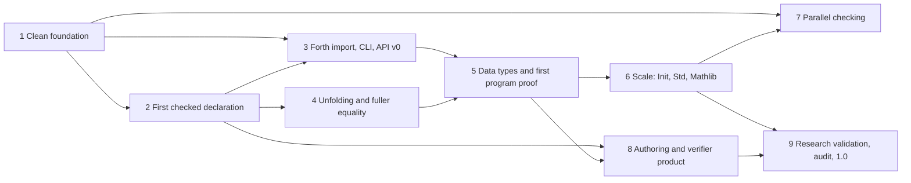

# LeanForth — next-level project plan (draft for owner review)

**Status: draft; the owner answered §8 on 2026-11-02** (recorded in
[owner decisions](OWNER_DECISIONS.md#planning-answers-2026-11-02-later-the-same-day));
the phases themselves are not yet approved. Prepared 2026-11-02 by a Claude Code planning
agent from the documents listed in Appendix B. It changes nothing in the
repository, approves no checker rule, and replaces no existing document until
the owner says so. Anything guessed is marked *speculative*. Numbers come from
the cited files or from read-only commands run today (Appendix B).

**Answered since drafting:** OQ-13 — the machine has an AMD Ryzen 5 7600X
(6 cores, 12 threads), 39 GiB RAM visible to WSL (about 25 GiB free) and only
13 GB of free disk at first; the owner then freed space (160 GB free) and
approved the Mathlib download (OQ-9).

**Owner to-dos added 2026-11-02 (not yet placed in phases):**
- *Binary quick import.* If importing Mathlib from NDJSON is slow, a
  serialized binary snapshot of the decoded records could load much faster.
  *Measured 2026-11-02:* the Forth reader decodes and checks all of Mathlib
  in 1 min 43 s (`gforth-fast`, 17 MB), against 6.5 min to produce the
  export and an estimated hours of checking, so it is **not worth building
  now**; revisit only if reading becomes a large share of a run.
  Worth it only if measured parsing dominates (the scale assessment estimates
  about a minute to parse all of Mathlib in Forth). A snapshot of *decoded,
  unchecked* records is a cache the checker still re-checks; reusing
  *checked* results is allowed in development and research mode only,
  labelled, and never in a final full-trust run (OQ-3 answer).
- *Profiling alongside the tests.* `make profile-existing` and
  `make profile-history` exist (roadmap M1–M4) but are not run regularly or
  in CI. Add a report-only profiling job and keep a measurement history.

**How to read it in 20–30 minutes.** Read §1 (where we stand, 3 min), §3 (the
nine phases on one page, 5 min) and §8 (questions for you, 10 min). Skim the
task tables in §4 and the sample proof output in §7. §5 and §6 are reference
material for whoever does the work.

---

## 1. Where the project really stands

**Bottom line.** In 98 commits since 2026-10-30, LeanForth has built a careful
set of *experiments*, a strong test and CI setup, and a lot of design
documentation. It does **not yet have a proof checker**: LeanForth has never
accepted or rejected a single proof. Nothing in the code is trusted.

### What works today (all of it untrusted)

- **A Forth data model for Lean's building blocks.** Expressions (terms),
  universe levels and structured names are stored in fixed tables of 64
  entries each, with detection of stale references
  (`src/core/terms.fs`, `levels.fs`, `names.fs`). These are now being rebuilt
  on a small shared library in `src/lib/` (bounded stores, tagged nodes, an
  outcome vocabulary and walk records — the last two not yet committed).
- **Experimental checking steps** in `src/kernel/` (shift, substitution, beta
  reduction, cautious comparison, type inference, a definition probe). On the
  tiny pinned Lean examples they reach the right answer, but only by
  *assuming* that earlier declarations are correct, and when Lean says a proof
  is wrong they answer "unknown": there is no "rejected" answer yet
  (`docs/development/TEST_COVERAGE_REVIEW.md`, finding cov-T11).
- **Comparisons with Lean.** 29 paired comparison targets (774 rows) check the
  experiments against pinned Lean 4.35.0; about 40 Lean comparisons run in CI
  on every push. The latest CI run
  ([41520874066](https://github.com/pmilford/LeanForth/actions/runs/41520874066),
  commit `f09a243`) passed.
- **Reading Lean's export format** exists only as a strict *Python* development
  preview (`tests/support/ndjson_preview.py`). It handles 15 of the 24 record
  kinds; any real Lean file that mentions `Nat`, `Bool` or `Eq` contains a data
  type ("inductive") record it cannot handle, so its reach beyond toy examples
  is 0%. There is no Forth reader for Lean's format or for JSON.
- **Program track.** Six ordinary Forth words (clamp, checked add, abs,
  in-range, factorial, gcd, in `src/program/`) have extensive finite tests.
  Lean reference models prove properties *of models* of these words, and
  thousands of model-versus-Forth comparisons agree. Nothing connects the
  Forth source text to its model, and no program proof has been checked by
  LeanForth.
- **Engineering.** Pinned Gforth 1.0.0 and Lean 4.35.0, CI on two Gforth
  versions, Lean tests that fail on `sorry`, timeouts on every test, a
  documentation link check, Forth style metrics. The coverage review measured
  92.5% block coverage of the theorem-path Forth; of deliberately planted
  faults, 7 of 15 are caught in the theorem path and 43 of 46 in the program
  track.

### What is untrusted

Everything. All eight ADRs (0001–0008 in `docs/adr/`) are proposals. The only
human review (2026-10-30) approved continuing but left one technical question
about type comparison open (`docs/reviews/2026-10-30-human-review.md`). The
owner decisions of 2026-11-02 (`docs/project/OWNER_DECISIONS.md`) say *how* a
checker change will be approved — Lean as referee, Lean-comparison tests, an
independent AI review and owner approval of a plain summary — but no change
has been through that process yet.

### What is missing

In the order this plan addresses it: a checker with the three outcomes
(accepted, rejected, unsupported/unknown); a checked environment of
declarations; definition unfolding; data types (needed for `Nat`, `Eq` and
nearly all real Lean code); a Forth reader for Lean's export; capacity beyond
64 entries, hashing and sharing; saving checked results; readable proof
output; a command-line tool and a versioned JSON interface for AI tools;
parallel checking; user manuals and diagrams; any link from Forth program text
to a checked proof.

### Honest measures

| Measure | Value | Source |
| --- | --- | --- |
| Proofs accepted or rejected by LeanForth | 0 | PROJECT_PROGRESS.md |
| Lean import acceptance tasks done (roadmap T6) | 0 of 4 | PROJECT_PROGRESS.md |
| Full-Mathlib acceptance tasks done (roadmap T9) | 0 of 5 | PROJECT_PROGRESS.md |
| Mathlib declarations independently checked | 0; denominator unknown (Mathlib not yet pinned) | PROJECT_PROGRESS.md |
| Forth source, current path (lib, core, kernel, import, program, main) | about 2,950 lines | `scripts/code-inventory.py`, today |
| Forth source, superseded `legacy/` awaiting retirement | about 2,680 lines in 28 files | same |
| Forth tests and support / Lean reference files | 10,663 lines / 3,584 lines | same |

Important consequence for planning: **phases 2–4 below check only toy
inputs.** Real Lean library code — even `n + 0 = n` — needs data types, which
arrive in phase 5. The plan says so rather than hiding it.

---

## 2. How this plan is organised

- **Three levels.** A *phase* is a milestone with an outcome you can see. A
  *work package* (WP) groups related work inside a phase. A *task* is small
  enough to review on its own. IDs read phase.WP.task: `2.3.1` is phase 2,
  work package 3, task 1. Workstreams `W1`–`W7` run through all phases.
- **Both tracks, every phase.** Each phase has theorem-track (T) and
  program-track (P) work; the program track shares the checker from phase 2 on.
- **Rolling detail.** Phases 1–3 are detailed enough to work from; phases 4–5
  are detailed at work-package level with first tasks; phases 6–9 are at
  work-package level. Re-plan at the end of each phase, as AGENTS.md's
  "follow the critical path" rule intends.
- **Sizes.** **S** — one focused commit, reviewable in one sitting (roughly up
  to 300 changed lines with tests). **M** — a work batch of two to four
  related commits with one review. **L** — several batches and at least one
  gate; split into S/M tasks before starting. No dates: the roadmap
  deliberately avoids them, and so does this plan.
- **Gates** (AGENTS.md "Review gates", decided by the owner's process of
  2026-11-02):
  - **[kernel]** a checker rule or checker code change: (1) follows Lean's
    published kernel behaviour; (2) pinned-Lean differential tests agree and
    reach accepted, rejected and unsupported/unknown, including deliberately
    wrong and mutated proofs, and no failure is ever reported or stored as
    accepted; (3) an independent AI review of the exact change has no
    unresolved findings; (4) the owner approves a plain-language summary.
  - **[import]** what the importer hands to the checker; **[format]** proof
    certificates, receipts, saved results; **[axiom]** any change to the axiom
    allowlist (owner approves exact statements); **[bypass]** anything that
    could produce an "accepted" status other than through the checker;
    **[runtime]** compiler, FFI, host or thread assumptions; **[parser]**
    mathematical parser or notation semantics. Each uses the same four-part
    process.
  - **[owner]** policy, deletion, new dependency or network use;
    **[forth-review]** the independent Forth reviewer
    (`.claude/agents/forth-reviewer.md`) for meaningful Forth changes — not a
    human gate.
- **Existing IDs are kept.** Roadmap items T1–T10, P1–P10, Q1–Q10, C1–C4,
  D1–D3, M1–M4, R1–R3 and the coverage-review findings (X, N, cov-T, cov-P)
  stay valid; Appendix A maps them to tasks. Status words remain not started,
  in progress and done.
- **Outcomes** follow `src/lib/outcome.fs` (ADR 0008): ok, invalid, exhausted,
  unknown, rejected, unsupported. For you, the three that matter are
  *accepted*, *rejected* and *unsupported/unknown*; invalid input and
  exhaustion are reported separately and never count as accepted.

---

## 3. The plan on one page

| Phase | What you will be able to see | Theorem track | Program track | Needs | Main gates |
| --- | --- | --- | --- | --- | --- |
| **1 Clean foundation** (in progress) | Same behaviour, smaller clearer code; `src/legacy/` gone; one command each for coverage and planted-fault reports | refactor core and kernel onto `src/lib/`; retire legacy | example words and depth analyzer onto the library; better comparison tables | — | [forth-review], [owner] for deletion |
| **2 First checked declaration** | The five pinned Lean examples print *accepted — experimental, not independently audited; axioms: none*; every deliberately broken copy prints *rejected* or *unsupported*, never accepted; a readable proof of `composition` | rejection rules, checked environment, declaration checker, readable proofs v0 | clamp receipt: real Forth source → program IR → proof obligations (checked by Lean, labelled not-yet-LeanForth) → runtime tests | 1 | [kernel] ×3, [format], [owner] |
| **3 Lean input in Forth, CLI and API v0** — release 0.1 | `leanforth check file.ndjson` with no Python; `leanforth print`; `leanforth serve` speaking versioned JSON-RPC with schemas and golden examples | Forth JSON and Lean-export reader; capacity stage S1 | `leanforth program` prints program receipts | 1 (reader), 2 (end to end) | [import], [format], [bypass] |
| **4 Definitions that compute** | Declarations that need earlier definitions unfolded are accepted; "unknown" answers fall measurably; proofs say "by definition of f" | unfolding, universe-level equality, eta, proof irrelevance, let, caches | loops with invariants and bounded memory in the IR; obligations still Lean-checked | 2 | [kernel] per feature |
| **5 Data types; first real Lean code** — release 0.2 | `n + 0 = n` and `0 + n = n` (by induction), with every declaration they depend on, checked from real Lean output and printed readably | inductive types, recursors, structures, literals, quotients, axiom allowlist v1 | **first program fact checked by LeanForth itself** (clamp contract) | 3, 4 | [kernel] per feature, [axiom], [owner] |
| **6 Scale toward all of Mathlib** | Per stage — all of `Init`, then Std, a Mathlib slice, all of Mathlib — counts of accepted, rejected, unsupported and limit, zero false acceptances, measured time and memory | data structures from the scale report, corpus pinning, profiling, gap ledger | larger verified programs as features allow | 5 | [kernel] for checker data structures |
| **7 Parallel checking (12 cores)** | `--jobs 12` gives exactly the `--jobs 1` verdicts, faster | per-task contexts, process sharding, optional Gforth threads | same machinery | 1 (design), 6 | [kernel], [bypass], [runtime] |
| **8 Writing proofs and verified programs in LeanForth** | A user writes a theorem or a Forth word with its contract in LeanForth's Forth syntax and checks or verifies it | Forth syntax, term builder, untrusted elaboration and tactics | `leanforth verify`, RUN with assertions, translation validation | 2, 3, 5 | [parser], [bypass], [runtime] |
| **9 Research validation, audit, 1.0** | Published Lean results reproduced; an outside expert audit; release 1.0 | R1–R3, upgrade procedure, second Forth host | larger programs, tensor contracts | 6, 8 | [owner] |



**Lanes that can run at the same time** (useful when several agents work;
AGENTS.md's concurrent-commit rule still applies): (a) the checker critical
path 2 → 4 → 5; (b) library, reader, CLI and API (phase 3, startable after
phase 1); (c) the program track; (d) documentation and diagrams (W1, W2);
(e) test tooling (W4); (f) scale preparation (W7, phase 6.2) once the scale
report arrives.

**If you approve, the next ten tasks are:** finish 1.2.1–1.2.2 and commit
1.1.1–1.1.2 (in progress now); 1.1.3 store marks; 1.4.1 `make coverage`;
1.1.6 exceptions ADR; 1.3.1 legacy migration map; 2.1.1 rejection rules ADR;
2.1.4 Lean differential matrix; 3.1.1 shared byte reader; 2.5.1 receipt schema.

---

## 4. Phases in detail

Columns: **Acceptance** is what must be true to call the task done;
**Needs** lists task dependencies; **Gates** uses the words of §2.

### Phase 1 — Clean foundation (in progress)

**Outcome.** Behaviour unchanged, code smaller and clearer, and the test
tools needed for the checker exist. `make check` passes on a tree without
`src/legacy/`. **Roadmap:** Q9, Q10, X4, X5, X8, X9, cov-T7, cov-T8, cov-T10,
cov-T12, cov-T13, cov-P8, cov-P9, C2 (design).

**Exit criteria.** (1) No module in `core/`, `kernel/` or `program/` defines
its own status codes, and the 34 status-translation words are gone.
(2) Every remaining global is documented long-lived module state; no
`VARIABLE` is used to pass values between words (FORTH_STYLE.md §3).
(3) No word over ten lines without a justification comment. Baseline for
`core/` plus `kernel/`: 218 words, 23% over ten lines, 225 globals
(DEVELOPMENT_ROADMAP.md, Q10). (4) `src/legacy/` deleted with owner approval
after migration evidence. (5) `make coverage` and `make mutants` work.

**WP 1.1 Library (`src/lib/`)**

| ID | Task | Acceptance | Needs | Gates | Size |
| --- | --- | --- | --- | --- | --- |
| 1.1.1 | Outcome vocabulary `lib/outcome.fs` (ADR 0008 steps 1–2); *drafted, uncommitted* | Unit tests for every value, `outcome-sane`, flag-versus-status rule; ADR 0008 marked accepted for code structure only | — | [forth-review] | S |
| 1.1.2 | Walk records `lib/walk.fs`: bounded work stack and fuel per record; *drafted, uncommitted* | Tests: two interleaved walks, exhaustion by fuel and by stack, bad tags invalid | 1.1.1 | [forth-review] | S |
| 1.1.3 | Store marks: `store-mark` and `store-rollback` replace the hand-written saving of counts in about 33 modules | Rollback after partial failure tested; a mark from before a reset is refused | — | [forth-review] | S |
| 1.1.4 | Tag dispatch tables: a defining word for execution-token tables indexed by a validated tag | Out-of-range tag gives invalid; one walker converted as example | 1.1.1 | [forth-review] | S |
| 1.1.5 | Heap stores: `store:` variant using `ALLOCATE`/`FREE`, same checks | Same test suite as `store:` passes; allocation failure gives exhausted; prerequisite for 3.3 and 7.2 | 1.1.3 | [forth-review] | M |
| 1.1.6 | ADR 0009 (proposed number): exceptions — when to use `CATCH`/`THROW` (§6.10) | Decision recorded with rejected alternatives; one module piloted | 1.1.1 | [forth-review] | S |
| 1.1.7 | ADR 0010: wordlists and module boundaries (§6.9); apply to `lib/` first | `lib/` words in their own wordlist; `make smoke` still silent | — | [forth-review] | M |
| 1.1.8 | Reusable libraries (owner, 2026-11-03): each general-purpose library in `src/lib/` (bignum, JSON reader and writer, bytes, u32, stores, SHA-256, the compact store) requires only what it uses, keeps helpers private (1.1.7), has a short README with an example, and a test that loads it from outside the project; optional signed-integer layer over bignum; LeanForth-specific choices (such as `bytes.fs`'s strict framing) become options | Each library runs its example from an unrelated folder on both Gforths; reusability table in FORTH_LIBRARY.md updated | 1.1.7 | [forth-review] | M |

**WP 1.2 Refactor `core/` and `kernel/` bottom-up (Q10).** Every task keeps
behaviour identical (old and new tests pass, Lean comparisons unchanged),
gets a Forth review and records `make forth-metrics` before and after.

| ID | Task | Acceptance | Needs | Gates | Size |
| --- | --- | --- | --- | --- | --- |
| 1.2.1 | Data-model modules: level scope, Sort boundary, symbolic session, generation handles (*in progress in the working tree*) | Exit criteria (1)–(3) hold for these files | 1.1.1–1.1.3 | [forth-review] | M |
| 1.2.2 | Constant references and constant-term boundary and scope onto `store:` and walk records | as above | 1.2.1 | [forth-review] | M |
| 1.2.3 | Universe passes: level substitute, value, compare, mixed level substitute | as above | 1.2.1 | [forth-review] | M |
| 1.2.4 | Signature probe and audit | as above | 1.2.2, 1.2.3 | [forth-review] | M |
| 1.2.5 | Term passes: mixed shift, instantiate, beta | as above | 1.2.2 | [forth-review] | M |
| 1.2.6 | Mixed compare and convert | as above | 1.2.5 | [forth-review] | M |
| 1.2.7 | Mixed infer (longest word, 59 lines) and the definition probe; delete the last translation words | as above; translation words = 0 | 1.2.4, 1.2.6 | [forth-review] | M (two batches) |
| 1.2.8 | `import/load.fs` and `program/` (examples, depth analyzer) onto the library; scratch variables become a walk record | as above; program tests unchanged | 1.1.2 | [forth-review] | S |
| 1.2.9 | Module headers state purpose, trust, dependencies, state, re-entrancy; refresh FORTH_LIBRARY.md and `src/README.md` | Reviewer checklist passes for every file | 1.2.1–1.2.8 | — | S |

**WP 1.3 Retire legacy (Q9)**

| ID | Task | Acceptance | Needs | Gates | Size |
| --- | --- | --- | --- | --- | --- |
| 1.3.1 | Map each of the 14 legacy-dependent Lean comparisons and each legacy unit test to a current-path replacement | Table in DECISIONS.md; nothing unmapped | — | — | S |
| 1.3.2 | Migrate shift, instantiate and beta comparisons (plain and tagged) | Same or more rows; per-row verdicts pinned | 1.3.1, 1.2.5 | — | M |
| 1.3.3 | Migrate compare, convert, universe, binder and application comparisons; pin per-row verdicts (cov-T10) | as above | 1.2.6 | — | M |
| 1.3.4 | Migrate inference, declaration, signature and constant-probe comparisons, including the user of `symbolic-infer-oracle.lean` | as above | 1.2.7 | — | M |
| 1.3.5 | Evidence: coverage and planted-fault results on the current path at least as strong as on legacy | Report committed | 1.4.1, 1.4.2 | — | S |
| 1.3.6 | Delete exactly the listed legacy paths, their tests and Make targets; update docs | Owner approved the path list; `make check` passes | 1.3.5 | [owner] | S |

**WP 1.4 Test tooling** (see also W4)

| ID | Task | Acceptance | Needs | Gates | Size |
| --- | --- | --- | --- | --- | --- |
| 1.4.1 | `make coverage` (X5): package the review's Gforth `coverage.fs` wrapper | Per-folder block coverage printed; documented in TESTING_STRATEGY.md | — | — | S |
| 1.4.2 | `make mutants` (X4): checked-in list of planted faults and known-equivalent ones, run in a temporary copy | Caught/survived report; never edits the working tree | — | — | M |
| 1.4.3 | Harness self-tests (X8): each Lean comparison script must fail on a known-wrong table | One negative check per script in `make test` | — | — | M |
| 1.4.4 | Tester checks the return stack (cov-T12); reviewer checklist and a metrics heuristic flag statuses used as flags (X9) | New checks fail on planted examples | 1.1.1 | — | S |
| 1.4.5 | Deferred theorem-path tests: arena exhaustion inside mixed passes (cov-T7), corrupted counts and generation saturation (cov-T8), mixed-infer gaps (cov-T13) | Planted-fault catch rate rises; recorded | 1.2.7 | — | M |
| 1.4.6 | Allocation-failure injection: a test-only hook makes the k-th allocation fail, for every k | Every run ends exhausted or invalid with all stores rolled back | 1.1.3 | — | M |
| 1.4.7 | Determinism: run each Forth suite twice and compare output bytes | Part of `make test` | — | — | S |

**WP 1.5 Program track (P)**

| ID | Task | Acceptance | Needs | Gates | Size |
| --- | --- | --- | --- | --- | --- |
| 1.5.1 | Comparison tables print flags, depth and return-stack markers (cov-P8) | Comparisons detect a planted flag or depth fault | — | — | S |
| 1.5.2 | Depth analyzer: a read-count seam; running out of fuel distinguishable from invalid input (cov-P9) | Remaining surviving planted fault caught | 1.2.8 | — | S |
| 1.5.3 | Formal contracts for the five other example words in the style of `ClampContract`, each with a refuted wrong variant (P2.3) | Lean proves each contract and refutes each wrong variant | — | — | M |

### Phase 2 — First checked declaration

**Outcome.** For the five pinned fixtures (`composition`, `identity`,
`type-identity`, `poly-identity`, `constant-fixture` in `tests/reference/`)
LeanForth prints *accepted — experimental, not independently audited;
axioms: none*. For every deliberately broken copy it prints *rejected* or,
where the expected-results table says so, *unsupported* — never accepted. A
readable proof of `composition` is printed (§7). Program track: a clamp
receipt connects the actual Forth source to proof obligations and runtime
evidence. **Roadmap:** Q5, Q6, Q7, T4.1–T4.2, T5.1–T5.4, T8.1 (part), P1,
P6.1, P7.2, T10.4 (start).

**Scope** (owner decision 2): sorts with concrete and symbolic levels, bound
variables, application, λ, Π and references to *earlier checked*
declarations; safe non-recursive definitions and theorems; no unfolding
(owner decision 3: cautious first); no axioms (owner decision 4). Everything
else is unsupported. **Input path:** the existing test-only transport
(Python preview → byte stream → Forth). It is untrusted decoding; it cannot
make a wrong proof right, only hand over a different claim, which the printed
statement lets a human see. Phase 3 replaces it.

**Exit criteria.** The [kernel] gate passed for the checker; every check
reaches every outcome in tests; replay gives identical verdicts; owner
approval recorded in `docs/reviews/`; PROJECT_PROGRESS.md updated.

**WP 2.1 Rules and evidence, before code**

| ID | Task | Acceptance | Needs | Gates | Size |
| --- | --- | --- | --- | --- | --- |
| 2.1.1 | ADR 0011: *definite rejection* — which failures Lean's rules make definite in this fragment (Sorts at different concrete levels, applying a term whose type reduces to a Sort, a declared type that is not a type, a theorem whose type is not a proposition, wrong number of universe arguments, unknown, forward, self or duplicate names) and which must stay unknown (anything eta, proof irrelevance or unfolding might equate) | Each rule cites Lean 4.35.0 source; plain-language summary drafted | 1.1.1 | [kernel] | M |
| 2.1.2 | Settle the question left open on 2026-10-30: comparing under binders whose domains differ (ADR 0003) | Plain-language answer, Lean evidence, tests | — | [kernel] | M |
| 2.1.3 | ADR 0012: checked-environment implementation of ADR 0006 — append-only store, snapshot identity, staging then publish, handles bound to a snapshot, transitive axiom set | Answers questions 2, 5, 6 of CHECKED_ENVIRONMENT_REVIEW.md | 1.1.3 | [kernel], [import] | M |
| 2.1.4 | Lean differential matrix (completes Q5): every fixture plus mutants (wrong argument, wrong universe, swapped binder, non-proposition theorem, missing, forward or self constant, wrong universe arity, malformed, oversized); Lean's verdict **and its error reason** (N10); expected LeanForth outcome | Table and Lean oracle file; every LeanForth outcome appears at least once per check | — | — | M |
| 2.1.5 | ADR 0011 amendment (owner, 2026-11-03: "identical to Lean"): Lean's `infer_pi` rejects a Π whose body is not a type (`ensure_sort` on the body); LeanForth answers *unknown* there today | Rule cites Lean 4.35.0 source; Lean-checked rows added to the table; gate passed | 2.2.1 | [kernel] | S |

**WP 2.2 Checker implementation**

| ID | Task | Acceptance | Needs | Gates | Size |
| --- | --- | --- | --- | --- | --- |
| 2.2.1 | Return *rejected* from comparison and inference where ADR 0011 allows (ADR 0008 step 3) | Every rejection row of 2.1.4 agrees with Lean; no unknown row turns into rejected without a rule | 2.1.1, 1.2.7 | [kernel] | M |
| 2.2.2 | Checked environment v0 per ADR 0012 | Publish only after full success; stale and cross-snapshot handles fail; failure leaves the snapshot unchanged | 2.1.3 | [kernel] | M |
| 2.2.3 | `check-declaration` for definitions and theorems: closed terms, universe scope, type is a Sort, value's type converts to it, theorem type is a proposition | Accepted handle only on full success; unsupported features give unsupported | 2.2.1, 2.2.2 | [kernel], [bypass] | M |
| 2.2.4 | Failure-path suite: every check reaches accepted, rejected, unsupported, invalid and exhausted; nothing failing is stored or reported as accepted (owner decision 2 addition) | Suite in `make test`; allocation-failure injection (1.4.6) applied | 2.2.3 | — | M |
| 2.2.5 | Evidence and replay: run record (input SHA-256, tool versions, verdicts) and a replay test | Replay gives byte-identical verdicts | 2.2.3 | [format] | S |

**WP 2.3 Gate and approval**

| ID | Task | Acceptance | Needs | Gates | Size |
| --- | --- | --- | --- | --- | --- |
| 2.3.1 | Independent AI review of the exact diff by a fresh agent given the code, not our conclusions | No unresolved findings; review file in `docs/reviews/` | 2.2.4 | — | S |
| 2.3.2 | Plain-language summary for the owner: what it does, evidence, risks, recommendation | Owner approval recorded with date and commit | 2.3.1 | [owner] | S |
| 2.3.3 | Label every accepted result *experimental — not independently audited*; update PROJECT_PROGRESS.md (T5, Q5–Q7) | Label tested in output | 2.3.2 | — | S |

**WP 2.4 Readable proofs v0** (untrusted printer; parallel lane; design in §7)

| ID | Task | Acceptance | Needs | Gates | Size |
| --- | --- | --- | --- | --- | --- |
| 2.4.1 | ADR 0013: derivation log — optional records emitted by the checker (rule, inputs, result, context depth, step id) | Verdicts identical with the log on, off and full (tested) | 2.2.3 | [kernel] (no-behaviour-change review) | M |
| 2.4.2 | Presentation side table: binder names, binder kinds, source record ids — never read by the checker's comparisons | Byte transport keeps binder names (today it drops them, NDJSON_PREVIEW.md) | — | [import] | M |
| 2.4.3 | Term printer: names restored from de Bruijn indices without capture; ∀, →, Prop, Type | Golden tests including shadowed names | 2.4.2 | — | M |
| 2.4.4 | Proof-outline printer for λ/application proofs; text, Markdown and JSON (step schema of INTERFACE_CONTRACTS.md); rationale from fixed templates tagged `structured-template` | Golden output for `composition`, `fixtureUse`, identity | 2.4.1, 2.4.3 | — | M |

**WP 2.5 Program track (P)**

| ID | Task | Acceptance | Needs | Gates | Size |
| --- | --- | --- | --- | --- | --- |
| 2.5.1 | Receipt schema v0 (P1.1–P1.2): CHECK, VERIFY and RUN statuses kept separate; assumptions list; JSON Schema | Schema plus valid and invalid examples | — | [format] | M |
| 2.5.2 | Program IR v0 (P6.1): straight-line words plus `IF`/`ELSE`/`THEN`/`EXIT`, signed cells, failure, source locations; versioned | Specification and Lean model of the IR | 1.5.3 | — | M |
| 2.5.3 | Reader from restricted Forth colon definitions (the six example words) to IR; anything else unsupported | All six words translate; unsupported words refused with a diagnostic | 2.5.2 | [parser], [runtime] | M |
| 2.5.4 | IR interpreter versus host word versus Lean model on the existing tables | Closes the "nothing ties `lf-clamp` to `clampCode`" gap (cov-P10) for the IR route | 2.5.3 | — | M |
| 2.5.5 | Verification-condition generator v0 (untrusted, P7.2): IR plus contract → obligations as Lean statements; Lean proves them | Receipt says *checked by Lean reference, not by LeanForth*; a wrong contract is refuted | 2.5.4 | [bypass] | M |
| 2.5.6 | Clamp receipt v0 and its printed form (§7) | Golden output | 2.5.1, 2.5.5 | — | S |

### Phase 3 — Lean input in Forth, a command-line tool and API v0 (release 0.1)

**Outcome.** `leanforth check FILE.ndjson` runs on Forth alone and prints a
verdict per declaration; `leanforth print` shows a readable proof;
`leanforth program` prints program receipts; `leanforth serve` speaks
versioned JSON-RPC over standard input and output (no network listener) with
JSON Schemas and at least ten golden examples, as AGENTS.md and
INTERFACE_CONTRACTS.md require. **Roadmap:** T6.1–T6.2, T10.2, N7 (schema),
N13, X6, P8.1 (start), M1, D3 (start).

**WP 3.1 Reading bytes and JSON** (library; can start right after phase 1)

| ID | Task | Acceptance | Needs | Gates | Size |
| --- | --- | --- | --- | --- | --- |
| 3.1.1 | `lib/bytes.fs`: one bounded line reader with strict framing (valid UTF-8, no byte-order mark, no CR, final line feed); replaces the eleven test stream readers' framing (N13) | Same framing failures as the Python preview | 1.1.1 | [forth-review] | M |
| 3.1.2 | `lib/json.fs`: streaming tokenizer and bounded record view, no recursion, explicit depth, string and digit limits; integers kept as digit strings | Unit tests for every token and limit at and one past its bound | 3.1.1 | [forth-review] | M |
| 3.1.3 | `lib/json-write.fs`: deterministic writer (fixed key order, escaping) | Round trip with 3.1.2 | 3.1.2 | — | S |
| 3.1.4 | Fuzz harness (X6): seeded mutations of every fixture; Forth reader and Python preview must agree on outcome class and line | Thousands of seeded cases in `make check`; seed recorded | 3.2.1 | — | M |

**WP 3.2 Lean export decoder (`src/import/`)**

| ID | Task | Acceptance | Needs | Gates | Size |
| --- | --- | --- | --- | --- | --- |
| 3.2.1 | Names, levels and the supported expression kinds → candidate stores, with export-index to store-index tables; malformed, unsupported and limit classified exactly as NDJSON_PREVIEW.md | All preview contract tests pass against the Forth decoder | 3.1.2, 2.4.2 | [import] | M |
| 3.2.2 | Declaration records → checker in stream order; each declaration transactional | Fixtures accepted end to end; mutants as in 2.1.4 | 3.2.1, 2.2.3 | [import], [bypass] | M |
| 3.2.3 | Shape-check the nine kinds not yet handled (let, projection, literals, metadata, axiom, opaque, quotient, inductive) and report unsupported | Same classification as the preview on the 142 real records it was validated on | 3.2.1 | [import] | M |
| 3.2.4 | Round trip: re-emit each decoded record and compare bytes with the input (catches a decoder that silently reads a different term) | Identity on all fixtures and accepted fuzz cases | 3.1.3, 3.2.1 | — | S |
| 3.2.5 | Move fixture tests from the byte transport to the Forth reader; the Python preview stays as a test oracle only | No Python on the `leanforth check` path | 3.2.2 | — | M |
| 3.2.6 | Checksum manifest (owner, 2026-11-03): the export script writes the file's SHA-256, line and record counts, Lean version and Mathlib commit beside each export; import computes SHA-256 in Forth during its single read and checks the manifest by default (*invalid* if missing or wrong, unless skipped on request) | A file cut off between two lines, a changed byte and a missing manifest are each refused; SHA-256 agrees with `sha256sum` | 3.2.1 | [import] | M |
| 3.2.7 | Upgrade test (owner, 2026-11-03): for each new Lean or Mathlib release, export it and compare the Forth reader with the independent Python reader record by record; report every new record kind or field | Rehearsed on one newer export; differences listed, none hidden | 3.2.4 | — | M |

**WP 3.3 Capacity stage S1**

| ID | Task | Acceptance | Needs | Gates | Size |
| --- | --- | --- | --- | --- | --- |
| 3.3.1 | Configurable store capacities (heap stores, 1.1.5), set by a command-line option; exhaustion reported as a limit | Same verdicts at small and large capacities on all fixtures | 1.1.5 | [kernel] (no-behaviour-change) | M |
| 3.3.2 | Measured-limits table (roadmap D3): largest inputs handled, time and memory (W3) | Table in a limits document with reproduction commands | 3.3.1 | — | S |

**WP 3.4 Command-line tool**

| ID | Task | Acceptance | Needs | Gates | Size |
| --- | --- | --- | --- | --- | --- |
| 3.4.1 | `bin/leanforth` wrapper (finds pinned Gforth) and an entry point in `src/main.fs`: `check`, `print`, `program`, `version`, `capabilities` | Works from any directory; prints nothing unexpected | 3.2.2 | [bypass] | M |
| 3.4.2 | Exit codes: 0 all accepted, 1 something rejected, 2 unsupported or unknown, 3 resource limit, 4 malformed input, 5 internal fault; align the Python preview's codes (today malformed is 1) | Tests reach every code | 3.4.1 | — | S |
| 3.4.3 | Output formats: text by default, `--json` receipts (2.5.1 schema extended to theorems) | Deterministic bytes across runs | 3.1.3 | [format] | S |

**WP 3.5 JSON API v0 for AI tools**

| ID | Task | Acceptance | Needs | Gates | Size |
| --- | --- | --- | --- | --- | --- |
| 3.5.1 | Envelope and versioning: JSON-RPC 2.0, `schemaVersion`, request id, error object; `checked`, `under-assumptions`, `runtime-tested`, `unverified` as separate fields | Design in INTERFACE_CONTRACTS.md marked implemented-part versus plan | 2.5.1 | [format] | M |
| 3.5.2 | Methods `system.capabilities`, `proof.check`, `proof.pretty`, `program.receipt` | Malformed and oversized requests fail closed with a structured error; nothing but the checker sets `checked` | 3.5.1, 3.4.1 | [bypass] | M |
| 3.5.3 | `schemas/*.json` and at least ten golden request/response pairs in `examples/api/`, run in `make test` | Golden pairs byte-identical | 3.5.2 | — | M |
| 3.5.4 | Error-code catalogue (a new page in `docs/programming/`) and an LLM guide v0 | Every code emitted by the code appears in the catalogue (tested) | 3.5.2 | — | S |

**WP 3.6 Documentation for release 0.1** (W1): user manual "check a Lean
file with LeanForth" built around `composition` in three forms; CLI and API
references; installation refreshed. Size M.

### Phase 4 — Definitions that compute (unfolding and fuller equality)

**Outcome.** Declarations whose checking needs earlier definitions unfolded
are accepted; on the test corpus the share of "unknown" answers falls and is
reported; printed proofs say "by definition of f". This is owner decision 3's
"unfolding next". **Roadmap:** T4.3, T8.1–T8.2, N11.

| ID | Task | Acceptance | Needs | Gates | Size |
| --- | --- | --- | --- | --- | --- |
| 4.1.1 | ADR 0014: Lean's definitional-equality procedure for the supported forms — unfolding with reducibility hints and Lean's lazy strategy; theorems, axioms and opaque declarations never unfold | Cites Lean 4.35.0 source; plain-language summary | phase 2 | [kernel] | M |
| 4.1.2 | Universe-level equality by Lean's level normalisation (replaces sampled concrete checks; ADR 0004, 0007) | Differential cases with parameters, `max`, `imax` | phase 2 | [kernel] | M |
| 4.1.3 | Rules for eta, proof irrelevance, `let` and metadata nodes | One ADR section each | 4.1.1 | [kernel] | M |
| 4.2.1 | Implement level equality | Gate passed | 4.1.2 | [kernel] | M |
| 4.2.2 | Implement unfolding (delta) | Gate passed; unfolding steps logged for the printer | 4.1.1 | [kernel] | M |
| 4.2.3 | `let` expressions in the importer and checker (zeta) | Gate passed | 4.1.3, 3.2.3 | [kernel], [import] | M |
| 4.2.4 | Function eta | Gate passed | 4.1.3 | [kernel] | S |
| 4.2.5 | Proof irrelevance | Gate passed | 4.1.3 | [kernel] | M |
| 4.2.6 | Opaque declarations (never unfold) | Gate passed | 4.2.2 | [kernel], [import] | S |
| 4.2.7 | Caches v1 (weak-head normal form, inference, equality) keyed per ADR 0006; never cache unknown or exhausted as success | Verdicts identical with caches on and off on every corpus | 4.2.2 | [kernel] | M |
| 4.3.1 | Differential cases N11: eta, proof irrelevance, unfolding, universe arity, undeclared universe parameters, with Lean's error reasons | In `make check` | 4.1.* | — | M |
| 4.3.2 | Report the unknown rate on fixtures plus a synthetic corpus | Number and denominator in PROJECT_PROGRESS.md | 4.2.* | — | S |
| 4.4.1 | (P) IR v1: loops with invariants (factorial, gcd), bounded memory operations (copy, swap) (P6.3) | IR interpreter agrees with host and Lean model | 2.5.4 | [parser] | M |
| 4.4.2 | (P) Verification conditions v1 for loops and memory; still Lean-checked, labelled | Wrong invariants refuted | 4.4.1 | [bypass] | M |
| 4.4.3 | Printer v1: constants with a notation table v0 (=, +, ∧, ¬, …); "by definition of f" steps | Golden output | 4.2.2, 2.4.4 | — | M |

### Phase 5 — Data types and the first real Lean code (release 0.2)

**Outcome.** `Nat.add_zero` (n + 0 = n) and `Nat.zero_add` (0 + n = n, proved
by induction) — together with every declaration they depend on, exported
from pinned Lean 4.35.0 — are accepted, and their printed proofs show the
computation step and the induction's base and step cases (§7). Program
track: **the first program fact checked by LeanForth itself** — the clamp
contract — with a receipt that keeps source proof and runtime evidence
apart. **Roadmap:** T6.3–T6.4, T8.3–T8.4, P5.1–P5.3, owner decision 4.

Declaration kinds, for orientation:

| Lean feature | In plain words | Phase |
| --- | --- | --- |
| theorem; non-recursive definition | a named proof; a named value | 2 (definitions not unfolded until 4) |
| opaque definition; `let` | a definition that never unfolds; a local definition | 4 |
| axiom | a statement accepted without proof — only the allowlisted three | 5 |
| inductive type, constructors, recursor | data types such as `Nat`, `List`, `Eq` and their induction principles | 5 |
| structure and projection | records, such as a pair and its first component | 5 |
| number and string literals | `37`, `"abc"` | 5 |
| quotient | building new types from equivalence classes (fractions) | 5 |
| mutual and nested inductive types | several data types defined together | 5 (last) |
| unsafe and partial definitions | code Lean itself does not trust logically | never accepted; unsupported |

| ID | Task | Acceptance | Needs | Gates | Size |
| --- | --- | --- | --- | --- | --- |
| 5.1.1 | ADR 0015: inductive declarations — parameters, indices, universe constraints, positivity, constructor types | Lean source cited; plain summary | phase 4 | [kernel] | L (split) |
| 5.1.2 | ADR: recursors — the checker builds each recursor itself and compares it with the exported one; iota reduction | as above | 5.1.1 | [kernel] | M |
| 5.1.3 | ADR: elimination from `Prop`, K-like reduction (`Eq`), structures, projections, structure eta | as above | 5.1.2 | [kernel] | M |
| 5.1.4 | ADR: literals — `Nat` literals and the `Nat` operations Lean's kernel computes directly (list to confirm against 4.35.0 source), `String` literals | as above | 5.1.2 | [kernel] | M |
| 5.1.5 | ADR: quotients (`Quot`, `Quot.mk`, `Quot.lift`, `Quot.ind`) | as above | 5.1.2 | [kernel] | M |
| 5.2.1 | Implement non-recursive inductives (`Bool`, `And`), then recursive (`Nat`, `List`), then indexed (`Eq`) — one gate each | Each gate passed with Lean-rejected mutants | 5.1.1–5.1.3 | [kernel], [import] | L (three M) |
| 5.2.2 | Structures and projections | Gate passed | 5.2.1 | [kernel], [import] | M |
| 5.2.3 | `lib/bignum.fs` and literal support (§6.12) | Bignum differential against Lean and Python integers; gate passed | 5.1.4 | [kernel] | M |
| 5.2.4 | Quotients | Gate passed | 5.1.5, 5.3.1 | [kernel] | M |
| 5.2.5 | Mutual and nested inductive types | Gate passed | 5.2.1 | [kernel] | L |
| 5.2.6 | Importer: Lean's verdict per declaration for a file that is not closed, instead of the whole-file *invalid* of ADR 0016 C4 (a temporary default-mode difference from Lean; review rvI21 R4-4, 2026-11-04). Pinned Lean 4.35.0 rejects a declaration that names a constant no declaration has (`unknownConstant`), and its replay refuses a constructor or recursor whose type is not in the file ("No such constructor", "No such recursor"); the rest of the file is checked | Pinned-Lean rows for each case; the inductive table's `names.reserved-nested-prefix` and `quotinit.without-eq` checked declaration by declaration; malformed records still *invalid* | 5.2.1 | [import] | S–M |
| 5.3.1 | Axiom allowlist v1: a versioned file with the exact Lean 4.35.0 statements of `propext`, `Classical.choice`, `Quot.sound`, the only axioms that count as *proved*; `Lean.ofReduceBool` and `Lean.trustCompiler` never on it. Owner, 2026-11-03 (amending decision 4): any other axiom (`sorryAx`, a user's axiom, an altered statement) gets Lean's verdict, labelled **NOT PROVED: depends on** it, with its own exit code, and so does everything that uses it; `--standard-axioms-only` answers *unsupported* instead | Tests for altered and unlisted axioms in both settings; a NOT PROVED result is never stored or reported as proved | 5.1.5 | [axiom], [owner] | S |
| 5.3.3 | Revisit the axiom rule (owner, 2026-11-04: "consider changing the axiom rule"). Today: only `propext`, `Classical.choice` and `Quot.sound` count as proved; any other axiom gets Lean's verdict marked NOT PROVED; `Lean.ofReduceBool` and `Lean.trustCompiler` are never on the list. Bring the owner the options in plain words with their consequences, for example: count proofs that use `Lean.ofReduceBool` (what `native_decide` produces) as proved-with-a-trusted-compiler, and how LeanForth would evaluate `Lean.reduceBool` without Lean's compiled code; a user-chosen axiom list per run; how Mathlib and other libraries use each axiom | Options note with counts from Init and Mathlib; owner decision recorded | 5.3.1, 5.3.2 | [axiom], [owner] | S |
| 5.3.2 | Transitive axiom report on every accepted theorem (CLI, API, printed output) | Matches Lean's `#print axioms` on the corpus | 5.3.1 | [format] | S |
| 5.4.1 | Corpus C-Nat: export the dependency closures of `Nat.add_zero` and `Nat.zero_add`; manifest with hashes | Every declaration accepted; mutants rejected; printed proofs golden | 5.2.1–5.2.3 | — | M |
| 5.5.1 | (P) Clamp obligations proved in Lean, exported with their closure, checked by LeanForth (P5.2) | Receipt: source proof *kernel-accepted (experimental)*; mutated program, contract or proof rejected | 5.4.1, 2.5.5, 5.2.5 (the IR's Lean model uses a nested inductive type; W9 review) | [bypass], [format], [runtime] | M |
| 5.5.2 | (P) Replay the program receipt independently; source verification reported apart from runtime evidence (P5.3) | Replay identical | 5.5.1 | — | S |
| 5.6.1 | Printer v2: recognise induction (`Nat.rec` and Lean's compiled recursion), rewriting (`Eq.mpr`, `congrArg`) and equation chains; label *reconstructed from the proof term* | Golden output for both `Nat` theorems | 5.4.1 | — | M |

### Phase 6 — Scale toward all of Mathlib

**Outcome per stage.** A pinned corpus with a denominator; counts of
accepted, rejected, unsupported and limit; zero false acceptances on mutated
inputs; measured time and memory. **Roadmap:** T7, T9.1–T9.4, M1–M4, D3, N8,
N12.

| Stage | Corpus | Gate to pass |
| --- | --- | --- |
| S1 | the fixtures (phase 3) | done in 3.3 |
| S2 | all of Lean's `Init` | every declaration has an outcome; no false acceptance |
| S3 | Std and the parts of Lean core Mathlib uses | same |
| S4 | a Mathlib slice chosen with you (for example the closure of a basic logic and order file) | same, plus the unsupported ledger reviewed |
| S5 | all of Mathlib and its package dependencies (exact list from Mathlib's `lake-manifest.json`) | full reproducible run; T9.4 acceptance |

**Scale numbers are deliberately left blank** for the separate scale
workstream (W7):

| Stage | Declarations | Expression nodes | Memory budget | Time budget, 1 core / 12 cores | Data-structure changes |
| --- | --- | --- | --- | --- | --- |
| S2–S5 | *[scale report]* | *[scale report]* | *[scale report]* | *[scale report]* | *[scale report]* |

| ID | Task | Acceptance | Needs | Gates | Size |
| --- | --- | --- | --- | --- | --- |
| 6.0.1 | Intake the scale report: turn its estimates and recommended data-structure changes into tasks and stage budgets | Table above filled; tasks added under 6.2 | scale report | [owner] | S |
| 6.1.1 | Pin the Mathlib commit matching Lean 4.35.0; manifest of every declaration with hashes (T9.1). *Commit pinned and denominator recorded 2026-11-02 (729,263 constants); per-declaration manifest still to do.* | Denominator recorded in PROJECT_PROGRESS.md | — | [owner] (network, disk) | M |
| 6.2.0 | Variable-length universe argument and parameter lists (Mathlib has up to 30; no fixed limit since 2026-11-04, part (a), in progress) and depth limits sized for expression depth 1,221; also the checker's other fixed capacities that give *full* where Lean decides (temporary default-mode differences; review rvI21 R4-4): an inductive block's 512 constructors, 64 parameters plus indices and 64 fields per constructor (task 5.2.1a), and 16 dependencies per check. The rebuild passes (shift, instantiate, beta) recurse through frame records bounded by the store capacity, using up to about 1,200 return-stack cells at today's 64-node capacity (Gforth 0.7.3's default is 1,920): they must move to explicit stacks before the capacity grows | Every Mathlib signature representable; no pass depth tied to the Forth return stack; limits documented | 6.0.1 | [kernel] | M |
| 6.2.1 | Hash tables and hash-consing for names, levels and terms (§6.2) | Same verdicts; measured memory change | 6.0.1 | [kernel] | M |
| 6.2.2 | Growable stores; per-declaration scratch released after each check; streaming import without holding the whole file | Peak memory bounded by the largest declaration plus the environment | 6.0.1 | [kernel] | M–L |
| 6.2.3 | Further changes from the scale report (compact nodes, possibly file-backed environment) | per task | 6.0.1 | [kernel] | *[scale report]* |
| 6.3.1 | Unsupported-feature ledger per stage: every unsupported reason counted | Drives the next feature priorities | 3.2.3 | — | S (recurring) |
| 6.4.1 | Corpus differential (T7): Lean's verdict for each declaration, plus mutated subsets that must be rejected; optional second referee (lean4lean, nanoda; N12) | Mismatches triaged, none hidden | 6.1.1 | — | M |
| 6.4.2 | Lean's own test suites (owner, 2026-11-04: "review the lean test suites and plan to be able to run them - I assume as ndjson exports?"): review the pinned Lean 4.35.0 repository's tests and any published test collections for independent kernel checkers, classify them (kernel-relevant; elaborator, parser, tactic or compiler only, which a kernel checker cannot run), and build a harness: each test file Lean accepts is compiled with the pinned toolchain and exported to NDJSON with its manifest, and LeanForth must give Lean's verdict on every declaration; tests where Lean's kernel refuses a declaration are captured as exports of the refused declaration (the method of `tests/reference/inductive-expected.lean`, which writes refused cases through Lean's `Kernel.Environment.add`) | Classification table with counts; harness runs the kernel-relevant tests in `make check` or a nightly target; every disagreement triaged, none hidden; temporary gaps named with the task that closes them | 6.4.1 | — | M–L |
| 6.5.1 | Profiling M1–M4 (W3) applied to each stage | Per-stage report | 3.3.2 | — | M |
| 6.5.2 | Resource report for every check (owner, 2026-11-04: "after a proof or other is run, we should report cleanly the fuel, memory, cpu usage"): after each declaration and each run, `leanforth check`, `print` and the JSON API report fuel used against the limit, peak memory per store and in total, CPU and wall time, and which limit ended a check that ran out (*exhausted* or *full*), in plain words and as data; run records carry the same figures (a run-record schema version, [format] gate). Applies to program receipts too | One table per run in the CLI, fields in the API and records; figures stable across repeated runs where they are deterministic (fuel, store counts) | 3.4.1, 2.2.5 | [format] | M |
| 6.5.3 | Large proofs: limits and how to split them (owner, 2026-11-04: "for larger ones, no doubt there will be problems to solve related to memory, or fuel, perhaps by subdividing into smaller sub-proofs ... how do lean programmers do this now?"). Survey how Lean users handle expensive proofs today: `maxHeartbeats` and `maxRecDepth` options and the kernel's "(kernel) deterministic timeout" and deep-recursion errors; splitting a proof into separate lemmas and `have` steps; avoiding kernel computation with large `decide` (and why `native_decide` is not acceptable here: it trusts the compiler); controlling unfolding (`irreducible`, `opaque`); measuring with `set_option profiler true` and Mathlib's `#count_heartbeats`. Then design LeanForth's side: per-declaration fuel and memory limits that can be raised for one declaration, a report of which sub-term cost the most, and checking independent declarations in parallel (ADR 0009's job pool, at most 10 workers) | Survey written with sources; worst Mathlib declarations measured (Init and Mathlib top-20 by fuel and memory); design note with owner questions | 6.5.2, 6.6.1 | [owner] | M |
| 6.5.4 | Number of workers (owner, 2026-11-04: "the 10 workers can probably be increased, as many may be waiting for sub-processes?? Is lean parallel? if not why not?"). Checking workers compute without waiting, so beyond the machine's cores (10 logical CPUs here) extra workers only take turns; make the worker count a setting that defaults to the core count, measure speed-up from 1 to the core count and beyond on Init and Mathlib slices, and compare with Lean: Lean 4.35.0 elaborates with several threads (`Elab.async`, on for the command line, `-j`), `lake` builds files in parallel, one declaration's kernel check is single-threaded, and Lean's export re-checker (`Lean/Replay.lean`) checks declarations one at a time. LeanForth's job pool (ADR 0009) can check independent declarations in parallel once their dependencies are published | Speed-up curve recorded; default chosen; comparison with Lean's re-check written down | 6.5.2 | — | S–M |
| 6.6.1–6.6.4 | Run stages S2, S3, S4, S5: run, report, triage, fix | Stage table complete with denominators | previous stage | [kernel] for fixes | L each |
| 6.1.6 | Other Lean libraries (owner, 2026-11-03: "soon … a few small ones and the biggest one perhaps", not yet): build a few small libraries and the largest available with Lean 4.35.0 (candidates: Batteries, Aesop, Lean's own compiler and elaborator, the FLT project, PFR, Carleson, PhysLean, the Equational Theories project, Cedar, SampCert), export them with manifests and import them | Each loads, every name and reference resolved, or the failure is recorded as a finding | importer gate | [owner] (network, disk) | M |
| 6.7.1 | Usable library (T9.3): name and type search, dependency and axiom inspection in CLI and API (`library.search`) | Representative workflows scripted | S3 | — | M–L |

### Phase 7 — Parallel checking on the 12-core machine

**Outcome.** `leanforth check --jobs 12` gives exactly the verdicts of
`--jobs 1` on every stage corpus, faster, with documented limits.
**Roadmap:** C1–C4. Design in §6.11.

| ID | Task | Acceptance | Needs | Gates | Size |
| --- | --- | --- | --- | --- | --- |
| 7.1.1 | Investigate (C1): Gforth 1.0 threads (`newtask`, `initiate`, `User` variables, `mutex`, `cond`, `send-event`, `stick-to-core` in `unix/pthread.fs`, marked *gforth-experimental* and built through Gforth's C interface); which state is shared; behaviour on Gforth 0.7.3 | Written inventory; small thread test on Gforth 1.0 | — | [runtime] | S–M |
| 7.2.1 | Context record (C2): all mutable state of one check reachable from one record (stores, walk records, caches, fuel, log, diagnostics) | No-behaviour-change review; two contexts interleaved in one process give serial results | 1.1.5, 1.2.* | [kernel] | M |
| 7.3.1 | Forth task pool (owner choice, ADR 0009): one image, shared read-only published environment, per-task contexts through a `USER` pointer, one publisher; the task words behind one adapter file per host | Parallel verdicts equal serial on S2–S3; serial path still mandatory; interleaving also tested on Gforth 0.7.3's cooperative tasks | 7.1.1, 7.2.1 | [kernel], [runtime] | L |
| 7.4.1 | (Dropped: operating-system process sharding; the owner prefers Forth tasks. Reconsider only if one image's memory limits parallelism.) | — | — | — | — |
| 7.5.1 | Validate (C3): interleaving stress, cancellation, exhaustion in one worker, stale handles | No cross-job effect | 7.3.1 | — | M |
| 7.6.1 | Measure (C4): throughput and memory for 1 to 12 workers | Documented scaling curve | 7.5.1 | — | S |
| 7.7.1 | Investigate GPU offloading (owner, 2026-11-03): candidates are untrusted bulk work (hashing, decoding, pre-filtering); never inside the trusted kernel, CPU path always kept (AGENTS.md) | Written assessment with measurements; owner decides | 7.6.1 | [owner], [runtime] | M |

### Program-track goal: most of Forth-2012 Core (owner, 2026-11-02)

The program track's destination is verifying words written in most of the
Forth-2012 Core word set ([owner decision](OWNER_DECISIONS.md#program-track-goal-most-of-forth-2012-core-2026-11-02-night)).
Each stage extends the program IR, its Lean model, the Forth reader, the IR
interpreter's three-way comparison (interpreter, host word, Lean model) and
the verification-condition generator together, with refuted wrong programs:

| ID | Stage | Fits after | Acceptance |
| --- | --- | --- | --- |
| G1 | Core arithmetic and stack words: double-cell and unsigned arithmetic, comparisons, `DO`/`?DO`/`LOOP`/`+LOOP`/`LEAVE`/`I`/`J`, `RECURSE` | 4.4.1 (IR v1) | Every Core word of this group has an IR rule, a Lean semantics and a three-way comparison; wrapping and edge cases (min, max, zero divisor) tested |
| G2 | Memory model: cells, characters, `ALLOT`ed buffers, `@ ! C@ C! +! MOVE FILL`, with ownership, bounds and no-overlap contracts (AGENTS.md's aliasing rule) | 4.4.2 | Copy/fill/swap verified; an overlapping or out-of-bounds use refuted |
| G3 | Execution tokens with known targets (`'`, `EXECUTE`, `DEFER`/`IS`), `CATCH`/`THROW` with stated exception semantics | phase 5 | Higher-order example and an error-handling example verified |
| G4 | Data defined with `CREATE`/`DOES>`, `VALUE`/`TO`, `CONSTANT`, `VARIABLE`, as declared data | phase 8 | A table-driven word verified against its declared table |
| G5 | Characters, strings and I/O (`TYPE`, `EMIT`, `ACCEPT`, files) as effects with stated assumptions | phase 9 | A text-processing word verified with its I/O assumptions in the receipt |

**Flagship program target: SHA-256** (owner, 2026-11-03: "the forth program
correctness is equally important, but, lets not slow down the lean for it
… perhaps SHA-256 should be a good one?"). Prove that LeanForth's own
`src/lib/sha256.fs` (written for the import checksum, plan 3.2.6) computes
exactly FIPS 180-4 SHA-256 for every message. Why it fits: the standard
specifies every step and publishes test vectors; it needs the features the
program track must support anyway (32-bit wrapping arithmetic, bit
operations, counted loops, buffers); it is real code the product relies on;
and published verified implementations exist to compare with. It runs in
the program-track lane and never delays the theorem track. Stages:

| ID | Stage | Fits after | Acceptance |
| --- | --- | --- | --- |
| SHA-1 | Lean specification of FIPS 180-4 SHA-256, written from the standard, checked against the NIST test vectors by Lean's kernel (no `Lean.ofReduceBool`) | now (Lean only) | Spec agrees with every NIST vector; reviewed against the standard's text |
| SHA-2 | The helper words (ROTR, SHR, Ch, Maj, Σ0, Σ1, σ0, σ1) as straight-line IR words with 32-bit masking; IR additions they need (`lshift`, 32-bit constants beyond today's literal limit) | IR 0.2 (small extension of IR 0.1) | Each word's IR proved equal to its spec function for all 32-bit inputs; wrong variants refuted |

IR 0.2 also takes the owner's request of 2026-11-04 (approving the program
words): "reconsider the refusal of redefinintions - for example sometimes
adding a dup . into a word definition for debugging helps - surely they can
nest the names?" Redefinition follows Forth's own early binding (each use
names the definition current where it is compiled, and each version of a
name is its own IR name), and output words such as `.`, `CR`, `EMIT` and
`.S` are allowed as effects that leave the stack proof unchanged; designed
in an ADR 0019 amendment before coding, under the [parser] gate.
| SHA-3 | Message schedule and one compression round, then the 64-round block compression: counted loops with invariants | G1 (IR v1 loops, plan 4.4.1) | Block compression proved equal to the spec for every block and state |
| SHA-4 | Padding, buffers and the incremental interface (init, update, final) over memory | G2 (memory model) | The whole word set proved to compute the spec for every message and every split into updates; receipt ties the exact source file to the proof |
| SHA-5 | The proof checked by LeanForth itself, not by Lean | phase 5 (first program fact checked by LeanForth) | Receipt says *kernel-accepted (experimental)* |

Always *unsupported* inside verified words: `IMMEDIATE`, `POSTPONE`,
`[COMPILE]`, `EVALUATE`, `STATE` games and run-time dictionary changes.

### Phase 8 — Writing proofs and verified programs in LeanForth

**Outcome.** A user writes a theorem, or a Forth word with its contract, in
LeanForth's Forth syntax; `leanforth check` or `leanforth verify` checks it;
the manuals show each example in mathematical notation, LeanForth Forth and
Lean. **Roadmap:** T10.1–T10.4, P6–P9, D1.

| ID | Task | Acceptance | Needs | Gates | Size |
| --- | --- | --- | --- | --- | --- |
| 8.1.1 | ADR 0017: LeanForth Forth syntax — term-building words, binders, source spans, no bracket with two meanings; whether a math wordlist may reuse names like `+` (§7). *Start the design in phase 2 so documentation can show a labelled sketch* | Syntax reviewed with examples for the three forms | 2.4.3 | [parser] | M |
| 8.1.2 | Term builder words and a Forth-syntax printer; printing then reading gives the identical term | Property test over all corpus terms | 8.1.1 | [parser] | M |
| 8.2.1 | Process separation: user Forth (authoring, tactics) runs in its own Gforth process; the checker process receives serialized terms only (OQ-1) | Test: authoring code cannot reach checker memory | 3.4.1 | [bypass] | M |
| 8.3.1 | Untrusted elaboration helpers: implicit arguments, metavariables, unification | Every result rechecked; adversarial wrong outputs rejected | 8.1.2 | — | L |
| 8.3.2 | Untrusted tactics: intro, exact, apply, rfl, rewrite, induction, a small simplifier | as above | 8.3.1 | — | L |
| 8.4.1 | (P) `leanforth verify WORD.fs --contract …` (P8): IR, obligations, proofs (Lean-authored or LeanForth tactics), checker, receipt | Broken contract and tampered receipt rejected (P8.2) | 5.5.1, 8.3.2 | [bypass], [format] | L |
| 8.4.2 | (P) RUN with optional runtime assertions; receipts say runtime-tested, never verified, for the backend (P9.1–P9.2) | Model, IR interpreter and host compared on valid and invalid inputs | 8.4.1 | [runtime] | M |
| 8.4.3 | (P) Translation validation for a bounded subset (P9.3) | Adversarial compiler outputs rejected | 8.4.2 | [runtime], [kernel] | L |
| 8.5.1 | Same schemas exposed as MCP tools and editor integration (INTERFACE_CONTRACTS.md, handoff §6) | Golden tests shared with 3.5.3 | 3.5.3 | [owner] (new dependency) | M |
| 8.6.1 | LaTeX output mode of the term and proof printers (owner, 2026-11-03), beside Unicode and ASCII; untrusted presentation | Golden LaTeX for the pinned examples; renders with a standard LaTeX install | 2.4.4 | — | S |
| 8.6.2 | The statement in three forms in every printed outline and `leanforth print` (owner, 2026-11-04: "as well as mathematical notation, potentially Lean notation, we should be showing the problem statement in LeanForth"): the outline's header gives the statement in LeanForth words (the printer's Forth mode, `src/present/print-forth.fs`), in Lean's notation (today's Statement line) and in mathematical notation (LaTeX, 8.6.1); an option chooses which; untrusted presentation | Golden outlines for the pinned examples show all three forms; the LeanForth form, read back by the authoring words (8.1.2), builds the identical statement term | 2.4.4, 8.1.2, 8.6.1 | — | S |

### Phase 9 — Research validation, outside audit and release 1.0

| ID | Task | Acceptance | Needs | Gates | Size |
| --- | --- | --- | --- | --- | --- |
| 9.1.1 | R1: reproduce several published Lean results of several pages; record sources, versions, licences, assumptions; compare with Lean | Checked results with axioms reported | S4 | — | L |
| 9.1.2 | R2: a longer recent theorem | as above | 9.1.1 | — | L |
| 9.1.3 | R3: an open-problem investigation with transparent status; failed attempts kept | A solution is reported only with a checked proof of the exact statement | 9.1.2 | — | L |
| 9.2.1 | Outside Lean-expert audit (owner decision 1); remove the *not independently audited* label only for the audited scope | Audit report and owner decision recorded | phase 5 at least | [owner] | — |
| 9.3.1 | Upgrade procedure for later Lean and Mathlib releases (T9.5) | Rehearsed on one upgrade | S5 | — | M |
| 9.4.1 | Portability: a second Forth host and a 32-bit host (X7, T1.4) | Portable suite passes there; limits documented | — | [runtime] | M–L |
| 9.5.1 | (P) Larger programs: a bounded array operation, tensor contracts with a CPU reference (P10); native libraries only after approval | Per roadmap P10 | 8.4.1 | [runtime], [owner] | L |

---

## 5. Cross-cutting workstreams

### W1 Documentation for each audience (roadmap D1, D3)

**Rule (owner, 2026-11-02):** every example in user documentation appears
concretely in three forms — mathematical notation, LeanForth Forth syntax and
Lean. Until the Forth syntax exists (8.1.1), the Forth form is a sketch
labelled *illustrative, not yet implemented*. Documents state what is
implemented, what is planned and where the trust boundary is.

| Audience | Entry point to create | First due |
| --- | --- | --- |
| Mathematicians new to Lean | "What LeanForth checks and what 'accepted' means", using `composition`, later `n + 0 = n` | phase 2, extended in 5 |
| Mathematicians who know Lean | "Check your Lean export with LeanForth": export, check, read the verdict and axioms | phase 3 |
| Lean users | supported kernel features, differences from Lean, the feature-gap ledger | phase 3, updated each phase |
| Forth users | writing and verifying words: contracts, receipts, RUN versus VERIFY | phase 2 (receipts), phase 8 (full) |
| Forth developers (contributors) | library, style guide, module map, how to add a checker rule through the gate | phase 1 |
| AI tools | LLM guide, API reference, error codes, stack-effect reference, golden examples | phase 3 |

Per-phase documentation deliverables are part of each phase's exit
criteria: phase 1 contributor and library docs; phase 2 trust-boundary
explainer and the gate summary; phase 3 user manual, CLI, API, error codes;
phase 4 "by definition" explainer; phase 5 data types and axioms pages; phase 6
limits and Mathlib coverage report (D3); phase 7 parallel use and limits;
phase 8 proof-authoring cookbook and verified-program guide.

### W2 Diagrams (roadmap D2)

Planned diagrams, each checked against the code and labelled *planned* where
it shows future work: (1) theorem-checking workflow — Lean source → export →
reader (untrusted) → checker (trusted) → environment, receipt, printer
(phase 2–3); (2) program-verification workflow — word and contract → IR →
obligations → proofs → checker → receipt, RUN shown apart (phase 2);
(3) architecture and trust boundary — `lib`, `core`, `kernel`, `import`,
`program`, API (phase 1–2); (4) data structures — store layout, node, term
DAG with sharing, environment snapshots, context record (phase 1–2);
(5) outcome flow — how each outcome travels and why none becomes accepted
(phase 2); (6) parallel checking (phase 7). Tool choice is OQ-12.

### W3 Profiling (roadmap M1–M4)

M1 an opt-in `--profile` option for the CLI with one-line default output and a
JSON detail mode (phase 3); M2 per-stage counters (decode, check, unfold,
allocate) and store high-water marks, unavailable metrics reported as
unavailable (phase 3–4); M3 fair Lean comparisons with recorded versions,
hashes and hardware (phase 6); M4 replaceable hot paths behind stable
interfaces, only after measurement (phase 6). Every profiling feature has a
test that verdicts are identical with profiling on and off.

### W4 Test tooling and test classes

Phase 1 delivers coverage, planted faults, harness self-tests, return-stack
checks, allocation-failure injection and determinism (1.4). Later: fuzzing of
the Forth reader (3.1.4); *verdict-invariance* tests — the same verdicts with
the derivation log on or off, caches on or off, small or large capacities,
one or twelve jobs; golden-file tests for printer and API output; seeded
property tables for the program track (cov-P12); end-to-end specify → check →
run → receipt tests (phase 5 onward); 32-bit and number-base portability
(X7); real-export fixtures for every record kind as they become supported
(N8); mutated exports replayed through Lean itself (N9).

### W5 CI and portability (roadmap T1)

Keep `make test` on distribution Gforth 0.7.3 and `make check` on pinned
Gforth 1.0.0 and Lean 4.35.0. Add `make coverage` and `make mutants` as
non-blocking reports first, then blocking thresholds once stable. Gforth-only
features (threads, C interface, timers, command-line arguments) live behind
adapters and have a portable serial fallback that CI exercises. Record each
push's run URL and outcome (AGENTS.md).

### W6 Running the gates

A one-page template for every gate packet in `docs/reviews/`: what changed in
plain words; the evidence table (tests, Lean agreement counts, outcomes
reached, planted faults caught); the independent AI review file; risks; a
recommendation with reasons; the owner's answer with date and commit. Group
related rules into one packet where they are reviewed together anyway, but
never batch across gates (AGENTS.md). Your time is the scarcest resource on
the critical path; each summary should take under ten minutes to read.

### W9 Related work

Review projects close to LeanForth and record what to adopt, with the plan
tasks each finding affects:

- **MiniForth** (<https://github.com/leodemoura/MiniForth>), a Forth written
  in Lean by Leonardo de Moura — the mirror image of LeanForth's Lean in
  Forth (owner, 2026-11-03: "review this and see if we can learn anything
  useful to apply"). **Reviewed 2026-11-03**
  ([review](../development/MINIFORTH_REVIEW.md)): a Lean semantics
  tutorial (7 primitives, unbounded integers, recursion as the only loop,
  no memory), pinned to Lean 4.35.0, with no licence (ideas only, no code).
  Adopted as proposals: early binding of calls and a Lean well-formedness
  check plus round-trip test in ADR 0019; a fuel-free semantics proved
  equivalent to the fuelled interpreter in IR v1 (4.4.1); verification
  conditions v1 as proved Lean rules plus a tactic (4.4.2); helper-word
  contracts as rewrite rules for SHA-256. Not a test oracle (fragment too
  small, different number model). Gap found: task 5.5.1 also needs 5.2.5
  (nested inductive types), because the IR's Lean model uses a nested
  inductive type and well-founded recursion — or IR v1 picks a simpler
  encoding.
- Other independent Lean kernel checkers (lean4lean, nanoda) as second
  referees (already plan 6.4.1).

### W8 Improved mode (beyond Lean)

The owner (2026-11-03): "we need 100% compatibility with lean, but, also,
if we can have an improved solver mode, that would be great!" Every place
where Lean's kernel rejects or cannot decide something true is recorded in
[BEYOND_LEAN.md](BEYOND_LEAN.md) as it is found (first entry: universe
level equality). Design of an opt-in, clearly labelled improved mode starts
only after the compatibility checker covers Mathlib (phase 6), so that
compatibility is never delayed; each improved rule needs a soundness
argument and the full checker gate.

Stricter-than-Lean options belong here too. The owner (2026-11-03, ADR
0015 Q2): "consider if there is a better design that we can make an option
in the future" — a *strict import* that refuses an export whose recorded
fields (for example "is recursive", a missing recursor or quotient record)
disagree with what LeanForth rebuilds, where Lean's checker only ignores
them; and `--strict-builtins` (ADR 0015 Q1, due in phase 5) and
`--standard-axioms-only` (5.3.1).

### W7 Scale (placeholder for the separate scale workstream)


**Update:** the scale assessment is in [SCALE_ASSESSMENT.md](SCALE_ASSESSMENT.md) (2026-11-02); its figures still need folding into phase 6.
A separate agent is estimating Mathlib-scale memory, CPU and the required
data-structure changes. This plan reserves 6.0.1 to absorb its results and
leaves every scale number blank. What the plan needs from that report:
corpus sizes per stage (declarations, expression nodes, names, levels, export
bytes); memory per node in today's layout and in a proposed one; CPU time
estimates and their assumptions; the recommended changes (hash-consing,
compact nodes, streaming, file-backed storage) with priorities; per-worker
memory for 12-way parallel checking.

---

## 6. Forth library gap analysis

Priorities: **P0** needed for phase 2 (the critical path now), **P1** phase 3–4,
**P2** phase 5–6, **P3** later. "Trusted" means the checker's verdicts depend
on it, so it falls under the [kernel] gate.

| # | Facility | Today (FORTH_LIBRARY.md) | Needed by | Priority | Trusted? |
| --- | --- | --- | --- | --- | --- |
| 1 | Bounded stores (`store:`) | exists; term, level, name stores built on it | everything | — | yes |
| 2 | Store marks and rollback | hand-written in about 33 modules | 1.1.3, all transactions | P0 | yes |
| 3 | Heap stores (`ALLOCATE`) | missing | 3.3.1, 7.2.1 | P1 | yes |
| 4 | Growable stores | missing | 6.2.2 | P2 | yes |
| 5 | Tagged nodes | exists, tag plus two fields | wider nodes for constants with levels, `let` (four fields), projections, literals | P1 | yes |
| 6 | Outcome vocabulary | drafted (`lib/outcome.fs`) | everything | P0 | yes |
| 7 | Walk records | drafted (`lib/walk.fs`) | re-entrant passes, 7.2.1 | P0 | yes |
| 8 | Tag dispatch tables | missing | walkers (style guide §1) | P0 | yes |
| 9 | Byte/line reader with strict framing | eleven copies in test readers | 3.1.1 | P1 | no |
| 10 | Streaming JSON reader | missing (Python only) | 3.1.2, 3.5 | P1 | no (fail-closed) |
| 11 | JSON writer | missing | receipts, API | P1 | no |
| 12 | Diagnostics records and catalogue | missing | 3.4, 3.5.4 | P1 | no |
| 13 | Derivation log | missing | readable proofs, 2.4.1 | P0–P1 | emitter yes, consumer no |
| 14 | Pretty-printer, notation table | missing | 2.4, 4.4.3, 5.6.1 | P0–P2 | no |
| 15 | Portable hash function | missing | 6.2.1, caches | P2 | yes (as cache key only) |
| 16 | Hash tables (index-based, growable) | missing; names use linear search | name lookup, environment, caches | P1–P2 | yes |
| 17 | Hash-consing | missing | 6.2.1 | P2 | yes |
| 18 | Caches (whnf, inference, equality) | missing | 4.2.7 | P1 | yes |
| 19 | Checked environment store with snapshots | missing | 2.2.2 | P0 | yes |
| 20 | Big natural numbers | missing (only double cells) | Nat literals, 5.2.3 | P2 | yes |
| 21 | UTF-8 utilities | in Python only | reader; `String` literals | P1–P2 | reader no, literals yes |
| 22 | Serialization of checked results and receipts | missing | 2.2.5, 3.4.3 | P1 | no (rechecked) |
| 23 | SHA-256 | host tool only | receipts, manifests | P2 | no |
| 24 | Wordlists and namespaces | none | 1.1.7 | P1 | defence in depth |
| 25 | `CATCH`/`THROW` convention | undecided (ADR 0008) | 1.1.6 | P0 | yes |
| 26 | Per-task context record | globals everywhere | 7.2.1 | P1 (design), P2 | yes |
| 27 | Parallel scheduler | missing | 7.3–7.4 | P2–P3 | coordinator yes |
| 28 | Host adapters: timers, memory, arguments, exit codes, files | partial portability adapter | CLI, W3 | P1 | no |
| 29 | Test tools: coverage, planted faults, fuzzing, failure injection | scratch scripts outside the repo | 1.4, 3.1.4 | P0 | no |

### 6.1 Streaming JSON and Lean-export reader — untrusted but fail-closed

**Layers.** bytes (framing) → JSON tokens → a bounded view of one record →
the lean4export 3.1.0 schema → candidate terms in staging stores → the
checker. Only the checker can produce *accepted*. The same JSON layers serve
API requests (3.5).

**Fail-closed properties**, each with tests:

1. Every record ends in exactly one class: ok, malformed, unsupported, limit
   or internal fault — the contract already defined in NDJSON_PREVIEW.md.
2. No partial record reaches the checker: a record is decoded into staging
   and committed (store marks) only when complete and valid.
3. Every limit is explicit — line bytes, nesting depth, string bytes, digits,
   table sizes — and reported as a limit, not as malformed or success.
4. A `CATCH` at the top turns any unexpected Forth error (stack underflow,
   bad address) into *internal fault*, never success.
5. Output is deterministic.
6. The reader cannot name the checker's private words (wordlists, 1.1.7);
   this is defence in depth only, because Forth code in the same process can
   write any memory.
7. **What the reader can still get wrong** is to decode a *different* term
   than the file contains, so LeanForth would check a different claim. Three
   defences: re-emit each record and compare bytes (3.2.4); agreement with
   the independent Python preview on fixtures and fuzzed inputs (3.1.4);
   printing the checked statement for a human (2.4).

**Why Forth rather than Python** (OQ-4): no Python on the checking path, one
toolchain to install, AGENTS.md's "semantics checked in Forth", and the
Python preview remains as a genuinely independent second implementation for
differential tests.

### 6.2 Hashing and hash-consing

A portable hash computed with explicit 32-bit masking, so 32- and 64-bit
hosts give identical values; open-addressing tables over store indices
(no host addresses); growth by rebuilding. **Correctness rule:** a hash match
is only a hint — equality is always confirmed structurally. With children
already shared, structural confirmation is cheap: compare tag and child
indices. Hash-consing then means "same index ⇒ same term", a fast path for
comparison; collisions cost time, never correctness. Lean's export already
shares subterms within a file; hash-consing extends sharing across
declarations. Hash values are never serialized as identities.

### 6.3 Arenas: heap, growable, file-backed

Heap stores first (1.1.5), with the same checks as `store:`. Growth by
`RESIZE` works because the code refers to records by index; the rule is
"never hold a record's address across an allocation". Per-declaration
scratch is released by rolling back to a mark after each check, so memory
holds the environment plus the largest single check. File-backed storage is
Gforth- and OS-specific and is considered only if the scale report shows the
environment cannot fit in memory (*speculative*).

### 6.4 Caches

Weak-head normal forms, inferred types, and pairs already shown equal. Keys
include environment snapshot, binder context, universe substitution and
policy (ADR 0006). Never cache unknown, exhausted or invalid as success.
Bounded, per context, cleared on context change. Required test: verdicts are
identical with caches disabled.

### 6.5 Serialization of checked results

Recommendation: (a) write checked declarations back out in the same
lean4export NDJSON format LeanForth reads — then Lean itself can check what
LeanForth checked, a strong independent cross-check (N9, N12); (b) receipts
as JSON per the schema (2.5.1, 3.5.1), binding input SHA-256, declaration
name, statement hash, checker version and commit, axioms, outcome and the
*not independently audited* label; (c) under the owner's storage
recommendation ("nothing saved to disk is trusted without being checked
again", OWNER_DECISIONS.md) loading saved results means re-checking them.
Whether a reviewed "trusted cache" should ever skip that is OQ-3.

### 6.6 Pretty-printing

See §7 for the output design and the data the checker must keep.

### 6.7 Error and diagnostic reporting

One diagnostic record: code (`LF_…`), outcome, stage (read, decode, check,
print), location (file, NDJSON line, record index, declaration, later a
source span), rule involved, expected and found terms (printed), and a hint.
Renderers for text and JSON; a catalogue on a new page in `docs/programming/`;
tests pin codes, not wording. The three outcomes are always visible.

### 6.8 Big numbers and literals

Lean's kernel computes certain `Nat` operations on literals directly
(addition, subtraction, multiplication, division, remainder, gcd,
comparisons, bit operations, shifts, power and log2 — the exact list must be
confirmed against Lean 4.35.0 source). LeanForth needs `lib/bignum.fs` with
cell-size-independent limbs, decimal parse and print, and these operations,
tested against Lean and against Python integers. Because verdicts depend on
it, it is trusted code (OQ-6 on GMP versus Forth).

### 6.9 Wordlists and namespaces

One wordlist per module group (`LF-LIB`, `LF-CORE`, `LF-KERNEL`, `LF-IMPORT`,
`LF-API`, `LF-PROGRAM`), with private helper wordlists, using Forth-2012
`WORDLIST`, `GET-ORDER`, `SET-ORDER`. The kernel exports a small public set.
This prevents accidental use of internal words and name collisions; it does
**not** protect memory, which is why OQ-1 proposes a separate process for
any untrusted Forth.

### 6.10 The `CATCH`/`THROW` decision

Options: (a) outcomes returned everywhere (today, ADR 0008) — explicit but
every call site checks; (b) **`THROW` for exceptional outcomes** (invalid,
exhausted, internal fault) with `CATCH` only at a few transaction boundaries
that roll back with store marks, while ok, rejected, unknown and unsupported
stay returned values; (c) `THROW` for everything that is not ok.
**Recommendation: (b).** It removes most status plumbing; rollback happens in
one reviewed place per transaction; Gforth already reports host errors (stack
underflow, bad memory access) as `THROW` codes, so a boundary `CATCH` turns a
crash into *internal fault — not accepted* instead of killing the process;
and the outcomes callers genuinely branch on remain visible in stack effects.
Risks: hidden exits can skip clean-up (mitigation: only boundary words own
resources; failure injection 1.4.6 throws at every allocation site); project
`THROW` codes must not collide with system codes (reserve a documented range;
never `THROW` 0). `CATCH`/`THROW` are in Forth-2012's exception word set and
exist on both CI Gforth versions.

### 6.11 Parallel scheduler and per-task contexts

- **Context record.** Every piece of mutable state for one check — staging
  stores, walk records, caches, fuel, derivation log, diagnostics — hangs off
  one record created with `ALLOCATE`. A task finds its record through one
  task-local variable (a Gforth `User` variable; a plain variable in the
  portable single-task build), so most stack effects stay unchanged.
- **Shared environment.** Published declarations live in an append-only
  store, written only by a single publisher under a mutex; a job records the
  published count when it starts and only reads entries below it, so it
  never sees a half-written entry (matches ADR 0006 snapshots).
- **Scheduling.** Declarations are jobs in dependency order; a job is ready
  when all its dependencies are published; on 12 cores, for example, 11
  workers and one coordinator-publisher (*speculative*; the scale report
  decides memory per worker).
- **Gforth facts that shape the design** (from the installed
  `unix/pthread.fs`): tasks share one dictionary, so nothing may compile or
  `ALLOT` after start-up — all run-time memory comes from `ALLOCATE`; thread
  support is marked *gforth-experimental* and is built through Gforth's C
  interface; Gforth 0.7.3 has a cooperative tasker (to be confirmed in CI).
  Hence Forth tasks behind an adapter (7.3.1, the owner's choice over
  processes) and a serial path that always works.
- **Trust.** Parallelism must never change a verdict: every corpus is run at
  `--jobs 1` and `--jobs 12` and the verdicts compared. Sharding by process
  changes what "accepted" rests on (a dependency checked in another process),
  so it goes through the [kernel] and [bypass] gates (OQ-2).

### 6.12 Test tooling (X4, X5 and others)

Coverage (`make coverage`, X5) and planted faults (`make mutants`, X4) come
first, from the scratch tools the coverage review used. Add allocation-
failure injection, determinism checks, harness self-tests, the fuzzer, and
verdict-invariance tests (W4). Planted-fault survivors are reviewed at each
gate; known-equivalent faults are listed with a reason.

---

## 7. Readable proofs: what the output could look like

The owner wants human-readable proofs early, in mathematical notation, with
the reason printed between proof lines and sub-proofs. The design principle
from the handoff (§4) and INTERFACE_CONTRACTS.md: **every printed line points
to a step the checker actually performed**; the rationale text comes from
fixed templates for each rule (tagged *structured-template*) or is labelled
*reconstructed from the proof term*; nothing invents a premise. Lean exports
contain proof terms, not the author's reasoning, so imported proofs are
always reconstructions.

All outputs below are **design mock-ups**, not output of existing code. Step
names in brackets are the checker rules behind each line; `[s3 ← s1, s2]`
means step 3 used steps 1 and 2.

### 7.1 Phase 2: `composition` (needs only functions; first available)

Three forms:

- Mathematics: for all propositions A, B, C, if A implies B and B implies C,
  then A implies C.
- Lean (`tests/reference/composition.lean`):
  `theorem composition {A B C : Prop} (f : A → B) (g : B → C) : A → C := fun value => g (f value)`
- LeanForth Forth — *illustrative sketch; the syntax is designed in 8.1.1*:

```forth
s" composition" theorem
  s" A" prop implicit   s" B" prop implicit   s" C" prop implicit
  s" f" A B arrow explicit   s" g" B C arrow explicit
  A C arrow                                   statement
  s" value" A   g  f value apply  apply  fun  proof
end-theorem
```

Printed:

```text
Theorem composition            accepted · experimental, not independently audited
  For all propositions A, B, C: if A implies B, and B implies C, then A implies C.
  Axioms: none.   Input: tests/reference/composition.ndjson (sha256 …)

Proof.
  1  Let A, B, C be propositions.                          [∀-introduction]        s1
  2  Assume f : A → B.                                     [assumption]            s2
  3  Assume g : B → C.                                     [assumption]            s3
  4  Assume value : A.                                     [→-introduction opens]  s4
  5    Then f value : B,                                   [→-elimination]   s5 ← s2, s4
       because f turns any proof of A into a proof of B.
  6    Then g (f value) : C,                               [→-elimination]   s6 ← s3, s5
       because g turns any proof of B into a proof of C.
  7  Discharging 4: A → C.                                 [→-introduction closes] s4
∎
```

### 7.2 Phase 5: `n + 0 = n` (one computation step)

- Mathematics: for every natural number n, n + 0 = n.
- Lean: `theorem Nat.add_zero (n : Nat) : n + 0 = n := rfl` (in Lean's core
  library; the exact proof term is confirmed when the corpus is exported in
  5.4.1).
- LeanForth Forth — *illustrative*:
  `s" Nat.add_zero" theorem  s" n" Nat explicit  n 0 lit add n eq statement  n rfl proof  end-theorem`
  (whether `+` and `=` may name term-building words in a math wordlist is a
  question for 8.1.1, because they already mean arithmetic in Forth).

```text
Theorem Nat.add_zero           accepted · experimental, not independently audited
  For every natural number n,  n + 0 = n.
  Axioms: none.   Uses 14 earlier declarations, all accepted (list: --deps).

Proof.
  1  Let n be a natural number.                            [∀-introduction]        s1
  2  n + 0 = n holds by computation:                       [definitional equality] s2
       n + 0   is  Nat.add n 0     "+" on ℕ is Nat.add           (4 unfoldings hidden) s3
       Nat.add n 0  computes to  n  first defining equation of Nat.add       [recursor rule] s4
     Both sides are now the same term n, so reflexivity of equality
     (Eq.refl n) proves it.                                [reflexivity]     s5 ← s2
∎
  --detail shows every checker step, including the hidden instance unfoldings.
```

### 7.3 Phase 5: `0 + n = n` (induction with sub-proofs)

```text
Theorem Nat.zero_add           accepted · experimental, not independently audited
  For every natural number n,  0 + n = n.
Proof (reconstructed from the proof term). By induction on n.
                                       [Nat recursor, property: n ↦ 0 + n = n]  s1
  Case n = 0.
    1  0 + 0 = 0                       by computation: first equation of +       s2
  Case n = k + 1, assuming the induction hypothesis  IH: 0 + k = k.            s3
    2  0 + (k + 1) = (0 + k) + 1       by computation: second equation of +      s4
    3              = k + 1             by IH, applied inside "+ 1"  [congrArg]    s5 ← s3
  Both cases hold, so 0 + n = n for every n.                                    s1
∎
```

Lean compiles recursive proofs into recursor terms (for example `Nat.rec` or
its compiled-recursion helpers); the printer recognises such patterns and
labels the result *reconstructed*. Recognising them reliably is real work
(5.6.1), and some imported proofs will print as long term-level chains.

### 7.4 Program track: clamp receipt

```text
Program lf-clamp ( value lower upper -- result true | false )
  Source: src/program/clamp.fs line 9, sha256 …     IR: v0, sha256 …
Contract, for integers v, l, u in the host cell range:
  if l ≤ u:  returns  r = min(max(v, l), u)  and true;
             so l ≤ r ≤ u;  r = v when l ≤ v ≤ u;  r = l when v < l;  r = u when v > u.
  if l > u:  consumes its three inputs and returns false.
Source proof:  phase 2 — obligations O1–O4 checked by Lean 4.35.0 (reference), NOT by LeanForth
               phase 5 — obligations O1–O4 accepted by LeanForth · experimental, not independently audited
Runtime:       tested on Gforth 1.0.0, x86-64, 64-bit cells (343 + 343 + 1,470 + 784 cases). Testing is not proof.
Assumptions:   the reader translated the source into IR correctly; host >, MAX and MIN are signed-cell
               integer operations; no data- or return-stack overflow; Gforth behaves as documented.

Proof outline (from the verification conditions).
  1  Branch "lower > upper": the stack becomes  false.                     [IF rule]        O1
  2  Branch "lower ≤ upper": ">r max r>" leaves  max(v, l)  u.              [MAX, moves]     O2
  3  "min true" leaves  min(max(v, l), u)  true.                            [MIN]            O3
  4  l ≤ min(max(v, l), u) ≤ u, because l ≤ max(v, l), l ≤ u,
     and min(x, u) ≤ u.                                                     [order lemmas]   O4
∎
```

### 7.5 What the checker and importer must keep to print this

1. **Presentation metadata**, never consulted by the checker's comparisons:
   binder names and kinds (explicit, implicit, instance) for each λ and Π;
   declaration and universe-parameter names; source references (input hash,
   NDJSON line of each record; later Forth source spans). Today's test byte
   protocol drops binder names; 2.4.2 and 3.2.1 must keep them.
2. **A derivation log** (2.4.1): for each step, a step id, the rule from a
   fixed list (Sort, variable, constant, application, λ, Π, let, beta,
   unfolding of a named constant, recursor rule, eta, proof irrelevance,
   level equality, literal, projection, quotient), the premises' step ids, the
   term and type involved, the context depth and the constants used. It is
   bounded; when full it says *truncated*; verdicts never depend on it.
3. **Declaration records**: kind, dependencies, transitive axioms, checker
   version and commit, outcome and label.
4. **A notation table** (versioned data, untrusted): for each constant its
   printed form, precedence, associativity and hidden arguments — for example
   `HAdd.hAdd _ _ _ _ a b` prints as `a + b`, `Eq _ a b` as `a = b`, `Nat` as
   `ℕ` — with Unicode, LaTeX, Forth and Lean renderings.
5. **Rationale templates** per rule, and a summariser that folds routine
   steps (instance unfoldings) into one line, with a detail mode that shows
   them all.
6. **Recognisers** (untrusted) for induction, case analysis, rewriting,
   equation chains and program-obligation rules.

Outputs: Unicode text, Markdown, LaTeX, JSON (the proof-step schema of
INTERFACE_CONTRACTS.md), LeanForth Forth (after 8.1.2) and approximate Lean
syntax. Tests: printing a term in Forth syntax and reading it back gives the
identical term; the printed statement of every accepted declaration is
generated from the checked term itself; provenance tags are always present.

---

## 8. Questions for the owner

Ordered by when the answer is needed. Each has a recommendation; you can
answer with "agree" or pick another option.

**OQ-1 (needed for phases 3 and 8). Should the checker always run in its own
process, separate from any user-written Forth?**
In one Forth program every word can overwrite any memory, so a user's proof
script or tactic loaded next to the checker could, by mistake or on purpose,
corrupt it. *Options:* (a) the checker runs in its own process and receives
proofs only as data; (b) everything in one process, relying on care.
*Recommendation: (a).* It makes "only the checker decides" a physical fact,
not a convention, at little cost. Independent Lean checkers likewise run as
separate programs that read exported data.
*Answered: separate program.*

**OQ-2 (phase 7). May many checks run at the same time if only one place
adds results to the library, in dependency order?**
Your storage decision recommended "one check at a time". Twelve cores help
only if checks run in parallel. *Options:* (a) keep one check at a time;
(b) many checks at once, one publisher, results added only after a full
pass. *Recommendation: (b), but only after the serial checker has passed its
gate for the same features, and only if parallel and serial verdicts are
identical on every test corpus.* It keeps "added only after it fully passes"
and gains the speed needed for Mathlib.
*Treated as answered (b) by approving ADR 0009; condition kept.*

**OQ-3 (phase 6). May LeanForth ever trust its own saved results instead of
re-checking them?**
Re-checking all of Mathlib in every session may be slow (the scale report
will say how slow). *Options:* (a) always re-check (your current rule);
(b) later, a reviewed "trusted cache" tied to the exact checker version and
input hashes, with regular full re-checks. *Recommendation: (a) now; decide
(b) with real timings.* Trusting saved results widens what must be trusted;
there is no evidence yet that it is needed.
*Answered: development and research runs may reuse labelled saved results; a final run re-checks everything.*

**OQ-4 (phase 3). Should a Forth reader replace the Python preview on the
checking path, keeping Python only as a test oracle?**
*Recommendation: yes.* One toolchain for users; AGENTS.md wants semantics in
Forth; and keeping the Python version as an independent second reader makes
disagreements visible in tests.
*Answered: Forth reader.*

**OQ-5 (phase 2). Is it acceptable that the first program proof checked by
LeanForth itself arrives with data types (phase 5)?**
Program facts need integers, comparisons and equality, which are data types.
Before phase 5 the program track still shows visible progress — real Forth
source translated to a program form, proof obligations, runtime evidence —
but its proofs are checked by Lean, and receipts say so. *Options:* (a) this
honest order; (b) an earlier, contrived demonstration using only functions.
*Recommendation: (a).* (b) would look like progress without proving anything
a Forth user cares about.
*Answered: (a), the honest order.*

**OQ-6 (phase 5). Big-number arithmetic inside the checker: our own Forth
code or the GMP library?**
Lean's checker computes with large numbers directly. *Options:* (a) a small,
reviewed Forth big-number module; (b) call GMP, a widely used C library.
*Recommendation: (a).* (b) puts an outside C library inside what must be
trusted and adds a native dependency; (a) is a few hundred lines that can be
tested exhaustively against Lean and Python.
*Answered: own Forth module, and it must be very fast.*

**OQ-7 (phases 3 and 7). May Gforth-only features (threads, the C interface,
timers, command-line arguments) be used?**
*Recommendation: yes, only behind small adapters, only for optional
convenience and speed, never inside checker rules, and always with a
portable serial path that CI tests.* This keeps the Forth-2012 portability
goal while using the 12 cores.
*Answered for threads: Forth-style tasks behind an adapter, preferred over OS processes; other features not yet discussed.*

**OQ-8 (phase 1). After the legacy tests have moved to the current code with
at least the same coverage, may the listed `src/legacy/` paths be deleted?**
You chose on 2026-11-02 to remove nothing yet. *Recommendation: approve
deletion of an exact, listed set of paths once 1.3.5's evidence is in.*
Legacy is 2,680 lines — nearly as large as the current code — and its three
variants of the same operations make every change and review more expensive.
Git history keeps everything.
*Answered: yes, once coverage has moved; legacy tests move to `tests/legacy/`.*

**OQ-9 (phase 6, or earlier for the scale report). May I download and build
a pinned Mathlib (several gigabytes, network) to count its declarations and
produce exports?**
*Recommendation: yes, into an ignored machine-local directory like `.tools/`,
with hashes recorded.* Without it the Mathlib percentage has no denominator.
*Answered: yes (disk freed).*

**OQ-10 (after phase 2). When should an outside Lean expert be involved?**
*Options:* (a) only before a public trust claim; (b) a short paid
consultation after phase 2 on the rules and ADRs, plus a full audit before
any public claim. *Recommendation: (b).* Mistakes in the foundations are
cheapest to fix early, and a small consultation is far cheaper than a full
audit.
*Answered: (a), a full audit only before a public claim.*

**OQ-11 (phase 2). Where should the explanation text in printed proofs come
from?**
*Recommendation: fixed templates tied to checker steps now; AI-written
explanations only later, always labelled, and never part of what is checked.*
This follows the handoff's "no fake reasoning" rule.
*Answered: templates first, with AI- and human-written explanations easy to attach from the start and kept with the proof as it evolves.*

**OQ-12 (phases 2–3). Small tooling approvals.** (a) Diagrams: Mermaid
source in Markdown, which GitHub renders without installing anything; render
checks with the Mermaid command-line tool only if you approve it (it pulls in
Node.js and a headless browser). (b) JSON Schema validation of golden
examples: Python standard library checks only, or approve the `jsonschema`
package. *Recommendation:* Mermaid, checked visually on GitHub for now;
standard-library checks only.
*Not asked; the no-install default applies.*

**OQ-13 (phase 6). What RAM and free disk does the 12-core machine have?**
The scale report and stage budgets need it. No recommendation; a number is
needed.
*Answered (see the top of this plan).*

Decisions this plan expects to settle through the ordinary ADR and review
process unless you want to weigh in: the exceptions convention (§6.10),
wordlists (§6.9), the hash function, the receipt format, the CLI exit codes,
and the choice of the Mathlib slice for stage S4 (to be proposed to you).

---

## 9. Risks and limits of this plan

- **The hard core is phases 4 and 5.** Lean's definitional equality and data
  types are where independent checkers spend most of their effort; their L
  tasks will need further splitting and several gates each.
- **Performance in Forth at Mathlib scale is unknown** until the scale report;
  phase 6 may add tasks or change data structures.
- **Owner review time is the bottleneck.** Every [kernel] gate needs your
  approval. W6 keeps summaries short; related rules can share a packet.
- **AI reviewers can share blind spots** (owner decision 1); OQ-10 addresses
  it.
- **Imported proofs are not textbook proofs.** Readable output for compiled
  Lean proofs will sometimes be long; it is always labelled reconstructed.
- **Gforth threads are experimental**; processes come first.
- **Several agents commit concurrently**; the concurrent-commit practice
  (freeze the file list, test in an isolated worktree) applies.
- This plan ran no test suite and changed no repository file. Its only
  commands were read-only: `git ls-files`, `git status`, `git log`,
  `python3 scripts/code-inventory.py` and `gh run list`.

---

## Appendix A — where existing roadmap items go

| Existing item | Plan tasks |
| --- | --- |
| Q5 Lean comparison | 2.1.4 |
| Q6 checked environment design | 2.1.3, 2.2.2 |
| Q7 first checked declaration | 2.2.3–2.3.3 |
| Q8 parallel program path | 2.5, 4.4, 5.5 |
| Q9 consolidate experiments | 1.3 |
| Q10 refactor | 1.1, 1.2 |
| T1 foundation | W5, 9.4.1 |
| T2–T3 terms, scope | 1.2, phase 2 |
| T4 equality | 2.1.2, 2.2.1, phase 4 |
| T5 small checker | phase 2 |
| T6 importer | 3.2, 4.2.3, 5.2 |
| T7 corpus | 6.4.1, 6.6 |
| T8 declarations | 2.2.2, phase 4, phase 5 |
| T9 Mathlib | phase 6 |
| T10 authoring | 2.4, 3.5, phase 8 |
| P1 contracts | 2.5.1 |
| P2 examples | 1.5.3, 2.5.3 |
| P3, P6 model and IR | 2.5.2, 4.4.1 |
| P4 comparisons | 2.5.4, 8.4.2 |
| P5 shared kernel | 5.5 |
| P7 verification conditions | 2.5.5, 4.4.2 |
| P8 user verifier | 3.4, 8.4.1 |
| P9 execution, compilation | 8.4.2, 8.4.3 |
| P10 larger programs | 9.5.1 |
| C1–C4 concurrency | 7.1–7.6 |
| D1–D3 documentation | W1, W2, 3.3.2 |
| M1–M4 profiling | W3, 6.5.1 |
| R1–R3 research | 9.1.1–9.1.3 |
| X4, X5 planted faults, coverage | 1.4.2, 1.4.1 |
| X6 fuzzing | 3.1.4 |
| X7 32-bit, number base | 9.4.1, W4 |
| X8 harness self-tests | 1.4.3 |
| X9 status used as flag | 1.4.4 |
| N8–N12 import findings | W4, 2.1.4, 4.3.1, 6.4.1 |
| N13 shared stream reader | 3.1.1 |
| cov-T7, T8, T10, T12, T13 | 1.4.5, 1.3.3, 1.4.4 |
| cov-T11 no *rejected* outcome | 2.1.1, 2.2.1 |
| cov-P8, P9 | 1.5.1, 1.5.2 |
| cov-P10 source not tied to model | 2.5.3, 2.5.4 |
| cov-P12 property tables, end to end | W4, 5.5 |

## Appendix B — sources and commands

Read: `AGENTS.md`; `docs/project/OWNER_DECISIONS.md`, `CODEX_HANDOFF.md`,
`IMPLEMENTATION_PLAN.md`, `DEVELOPMENT_ROADMAP.md`, `PROJECT_PROGRESS.md`,
`DECISIONS.md`, `RESEARCH_NOTES.md`; `docs/development/TEST_COVERAGE_REVIEW.md`,
`FORTH_LIBRARY.md`, `FORTH_STYLE.md`, `NDJSON_PREVIEW.md`, `KERNEL_START.md`,
`PROFILING.md`, `TESTING_STRATEGY.md`; the ADRs 0001–0008 in `docs/adr/`;
`docs/reviews/KERNEL_REVIEW.md`, `CHECKED_ENVIRONMENT_REVIEW.md`,
`2026-10-30-human-review.md`; `docs/programming/INTERFACE_CONTRACTS.md`,
`PROGRAM_EXAMPLE.md`, `PROGRAM_CONTRACTS.md`;
`docs/user/TERMS_FOR_NEW_READERS.md`; `docs/README.md`; `src/README.md`,
`src/kernel/README.md`, `src/main.fs`, `src/lib/*.fs` (including the
uncommitted `outcome.fs` and `walk.fs`), `src/core/terms.fs`,
`src/kernel/mixed-infer.fs` (header), `src/program/clamp.fs`,
`src/program/program-depth.fs` (header); `tests/reference/composition.lean`,
`constant-fixture.lean`; the installed Gforth 1.0.0 `unix/pthread.fs`.

Commands (all read-only), 2026-11-02: `git ls-files`, `git status`,
`git log` (HEAD `f09a243`, 98 commits), `python3 scripts/code-inventory.py`
(working tree including uncommitted refactor files), `gh run list --limit 4`
(latest run 41520874066 succeeded).
