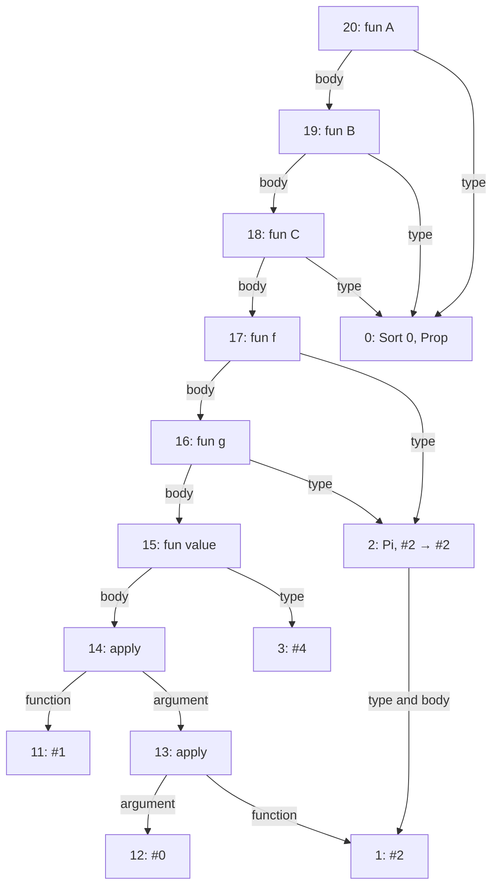
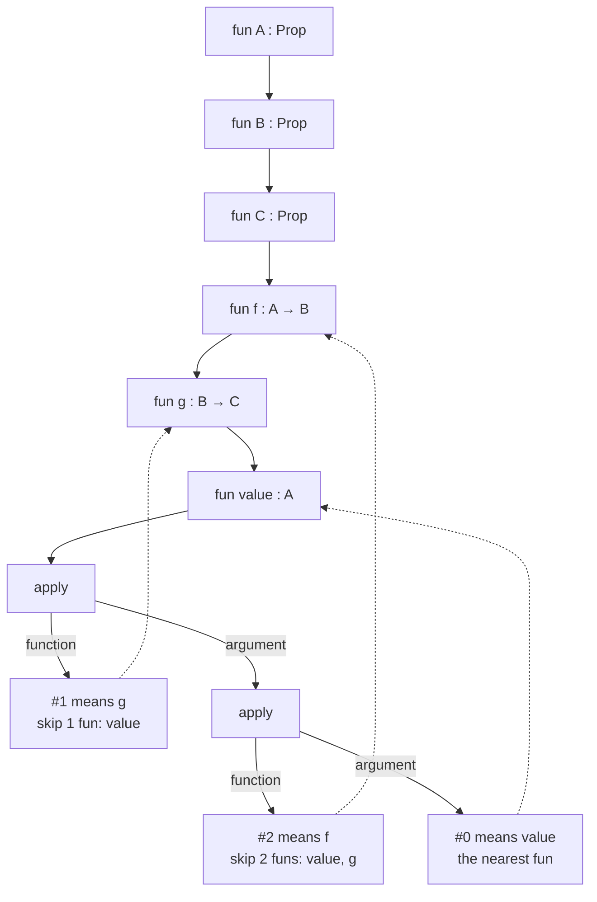

# Reading a Lean proof

This page is for a reader who knows school mathematics and some
programming, but no logic notation and no Lean. It explains every symbol it
uses, then reads three small theorems slowly: first as a proof you could
find in a textbook, then in each of the forms in which Lean and LeanForth
write the same theorem down.

You can read it without running anything. If you want to check it:

- Every Lean example was checked with the pinned Lean 4.35.0 and
  `-DwarningAsError=true`, and `make check` checks them again. Every output
  shown after an example is Lean's real output.
- Every Forth example runs in LeanForth, and `make test` checks that it
  prints exactly what is shown. The Forth parts are for Forth readers;
  you can skip them.
- One example, about complex numbers, needs Mathlib, Lean's mathematics
  library. It was checked by hand and is not part of the tests; it is
  marked where it appears.

**What this page does not claim.** LeanForth does not yet check proofs.
The [last section](#what-leanforth-checks-today) says exactly what it does
today.

## 1. What a theorem and a proof are

A **theorem** is a statement together with a proof of it.

A **statement** says that something follows from something else. It has
*assumptions* (what we may take as given) and a *conclusion* (what must
then be true). For example:

> If rain makes the ground wet, and a wet ground gets the match cancelled,
> then rain gets the match cancelled.

The assumptions are "rain makes the ground wet" and "a wet ground gets the
match cancelled". The conclusion is "rain gets the match cancelled".

A **proof** is a list of steps. Each step is justified by an assumption,
by an earlier step, or by a rule everybody agreed on in advance. A proof is
finished when its last step is the conclusion.

Lean writes a theorem as a name, the statement, the sign `:=`, and the
proof. Lean's **kernel** is the small program that checks that the proof
really proves the statement, step by step, the way a strict teacher would.
Everything else in Lean (and in LeanForth) helps people write and read
proofs, but only the kernel decides whether a proof is correct.

Two kinds of things appear in every proof below. Keep them apart, and most
of the notation becomes easy:

- **Statements**, such as *A = "it rains"*. A statement may be true or
  false; on its own it proves nothing. Lean calls the kind of all
  statements `Prop` (short for proposition), and writes `A : Prop` for
  "A is a statement".
- **Facts**, also called *evidence* or *proofs*: something that shows a
  particular statement holds. An assumption is a fact we were handed; a
  step of a proof makes a new fact out of earlier ones. Lean writes
  `value : A` for "value is a fact showing that A holds", and reads the
  colon as "is evidence for" (or "has type", the general word).

## 2. The symbols

Every symbol used on this page is in one of the four tables below. "ASCII"
is how you may type the symbol in Lean with an ordinary keyboard; "LaTeX"
is how mathematicians typeset it. A dash means there is none.

### Logic

| Symbol | Say | ASCII | LaTeX | Meaning | Example |
| --- | --- | --- | --- | --- | --- |
| `∀` | for all | `forall` | `\forall` | The statement holds for every value of the named variables. | `∀ (n : Nat), n + 0 = n` |
| `∃` | there exists | `exists` | `\exists` | Some value makes the statement true. | `∃ n : Nat, n = 2` |
| `→` | implies; to | `->` | `\to` | Between statements: "if … then …". Between types of data: "functions from … to …". It is a `∀` whose variable is not used again (section 4, "Arrows group to the right"). | `A → B`; `Nat → Nat` |
| `↦` | maps to | `=>` | `\mapsto` | In `fun x ↦ result`, separates the names of the inputs from the result. | `fun value ↦ g (f value)` |
| `∧` | and | `/\` | `\land` | Both statements hold. | `A ∧ B` |
| `∨` | or | `\/` | `\lor` | At least one of the two holds. | `A ∨ B` |
| `¬` | not | `Not A` | `\neg` | The statement is false: assuming it leads to `False`. | `¬A` |
| `↔` | if and only if | `<->` | `\leftrightarrow` | Each statement implies the other. | `A ↔ B` |
| `=` | equals | `=` | `=` | Both sides are the same value. | `2 + 2 = 4` |
| `+` | plus | `+` | `+` | Addition. | `n + 0` |
| `True`, `False` | true, false | same | `\top`, `\bot` | The statement that always holds, and the one that never does. | `¬A` means `A → False` |
| `⊢` | goal, "show" | — | `\vdash` | In Lean's display of an unfinished proof: what is still to be proved. | `⊢ A → C` |

The ASCII spellings mean exactly the same as the symbols; Lean confirms
that each pair below is one and the same statement (`rfl`, explained in
section 7, says "these two are equal"):

```lean
example : (∀ A B : Prop, A ∧ B → A ∨ B) = (forall A B : Prop, A /\ B -> A \/ B) := rfl
example : (¬ True ↔ False) = (Not True <-> False) := rfl
example : (∃ n : Nat, n = 2) = (exists n : Nat, n = 2) := rfl
example : (fun (n : Nat) ↦ n + 1) = (fun n => n + 1) := rfl
example : (λ (n : Nat) => n + 1) = (fun n => n + 1) := rfl
```

### Brackets and punctuation

| Symbol | Say | Meaning | Example |
| --- | --- | --- | --- |
| `:` | is evidence for; has type | Left: a thing. Right: what it is. | `value : A`, `n : Nat`, `A : Prop` |
| `:=` | is proved by; is defined as | Separates a statement from its proof. | `theorem t : 2 + 2 = 4 := rfl` |
| `( )` | — | Grouping, as in school algebra; around a variable, an *explicit* argument, one you write when you use the theorem. | `g (f value)`; `(f : A → B)` |
| `{ }` | — | An *implicit* argument: Lean works it out itself when the theorem is used. LaTeX `\{ \}`. | `{A B C : Prop}` |
| `[ ]` | — | An *instance* argument: Lean finds it in its library of standard recipes, such as how to add two numbers. | `[self : HAdd α β γ]` |
| `⟨ ⟩` | angle brackets | Builds a structure (such as an "and") from its parts. No ASCII spelling; LaTeX `\langle \rangle`. | `⟨both.right, both.left⟩` |
| `,` | — | Ends the variables of a `∀` or `∃`. | `∀ {A B C : Prop}, …` |
| `.` | dot | Inside a name: a part of a longer library name. After a fact: one of its parts. | `And.intro`; `both.right` |
| `@` | at | Show every argument, including the implicit ones. | `@And.intro B A x y` |
| `·` | dot | In a tactic proof (section 8): start working on the next goal. ASCII `.` | `· exact both.right` |
| `_` | underscore | On its own: a variable with no name. Inside a name: a letter like any other. | `∀ (_ : A), B`; `u_1`, `nat_lit` |
| `--` | comment | Lean ignores the rest of the line. (In Forth, `\` does the same.) | `-- a note` |

### Words

| Word | Meaning | Example |
| --- | --- | --- |
| `theorem` | A named statement and its proof: `theorem name : statement := proof`. | `theorem composition …` |
| `example` | The same without a name; used for checks like the ones above. | `example : 2 + 2 = 4 := rfl` |
| `def` | A definition: a name for a value. | `def Not (a : Prop) : Prop := a → False` |
| `fun`, `λ` | "Given these, here is the result." `λ` (lambda, LaTeX `\lambda`) is another spelling of `fun`. | `fun value ↦ g (f value)` |
| `Prop` | The kind of all statements. | `A : Prop` |
| `Type` | The kind of ordinary data types. | `Nat : Type` |
| `Sort` | The general name of both: `Prop` is `Sort 0`, `Type` is `Sort 1`. See [concepts](CONCEPTS.md#prop-and-type). | `Sort 0` |
| `Nat`, `ℕ` | The natural numbers 0, 1, 2, …. `ℕ` (LaTeX `\mathbb{N}`) is Mathlib's spelling. | `2 : Nat` |
| `Int` | The integers …, −1, 0, 1, …. | `(2 : Int)` |
| `ℂ` | The complex numbers (LaTeX `\mathbb{C}`); defined in Mathlib, not in Lean itself. | `(2 : ℂ)` |
| `rfl` | "Both sides are the same": proves `a = a`, and `a = b` when computing both sides gives the same value. | `2 + 2 = 4 := rfl` |
| `by` | Starts a *tactic* proof: commands that build the proof for you (section 8). | `:= by decide` |
| `intro`, `exact`, `constructor`, `decide`, `trace_state` | Tactics: "assume", "this finishes it", "prove each part", "compute the answer", "show the goals". | section 8 |
| `#print`, `#check`, `#eval`, `set_option`, `import` | Commands asking Lean to show something, or to change how it shows it. They are not part of any theorem. | `#print composition` |

### Things you see only in Lean's or LeanForth's output

| Symbol | Meaning |
| --- | --- |
| `#0`, `#1`, `#2`, … | A variable written as a number instead of a name: count outward to the binder it belongs to (section 4). Not Lean source. |
| `Π`, `Pi` | The kernel's name for `∀` and `→`, which it stores as one kind of node. |
| `nat_lit 2` | The plain number stored inside the numeral `2` (section 7). |
| `@[defeq]`, `@[implicit_reducible]` | *Attributes*: labels Lean attaches to a declaration for its own tools. They do not change the statement. |
| `u`, `u_1`, `u_2`, `.{u}` | *Universe levels*: they let one definition work for types of every size. You can ignore them here; [concepts](CONCEPTS.md#universe-level) explains them. |
| `α`, `β`, `γ` | Greek letters alpha, beta, gamma: the usual names for "some type". |
| `outParam` | Marks an argument that Lean works out from the others. |
| `case left` | The name of one goal in a tactic proof. |
| `?m.9` | A blank Lean had not filled in when it reported an error. |
| `a._@._internal._hyg.0` | A name Lean made up for a variable nobody named. |
| `` `A `` | The name A, as data (in Lean's own program output). |
| `\mathrm`, `\mathsf`, `\mathit`, `\ ` | In LaTeX output: upright, sans-serif and italic letters, and a space. |

## 3. Worked example 1: composition

### The textbook proof

Take three statements: A = "it rains", B = "the ground is wet", C = "the
match is cancelled". The theorem says: if A implies B, and B implies C,
then A implies C. Here is the proof, one step per line, with the piece of
Lean that says the same thing:

| Step | Textbook proof | Lean |
| --- | --- | --- |
| 1 | Let A, B, C be any statements. | `{A B C : Prop}` |
| 2 | Assume "A implies B". Call this assumption f. | `(f : A → B)` |
| 3 | Assume "B implies C". Call this assumption g. | `(g : B → C)` |
| 4 | We must show "A implies C". | `: A → C` |
| 5 | To show that, assume A holds. Call this fact value. | `fun value =>` |
| 6 | Use assumption f on the fact value: B holds. | `f value` |
| 7 | Use assumption g on that fact: C holds. Done. | `g (f value)` |

In Lean the whole theorem is:

```lean
theorem composition {A B C : Prop} (f : A → B) (g : B → C) : A → C :=
  fun value => g (f value)
set_option pp.unicode.fun true in
#print composition
```

```text
theorem composition : ∀ {A B C : Prop}, (A → B) → (B → C) → A → C :=
fun {A B C} f g value ↦ g (f value)
```

The first two lines are the theorem; `#print composition` asks Lean to
show it back, and the box after it is what Lean printed. (`set_option
pp.unicode.fun true in` only asks Lean to write `↦` instead of `=>`.)

**What is f?** f is the name we gave to the assumption "A implies B". In
the rain reading: f is "if it rains, the ground is wet", g is "if the
ground is wet, the match is cancelled", and value is "it rains (today)".
An assumption of the form "A implies B" is used by giving it a fact about
A; it gives back a fact about B. Lean writes "use f on value" as
`f value`, with a space and no brackets. (Programmers: this is a function
call, `f(value)`.)

**Are A, B, C passed to value?** No. A, B and C are *statements*; f, g and
value are *facts* about those statements. `value : A` does not give A to
value; it says which statement value is evidence for.

**Why `g (f value)` and not `f (g value)`?** Read it from the inside out.
`f value` uses f on value, a fact about A, and gives a fact about B. Then
`g (f value)` uses g on that fact about B and gives a fact about C, which
is what we need. `f (g value)` would first use g on value; but g only
accepts facts about B, and value is about A. Lean rejects it, and says
exactly that:

```lean
theorem compositionWrong {A B C : Prop} (f : A → B) (g : B → C) : A → C :=
  fun value => f (g value)
```

```text
error: Application type mismatch: The argument
  value
has type
  A
but is expected to have type
  B
in the application
  g value
```

### Where f is matched to "A implies B": by position

The source names f and g in the theorem's header, before the colon, and
value after it, with `fun`. Lean's `#print` moves all of them into one
list, and the statement into one line. Line the two up:

```
statement:  ∀ {A B C : Prop},   (A → B)   →   (B → C)   →   A       →   C
proof:      fun {A B C}          f              g              value   ↦   g (f value)
```

The statement has six slots before its conclusion, the proof six names
before `↦`. They are matched **by position**: the first name is the first
slot, and so on. So A, B, C are the three statements; f is evidence for the
fourth slot, `A → B`; g for the fifth, `B → C`; value for the sixth, `A`.
What comes after `↦`, `g (f value)`, must be evidence for what comes after
the last arrow, `C`.

Lean can write each name next to its slot, which is the same pairing
spelled out (`pp.funBinderTypes`, the second `#print` below).

### The same theorem in seven forms

One theorem, written seven ways. Nothing about its meaning changes from
one form to the next; only how much is written out, and who the form is
for.

**1 and 2. Lean source and `#print`.** Shown above. The source is what a
person writes; `#print` is how Lean shows the stored theorem back.
Between the two, Lean has moved the header's arguments into the statement
(`∀ {A B C : Prop}, (A → B) → (B → C) → …`) and into the proof
(`fun {A B C} f g value ↦ …`).

**3. Fully explicit.** `pp.explicit` shows every argument Lean normally
hides. This proof hides none, so nothing changes. `pp.funBinderTypes`
writes the slot of each name next to it:

```lean
theorem composition {A B C : Prop} (f : A → B) (g : B → C) : A → C :=
  fun value => g (f value)
set_option pp.unicode.fun true in
set_option pp.explicit true in
#print composition
set_option pp.unicode.fun true in
set_option pp.funBinderTypes true in
#print composition
```

```text
theorem composition : ∀ {A B C : Prop}, (A → B) → (B → C) → A → C :=
fun {A B C} f g value ↦ g (f value)
theorem composition : ∀ {A B C : Prop}, (A → B) → (B → C) → A → C :=
fun {A B C : Prop} (f : A → B) (g : B → C) (value : A) ↦ g (f value)
```

**4. The kernel's stored form.** Lean's kernel does not store text. It
stores a tree of *nodes*. A short Lean program can print the tree of
`composition`'s proof as Lean holds it in memory. You need not read the
program: `import Lean` makes Lean's own internals available, `#eval` runs
the lines below it, which look up the theorem by its name
(``` ``composition ```), take its proof (`info.value`) and print it with
`repr`, which writes data out in full. The rest of its notation
(`show … from do`, `let`, `←`, `|`) belongs to Lean as a programming
language and appears nowhere else on this page.

```lean
import Lean
open Lean

theorem composition {A B C : Prop} (f : A → B) (g : B → C) : A → C :=
  fun value => g (f value)

#eval show MetaM Unit from do
  let .thmInfo info ← getConstInfo ``composition | throwError "not a theorem"
  IO.println (repr info.value)
```

```text
Lean.Expr.lam
  `A
  (Lean.Expr.sort (Lean.Level.zero))
  (Lean.Expr.lam
    `B
    (Lean.Expr.sort (Lean.Level.zero))
    (Lean.Expr.lam
      `C
      (Lean.Expr.sort (Lean.Level.zero))
      (Lean.Expr.lam
        `f
        (Lean.Expr.forallE
          (Lean.Name.mkNum `a._@._internal._hyg 0)
          (Lean.Expr.bvar 2)
          (Lean.Expr.bvar 2)
          (Lean.BinderInfo.default))
        (Lean.Expr.lam
          `g
          (Lean.Expr.forallE
            (Lean.Name.mkNum `a._@._internal._hyg 0)
            (Lean.Expr.bvar 2)
            (Lean.Expr.bvar 2)
            (Lean.BinderInfo.default))
          (Lean.Expr.lam
            `value
            (Lean.Expr.bvar 4)
            (Lean.Expr.app (Lean.Expr.bvar 1) (Lean.Expr.app (Lean.Expr.bvar 2) (Lean.Expr.bvar 0)))
            (Lean.BinderInfo.default))
          (Lean.BinderInfo.default))
        (Lean.BinderInfo.default))
      (Lean.BinderInfo.implicit))
    (Lean.BinderInfo.implicit))
  (Lean.BinderInfo.implicit)
```

A backquote marks a name: `` `A `` is the name A. There are only five
kinds of node here:

| Node | Holds | Is |
| --- | --- | --- |
| `Lean.Expr.lam` | a name, a type, a body, and whether the argument is implicit | one name of a `fun`; `fun {A B C} f g value` is six nested `lam` nodes |
| `Lean.Expr.forallE` | the same four parts | one `∀`, or one arrow `→` |
| `Lean.Expr.app` | a function and one argument | "use … on …" |
| `Lean.Expr.bvar` | a number | a variable, counted outward (section 4) |
| `Lean.Expr.sort` | a universe level | `Prop` is `sort zero` |

Two things differ from `#print`. Variables inside are numbers, not names:
`g (f value)` is `app (bvar 1) (app (bvar 2) (bvar 0))`, and section 4
explains the counting. And the arrow `A → B` is stored as a `∀` whose
variable has a made-up name (`a._@._internal._hyg.0`) and is never used.
The names on `lam` and `forallE` nodes are kept only for printing; the
kernel ignores them when it compares two terms.

The same proof drawn as a graph, with the node numbers of the export file
in form 5. The export writes a piece that occurs twice only once, so
`A → B` and `B → C`, which are both "`#2 → #2`", are the same node 2:



**5. The NDJSON export.** Lean's exporter writes a library as a text file
with one record per line (NDJSON: "newline-delimited JSON"). This is the
whole of `tests/reference/composition.ndjson`, the export of the theorem
above that LeanForth's tests use:

```json
{"meta":{"exporter":{"name":"lean4export","version":"3.1.0"},"format":{"version":"3.1.0"},"lean":{"githash":"eb6cafb7290e8bd5f2937522d8d804f58f02bafc","version":"4.35.0"}}}
{"in":1,"str":{"pre":0,"str":"composition"}}
{"in":2,"str":{"pre":0,"str":"A"}}
{"ie":0,"sort":0}
{"in":3,"str":{"pre":0,"str":"B"}}
{"in":4,"str":{"pre":0,"str":"C"}}
{"in":5,"str":{"pre":0,"str":"f"}}
{"in":6,"str":{"pre":0,"str":"a"}}
{"in":7,"str":{"pre":6,"str":"_@"}}
{"in":8,"str":{"pre":7,"str":"_internal"}}
{"in":9,"str":{"pre":8,"str":"_hyg"}}
{"in":10,"num":{"i":0,"pre":9}}
{"bvar":2,"ie":1}
{"forallE":{"binderInfo":"default","body":1,"name":10,"type":1},"ie":2}
{"in":11,"str":{"pre":0,"str":"g"}}
{"bvar":4,"ie":3}
{"bvar":3,"ie":4}
{"forallE":{"binderInfo":"default","body":4,"name":10,"type":3},"ie":5}
{"forallE":{"binderInfo":"default","body":5,"name":11,"type":2},"ie":6}
{"forallE":{"binderInfo":"default","body":6,"name":5,"type":2},"ie":7}
{"forallE":{"binderInfo":"implicit","body":7,"name":4,"type":0},"ie":8}
{"forallE":{"binderInfo":"implicit","body":8,"name":3,"type":0},"ie":9}
{"forallE":{"binderInfo":"implicit","body":9,"name":2,"type":0},"ie":10}
{"in":12,"str":{"pre":0,"str":"value"}}
{"bvar":1,"ie":11}
{"bvar":0,"ie":12}
{"app":{"arg":12,"fn":1},"ie":13}
{"app":{"arg":13,"fn":11},"ie":14}
{"ie":15,"lam":{"binderInfo":"default","body":14,"name":12,"type":3}}
{"ie":16,"lam":{"binderInfo":"default","body":15,"name":11,"type":2}}
{"ie":17,"lam":{"binderInfo":"default","body":16,"name":5,"type":2}}
{"ie":18,"lam":{"binderInfo":"implicit","body":17,"name":4,"type":0}}
{"ie":19,"lam":{"binderInfo":"implicit","body":18,"name":3,"type":0}}
{"ie":20,"lam":{"binderInfo":"implicit","body":19,"name":2,"type":0}}
{"thm":{"all":[1],"levelParams":[],"name":1,"type":10,"value":20}}
```

Each line is one JSON record, `{"key": value, …}`. Every record gets a
number, and later records refer to earlier ones by that number: `"in"`
numbers a name, `"ie"` an expression (a node). Reading some of the lines:

| Line | Says |
| --- | --- |
| `{"in":2,"str":{"pre":0,"str":"A"}}` | Name 2 is `A` (name 0 is the empty name). |
| `{"in":10,"num":{"i":0,"pre":9}}` | Name 10 is name 9 followed by the number 0: the made-up name `a._@._internal._hyg.0`, built up over lines 8 to 12. |
| `{"ie":0,"sort":0}` | Expression 0 is `Sort` at level 0: `Prop`. |
| `{"bvar":2,"ie":1}` | Expression 1 is the variable `#2`. |
| `{"forallE":{"binderInfo":"default","body":1,"name":10,"type":1},"ie":2}` | Expression 2 is a `∀` with the made-up name 10, type expression 1 and body expression 1: `#2 → #2`. |
| `{"app":{"arg":12,"fn":1},"ie":13}` | Expression 13 uses expression 1 (`#2`, which is f there) on expression 12 (`#0`, value): `f value`. |
| `{"app":{"arg":13,"fn":11},"ie":14}` | Expression 14 uses `#1` (g) on expression 13: `g (f value)`. |
| `{"ie":15,"lam":{"binderInfo":"default","body":14,"name":12,"type":3}}` | Expression 15 is `fun (value : #4) ↦ expression 14`. |
| `{"thm":{"all":[1],"levelParams":[],"name":1,"type":10,"value":20}}` | A theorem named name 1 (`composition`), with no universe levels (`[]`, an empty list); its statement is expression 10 and its proof expression 20. `all` lists the declarations made together with it: only itself. |

Expressions 0 to 10 are the statement, 11 to 20 the proof; expressions 0
to 3 are shared by both. The graph in form 4 is expressions 0 to 3 and 11
to 20.

**6. LeanForth's Forth words.** LeanForth stores a term the same way, as
numbered nodes in its *term store*. LeanForth has no syntax of its own for
writing theorems yet (planned, task 8.1.1 of the
[plan draft](../project/PLAN_DRAFT.md)); its tests build terms with Forth
words from `tests/present/build.fs`. The helper words below are loaded
first for every Forth example on this page:

<details>
<summary>The helper words (Forth)</summary>

```forth
\ Helpers for this page's examples (documentation only, not part of
\ LeanForth). They load the printer's test words, tests/present/build.fs,
\ from the repository root (~+ is Gforth's name for the working directory).
\ From that file: fresh empties every store; t-var, t-app, t-lam and t-pi
\ each make one node and leave its number; ex. and im. name the newest fun
\ or Pi node, explicit or implicit; args{ and t-const make a constant; and
\ declare tells the printer a constant's type.
require ~+/tests/present/build.fs
\ Prop-node ( -- t ): a new node for Prop, which is Sort 0.
: Prop-node ( -- t ) lzero ssort ;
\ How the printer writes: in Lean's notation, in ASCII or in LaTeX.
: in-lean ( -- ) ['] type lf-print-unicode lf-print-setup ;
: in-ascii ( -- ) ['] type lf-print-ascii lf-print-setup ;
: in-latex ( -- ) ['] type lf-print-latex lf-print-setup ;
\ .term ( t -- ) prints a term, .statement ( t -- ) a theorem's statement,
\ whose leading binders are "for all"; each ends the line.
: .term ( t -- ) 10000 lf-print-term must-ok cr ;
: .statement ( t -- ) 10000 lf-print-statement must-ok cr ;
\ .nodes ( -- ): every node of the term store: number, kind and fields.
: .plain ( n -- ) 0 .r ;
: .fields ( type body -- ) swap ." type " .plain ." , body " .plain ;
: .node ( tag first second -- )
  rot case
    lf-tag-symbolic-sort of drop ." Sort, level " .plain endof
    lf-tag-bvar of drop ." variable #" .plain endof
    lf-tag-app  of swap ." apply " .plain ."  to " .plain endof
    lf-tag-lam  of ." fun, " .fields endof
    lf-tag-pi   of ." Pi,  " .fields endof
    nip nip ." ?" endcase ;
: .nodes ( -- ) lf-term-count @ 0 ?do i 2 .r ." : " i lf-term-read must .node cr loop ;
```

</details>

For readers new to Forth: words run from left to right and pass numbers
on a stack; `\` starts a comment; `s" g"` is the text g; `constant prop`
gives the number on top of the stack the name prop. Forth builds the
innermost part first. Each `t-pi` or `t-lam` joins a type made earlier
with the body just made; `ex.` or `im.` then gives that binder its name.
The words are called in the same order as the export's lines, so the node
numbers come out equal to the expression numbers:

```forth
fresh
\ Pieces used more than once come first, so that node numbers equal the
\ expression numbers of tests/reference/composition.ndjson.
Prop-node   constant prop          \ node 0: Prop
2 t-var     constant v2            \ node 1: #2
v2 v2 t-pi  constant v2->v2        \ node 2: #2 → #2, both A → B and B → C
4 t-var     constant v4            \ node 3: #4, which is A where it is used
\ The statement ∀ {A B C : Prop}, (A → B) → (B → C) → A → C, inside out.
prop prop prop v2->v2 v2->v2  v4 3 t-var t-pi        \ nodes 4, 5: A → C
t-pi s" g" ex.  t-pi s" f" ex.  t-pi s" C" im.  t-pi s" B" im.  t-pi s" A" im.
constant statement                                   \ nodes 6 to 10
\ The proof fun {A B C} f g value ↦ g (f value), inside out.
prop prop prop v2->v2 v2->v2 v4
1 t-var  v2 0 t-var t-app  t-app                     \ nodes 11 to 14
t-lam s" value" ex.  t-lam s" g" ex.  t-lam s" f" ex.
t-lam s" C" im.  t-lam s" B" im.  t-lam s" A" im.
constant proof                                       \ nodes 15 to 20
in-lean   statement .statement  proof .term
in-ascii  statement .statement  proof .term
in-latex  statement .statement  proof .term
.nodes
```

```text
∀ {A B C : Prop}, (A → B) → (B → C) → A → C
fun {A B C} f g value ↦ g (f value)
forall {A B C : Prop}, (A -> B) -> (B -> C) -> A -> C
fun {A B C} f g value => g (f value)
\forall \{A\ B\ C : \mathrm{Prop}\},\ (A \to B) \to (B \to C) \to A \to C
\lambda\ \{A\ B\ C\}\ f\ g\ \mathit{value} \mapsto g\ (f\ \mathit{value})
 0: Sort, level 0
 1: variable #2
 2: Pi,  type 1, body 1
 3: variable #4
 4: variable #3
 5: Pi,  type 3, body 4
 6: Pi,  type 2, body 5
 7: Pi,  type 2, body 6
 8: Pi,  type 0, body 7
 9: Pi,  type 0, body 8
10: Pi,  type 0, body 9
11: variable #1
12: variable #0
13: apply 1 to 12
14: apply 11 to 13
15: fun, type 3, body 14
16: fun, type 2, body 15
17: fun, type 2, body 16
18: fun, type 0, body 17
19: fun, type 0, body 18
20: fun, type 0, body 19
```

Compare node 13, `apply 1 to 12`, with the export's line
`{"app":{"arg":12,"fn":1},"ie":13}`: the same node. Unlike Lean's nodes,
LeanForth's do not hold the names `A`, `f`, `value` at all; `ex.` and
`im.` keep them in a separate table that only the printer reads.

**7. The term printer's output.** The first six lines above are
LeanForth's term printer (`src/present/`, see
[printing terms](TERM_PRINTER.md)) turning the nodes back into text: in
Lean's notation, exactly as `#print` wrote it; in ASCII; and in LaTeX,
which renders as

```math
\forall \{A\ B\ C : \mathrm{Prop}\},\ (A \to B) \to (B \to C) \to A \to C
```

```math
\lambda\ \{A\ B\ C\}\ f\ g\ \mathit{value} \mapsto g\ (f\ \mathit{value})
```

The printer only presents; it checks nothing.

## 4. Positional encoding

Lean says very little by name and a lot by position. Four rules cover
everything on this page.

**Pairing by position.** The names after `fun` are matched with the
slots of the statement in order, as in section 3: first name, first slot.

**Using a fact or function on several things.** `f x y` means
`(f x) y`: use f on x, then use the result on y. So arguments are also
matched by position: the first argument fills the first slot. `Nat.add`
is Lean's addition of natural numbers, written as a function. Using a
function on fewer arguments than it takes is allowed and gives back
something that waits for the rest:

```lean
example : Nat.add 2 3 = (Nat.add 2) 3 := rfl
#check Nat.add
#check Nat.add 2
```

```text
Nat.add : Nat → Nat → Nat
Nat.add 2 : Nat → Nat
```

The same holds for theorems. Here `composition` is used with the rain
reading. The implicit arguments `{A B C}` are left out, and Lean works
them out from h1 and h2; with `@` in front, all of them are written, in
order; and given a third fact, `composition h1 h2 today` fills the
`value` slot and is evidence that the match is cancelled:

```lean
theorem composition {A B C : Prop} (f : A → B) (g : B → C) : A → C :=
  fun value => g (f value)
example (Rains Wet Cancelled : Prop) (h1 : Rains → Wet) (h2 : Wet → Cancelled) :
    Rains → Cancelled :=
  composition h1 h2
example (Rains Wet Cancelled : Prop) (h1 : Rains → Wet) (h2 : Wet → Cancelled) :
    Rains → Cancelled :=
  @composition Rains Wet Cancelled h1 h2
example (Rains Wet Cancelled : Prop) (h1 : Rains → Wet) (h2 : Wet → Cancelled)
    (today : Rains) : Cancelled :=
  composition h1 h2 today
```

**Arrows group to the right.** `A → B → C` means `A → (B → C)`: "if A,
then (if B, then C)", which says the same as "if A and B, then C". That is
why the statement of section 3 lists its assumptions one after another
with arrows. `(A → B) → C` is different: its one assumption is the whole
"A implies B". An arrow is itself a `∀` whose variable is never used
again: `A → B` is "for every fact `_` about A, B holds", where `_` is a
variable with no name. Lean confirms both:

```lean
example : (Nat → Nat → Nat) = (Nat → (Nat → Nat)) := rfl
example (A B C : Prop) : (A → B → C) = (A → (B → C)) := rfl
example (A B : Prop) : (A → B) = (∀ (_ : A), B) := rfl
```

**Variables as numbers (de Bruijn indices).** Inside the stored form
(section 3, forms 4 to 6) a variable is not written by name. It is
written as a number that counts outward to the `fun` or `∀` it belongs
to: `#0` is the nearest one, `#1` the one before that, and so on. (The
idea is due to N. G. de Bruijn, hence the name.) In the proof of
`composition`, the innermost part `g (f value)` sits inside six `fun`s;
counting outward from it:



So `g (f value)` is stored as `#1 (#2 #0)`. The same number can mean
different variables in different places, because it counts from where it
stands:

- In the statement, `A → B` sits inside A, B, C, so its first `#2` (skip
  C and B) is A. Its `B` sits one level deeper, inside the arrow's own
  unused variable, so `#2` (skip that variable and C) is B. Both are `#2`,
  and the whole is `#2 → #2`.
- `B → C`, the type of g, sits inside f as well, so it too reads
  `#2 → #2`. That is why one node serves for both.
- The type of value sits inside f and g, two more `fun`s, so A is `#4`
  there. In the body, inside value as well, `#2` means f, as the picture
  shows.

Why numbers? Two proofs that differ only in the names of their variables
are stored identically, so the kernel never has to worry about names, and
one variable can never be mistaken for another that happens to have the
same name. These numbers are data inside a term; they are not positions
on the Forth stack.

## 5. Worked example 2: "if A and B, then B and A"

### The textbook proof

Take A = "it rains" and B = "it is cold". If it rains and it is cold, then
it is cold and it rains.

| Step | Textbook proof | Lean |
| --- | --- | --- |
| 1 | Let A, B be any statements. | `{A B : Prop}` |
| 2 | Assume "A and B". Call this assumption both. | `(both : A ∧ B)` |
| 3 | We must show "B and A". | `: B ∧ A` |
| 4 | From both, its right half: B holds. | `both.right` |
| 5 | From both, its left half: A holds. | `both.left` |
| 6 | Put the two halves together: "B and A". Done. | `And.intro both.right both.left` |

### What `∧` really is

`A ∧ B` is a nicer spelling of `And A B`. `And` is not built into Lean's
kernel. It is an ordinary definition in Lean's standard library: a
*structure* (a record) with two fields, `left`, a fact about A, and
`right`, a fact about B. `And.intro` builds one from the two facts;
`And.left` and `And.right` take one apart. `both.right` is short for
`And.right both`, and `⟨x, y⟩` is short for `And.intro x y`. Lean shows
the definition:

```lean
#print And
#check @And.intro
#check @And.left
#check @And.right
```

```text
structure And (a b : Prop) : Prop
number of parameters: 2
fields:
  And.left : a
  And.right : b
constructor:
  And.intro {a b : Prop} (left : a) (right : b) : a ∧ b
@And.intro : ∀ {a b : Prop}, a → b → a ∧ b
@And.left : ∀ {a b : Prop}, a ∧ b → a
@And.right : ∀ {a b : Prop}, a ∧ b → b
```

In the output, *constructor* is Lean's word for a way to build evidence,
here `And.intro`, and `#check` shows what something is evidence for. Read
`@And.intro : ∀ {a b : Prop}, a → b → a ∧ b` by position: give it
two statements a and b (implicit), then a fact about a, then a fact about
b, and it gives a fact about "a and b".

### The forms

The source, `#print`, and the fully explicit form:

```lean
theorem swapAnd {A B : Prop} (both : A ∧ B) : B ∧ A :=
  And.intro both.right both.left
set_option pp.unicode.fun true in
#print swapAnd
set_option pp.unicode.fun true in
set_option pp.explicit true in
#print swapAnd
```

```text
theorem swapAnd : ∀ {A B : Prop}, A ∧ B → B ∧ A :=
fun {A B} both ↦ ⟨both.right, both.left⟩
theorem swapAnd : ∀ {A B : Prop}, And A B → And B A :=
fun {A B} both ↦ @And.intro B A (@And.right A B both) (@And.left A B both)
```

`#print` uses the short forms `⟨…, …⟩` and `both.right`. The explicit
form shows what is stored: `And A B` instead of `A ∧ B`, and every
argument in its slot. Matching `@And.intro B A (…) (…)` against
`@And.intro : ∀ {a b : Prop}, a → b → a ∧ b` by position:

| Slot of `And.intro` | Filled with | Because |
| --- | --- | --- |
| `{a : Prop}` | `B` | we build "B and A", so a is B |
| `{b : Prop}` | `A` | and b is A |
| `a`, a fact about a | `@And.right A B both` | the right half of "A and B" is a fact about B |
| `b`, a fact about b | `@And.left A B both` | the left half is a fact about A |

In the same way `@And.right A B both` fills `And.right`'s slots
`{a}`, `{b}` and the fact `a ∧ b` with A, B and both.

**In LeanForth's Forth words.** `And`, `And.intro`, `And.left` and
`And.right` become *constant* nodes: bare names. To print the implicit
arguments hidden, as Lean does, the printer must be told their types
(`declare`):

```forth
fresh
Prop-node constant prop
0 t-var constant v0   1 t-var constant v1   2 t-var constant v2   3 t-var constant v3
\ The four library constants, bare names without their definitions.
args{  s" And" t-const constant [And]
s" And.intro" t-const constant [And.intro]
s" And.left"  t-const constant [And.left]
s" And.right" t-const constant [And.right]
[And] v1 t-app v0 t-app  constant And#1#0       \ And a b, just inside a and b
\ Their types, so that the printer knows which arguments are hidden:
\ And.intro : ∀ {a b : Prop}, a → b → And a b, and so on.
prop prop  v1  v1  [And] v3 t-app v2 t-app  t-pi s" right" ex.  t-pi s" left" ex.
t-pi s" b" im.  t-pi s" a" im.  s" And.intro" declare
prop prop  And#1#0 v2  t-pi s" self" ex.  t-pi s" b" im.  t-pi s" a" im.  s" And.left" declare
prop prop  And#1#0 v1  t-pi s" self" ex.  t-pi s" b" im.  t-pi s" a" im.  s" And.right" declare
\ The statement ∀ {A B : Prop}, And A B → And B A.
prop prop  And#1#0  [And] v1 t-app v2 t-app
t-pi s" both" ex.  t-pi s" B" im.  t-pi s" A" im.  constant statement
\ The proof fun {A B} both ↦ @And.intro B A (@And.right A B both) (@And.left A B both).
prop prop  And#1#0
[And.intro] v1 t-app v2 t-app
[And.right] v2 t-app v1 t-app v0 t-app  t-app
[And.left]  v2 t-app v1 t-app v0 t-app  t-app
t-lam s" both" ex.  t-lam s" B" im.  t-lam s" A" im.  constant proof
in-lean   statement .statement  proof .term
in-ascii  statement .statement  proof .term
in-latex  statement .statement  proof .term
```

```text
∀ {A B : Prop} (both : And A B), And B A
fun {A B} both ↦ And.intro (And.right both) (And.left both)
forall {A B : Prop} (both : And A B), And B A
fun {A B} both => And.intro (And.right both) (And.left both)
\forall \{A\ B : \mathrm{Prop}\}\ (\mathit{both} : \mathsf{And}\ A\ B),\ \mathsf{And}\ B\ A
\lambda\ \{A\ B\}\ \mathit{both} \mapsto \mathsf{And.intro}\ (\mathsf{And.right}\ \mathit{both})\ (\mathsf{And.left}\ \mathit{both})
```

Rendered:

```math
\forall \{A\ B : \mathrm{Prop}\}\ (\mathit{both} : \mathsf{And}\ A\ B),\ \mathsf{And}\ B\ A
```

```math
\lambda\ \{A\ B\}\ \mathit{both} \mapsto \mathsf{And.intro}\ (\mathsf{And.right}\ \mathit{both})\ (\mathsf{And.left}\ \mathit{both})
```

The printer writes `And A B` rather than `A ∧ B` (notation is planned,
task 4.4.3 of the plan draft) and `And.intro x y` rather than `⟨x, y⟩`.
It also writes `(both : And A B), And B A` where Lean writes the arrow
`And A B → And B A`: an arrow is a `∀` whose variable is not used, and the
printer, unlike Lean, cannot yet tell that `And A B` is a statement, the
case in which Lean prefers the arrow ([limits](TERM_PRINTER.md#limits-and-differences-from-lean)).
Both spellings mean the same, and Lean accepts the printer's ASCII lines
as source. (The `set_option` line turns off a style warning about names
that are given but never used, such as `both` in the statement; Lean
would otherwise refuse, because these checks treat every warning as an
error.)

```lean
set_option linter.unusedVariables false
theorem swapAndPrinted : forall {A B : Prop} (both : And A B), And B A :=
  fun {A B} both => And.intro (And.right both) (And.left both)
example : (∀ {A B : Prop} (both : And A B), And B A) = (∀ {A B : Prop}, A ∧ B → B ∧ A) :=
  rfl
```

**The export and the stored form.** The pinned test fixtures include no
export of a theorem that uses `And`, so this page shows no NDJSON lines
for it, and no `Lean.Expr` tree. In both, `And` and `And.intro` are
constants (`const` records and `Lean.Expr.const` nodes) that hold a name;
everything else is as in section 3.

## 6. The other extras: Or, Not, Iff, Exists, Eq

Like `∧`, each of these is a definition in Lean's library with a nicer
spelling. `pp.notation false` asks Lean to drop the nicer spellings:

```lean
set_option pp.notation false in
#check ∀ (A B : Prop), (A ∨ B) ∧ ¬A ↔ ∃ n : Nat, n = 2
#print Or
#print Not
#print Iff
#print Exists
#print Eq
```

```text
∀ (A B : Prop), Iff (And (Or A B) (Not A)) (Exists fun n => Eq n 2) : Prop
inductive Or : Prop → Prop → Prop
number of parameters: 2
constructors:
Or.inl : ∀ {a b : Prop}, a → a ∨ b
Or.inr : ∀ {a b : Prop}, b → a ∨ b
@[implicit_reducible] def Not : Prop → Prop :=
fun a => a → False
structure Iff (a b : Prop) : Prop
number of parameters: 2
fields:
  Iff.mp : a → b
  Iff.mpr : b → a
constructor:
  Iff.intro {a b : Prop} (mp : a → b) (mpr : b → a) : a ↔ b
inductive Exists.{u} : {α : Sort u} → (α → Prop) → Prop
number of parameters: 2
constructors:
Exists.intro : ∀ {α : Sort u} {p : α → Prop} (w : α), p w → Exists p
inductive Eq.{u_1} : {α : Sort u_1} → α → α → Prop
number of parameters: 2
constructors:
Eq.refl : ∀ {α : Sort u_1} (a : α), a = a
```

An *inductive* type lists the ways (*constructors*) to build evidence for
it; a *structure* is an inductive type with exactly one way, whose parts
have names. In a table:

| Written | Really | What it is | Build evidence with | Use evidence with |
| --- | --- | --- | --- | --- |
| `A ∧ B` | `And A B` | structure: parts `left`, `right` | `And.intro a b`, `⟨a, b⟩` | `h.left`, `h.right` |
| `A ∨ B` | `Or A B` | inductive: two constructors | `Or.inl a` or `Or.inr b` | `Or.elim h f g`: say what to do in each case |
| `¬A` | `Not A`, which is `A → False` | definition | a `fun` from a fact about A to `False` | use it on a fact about A to get `False` |
| `A ↔ B` | `Iff A B` | structure: parts `mp`, `mpr` | `Iff.intro f g` | `h.mp`, `h.mpr` |
| `∃ n, p n` | `Exists (fun n ↦ p n)` | inductive: one constructor | `Exists.intro w h`, `⟨w, h⟩`: a witness and evidence | take the witness and evidence apart |
| `a = b` | `@Eq α a b` | inductive: one constructor | `rfl`, which is `Eq.refl a` | `h.symm` turns it round; rewriting replaces a by b |

In `∃ n : Nat, n = 2`, the part after the comma becomes a `fun`:
`Exists (fun n => Eq n 2)`, the property "is equal to 2"; evidence for it
is a witness w together with evidence that w has the property. Each of
these lines builds or uses one of them, and Lean accepts every one:

```lean
example (A B : Prop) (a : A) : A ∨ B := Or.inl a
example (A B C : Prop) (h : A ∨ B) (f : A → C) (g : B → C) : C := Or.elim h f g
example (A : Prop) (a : A) (n : ¬A) : False := n a
example (A B : Prop) (h : A ↔ B) (a : A) : B := h.mp a
example : ∃ n : Nat, n + n = 4 := ⟨2, rfl⟩
example (a : Nat) : a = a := Eq.refl a
example (a b : Nat) (h : a = b) : b = a := h.symm
```

## 7. Worked example 3: numbers

### The textbook proof

"2 + 2 = 4. Proof: compute the left side; it is 4, the same as the right
side."

### Which numbers?

A bare numeral such as `2` is a natural number (`Nat`) unless something
says otherwise. Lean works the type out from the context; when nothing
decides it, `Nat` is the default. So `fun n => n + 1` is a function from
`Nat` to `Nat` without anyone saying so:

```lean
#check 2
#check (2 : Int)
#check fun n => n + 1
```

```text
2 : Nat
2 : Int
fun n => n + 1 : Nat → Nat
```

Complex numbers are not part of Lean itself; Mathlib defines them as `ℂ`.
This block needs Mathlib, so it is not run by `make check`. It was checked
by hand on 2026-11-02 with the pinned Lean and the pinned Mathlib build
(`import Mathlib.Basic.Complex.Basic`, exit status 0); it printed the
three lines after it. With Mathlib loaded, `Nat` prints as `ℕ`:

```
import Mathlib.Basic.Complex.Basic
#check 2
#check (2 : ℂ)
#check fun (z : ℂ) => z + 1
example : (2 : ℂ) + 2 = 4 := by norm_num
```

```
2 : ℕ
2 : ℂ
fun z => z + 1 : ℂ → ℂ
```

### The forms

```lean
theorem twoPlusTwo : 2 + 2 = 4 := rfl
#print twoPlusTwo
set_option pp.explicit true in
#print twoPlusTwo
```

```text
@[defeq] theorem twoPlusTwo : 2 + 2 = 4 :=
rfl
@[defeq] theorem twoPlusTwo : @Eq Nat
  (@HAdd.hAdd Nat Nat Nat (@instHAdd Nat instAddNat) (@OfNat.ofNat Nat (nat_lit 2) (instOfNatNat (nat_lit 2)))
    (@OfNat.ofNat Nat (nat_lit 2) (instOfNatNat (nat_lit 2))))
  (@OfNat.ofNat Nat (nat_lit 4) (instOfNatNat (nat_lit 4))) :=
@rfl Nat
  (@HAdd.hAdd Nat Nat Nat (@instHAdd Nat instAddNat) (@OfNat.ofNat Nat (nat_lit 2) (instOfNatNat (nat_lit 2)))
    (@OfNat.ofNat Nat (nat_lit 2) (instOfNatNat (nat_lit 2))))
```

The short statement `2 + 2 = 4` is really a nest of library functions,
each filled in by position:

| Piece | Means |
| --- | --- |
| `@Eq Nat x y` | `x = y`, where both sides are `Nat`s. |
| `@HAdd.hAdd Nat Nat Nat inst x y` | `x + y`: the two inputs and the result are `Nat`s, and `inst` says how to add them. |
| `@instHAdd Nat instAddNat` | That `inst`: "use the ordinary addition of `Nat`". |
| `@OfNat.ofNat Nat (nat_lit 2) (instOfNatNat (nat_lit 2))` | The numeral `2`, read as a `Nat`. `nat_lit 2` is the plain number stored in the term; `instOfNatNat 2` says how to make a `Nat` from it. |
| `@rfl Nat (2 + 2)` | The proof: "2 + 2 is equal to itself". The kernel accepts it for `2 + 2 = 4` because computing both sides gives the same number. |
| `@[defeq]` | A label Lean added because the proof is `rfl`. |

The slots of `HAdd.hAdd` and `OfNat.ofNat`, in order (the `[self : …]`
slots are the instance arguments Lean looks up in its library):

```lean
#check @HAdd.hAdd
#check @OfNat.ofNat
```

```text
@HAdd.hAdd : {α : Type u_1} → {β : Type u_2} → {γ : outParam (Type u_3)} → [self : HAdd α β γ] → α → β → γ
@OfNat.ofNat : {α : Type u_1} → (x : Nat) → [self : OfNat α x] → α
```

A statement about every number uses `∀` over `Nat`, not over statements.
`n + 0 = n` also holds by computing, even though n is unknown: Lean
defines addition by counting down the second number, and "adding 0 gives
the number itself" is the first line of that definition:

```lean
theorem addZero (n : Nat) : n + 0 = n := rfl
set_option pp.unicode.fun true in
#print addZero
```

```text
@[defeq] theorem addZero : ∀ (n : Nat), n + 0 = n :=
fun n ↦ rfl
```

But `0 + n = n` does not follow by computing alone: counting down n is
impossible while n is unknown. It needs a proof by induction (true for 0,
and from n to n + 1). Lean rejects `rfl` for it:

```lean
theorem zeroAdd (n : Nat) : 0 + n = n := rfl
```

```text
error: Not a definitional equality: the left-hand side
  0 + n
is not definitionally equal to the right-hand side
  n
error: Type mismatch
  rfl
has type
  ?m.9 = ?m.9
but is expected to have type
  0 + n = n
```

A false statement has no proof at all. Asked to prove one, the tactic
`decide` (section 8) computes the answer and reports it:

```lean
theorem twoPlusTwoIsFive : 2 + 2 = 5 := by decide
```

```text
error: Tactic `decide` proved that the proposition
  2 + 2 = 5
is false
```

**LeanForth and numbers.** LeanForth cannot store or check this example
yet, and this page has no NDJSON or Forth form of it. Its term store has
no node for a plain number like `nat_lit 2`. `Nat`, `Eq`, `HAdd` and
`And` are inductive types and structures. Under the first checker's
approved rules ([ADR 0011](../adr/0011-definite-rejection.md#scope-of-the-first-checker)),
inductive types (rule U1) and number literals (rule U2) are
*unsupported*, and so is any theorem that uses them; *unsupported* means
"not built yet", never "wrong" (see [outcomes](CONCEPTS.md#outcomes)).
They come in phase 5, "Data types", of the
[plan draft](../project/PLAN_DRAFT.md), whose first targets are exactly
`n + 0 = n` and `0 + n = n`.

## 8. Where tactics fit

Writing a proof term by hand gets hard quickly. *Tactics* are commands
that build the proof term for you, one step at a time, much like the
lines of a textbook proof. A tactic proof starts with `by`.
`trace_state` shows what is known and what is left to prove (the goal,
after `⊢`) at that point:

```lean
theorem compositionByTactics {A B C : Prop} (f : A → B) (g : B → C) : A → C := by
  trace_state
  intro value
  trace_state
  exact g (f value)
set_option pp.unicode.fun true in
#print compositionByTactics

theorem swapAndByTactics {A B : Prop} (both : A ∧ B) : B ∧ A := by
  constructor
  trace_state
  · exact both.right
  · exact both.left
set_option pp.unicode.fun true in
#print swapAndByTactics
```

```text
A B C : Prop
f : A → B
g : B → C
⊢ A → C
A B C : Prop
f : A → B
g : B → C
value : A
⊢ C
theorem compositionByTactics : ∀ {A B C : Prop}, (A → B) → (B → C) → A → C :=
fun {A B C} f g value ↦ g (f value)
case left
A B : Prop
both : A ∧ B
⊢ B

case right
A B : Prop
both : A ∧ B
⊢ A
theorem swapAndByTactics : ∀ {A B : Prop}, A ∧ B → B ∧ A :=
fun {A B} both ↦ ⟨both.right, both.left⟩
```

Read the first proof as the textbook proof of section 3. At the start we
have A, B, C, f and g, and must show `A → C`. `intro value` is "assume A;
call it value"; now the goal is just `C`. `exact g (f value)` is "and
this gives C". In the second proof, `constructor` is "to show B and A,
show B and show A": it leaves two goals, named after `And.intro`'s slots
`left` and `right`, and each `·` proves one.

`#print` shows that both tactic proofs produced exactly the terms of
sections 3 and 5. That is the point: **tactics are untrusted helpers**.
The kernel never sees the tactics, only the finished term, and checks it
as if a person had written it. A faulty tactic can at worst produce a term
that the kernel rejects. LeanForth is built the same way: it is to check
finished terms exported from Lean, whatever produced them.

## What LeanForth checks today

Nothing yet that you can rely on. Today LeanForth can store terms like
the ones above (without numbers), read Lean's NDJSON exports (all of
Mathlib), print terms as Lean does, and run its first checker, whose rules
the owner approved on 2026-11-02 and whose code (plan task 2.2.3) has not
yet passed its review gate. It checks `composition` from its export and
accepts it, labelled *accepted (experimental, not independently audited);
axioms: none*, and rejects a broken copy ([first check](FIRST_CHECK.md)).
Its scope covers terms like `composition`; theorems that use `And`, other
inductive types or numbers are outside it and are answered *unsupported*
until phase 5. Until an outside Lean expert has audited it, every result
it accepts is labelled that way. The current state is in
[project progress](../project/PROJECT_PROGRESS.md); what can be trusted is
in the [user guide](USER_GUIDE.md).

## See also

- [Terms for new readers](TERMS_FOR_NEW_READERS.md): a short glossary.
- [Concepts, in three forms](CONCEPTS.md): level, `Sort`, term, binder,
  constant, declaration, kernel, outcomes, with Forth you can run.
- [Printing terms](TERM_PRINTER.md): the term printer.
- [NDJSON reader](../development/NDJSON_READER.md): how LeanForth reads
  exports.
