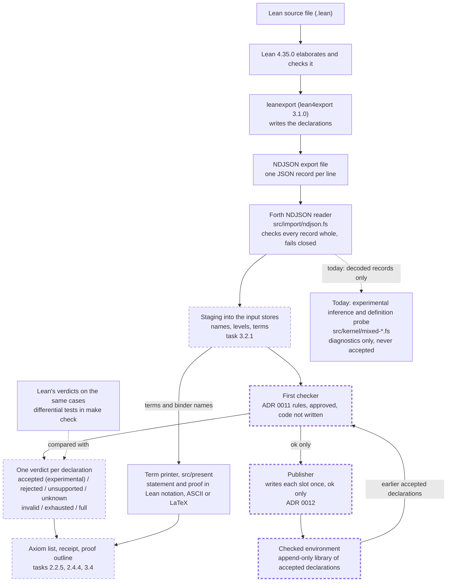
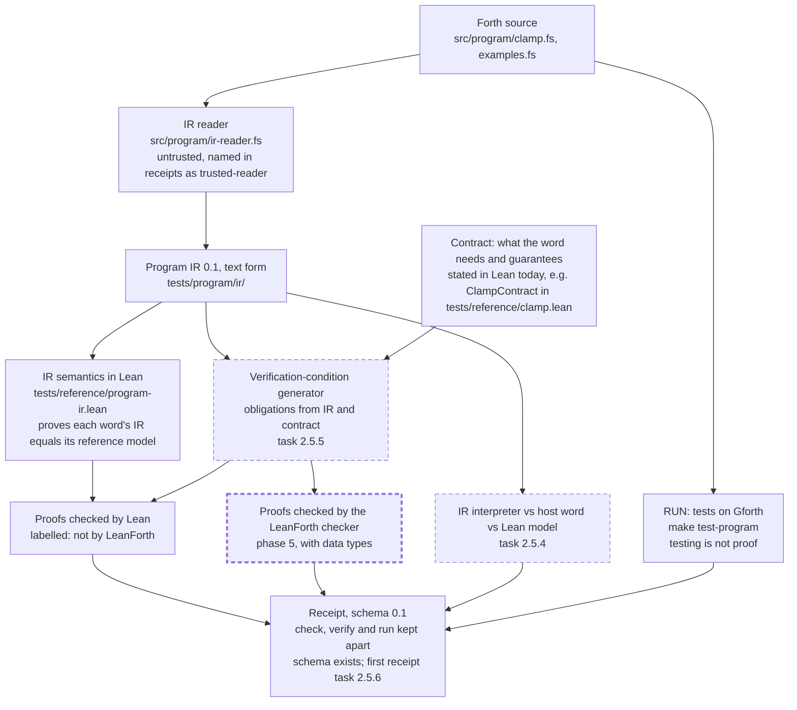

# Workflows: checking a theorem, verifying a program

Two diagrams of how LeanForth is meant to be used, as of 2026-11-02
(commit `fc558cc`). **Solid boxes exist and are tested; dashed boxes are
planned and do not exist yet.** Thick boxes are the parts that are to be
trusted once they pass the review gate of `AGENTS.md`; nothing is trusted
today. The internal structure behind them is in
[the architecture page](../development/ARCHITECTURE.md).

## Checking a theorem

You write and prove the theorem in Lean, as usual. Lean's exporter writes
the checked declarations as an NDJSON file; LeanForth reads that file and
checks every declaration again, on its own, in the file's order.

What each step means for you:

1. **Lean and its exporter** are outside LeanForth. Lean has already
   checked the file; LeanForth checks it again independently. Users who
   check an existing library (such as Mathlib) need only its export file.
2. **The reader** exists. It decodes every record kind of the pinned
   format and refuses anything malformed, any other exporter or Lean
   version, and any record kind its caller did not ask for. It decides
   nothing about proofs. It decodes the whole pinned Mathlib export in
   under two minutes ([reader guide](../development/NDJSON_READER.md)).
3. **Staging** copies decoded names, levels and expressions into
   LeanForth's stores. Today the stores hold 64 entries each and only test
   fixtures reach them, through a test-only Python bridge.
4. **The checker** gives each declaration exactly one outcome
   ([outcomes](CONCEPTS.md#outcomes)). Its rules are approved; it is not
   written. What runs today is the experimental probe, which can show a
   value has its claimed type but never rejects and never accepts.
5. **The publisher and the checked environment** keep the accepted
   declarations; a later declaration may use only earlier accepted ones,
   and a failed check changes nothing
   ([ADR 0012](../adr/0012-checked-environment.md)).
6. **The term printer** exists: it prints a statement and its proof in
   Lean's notation, ASCII or LaTeX, with the binder names the export
   recorded ([printing terms](TERM_PRINTER.md)). Printing the checked
   statement lets a person see what was actually checked — the defence
   against a reader that decoded a different claim. The proof outline with
   reasons between the lines is planned (task 2.4.4).
7. **Lean as referee.** `make check` compares LeanForth's experimental
   passes and the printer with Lean on finite tables, and Lean's own
   verdicts on the first checker's
   [expected results](../reviews/FIRST_CHECKER_EXPECTED.md).

## Verifying a Forth program

You write an ordinary Forth word and state its contract. LeanForth
translates the word into a small intermediate language (the program IR),
whose meaning is defined in Lean, produces proof obligations from the
contract, checks their proofs, and writes a receipt that keeps three
answers apart: was a proof *checked*, are the obligations *verified*, and
did the word *run* correctly in tests.

What exists today, for the six example words (clamp, checked add, checked
abs, in-range, factorial, gcd):

- The **IR reader** translates their source into IR 0.1 with the source
  location of every token, and refuses anything outside IR 0.1 with a
  diagnostic ([program IR](../programming/PROGRAM_IR.md)).
- **Lean proves**, for every cell width, that each word's IR returns
  exactly what its reference model returns, and refutes two deliberately
  wrong programs. These proofs are checked by Lean, not by LeanForth.
- **Runtime tests** compare the host words with Lean models on finite
  input tables.
- The **receipt format** exists as a JSON Schema with valid and invalid
  examples ([program receipts](../programming/PROGRAM_RECEIPTS.md)); no
  receipt is generated yet. The receipt for clamp (task 2.5.6) will say
  *checked by the Lean reference, not by LeanForth*.

Not established: that Gforth runs the words as the IR semantics says (task
2.5.4 compares them), that the reader's translation is faithful (it is
tested, not proved), and anything about stack overflow, other hosts or
compiled code. The program track's destination is most of the Forth-2012
Core word set, in five stages (plan, "Program-track goal").
