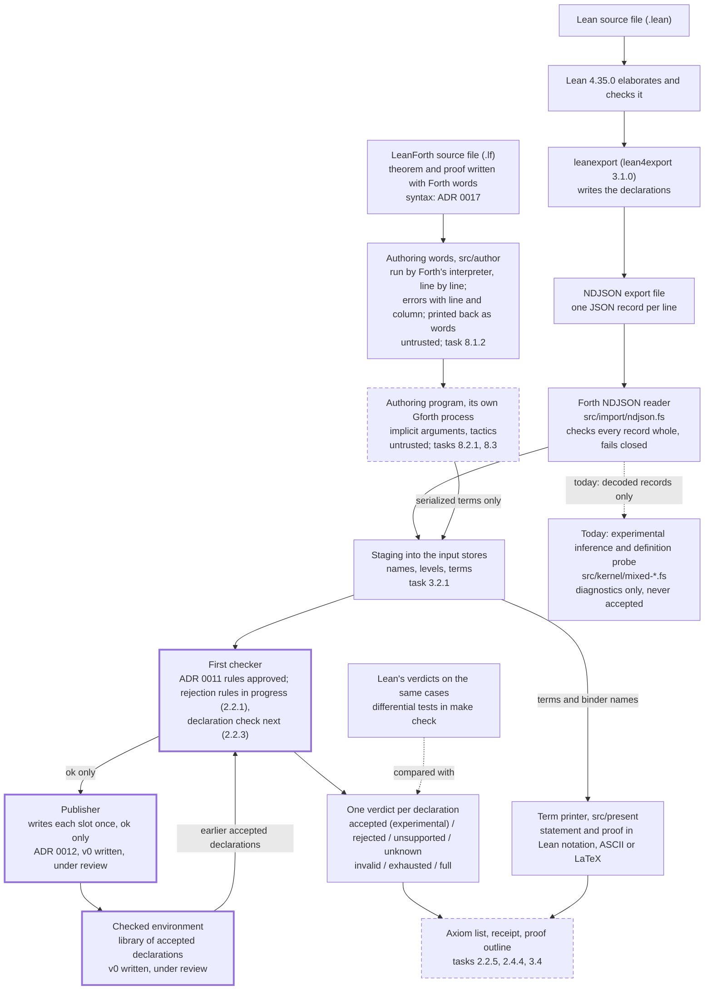
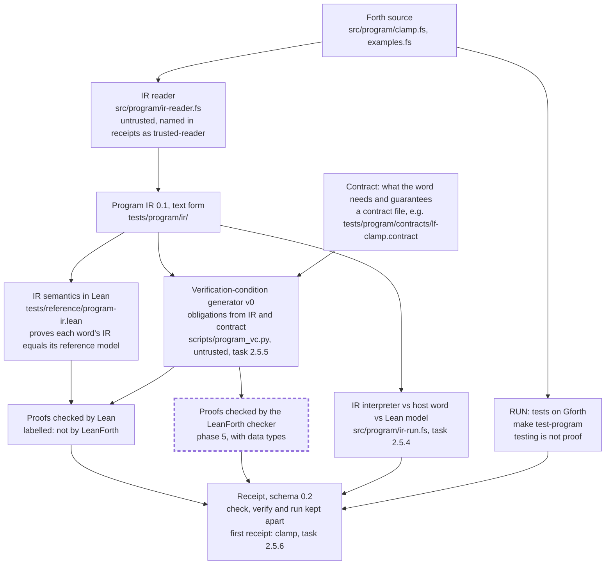

# Workflows: checking a theorem, verifying a program

Two diagrams of how LeanForth is meant to be used, as of 2026-11-12. **Solid boxes exist and are tested; dashed boxes are
planned and do not exist yet.** Thick boxes are the parts that are to be
trusted once they pass the review gate of `AGENTS.md`; nothing is trusted
today. The internal structure behind them is in
[the architecture page](../development/ARCHITECTURE.md).

## Checking a theorem

Today there is one way in that works end to end, and a second that is only
partly built; both are meant to end at the same checker:

- **From Lean** (works today): you write and prove the theorem in
  Lean, as usual. Lean's exporter writes the checked declarations as an
  NDJSON file; LeanForth reads that file and checks every declaration
  again, on its own, in the file's order.
- **In LeanForth itself** (the words exist; **checking this text is not built**,
  `leanforth check FILE.lf` exits 4; plan 8.2.1a-g not started): you write the theorem and its proof with Forth words
  ([LeanForth syntax](LEANFORTH_SYNTAX.md), [ADR 0017](../adr/0017-leanforth-syntax.md),
  approved by the owner). The authoring words (`src/author/`, plan task
  8.1.2) run a file line by line through Forth's own interpreter, build
  the terms, report mistakes with line and column, and print a declaration
  back as words. They are untrusted, and the checker never loads them. They build
  terms and print them back; they do not type-check them, so a wrong proof builds
  without error, and nothing has been proved from LeanForth input.
  Still planned: running them in an authoring program of their own, which
  hands the checker serialized terms only, so nothing the author's code
  does can reach the checker's memory (8.2.1); untrusted helpers such as
  implicit arguments and tactics (8.3). The same checker is to decide; a
  LeanForth-written theorem is to be printable as Lean source for Lean
  to check as a second opinion (not built).

What each step means for you:

1. **Lean and its exporter** are outside LeanForth. Lean has already
   checked the file; LeanForth checks it again independently. Users who
   check an existing library (such as Mathlib) need only its export file.
2. **The reader** exists. It decodes every record kind of the pinned
   format and refuses anything malformed, any other exporter or Lean
   version, and any record kind its caller did not ask for. It decides
   nothing about proofs. It decodes the whole pinned Mathlib export in
   under two minutes ([reader guide](../development/NDJSON_READER.md)).
3. **Staging** keeps the decoded names, levels, expressions and
   declarations in the importer's compact store (`src/import/stage.fs`; a loading stage,
   the checker does not read it in place), and the **feed** (`src/import/feed.fs`) gives them to the checker in
   file order, its stores grown to fit; `bin/leanforth check` runs both, on
   exports of any size ([the command line](COMMAND_LINE.md)). `check
   --record`, `replay` and `print` still copy an export straight into the
   checker's stores at their default sizes (`src/import/checker-input.fs`,
   version 0), so only exports the size of the test fixtures fit there.
4. **The checker** gives each declaration exactly one outcome
   ([outcomes](CONCEPTS.md#outcomes)). Its rules are approved; the checker
   runs from the shell on Lean's exports (all of `Init` on this build), but has
   not passed its review gate, so every declaration it
   accepts is labelled *experimental, not independently audited*
   ([first check](FIRST_CHECK.md)).
5. **The publisher and the checked environment** keep the accepted
   declarations; a later declaration may use only earlier accepted ones,
   and a failed check changes nothing
   ([ADR 0012](../adr/0012-checked-environment.md)). Version 0 is written
   and tested ([checked environment](../programming/CHECKED_ENVIRONMENT.md))
   and the checker publishes its accepted declarations into it; it
   awaits its review gate.
6. **The term printer** exists: it prints a statement and its proof in
   Lean's notation, ASCII or LaTeX, with the binder names the export
   recorded ([printing terms](TERM_PRINTER.md)). Printing the checked
   statement lets a person see what was actually checked — the defence
   against a reader that decoded a different claim. `leanforth print` also prints a proof outline
   from the checker's derivation log (task 2.4.4; untrusted presentation).
7. **Lean as referee.** `make check` compares LeanForth's experimental
   passes and the printer with Lean on finite tables, and Lean's own
   verdicts on the first checker's
   [expected results](../reviews/FIRST_CHECKER_EXPECTED.md).

## Verifying a Forth program

You write an ordinary Forth word and state its contract. LeanForth
translates the word into a small intermediate language (the program IR),
whose meaning is defined in Lean, produces proof obligations from the
contract, checks their proofs, and writes a receipt that keeps three
answers apart: was a proof *checked*, are the obligations *verified*, and
did the word *run* correctly in tests.

What exists today, for the six example words (clamp, checked add, checked
abs, in-range, factorial, gcd):

- The **IR reader** translates their source into IR 0.1 with the source
  location of every token, and refuses anything outside IR 0.1 with a
  diagnostic ([program IR](../programming/PROGRAM_IR.md)).
- **Lean proves**, for every cell width, that each word's IR returns
  exactly what its reference model returns, and refutes two deliberately
  wrong programs. These proofs are checked by Lean, not by LeanForth.
- **Runtime tests** compare the host words with Lean models on finite
  input tables.
- The **IR interpreter** runs IR as the Lean model does and agrees with
  the host words and with Lean on 5,152 cases and 300 random programs
  ([IR interpreter](../programming/PROGRAM_IR_RUN.md)).
- The **verification-condition generator** v0 turns IR plus a contract
  into Lean obligations; Lean proves them for clamp, checked add, checked
  abs and in-range, and refutes three wrong contracts
  ([verification conditions](../programming/PROGRAM_VC.md)).
- The **receipt format** exists as a JSON Schema
  ([program receipts](../programming/PROGRAM_RECEIPTS.md)), and the first
  receipt, for clamp, is generated: *checked by the Lean reference, not by
  LeanForth*, obligations discharged, 986 runs passed. The reader and the
  format await the owner's review gates.

Not established: that Gforth runs the words as the IR semantics says (the
interpreter comparison tests it; testing is not proof), that the reader's
translation is faithful (it is tested, not proved), and anything about stack overflow, other hosts or
compiled code. The program track's destination is most of the Forth-2012
Core word set, in five stages (plan, "Program-track goal").
